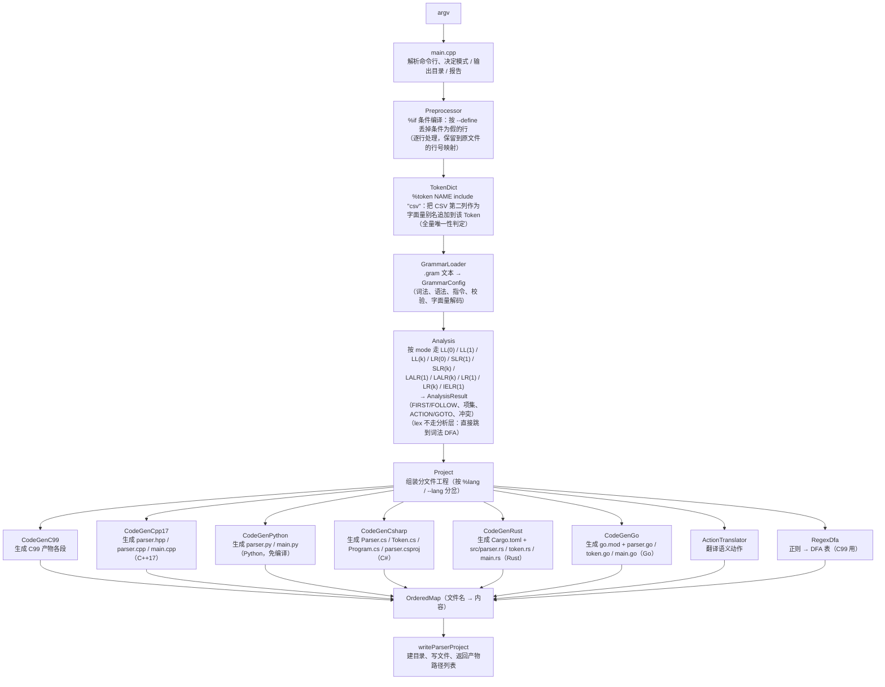

# 01 总体架构

语言与模式的组合限制、增量 API 范围统一见 [12 支持矩阵](15-language-mode-support.md)。

## 1. 流水线

一次生成就是一条直线流水线，没有反向依赖：

关键点：

- **生成期算完一切**：FIRST/FOLLOW、项集族、ACTION/GOTO、正则 DFA 都在 C++
  里算好，产物运行时不依赖生成器，也不依赖 `source/templates/`。
- **模板在构建期内联**：`tools/embed_templates.py` 把 `source/templates/` 下的
  模板（**377 份，全部 `.tmpl`**）生成为 `source/src/templates_data.cpp` 里的字符串表，
  链接进可执行文件；详见 [`07-codegen.md`](07-codegen.md)。
- **六套语言后端**：缺省目标是 C++17（`code_gen_cpp17.cpp` + `source/templates/cpp17_*`），
  `--lang c` 走 C99 后端（`code_gen_c99.cpp` + `source/templates/c99_*.tmpl`），`--lang python` 走
  Python 后端（`code_gen_python.cpp` + `source/templates/python_*`），`--lang csharp` 走
  C# 后端（`code_gen_csharp.cpp` + `source/templates/csharp_*`），`--lang rust` 走
  Rust 后端（`code_gen_rust.cpp` + `source/templates/rust_*`），`--lang go` 走
  Go 后端（`code_gen_go.cpp` + `source/templates/go_*`）。
  六者不共享
  模板，只在「分析表 / 词法 DFA / 语义动作翻译」这几层复用生成期结果
  （`ActionTranslator` 按目标语言切方言：Python 用 `python`（`$$` / `$n` 译成
  `result.value` / `values[...]`、`and` / `or` / `not` 与去分号）、C# 用 `csharpStyle`、
  Rust 用 `rustStyle`、Go 用 `goStyle`（后三档同样是 `values[...]` 下标、语句带分号，
  区别在恢复函数与错误现场信息：C# 是 `yyErrOk()` / `yyClearIn()`，Rust 是
  `self.yy_err_ok()` / `self.current_line()`，Go 是 `p.YyErrOk()` / `p.CurrentLine()`）。
- **产物是自包含工程**：C99 只依赖 libc 与 `libm`；C++17 只依赖标准库与 `libm`；
  Python 产物只有 `parser.py` / `main.py`（外加 `%mermaid` / `%copy` 的文件），
  不需要编译、也不生成 `Makefile` / `CMakeLists.txt`；C# 产物只用自己语言的
  标准库，目录里是 `Parser.cs` / `Token.cs` / `Program.cs` / `parser.csproj`；
  Rust 产物是 Cargo 工程（`Cargo.toml` + `src/parser.rs` / `token.rs` / `main.rs`），
  计算只用标准库、**词法正则依赖官方的 `regex` crate**（这一档唯一的第三方依赖）；
  Go 产物是一个 Go 模块（`go.mod` + `parser.go` / `token.go` / `main.go`），三个 `.go`
  都是 `package main`，**只用标准库**（词法正则用标准库 `regexp`，没有任何第三方依赖）。

## 2. 生成器目录

`source/` 中的入口、文法加载、分析、代码生成和产物模板组成生成器本体：

| 路径 | 职责 |
| --- | --- |
| `source/src/main.cpp` | CLI 入口与参数解析 |
| `source/src/preprocessor.cpp`、`token_dict.cpp`、`grammar_loader.cpp` | 条件编译、词表展开和文法加载 |
| `source/src/analysis*.cpp` | LL、LR、GLR、Earley、CYK 等模式分析 |
| `source/src/code_gen*.cpp`、`project.cpp` | 目标语言代码生成与工程组装 |
| `source/templates/` | 全部生成产物模板 |
| `source/include/ParseEngine/` | 数据模型与公开接口 |
| `` | 生成器的专题文档 |

仓库中其他工程与附加库的归属见[仓库总览](01-overview.md)。

## 3. 模块职责

### 入口与基础模型

| 模块 | 主要类型 / 函数 | 职责 |
| --- | --- | --- |
| `source/src/main.cpp` | `CommandLine`、`printUsage`、`main` | 解析 `--grammar-file` / `--out-dir` / `--mode` / `--lang` / `--class` / `--teach` / `--no-teach` / `--mermaid` / `--no-mermaid` / `--report` / `--full-report` / `--dump-*`；命令行覆盖 `%mode` / `%lang` / `%class` / `%teach` / `%mermaid`，目标语言缺省 `cpp17`；`--class` 只配 Python 产物，`%namespace` 只配 C++17 产物，配错在进生成前就报错 |
| `source/include/ParseEngine/error.hpp` | `Error`、`fail`、`fatalInternal` | 生成器的错误值（说明 + 原文件行号）与「内部错误」兜底；所有失败路径共用的错误槽 |
| `source/include/ParseEngine/grammar_types.hpp` | `OrderedMap`、`Grammar`、`Production`、`PriorityConfig`、`LexSpec`、`CopySpec`、`GrammarConfig` | 纯数据模型，不依赖其它模块 |
| `source/src/grammar_loader.cpp` | `GrammarLoader`、内部 `GramParser` | `.gram` 词法/语法解析、指令处理、全部生成期校验、字面量与正则解码；`%class` 按标识符规则 + Python 关键字表校验，`%lang` 接受 `c` / `cpp17` / `python` / `csharp` / `rust` / `go` / `gram`，并解析 C# / Rust / Go 的 `%package` / `%import` / `%class_body … %endbody` |
| `source/src/preprocessor.cpp` | `Preprocessor`、`runConditions` | `%if` / `%elif` / `%else` / `%endif` 条件编译：在**解析文法之前**逐行处理，条件为假的整行丢掉（连解析都不做），保留「处理后行号 → 原文件行号」的映射供报错定位；条件表达式只认 `\|\|` / `&&` / `!` / 括号 / 变量名，取值来自 `--define` |
| `source/src/token_dict.cpp` | `TokenDict`、`TokenDictExpandResult` | `%token NAME include "csv"` 展开：在 `Preprocessor` **之后**、`GrammarLoader` **之前**跑一次纯文本变换——读 CSV（只取第一列等于该 Token 名的行），把第二列作为**字面量**追加到该 Token 的别名列表，并合并成一条 `%token NAME "a\|b\|c"` 声明；别名唯一性在这里做**一次全量扫描**（同 Token 去重 / 跨 Token 重复报错 / 撞上已声明 Token 名报错）。不做正则、不新建 Token |

### 分析与动作翻译

| 模块 | 主要类型 / 函数 | 职责 |
| --- | --- | --- |
| `source/src/analysis*.cpp` | `Analysis`、`AnalysisResult`、`LrItem` / `Lr1Item` / `LrAction` / `LrConflict` / `LrResolution` | 十一种分析（LL(0) / LL(1) / LL(k) / LR(0) / SLR(1) / SLR(k) / LALR(1) / LALR(k) / LR(1) / LR(k) / IELR(1)）、冲突消解、报告渲染（LR(0) 与 SLR 共用 LR(0) 项集构造；LR(1) 与 LALR / IELR 共用规范 LR(1) 构造；`analysis_lrk.cpp` 把「一个展望符」推广成 k 元组，LALR(k) / SLR(k) / LL(k) 各自接到经典路线上；`lr0` / `lr1` / `lrk` 恒放行未消解冲突、不用任何开关，`slr` / `lalr` / `ielr` / `lalrk` 只在 `%teach` / `--teach` 下放行）；见 [`06-analysis.md`](06-analysis.md) |
| `source/src/action_translator.cpp` | `ActionTranslator`、`ExprNode`、`translateAction` | `{ $$ = $1 + $3; }` 这类动作的解析（Pratt）与到 C 表达式的翻译；构造时传 `python` 就切换到 Python 方言（`$$` → `result.value`、`$n` → `values[n-1]`、`and` / `or` / `not`、语句结尾不分号、恢复函数写 `self._yy_err_ok()`），传 `csharpStyle` 就切到 C# 方言（同样是 `values[...]` 下标，但语句带分号、恢复函数写 `yyErrOk();` / `yyClearIn();`、`int32(x)` 这类类型构造映射成 C# 基础类型；末尾缺省参数，C / C++17 / Python 的调用点一字未改） |
| `source/src/regex_dfa.cpp` | `RegexNode`、`DfaProgram`、`CompiledRegex` | 正则字面量 → NFA → 子集构造 → 最小化 DFA、DFA 表生成 |

### 代码生成后端

| 模块 | 主要类型 / 函数 | 职责 |
| --- | --- | --- |
| `source/src/code_gen_c99.cpp` | `CodeGenC99` | C99 产物每个片段的文本生成；`%tree` / 语义值类型（`%value_type` / `%union`）的分支都在这里拼 |
| `source/src/code_gen.cpp` | `CodeGen` | 各档后端共用的那一小撮：`actionCases()`（C99 / C++17 / Python）、`destructorSymbolGroups()`（C99 / C++17）、分段标记 `sectionMarker()` / `extractSection()`、`resolveLineDirectives()` 与两个 `#line` 占位符 |
| `source/src/code_gen_cpp17.cpp` | `CodeGenCpp17` | C++17 产物生成：命名空间 `Parser`（`%namespace` 可改）、`class Engine` + d-pointer、`std::string_view` / `std::vector` / `std::unique_ptr`，分析表重新排版成 `inline constexpr`；**不支持自定义分配器** |
| `source/src/code_gen_python.cpp` | `CodeGenPython` | Python 产物生成：模块级常量 / `Token` / `Tree` / `ParserError` 与一个普通类（`%class` / `--class` 改类名，缺省 `Parser`），`run_text` / `run` / `parse_tree` + `_apply_action`；支持 `%code ... %endcode` 用户代码，在生成期拒绝 `%value_type` / `%union` / `%namespace` 这些 C 专属写法 |
| `source/src/code_gen_csharp.cpp` | `CodeGenCsharp` | C# 产物生成：`Parser.cs` / `Token.cs` / `Program.cs` / `parser.csproj`（类型名首字母大写、`namespace` / `using` / `List` / `Dictionary`）；入口类叫 `Program`（C# 不允许成员名与类名相同）；`%package` / `%import` / `%class_body` 只在这一档生效 |
| `source/src/code_gen_rust.cpp` | `CodeGenRust` | Rust 产物生成：Cargo 工程（`Cargo.toml` + `src/parser.rs` / `token.rs` / `main.rs`），计算只用标准库；语义值按值拷贝（要 `Copy + Default + Debug`）、`%union` 落成带 `derive` 的 `ParserValue`；**词法正则用官方 `regex` crate**（产物里没有 DFA 表，模式原样交给它，`OnceLock` 里各编译一次）；`%package`（crate 名）/ `%import` / `%class_body` 生效，**`%destructor` 不支持**（靠所有权回收） |
| `source/src/code_gen_go.cpp` | `CodeGenGo` | Go 产物生成：Go 模块（`go.mod` + `parser.go` / `token.go` / `main.go`，三个 `.go` 都是 `package main`），**只用标准库**；语义值按值拷贝（缺省 `int64`）、`%union` 落成 `type ParserValue struct { … }`（成员照 C 的声明写 `int64 ival;`，生成器拼成 Go 字段写法）；**词法正则用标准库 `regexp`**（没有 DFA 表；没写任何正则时连 `regexp` 都不 import——Go 对 "imported and not used" 是硬错误）；`%package`（module path，`::` 归一成 `/`）/ `%import`（`::` 当路径分隔符、与标准库重复的包跳过）/ `%class_body`（一组 `func (p *Parser) …`）生效，**`%destructor` 不支持**（由 GC 回收） |

### 工程组装、指令表与图示

| 模块 | 主要类型 / 函数 | 职责 |
| --- | --- | --- |
| `source/src/project.cpp` | `Project`、`ProjectRequest`、`k_projectFiles` | 决定产物清单、按目标语言分派到 `CodeGen`（C99）/ `CodeGenCpp17`（C++17）/ `CodeGenPython`（Python）/ `CodeGenCsharp`（C#）/ `CodeGenRust`（Rust）/ `CodeGenGo`（Go）组装各文件、按 `%namespace` 改产物文件名、写出目录；`ProjectRequest::mermaid` 为真时把 `Mermaid::projectFiles` 的 `mermaid/*` 追加进清单（与 `teach` 无关）；`generatorResultMd` 按目标语言选 `RESULT.md` 的「编译 / 运行」与语法树小节，C# 用 `generatorCsharpResultMd`、Rust 用 `generatorRustResultMd`、Go 用 `generatorGoResultMd` |
| `source/src/grammar_loader.cpp`（指令表） | `GramParser`、`GramTokenizer` | 除原有指令外，`%lang` 接受 `c` / `cpp17` / `python` / `csharp` / `rust` / `go` / `gram` 七个取值（缺省 `cpp17`，命令行 `--lang` 优先）；`%package NAME`（分段标识符，`.` 或 `::` 连接）、`%import NAME`（可重复、末段可 `*`；Go 档允许带引号的 import 路径）、`%class_body … %endbody` 三个只对 **csharp / rust / go** 生效：C# 落文件级 `namespace NAME;`、Rust 落 crate 名与 `use`、Go 落 `go.mod` 的 module path 与 import 块（`%class_body` 与 `%code … %endcode` 同一套「两个标记各自单独成行、正文原样收集」） |
| `source/src/mermaid.cpp` | `Mermaid`、`MermaidDiagram` | 状态机图：把 LR 自动机（LR 项集 + GOTO + ACTION）与词法 DFA 画成 Mermaid `flowchart`，拼成自带 CSS、走 CDN 的自包含 HTML 页面；由 `%mermaid` / `--mermaid` 独立开关控制，与教学模式无关；见 [`06-analysis.md`](06-analysis.md) §5.4 |
| `source/src/utils.cpp` | `Utils` | `loadTemplate`（内联表 + `SCRIPT_ENGINE_TEMPLATES` 覆盖）、`varCString`、`collapseBlankLines` |

## 4. 代码约定

- 命名空间统一 `ParseEngine`；内部实现放匿名命名空间或 `source/src/` 内部头。
- 命名：类 `PascalCase`；函数/变量 `camelCase`；类成员 `m_` 前缀；常量 `k_`
  前缀；静态/全局 `s_` 前缀。
- 注释用 Doxygen（`@brief` / `@param` / `@retval`），与 `Qt` 风格命名一致。
- 字符串拼接统一走 `OrderedMap` 替换与 `std::string` 追加，避免生成期反复构造
  临时对象；`OrderedMap` 用 `vector` + 线性查找保证插入序（产物顺序稳定）。
- 生成器**不开异常**（可 `-fno-exceptions` 构建）：会失败的下层函数一律
  「`bool` 返回 + 末尾 `Error &` 出参」，出错时把中文说明与行号写进 `Error`
  （`source/include/ParseEngine/error.hpp`）并立刻 `return`，调用方原样向上传；
  `main` 只在每个调用点检查一次，统一打印 `错误：...` 并以非 0 退出。
- 只保留一个「内部错误」出口：`fatalInternal()`（内联模板缺失、分段标记对不
  上、`OrderedMap::at` 取不到键这类按设计不可能发生的情况）打印后直接终止，
  与用户输入错误严格分开。

## 5. 线程与状态

生成器是单线程、无全局可变状态的：`GrammarLoader` / `Analysis` / `Project`
都是静态方法或栈上对象，唯一的全局是内联模板表（只读）与模板缓存
（`SCRIPT_ENGINE_TEMPLATES` 场景下按名缓存）。因此可以在一次进程里连续生成多份
文法，CLI 目前只生成一份。
