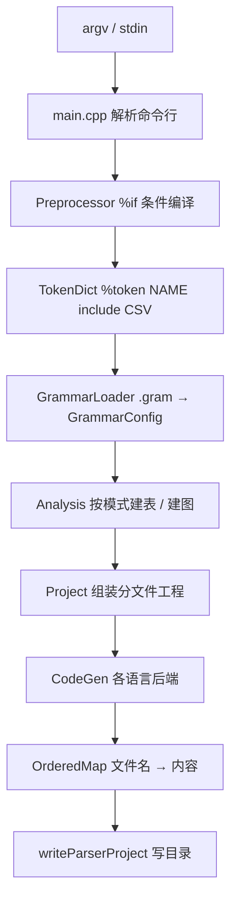

# 一份 `.gram`，八种语言：ParseEngine 的故事

> 这是一篇 ParseEngine 的技术故事，不是使用手册。当前文法规范、模式范围与语言边界以
> [`doc/`](../doc/README.md)（尤其 [12 支持矩阵](15-language-mode-support.md)）
> 和 [`source/README.md`](../source/README.md) 为准。想看更长的虚构外传，去读
> [02 满级文法](02-gram-legend.md)。

## 1. 先看结果：十六种模式，八种语言，外加一个导出档

ParseEngine 做的事用一句话就能说完：**吃进一份 `.gram`，吐出能编译能跑的解析器工程。**
但这句话背后撑开的是一张相当宽的地图。

同一份文法，可以选择十六种生成模式：

- LL 家族：`ll0` / `ll1` / `llk`；
- LR 家族：`lr0` / `slr` / `slrk` / `lalr` / `lalrk` / `lr1` / `lrk` / `ielr`；
- 图表与多路径：`glr` / `earley` / `cyk`；
- 回溯递归下降 `dd`；
- 只导出词法器的 `lex`。

同一份分析结果，可以落成八种语言的工程：C99、C++17、Python、C#、Rust、Go，
以及只支持 `dd` / `earley` / `cyk` 的 Java 与 JS-TS 窄后端；除此之外还有一个
`--lang gram` 的导出档——它不生成解析器，只把文法原文件与分析报告写成 `RESULT.md`，
因此十六种模式都能"导出"一遍给人看。

默认是 `--lang cpp17 --mode ielr`：一份文法进去，一个 C++17 工程出来。命令行
`--lang` / `--mode` 覆盖文法里的 `%lang` / `%mode`，谁在命令行上被显式写出，谁说了算。

## 2. 一条直线流水线：从 argv 到产物目录

一次生成是一条没有回头的直线，每一站只把结果往下一站传：



`%if` 条件编译在**解析之前**逐行处理，却保留到原文件的行号映射——这样报错时指到的
还是用户写的那一行。`%token NAME include "csv"` 在预处理之后、文法加载之前展开：
读 CSV 的第二列当字面量别名追加给该 Token，并做一次全量唯一性判定。设置这些顺序的
理由很朴素：**错误越早报、越靠近原文件，越容易修。**

## 3. 生成期算完一切

FIRST / FOLLOW、规范项集族、LALR 的同心状态合并、IELR 的分裂与再合并、
ACTION / GOTO 表、词法正则到 DFA 的转换，全都在生成器进程里算完。产物运行时不依赖
生成器，也不依赖 `source/templates/`——把它们整目录删掉，已生成的解析器照样跑。

这条原则换来两件事：

- **产物是自包含工程**。C99 只依赖 libc 与 `libm`，C++17 只依赖标准库与 `libm`，
  Python 产物只有 `parser.py` / `main.py`（不生成 `Makefile` / `CMakeLists.txt`），
  C# 用 `dotnet build`，Rust 是 Cargo 工程（唯一第三方依赖是词法用的官方 `regex` crate），
  Go 是一个只用标准库的模块（词法用 `regexp`），Java 是自包含 `Parser.java`，
  JS 是带可擦除 TypeScript 类型标注的 `parser.ts`（Node.js 22+ 直接运行）。
- **冲突在生成期就摊开**。消解不了的冲突写进报告的 `[未消解冲突]`，`--teach` 打开后
  再补 `[教学提示]` 与 `[教学对照]`；表项按 yacc 默认处理（移进 / 归约冲突取移进，
  归约 / 归约冲突取先到的）。`lr0` / `lr1` 这类"教材对照"模式因此可以带着冲突完整生成，
  把自动机与冲突本身都摆给人看。

## 4. 十六种模式不是十六个开关，而是四套脾气

- **LL 家族**按预测集合往下走，`llk` 用 k 元组展望；`ll0` 是最朴素的形态。
- **LR 家族**里，`lr0` / `lr1` 是规范自动机（`lr1` 不合并同心状态），`slr` / `lalr`
  是经典省状态方案，`slrk` / `lalrk` / `lrk` 把展望扩到 k 元组（k 取 1..3，默认 2，
  k=1 时分别等于 `slr` / `lalr` / `lr1`），`ielr` 是默认档：在 LALR 的规模上做到
  LR(1) 的识别能力。
- **GLR / Earley / CYK** 负责"一份输入可以有多棵树"这件事：GLR 走 GSS 多路径，
  Earley 走图表预测 / 扫描 / 完成，CYK 先把文法转成 CNF、用跨度表判定，再按原文法
  恢复派生树。
- **`dd` 与 `lex`** 是两个极端：`dd` 不建表，直接照文法生成每个非终结符的回溯递归
  下降函数；`lex` 干脆只出词法器，连分析栈都没有。

模式与语言之间不是随便配的：C99 提供 13 种（没有 GLR / Earley / CYK 运行时），
C++17 / Python / C# / Rust / Go 各 16 种，Java 与 JS 只支持 `dd` / `earley` / `cyk`，
`gram` 导出档十六种都能导出。这张矩阵由
[`15`](15-language-mode-support.md) 统一维护，代码里则由
`Project::generateParserProject` 与 `analysis.cpp` 的模式分类共同守住。

## 5. 八种语言，语义尽量对齐

同一份文法、同一份输入，C99 / C++17 / Python 三档的输出（含错误消息文本）逐字相同；
C# 在 Windows 上是平台 CRLF 行尾，比对前统一归一化。Rust 与 Go 的行列号也和 C 一致。

但"同一套语义"不等于"同一份模板"。六套完整后端各有自己的目录与文件形态：

| 目标 | 产物 |
| --- | --- |
| C99 | `parser.h` / `parser.c` / `parser_token.{h,c}` / `parser_table.c` / `main.c` / `parser_user.h` |
| C++17 | `parser.hpp` / `parser.cpp` / `main.cpp` / `parser_user.h`（缺省命名空间 `Parser`） |
| Python | `parser.py` / `main.py` |
| C# | `Parser.cs` / `Token.cs` / `Program.cs` / `parser.csproj` |
| Rust | `Cargo.toml` + `src/parser.rs` / `token.rs` / `main.rs` |
| Go | `go.mod` + `parser.go` / `token.go` / `main.go` |
| Java | `Parser.java`（窄后端） |
| JS/TS | `parser.ts` + `package.json`（窄后端，可擦除类型标注） |

C++17 产物不是把 C 产物塞进 `.cpp`：它有另一个后端、另一套模板，入口是
`Engine engine; engine.runText(...)`，但命名空间里保留了一层薄薄的 C 名字兼容层，
所以老示例里的 `Parser_RunText(...)` 也还能用。用户文件永远不动：`%code ... %endcode`
生成的 `parser_user.h`、`%copy` 拷进来的文件保持原名原内容——`%code` 只能单独成行，
旧的 `%{{ ... }}%` 已禁用并给出迁移错误。

## 6. 384 份模板，和一个"只认一种格式"的决定

所有产物每一段都在 `source/templates/` 里：**384 份，全部是模板引擎格式 `.tmpl`**
（`.template` 已归零）；纯静态片段也走引擎——除了必须过一遍引擎才能消掉文件头
`{# … #}` 说明块，也让"模板只有一种读法"这件事变成硬约束。

C99 50 / C++17 68 / Python 51 / C# 49 / Rust 53 / Go 55 / Java 2 / JS 3，
再加共用的 `code_gen_*` 片段 3 份、构建脚本 8 份、`RESULT.md` 1 份、
`result_*.md` 片段 21 份与 `mermaid_*` 模板 20 份。格式支持
`{{ 变量 }}` / `` / `` / `` / `{# 注释 #}` / `…`；
生成器一律调 `tmpl::renderValues` / `renderValueTemplate` 取值，比如
`code_gen_action_cases.cpp.tmpl` 就用对象数组 + `` 生成每个产生式的
`case Nu: { … break; }` 语义动作分支。

构建期由 `tools/embed_templates.py` 把这些文件按文件名排序，生成为
`source/src/templates_data.cpp` 里的 `R"PGX(...)PGX"` 字符串表；运行期
`Utils::loadTemplate` 先查内联表，再认 `SCRIPT_ENGINE_TEMPLATES=<目录>` 的磁盘覆盖——
开发时改模板不必重新内联。踩坑记录也留在文档里：产物要写目标语言自己的 `{{` / `}}` 时
必须包进 ``；`` 与内容同行会让每轮之间少一个换行。

## 7. 语义动作要翻译，不是复制

`ActionTranslator` 会把文法里的 `$$` / `$n` 与语言方言翻译成目标语言的写法：
Python 译成 `result.value` / `values[...]`，布尔改成 `and` / `or` / `not` 并去掉分号；
C# / Rust / Go 同样用 `values[...]` 下标、语句保留分号，区别在错误恢复的调用形态
（C# 是 `yyErrOk()` / `yyClearIn()`，Rust 是 `self.yy_err_ok()` / `self.current_line()`，
Go 是 `p.YyErrOk()` / `p.CurrentLine()`）。

所以"同一份文法换一个 `--lang`"并不是复制粘贴：**分析表复用，语义动作按目标语言重新
落地**。这也是为什么同一份文法可以在 C99 / C++17 / Python 三档跑出逐字相同的输出——
复用的是算法与规格，翻译的是每一行用户动作。

## 8. 增量解析：只有两档，而且边界写得很清楚

增量解析指的是**生成的解析器处理输入文本修改**，不是 Make / CMake / Cargo 的增量构建。
目前只有 C++17 与 Rust 提供这套 API：

- **LL / DD**：保守缓存。文本没变就复用上次状态、语义结果、错误与 `%commit` 片段；
  文本一变就完整重算。
- **确定性 LR**：token cache + 前缀 checkpoint。默认每 32 个 token 存一次 LR 栈快照
  （间隔可配置，0 表示禁用），文本变化后从公共 token 前缀内最近的 checkpoint 恢复、
  只重跑后缀，恢复失败就回退完整解析。
- **GLR 家族（含 Earley / CYK）**：实验缓存。默认策略是
  `GlrSemanticReusePolicy::Disabled`——每次照常执行语义动作；只有调用方显式声明
  `Pure`，且文本与语义环境版本都没变，才允许复用非 tree 模式的成功结果。

GLR 家族的 packed forest 还支持父依赖传递失效、稳定节点 ID 复用、跨度重映射与
局部修补：节点按 `(symbol, start, end)` 唯一，`alternatives` 保留歧义候选，
节点 `id` 在 `clear()` 之前不复用。`clear()` 保留策略与当前版本；从 `Disabled`
切到 `Pure` 后先重算一次。**这些语义责任都明确写在调用方手里**：文件 IO、进程启动、
日志、可变符号表写入都不该声明为纯。

## 9. 产物会自己清场：`.parseengine-manifest`

生成工程会在输出目录维护一份 `.parseengine-manifest`：再次生成时，把上一版登记、
这一版不再产出的旧文件删掉，未知文件一律保留。清单里如果出现绝对路径、`..`、
保留的清单名本身，或经过符号链接父目录的路径，必须拒绝——**删文件这件事不能靠猜。**

想整体回收就敲维护命令：

```bash
ParseEngine clear --out-dir 目录     # 等价于 --mode clear
```

`clear` **不读取文法**，只删除清单里登记的产物与因此变空的目录，所以它不计入十六种
分析模式；改这条链路时要跑 `python tests/clear_mode.py`，里面专门验证"重新生成换语言
会删掉旧产物""用户自己的文件留给用户"这些反例。

## 10. 看见中间过程：报告与图示

看不懂生成结果时，ParseEngine 允许你把中间层直接打印出来：

- `--report 文件` 把文法分析报告另存为 UTF-8 文本；
- `--dump-lr-automaton` 打印 LR 状态、项集与转移；`--dump-slr-tables` 打印 ACTION / GOTO；
- `%mermaid` / `--mermaid` 往产物里加一组自包含的 `mermaid/` 状态机图
  （总览页 + 文法自动机 + 词法 DFA），`--dump-mermaid` 则直接打到标准输出；
- `--preprocess-only` 只跑 `%if` 条件编译并打印处理后文本与行号映射；
- `--syntax-only` 强制启用语法树、忽略语义动作与用户代码，用来做 Token / 语法树可视化。

这些开关让"生成器在想什么"是可检查的，而不是只能对着报错猜。

## 11. 生存模式留下的规则

1. 能在生成期算完的，绝不留给运行期——FIRST / FOLLOW、项集、表、DFA 都是。
2. 产物必须自包含：换一台机器、删掉模板目录，生成的解析器照样编译。
3. 阶段顺序有讲究：预处理 → 词表展开 → 文法加载 → 分析 → 组装，每一步都保留行号。
4. 语言与模式的组合限制要有一张统一矩阵，不能散落在各后端里各自表述。
5. 命令行 `--lang` / `--mode` 覆盖文法 `%lang` / `%mode`，谁显式写谁赢。
6. 八种语言共享分析结果，但语义动作要按目标语言翻译，不能靠复制粘贴。
7. 模板只保留一种格式；共用片段也进模板，别写回 C++ 字符串字面量。
8. 删除产物只能按清单来；清单之外的用户文件必须留下。
9. 维护命令（`clear`）不读文法，也不该被塞进模式列表凑数。
10. 增量只要 C++17 / Rust；缓存策略的语义责任明确交给调用方，默认禁用而非默认乐观。
11. 中间过程要能打印：自动机、表、预处理结果、Mermaid 图，都是排错入口。
12. 验收判据不是"代码生成了"，而是产物真能编译、真能跑、跨目标真能对齐。

## 12. 尾声：一份文法，很多张地图

ParseEngine 的规模来自一次"别把边界写死"的决定：分析层只认文法与模式，代码生成层
各管一档语言，两者用 `AnalysisResult` 与产物模板对接。于是加一种模式，只动分析层与
报告；加一种语言，只动一个后端与一组模板——Java 与 JS 甚至只需要两个窄后端，
就能覆盖 `dd` / `earley` / `cyk` 这三件最需要"先看见结果"的事。

它仍然守着几条清楚的边界：不支持的模式在生成阶段明确拒绝，而不是偷偷生成一半；
Rust 的语义值要求 `Copy + Default + Debug`；`%destructor` 在 Rust / Go 由所有权与 GC
接管；GLR / Earley / CYK 不支持 `error` 产生式与 `%destructor`；Rust 那一档的
词法正则依赖官方 `regex` crate，Go 那一档坚持只用标准库。这些边界和它的能力一样，
都写在 [`15`](15-language-mode-support.md) 里。

所以这份故事最想说的是：**把"一份文法"翻译成八种语言的工程，靠的不是八倍的重复，
而是把生成期、分析层与产物模板切干净。** 切干净之后，第十六种模式、第九种语言，
都只是往这条直线流水线上再接一站。
