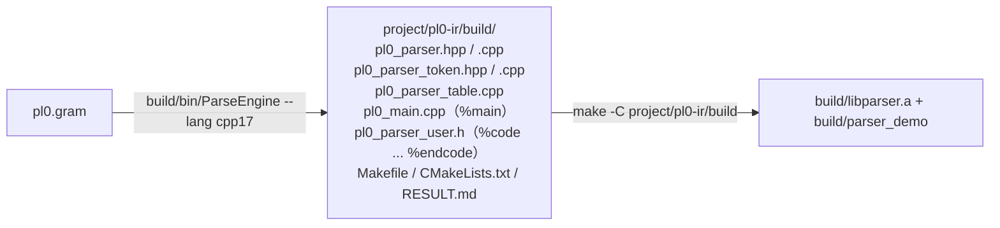

# 08 完整工程示例：从文法到能跑的程序

[`project/pl0-ir/`](../project/pl0-ir/) 是一个**完整的 C++17 工程**：用 ParseEngine
生成 PL/0 的解析器，再用它把 PL/0 程序编译成**三元式**（triple）或**四元式**
（quadruple）。它是「生成器 + 用户语义处理」怎么拼成真工程的最小可用样本——
生成器本身一行没改。

工程只针对 **C++17 产物**（`--lang cpp17`）：`%namespace pl0`、`%main` / `%epilogue`
的写法、`Makefile` 的构建都按 C++17 来，不承诺 C99 / Python 后端也能跑。

## 1. 工程结构

```
project/pl0-ir/
├── pl0.gram                    完整 PL/0 文法 + 三元式生成
├── pl0_quads.gram              完整 PL/0 文法 + 四元式生成
├── Makefile                    make（生成+编译） / run / check / quads / run-quads / clean
├── check.sh                    跑全部样例并比对期望输出
├── samples/*.pl0               9 个正常样例
├── samples-error/*.pl0         13 个出错样例
├── expected/*.triples          正常样例的期望三元式（已人工核对）
├── expected-error/*.txt        出错样例的期望报错首行
├── build/                      三元式产物的生成与编译结果（.gitignore 忽略）
└── build-quads/                四元式产物的生成与编译结果（.gitignore 忽略）
```

构建链路（`make -C project/pl0-ir`）：



## 2. 文法设计：完整 PL/0

覆盖 Wirth 的 PL/0 全部语法：

| 部分 | 产生式形状 | 说明 |
| --- | --- | --- |
| 程序 | `program := block DOT` | `.` 收尾 |
| 块 | `block := const_part var_part proc_part stmt` | 三段声明都可空，语句也可空 |
| 常量声明 | `const_item := VARIABLE EQ NUMBER` | 只收整数字面量，登记进符号表，表达式里直接折叠 |
| 变量声明 | `var_list := VARIABLE \| var_list COMMA VARIABLE` | 登记进当前作用域 |
| 过程声明 | `proc_decl := proc_head block SEMI`、`proc_head := PROCEDURE VARIABLE SEMI` | **可嵌套**；PL/0 的过程没有参数 |
| 语句 | 赋值 / `call` / `begin…end` / `if…then` / `while…do` / `read` / `write` / **空** | 语句间用 `;` 分隔；`statement` 可以为空 |
| 条件 | `odd expr` 或 `expr relop expr` | `relop` 产生一个「算子码」语义值 |
| 表达式 | `expr := term \| expr ± term`、`term := factor \| term ×÷ factor` | 左递归，交给 LALR |
| 因子 | 变量 / 数字 / `( expr )` / 一元 `+` `-` | |
| 词法 | `%identifier` + `%define` | 关键字与运算符走固定字面量，最长匹配让 `:=` `<=` `<>` 赢过单字符 |

三个「写起来才踩到」的文法细节：

1. **不能单列 `WRITE LPAREN expr RPAREN`**：它和 `factor := LPAREN expr RPAREN` 在
   `write ( expr )` 上会构成真实的归约/归约冲突（生成期直接报错）。而 `write(x)`
   本来就会按 `WRITE expr` 解析（`expr` 是 `(x)`），所以不需要那个分支。
2. **过程声明要拆一个 `proc_head`**：进过程时要「登记过程名 + 开作用域」，出过程时要
   「收作用域 + 补 endproc」，而动作 DSL 的语义动作只能写在产生式末尾（没有 mid-rule
   action），所以把「进入」放进 `proc_head := PROCEDURE VARIABLE SEMI { Pl0_BeginProc($2); }`。
3. **`statement` 可空** 让 `begin end`、`begin ; ; x := 1 end` 都合法；LALR 下不会冲突
   （空语句只在 `;` / `end` 这些「语句只能为空」的展望符上归约）。

**不支持**：数组（经典 PL/0 没有）、带参数的过程（PL/0 无参数）、`else`。

## 3. 语义值：一个「位置」，名字带作用域限定

`ParserValue_T` 是用户自己 typedef 的，而且**必须是 POD**：生成的运行时会对它整块
`memset`（语义值栈、初值、error 占位值都要清零）也会按值拷贝。所以语义值里只放
`int`，名字放到 `%epilogue` 的名字池里、位置里只存下标：

```c++
typedef struct Pl0_Place_T
{
    int kind;   /* NONE / CONST / NAME / TEMP / LABEL / CODE */
    int value;  /* CONST：常量值；LABEL：标签号；CODE：算子码 */
    int index;  /* TEMP：三元式下标；NAME：名字池下标 */
} ParserValue_T;

static std::vector<std::string> g_pl0Names;   /* 名字池（去重） */
```

所有动态数据都在 `%epilogue` 里用标准库容器：名字池 `std::vector<std::string>`、
三元式表 `std::vector<Pl0_Triple_T>`（成员是 `std::string`）、符号表
`std::vector<Pl0_Symbol_T>`、作用域栈 `std::vector<Pl0_Scope_T>`、
`while` 标签栈 `std::vector<int>`、当前限定名前缀 `std::string`。没有定长数组、
没有固定上限（只有内存），也没有手写的 `char[]` 缓冲。

**作用域**用一个「栈式数组 + 限定名」实现，没有额外的树结构：

- 符号表就是一个 `vector`；进过程时记下当前 `size()`，出过程时 `resize` 回去
  —— 内层声明自动消失；
- 查找**从尾部往前扫**，得到的就是「由内向外最近的同名符号」，天然支持遮蔽；
- 同层重名才报「重复声明」，遮蔽外层是允许的；
- 落进三元式的名字是**限定名**：顶层 `x`；过程 p 里 `p.x`；嵌套过程 p.q 里 `p.q.x`。

两个和「什么时候查表」有关的坑：

1. `PARSER_USER_TOKEN_VALUE` 对**每个被移进的 Token** 都会跑，`var x` / `procedure p`
   里的名字也在其中——那时它们还没进符号表。所以钩子只把词素文本记进位置，查表推迟到
   真正使用它的地方（`Pl0_Resolve` / `Pl0_Assign` / `Pl0_Read` / `Pl0_Call`）。
2. 左值和右值要分开查：`Pl0_Resolve` 负责右值（常量折叠、过程名报错），
   `Pl0_ResolveTarget` 负责左值（常量不能赋值、过程不能当变量）。这样
   `const n = 1; n := 2` 能报出「不能给常量赋值」而不是默默折叠。

## 4. 三元式生成规则

| 源码 | 生成 |
| --- | --- |
| `x := e` | `(:=, <e 的操作数>, x)` |
| `a + b` / `-` / `*` / `/` | `(+, a, b)` 等，结果是新临时量 `(k)` |
| 全是常量的算术 | 直接折叠，不生成三元式（`1 + 2 * 3` → `7`） |
| `-x` | `(neg, x, _)`；`x` 是常量时折叠成 `-值` |
| `odd e` | `(odd, e, _)` |
| `a < b` 等六种比较 | `(<, a, b)` |
| `if c then S` | 条件的比较/`odd` 之后 `(jz, (c), L1)`，`S` 之后 `(label, L1, _)` |
| `while c do S` | `(label, L0, _)` → 条件 → `(jz, (c), L1)` → `S` → `(j, _, L0)` → `(label, L1, _)` |
| `read x` / `? x` | `(read, _, x)` |
| `write e` / `! e` | `(write, e, _)` |
| `procedure p; …` | `(proc, p, _)` … `(endproc, p, _)`（嵌套时名字是 `p.q`） |
| `call p` | `(call, p, _)`（非局部过程用它的限定名） |

真假出口用**命名标签**（`L1` / `L2` …）而不是回填下标：三元式已经用「下标」引用结果，
再混一套「跳转到未来下标」会让人读不懂。`while` 的开始标签压在内建小栈里
（`Pl0_BeginWhile` 入栈、`Pl0_EndWhile` 出栈），嵌套循环也正确。

## 5. 三处用户代码怎么分工

| 位置 | 放什么 | 内容 |
| --- | --- | --- |
| `%code ... %endcode`（→ `pl0_parser_user.h`） | 类型、宏、声明 | `ParserValue_T`、`PL0_*` 算子码、`PARSER_USER_TOKEN_VALUE`、帮助函数声明 |
| `%epilogue`（→ `pl0_parser.cpp` 末尾） | 普通函数定义、静态状态 | 符号表、三元式表、注释剥离、全部 `Pl0_*` 实现 |
| `%main`（→ `pl0_main.cpp`） | 入口 | 读 `.pl0` → 剥注释 → `RunText` → 打印三元式 |

两条实战经验：

- `%epilogue` 贴在 `namespace pl0` **之外**、`%code ... %endcode` 又不参与 C++17 的名字改写，
  所以这两处不要写 `ParserToken_T` 这类 C 侧名字；本工程干脆只用基本类型，
  只有 `PARSER_USER_TOKEN_VALUE` 宏里用了 `TOKEN_NUMBER` / `TOKEN_VARIABLE`——它展开在
  `pl0_parser.cpp` 的命名空间**内**，那里能解析到。
- **注释交给词法器跳过**：文法里两条 `%trivia`（`\{[^}]*\}` 与
  `\(\*([^*]|\*+[^)]+)*\*+\)`）匹配即丢，`%space` 只能配空白字符集、做不到这件事。
  好处是解析器本身（当库调 `Parser_RunText()`）就认识注释，不用调用方先预剥文本；
  `(* … *)` 那条特意避开 `\*+[^*)]` 这种写法（会生成永不接受的 DFA，见
  [`docs/09`](12-grammar-usage.md#commit把识别但不进语法层的文本收进容器) 与
  `pl0-ir/README.md`）。注释没闭合仍由 `%main` 里**只读**的 `Pl0_CheckComments()`
  报成 `注释没有闭合（{ 少一个 }）`。

## 6. 构建、运行与自验

```sh
make                       # 先在仓库根目录构建生成器
make -C project/pl0-ir            # 生成 + 编译（project/pl0-ir/build/parser_demo）
make -C project/pl0-ir run        # 用 samples/if_while.pl0 跑一遍
make -C project/pl0-ir check      # 9 个正常样例 + 13 个错误样例
make -C project/pl0-ir quads      # 四元式：生成 + 编译（build-quads/）
```

`check.sh` 分两段：正常样例必须解析成功、三元式与 `expected/*.triples` 逐行一致
（比对前去掉行尾 `\r`，Windows 文本模式 stdout 与 Linux 共用同一份期望文件）；
错误样例必须**非 0 退出**，且 stderr 首行与 `expected-error/*.txt` 一致。

测试矩阵（覆盖到的点）：

| 样例 | 覆盖 |
| --- | --- |
| `expr` / `const` | 赋值、括号、常量折叠、临时量引用 |
| `if_while` / `odd` | 条件、循环、`odd`、`<>`、标签与回跳 |
| `proc` | 过程声明、`call`、过程内局部变量与循环 |
| `nested_proc` | 嵌套过程、过程内再声明过程、同名遮蔽、非局部引用（限定名） |
| `ops` | 全部算符：四则、一元正负、括号、六种比较、`#` 别名、`odd 表达式` |
| `comments` | 两种注释、空语句、`?` / `!`、`read` / `read(x)` / `write` / `write(x)` |
| `torture` | 综合一份：三层嵌套过程（`outer.mid`）+ 递归 `call` + 同名遮蔽 + 两种注释 + `?` / `!` + 空语句 |
| 13 个错误样例 | 未声明变量 / 重复声明（变量与过程）/ 常量赋值与 `read` / 过程当变量 / `call` 变量 / `call` 未声明过程 / 常量除零 / 注释未闭合 / 常量右值不是数字 / 两处语法错误（行列号指回 `.pl0`） |

## 7. 已知限制

- 数组与带参数的过程不支持——PL/0 本身没有这两项；过程之间靠外层变量通信
  （`samples/proc.pl0` 就是这么写的）。
- 没有条目上限：符号表 / 三元式表 / `while` 标签栈都是 `std::vector`（作用域标记用
  `size()`），名字池是 `std::vector<std::string>`，限定名前缀是 `std::string`；
  不再有 256 符号 / 1024 三元式 / 128 标签 / 16 层嵌套这类定长上限（细节见 §3）。
- 不生成目标代码，只产出三元式；也没有类型检查（PL/0 只有整数）。
- `read` / `write` 只生成三元式，不模拟输入输出；要看运行结果得再写一个三元式解释器。
- 只覆盖 C++17 产物；C99 / Python 后端的写法（`ParserToken_T`、`parser_user.h` 的包含方式等）
  没有专门适配。

## 8. 想照抄这个工程时

1. 先把文法拆成「声明 / 规则 / 动作」三段，动作只调用 `%code ... %endcode` 里声明好的帮助函数；
2. 语义值一开始就选好「位置」这类能同时表示常量、变量、临时量、标签的类型，能省掉后期大改；
3. **别新增与既有分支二义的备选写法**（本工程的 `write ( expr )` 就是例子）：生成期会
   直接报归约/归约冲突，这是好事——真到运行时才发现就晚了；
4. `PARSER_USER_TOKEN_VALUE` 对每个 Token 都跑（声明符也在内），「使用时才该做」的
   查表 / 报错别写在里面；
5. 用 `%namespace` 给产物一个自己的命名空间与前缀，多个解析器就能同时链接；
6. 最后用 `%main` 写入口、用 `check.sh` 这种「正常样例 + 错误样例 + 期望输出」的方式
   守住回归。

## 9. 其他解析器工程示例

本文件前面讲的都是 `project/pl0-ir/`。`project/` 下的示例工程大多使用统一
目录约定（`Makefile` + `check.sh` + `samples/` + `expected/` +
`samples-error/` + `expected-error/` + 各自的 `README.md`）；两个课程实验目录按自己的
README 分别生成和运行。总入口见 [`project/README.md`](../project/README.md)。

### C++17 工程

| 工程 | 学什么 |
| --- | --- |
| [`pl0-ir/`](../project/pl0-ir/README.md) | 完整前端的写法：LALR + 语义动作直接产中间代码（三元式 / 四元式）、作用域与符号表、`%trivia` 注释、`#line` 定位 |
| [`mini-basic/`](../project/mini-basic/README.md) | 单遍编译 + 栈式虚拟机：`%left` / `%right` / `%prec` 消解表达式二义、mid-rule action 记循环起点、`$line` 报错定位 |
| [`pl0-super/`](../project/pl0-super/README.md) | 同一门语言的两套前端：生成器出的 LALR(1) 与手写递归下降；**不建 IR**，简化代码直接出目标机汇编 |
| [`bigint-calc/`](../project/bigint-calc/README.md) | **大整数计算器**：语义值直接是 `library/big_number` 的 `BigInt`（`%value_type bigint::BigInt`），`2^10000` / `5000!`（16326 位）/ 4000 位字面量都是普通输入；用 `%token regex` 覆盖内建 NUMBER 绕开 int32 / double 的限制 |

### Python 工程

| 工程 | 学什么 |
| --- | --- |
| [`log-ir/`](../project/log-ir/README.md) | 免编译产物当脚本 / AI 接口：`%commit` 把注释当数据交出来、位置 API 落到输出与报错 |
| [`todo-scan/`](../project/todo-scan/README.md) | 最小的一份：`%mode lex` + `%commit`，一条产生式都不写就能扫源码出 Markdown 报告 |

### DSL 与多目标代码生成

| 工程 | 学什么 |
| --- | --- |
| [`protocol-dsl/`](../project/protocol-dsl/README.md) | Python / C++17 / Rust 三套编译器都用 ParseEngine 生成二进制协议 DSL 前端；Python 版输出四档 codec 与文档，两个原生版分别输出 C++17 与 `no_std` Rust；含大小端、嵌套 packet 和动态字节串 |

### 课程实验

| 工程 | 学什么 |
| --- | --- |
| [`lab_report_axhu/`](../project/lab_report_axhu/README.md) | 安徽新华学院编译原理课程的三个实验：文法类型判断、PL/0 词法分析、PL/0 语法分析（LALR(1) + `error` 恢复） |
| [`lab_report_nju/`](../project/lab_report_nju/README.md) | 南京大学编译原理五次实验：严格 C-- 词法语法、AST 与语义检查、四元式、MIPS 目标代码和优化；含五份报告、实验指导、源码及一键证据脚本 |

上面前五个工程（`pl0-ir` / `mini-basic` / `pl0-super` / `log-ir` / `todo-scan`）
`make -C project/<名字> check` 都能直接跑；
`protocol-dsl/` 同样可直接 `make check`，并会编译、运行四档生成代码；
`lab_report_axhu/` 按它自己的 README 逐实验生成、编译和运行；`lab_report_nju/` 在
仓库根运行 `powershell -ExecutionPolicy Bypass -File project/lab_report_nju/run-evidence.ps1`。
