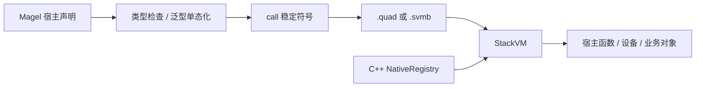

> This is the English edition. The Chinese edition is the default and is the one maintained first — see [中文文档](../README.md)。

# A Maxed-Out Grammar and a Big Cleanup (A ParseEngine Side Story)

> **That glorious chapter of Magel**: this language grew up inside this repository early on — the
> generator, StackVM, standard library, glue and reflection were all polished here together (the
> Magel documents below are the record of that time). It has since been split into its own
> repository <https://github.com/rabbitc999/magel>; every link in this document that pointed at
> `magel/` now points at the same-named document in the new repository.

**Author: Tangtang (an amateur writer)**

> **First, let's be clear about what's real — because most of it is.**
>
> `ParseEngine` was written by the author alone, in his spare time: working during the day, then coming home at night to a desktop he built himself; many of the commits in `git log` happened late at night.
>
> The motivation was real too: he wanted to use it to finish the half of the map that the compilers course back then never covered. The teacher taught all of lexical analysis plus LL(1), LR(0) and quadruple DAG simplification, but never SLR / LALR / LR(1) / IELR. He scored well on the exam back then, but a high score doesn't mean you've derived the whole table yourself.
>
> The co-authors were AI partners: **Codex, WorkBuddy, DeepSeek/GPT6**, later joined by 30x GPT accounts. The human set the direction, they implemented, the human accepted the result. The process was also **an indirect test of AI performance** — not a benchmark score, but seeing who could turn a direction into code in a real repository that compiles, runs and enters regression; who left fewer compile errors, broke other people's templates less, and circled around conflict resolution less. The `git log`, the smoke results, the byte-for-byte `diff`s and the rules in `AGENTS.md` are the scoreboard for that long-running test.
>
> One finding came out blunt and clear: **WorkBuddy is a bit dumb.** No matter which AI you configure it with, it behaves the same — it always slacks off: runs one fewer pass if it can, checks one fewer spot if it can, pushes things to the next round if it can. **Codex doesn't slack off.** Tell it to change a template and it really changes it; tell it to add tests and it really adds them; tell it to align the output artifacts and it compares byte by byte. It isn't that Codex is smarter — it just doesn't treat "taking it easy" as the default strategy.
>
> **This code has never really been looked at by anyone else**: no advisor reviewed it, no review meeting, no competition. The commands, directives, modes, artifact names and test results that appear in this text can all be found in the source and docs — none of it is fabricated.
>
> Only two things are made up: **the narrative shell** and **the dialogue in the text**. The protagonist "Tangtang" is a narrative device — don't take it as a real person.
>
> The book has twenty-six chapters: first what this thing does, then why it was built, then where it failed, how the load was trimmed, how the collaboration worked, and finally what was learned; the second half continues with incremental parsing, the five strict C-- experiments, the Java/JS narrow backends, closing out graph mode, and Magel's C++ glue, body macros, event interrupts and Qt GUI migration; Chapter 22 puts MetroLang and RustView on the map, Chapter 23 continues with Magel's non-null references, postfix generics and whole-library migration; Chapter 24 closes out Magel 1.0's names, references and iterator pipelines, and Chapter 25 records the multi-database and external-library three-backend acceptance for 1.1.
>
> **A note on scope**: the current state is six complete backends + two narrow backends, Java / JS, and sixteen modes; Chapters 2–11 and some later chapters keep the numbers and attempts as they were at the time of development. For target languages, template counts and example counts, the current source and support matrix are authoritative.
> Magel's source syntax already has a separate [EBNF grammar reference](https://github.com/rabbitc999/magel/blob/master/doc/33-ebnf.md); the old APIs and experimental schemes that appear in the story should be read as belonging to the stage they came from.

> Not every language supports all sixteen modes; the current support matrix, export restrictions and the boundaries of the incremental API are in [15](../15-language-mode-support.md).

---

## Before You Read: Understand This Story in One Minute

**What is ParseEngine?**

You can think of it as a "grammar-manual translation machine".

- You write a `.gram` file containing grammar rules, like "how expressions can be added, subtracted, multiplied and divided".
- It reads that in and can generate parser code in eight languages: C99, C++17, Python, C#, Rust, Go, plus the narrower Java and JavaScript/TypeScript.
- A parser's job is to let a program "understand" a piece of text.
- It can also output only an analysis report without generating code — that tier is called `--lang gram`.

**How impressive is it?**

One `.gram`, sixteen modes, eight target languages, plus an export tier that only produces the grammar and the analysis report.

**Who wrote it?**

Tangtang — works during the day, writes when he gets home at night. His partners are AI: Codex, DeepSeek/GPT6, later joined by 30x GPT accounts. The human sets the direction, they implement, the human accepts the result.

**What did the university background become?**

For that compilers course, the teacher only taught:

- all of lexical analysis;
- LL(1);
- LR(0);
- quadruple DAG simplification.

The rest wasn't covered. Tangtang scored well on the exam back then, but a high score doesn't mean you've walked the parts outside the map. `ParseEngine` is him going back to finish that other half of the map.

**The results can be checked.** The modes, languages, template counts and regression results in this text take the current source, tests,
`AGENTS.md` and [`15`](../15-language-mode-support.md) as authoritative.

---

## Chapter 0 Start With the Result: One `.gram`, Six Languages

Tangtang wrote `ParseEngine` in his spare time: coming home at night, sitting down at that folding desk.

**Writing this parser generator genuinely feels great.**

Daytime is always chopped into small fragments; sitting at your own folding desk at night is different — one sentence goes in, a table comes out, a hundred-odd states lined up neatly, conflicts resolved one line at a time, `make -C source test-smoke` green from start to finish.

That feeling is hard to describe — roughly: **the thing I wrote is the best in the world.**

Not arrogance, just the honest sensation of those three months.

Write one `.gram` and C, C++17, Python, C#, Rust and Go all come out together; sixteen modes from LL(0) to CYK, chosen according to each mode's supported range; `RESULT.md` lays out FIRST/FOLLOW, item sets, conflicts and the resolution process one by one for you to inspect.

> **Plain-speak aside:**  
> FIRST/FOLLOW are two tables for "guessing the start, guessing what follows"; an item set is all the possibilities for "how far we've read right now"; a conflict is "one cell has two choices and the tool has to decide which to take". Other tools just report a bare "conflict"; this one tells you directly which state the conflict is in, which two productions are involved, and how to fix it; `--teach` even walks through the resolution process.

The most addictive moment, writing into the small hours, is watching the `.gram` you casually wrote in the morning get turned by the tool into a parser that **compiles, runs and can go into the repository**.

That feeling of "I wired the whole chain up by myself" is enough to carry him through many late nights.

The place he lived was small: a folding desk, a chair, a desktop he assembled himself. When the case fan spun up it sounded like it was about to take off. The project sat in `D:\Desktop\ParseEngine`, and many commits in `git log` were late at night. The repository was on GitHub, initially Apache-2.0 and later switched to MIT, with a very short README:

> One `.gram`, sixteen modes, six target languages, plus an export tier that only produces the grammar and the analysis report.

Star count: 3. Two of them were from himself.

This code **was never really looked at by anyone else**. No advisor reviewed it, no review meeting, no acceptance — nobody knew he was writing this; in that room at night there was only him, a terminal, and the AI on the other side of the screen: **Codex and DeepSeek/GPT6**; later, when incremental parsing was wrapped up, 30x GPT accounts joined.

The division of labor was simple and steady: he set the direction — which modes, which tiers of output artifacts, what counted as handling a conflict correctly; they implemented — templates, backends, tests, docs; he accepted — `make -C source test-smoke` green from start to finish, `RESULT.md` checked character by character.

Over three months, the only ones who had "seen" this were the three of them.

So that "best in the world" sounds like a boast, but it isn't a comparison with anyone. **It's the kind of certainty that only grows after you've derived the whole table yourself and made each backend go green one by one** — no one nodded, and no one needed to.

Late that night, about to shut down the computer, he ran the `--lang gram` tier once more: the exported `.gram` was byte-for-byte identical to the input, and `calc.analysis.md` laid out all the evidence for this generation. He stared at that concluding line for half a second and smiled a little — not a smile for anyone else.

---

## Chapter 1 Then the Origin: University Only Taught Half the Map

—— Part of that thrill in Chapter 1 was making up for the map.

That compilers course at university was taught competently enough, but its coverage was narrow:

- lexical analysis was covered in full: regular expressions, NFA, DFA, minimization, the lexer table;
- parsing only went as far as LL(1) and LR(0);
- intermediate representation only went as far as quadruples and DAG simplification.

Beyond that, SLR, LALR, LR(1), IELR, LR(k), plus conflict resolution, data flow, SSA, register allocation and code generation, were all skipped.

He scored high on the exam. He could handle almost everything the papers covered: derive FIRST/FOLLOW, fill a LL(1) parse table, compute an LR(0) item-set closure, draw and simplify a quadruple DAG.

But that course always remained, to him: **the half of the map the teacher drew, I know by heart; what lies outside the map, I never walked.**

`ParseEngine` is him going back and computing that other half of the table from scratch:

- multiple modes from LL(0) to IELR;
- SLR / LALR / LR(1) derived himself;
- closures of item sets computed himself;
- conflicts examined one by one;
- `--teach` writes the resolution process into the report;
- after the tables, code too — each tier of output artifacts gets its own `build` and `run`;
- three runtimes (LL / LR / `lex`) compare results on the same input in the tests.

**The parts that course never covered, he finished himself** — and this time, every table can be recomputed and every conflict explained.

> **Plain-speak aside:**  
> LL is like "guessing from the top down", LR like "reducing from the bottom up". The teacher taught LL(1) and LR(0), which is like teaching only the two most basic ways of reading. SLR, LALR, LR(1), IELR are finer, stronger ways of reading. Tangtang later filled all of them in.

### Addendum: He Wasn't the Only One on That Map

Halfway through filling in the map, one day Tangtang was browsing material online and came across the lab document for the compiler principles course at Nanjing University. Appendix A plainly described a language called **C—**: Tokens, High-level Definitions, Specifiers, Declarators, Statements, Local Definitions, Expressions…… a complete, from-scratch compiler lab framework.

He froze for a moment.

Not envy. It was the dawning that "so there's more than just me walking outside this map".

The students at Nanjing University were asked, in class, to write a compiler for C— — lexer, parser, semantics, intermediate code, target code, the whole chain. Meanwhile he, at home, with no one asking, added chores for himself: pushing from `.gram` to six backends, from LL(0) to IELR, then retreating from the failed quadruple line, switching to `pl0-super`, and finally, still unsatisfied, starting to write the Magel language.

The direction had collided.

Nanjing University was "asked to hand-roll C—"; he was "making trouble for himself by hand-rolling Magel". One inside a course, one at home; one with a grading standard, one with nothing but late-night commits in `git log`. But the two groups were essentially doing one thing: **pushing a map from "the half the teacher drew" out to "the whole thing you can recompute yourself".**

He bookmarked that lab document. Told no one.

Only that night, while writing the Magel language, there was a little extra quiet confidence in his heart — **so there are others on this road too.**

---

## Chapter 2 The Bill for Failure: The Quadruple Intermediate Layer

This piece isn't a victory lap. This piece is a bill.

After getting the generator running smoothly, Tangtang felt this line was "too shallow" — he wanted a **real compiler backend**: source in, intermediate representation, then data flow, SSA and register allocation on that representation, and finally target code out.

> **Plain-speak aside:**  
> An intermediate representation is "translate the program first into a kind of universal sticky note". Quadruples are like lines of `x = y + z` sticky notes. SSA is the form where "each variable is assigned exactly once". Register allocation is "cramming variables into the CPU's little cells". These sound advanced, but they're not necessarily worth it.

So the repository gained a `library/transfer`: five pieces combined into one library (`irbridge` / `core` / `dataflow` / `ssa` / `regalloc`), a command-line tool `t1t`, and an end-to-end pipeline. Later it grew `typebuild` (type trees, generics, interfaces, operator overloading) and `astbuild` (AST annotation + lowering) — **both sub-libraries were later deleted too**: the quadruple optimization engine stayed in use, but the flattening route was dropped.

That night unfolded like this:

```text
$ t1t-example-suite … mips
[失败] 23_pointer_array.quad —— 期望 1 20 2 2，实际 1 0 2 2
$ t1t transfer 24_pointer_compare.quad
t1t transfer: 第 35 条四元式的操作 '!' 不存在（未知四元式）
$ t1t transfer 29_literal_cast.quad
t1t transfer: Read of uninitialized variable: t10
```

Digging one by one, what surfaced in the end wasn't "the algorithm isn't advanced enough" but that **the layering itself was leaking**:

- A pointer's tag was numbered by "each pointer's own base list", so `q = &b[1]` and `ps`'s list didn't line up; the dispatch chain looked up with `0` and landed on the `a` branch — reading a never-written `a[1] = 0`. The fix was to change the tag to **global numbering by base name**. Nothing to do with the backend at all.
- The backend optimizer had three defects **of its own**: constant propagation plus dead-code elimination across two parallel vectors folded to a wrong result; when a `cvt` was folded into a literal it **wasn't truncated to the target type**; constant propagation deleted the definition of a temporary like `t1 = t0 + 0`, yet missed the "source operand of an assignment" position. So several examples could only be written as `# 优化: 否`, effectively bypassing the optimizer.
- The same semantics had to be written **twice, in two places**: operator overloading needed an annotation-time decision plus a lowering-time call emission; generics needed type instantiation plus function-body monomorphization; pointers needed a type-level `*T` plus a lowering-level "base + index".
- Fixing each end-to-end sample meant understanding four or five layers at once; and verification required writing two minimal `.quad` reproductions yourself.

Near dawn, staring at that pipeline, he said something harsh but true: **the cost comes from the IR, and the payoff never arrived.**

The layering was meant for "analyze once, reuse in many places", but the main line was a single-threaded, statically bound address model, so none of those analyses were used; what actually blocked the samples were the optimizer's own defects.

So he did two things.

First, he **reined this line in**: `library/transfer` was kept for research, teaching and experimentation, no longer the main line; the retrospective is the experience above.

Second, he **switched routes**: a new `project/pl0-super` — **with no intermediate representation**. Code simplification is built into the pool during grammar reduction, and only four simplification passes that can be described in one sentence and have countable occurrences are done (constant folding / algebraic simplification / dead branches / peephole), then stack-machine target assembly is emitted directly and run with the bundled interpreter:

```text
$ pl0-super --stats samples/simplify_demo.p0s
简化：折叠 6，代数 2，死分支 3，窥孔 2
46
```

By the way, he also put "two front ends" on the same language: `lalr1/` is a **table-driven LALR(1)** produced by the generator, and `ll1/` is a **hand-written recursive descent** parser. Switching the same grammar straight to `--mode ll1` gets rejected:

```text
错误：文法不是 LL(1)：M[expr__tail, AND] 同时对应
      expr__tail -> AND expr expr__tail 和 expr__tail -> %empty
```

—— `%left` precedence has no equivalent in LL(1), so expressions must be layered. This error message and the measured numbers from all three implementations were written into `project/pl0-super/语法分析对比.md`.

What remains in the end isn't a failed branch, but a reproducible route judgment: judge it a failure, switch routes, then get both front ends green.

### Addendum to This Chapter: Why This Chapter Is Worth Writing

- Chapter 1 was about "how to win"; this chapter is about "how to admit you lost".
- Three optimizer defects, one tag-numbering issue in the lowerer, one redundant parse — each one is **reproducible, localizable, and can be written into the docs**.
- Failure isn't money wasted: `typebuild`'s type system, `astbuild`'s gap list, the unified pointer address model, generic function monomorphization, operator-overloading lowering, and that "quadruples vs. direct code emission" trade-off conclusion were all bought with this stretch.
- In one sentence: **when you find yourself writing a second implementation for a layer of abstraction and the payoff hasn't shown up yet, first suspect whether that layer should exist at all.**

—— End of Chapter 3

---

## Chapter 3 The Big Cleanup: Deleting the Extra Features

The next night, instead of rushing to add new features, he first counted the repository from top to bottom.

The inventory that came out was intimidating: **seven** language backends — C99, C++17, Python, Rust, Go, Java, C#; **thirteen** modes; plus a set of `%ast_*` directives that only tagged the syntax tree.

Then he **saw through** one thing: these weren't war trophies, they were debts.

A feature doesn't sit still on its own; it has to be fed every day — a template, a `RESULT.md`, a smoke branch, a chapter of docs. Every tier you open is interest you have to keep paying.

The problem was the numbers didn't line up. The README said "five target languages", "thirteen modes", "120 (grammar, language) combinations", but the code only recognized four, twelve, and 97. Anyone who typed `--lang java` following the README got "unknown target language".

"The docs are lying," he wrote on the handover sheet.

"It's not that the docs broke," the other side of the screen replied, "it's that every extra backend is one more list to keep in sync — generator, templates, `RESULT.md`, smoke branch, doc chapter, editor dropdown. Among seven lists, one is always half a step behind."

So the deletion began.

Rust and Go had both originally been derived from the C# backend as "dialect backends": similar template skeletons, a different syntactic skin. The Rust tier went first — not because it was bad, but because the main line didn't need it at the time, and keeping it meant feeding one more template, one more `RESULT.md`, one more smoke branch; there was even an entire Rust project (five hundred-odd files) lying in the examples library. Go went too, for a more direct reason: **narrow applicability, few people asking, yet non-trivial maintenance cost**. Delete it, and clean up the comments too.

The Java backend and the C# backend were twins, but the reason for deleting Java wasn't "twins". Java has hard limits on constants written directly into code: **a single UTF-8 constant in the constant pool can be at most 65535 bytes, and method bytecode is capped at 64KB**. The large DFA tables, large templates and large string constants ParseEngine generates easily hit the line without warning. It isn't "doesn't want to support it", it's that this language's vehicle is unfriendly to "writing a big table directly as a constant". Delete.

> **Plain-speak aside:**  
> In a Java class file, hard-coded strings and constants carry a label that says "64KB max at most"; once the generator spits out a big table, it can't fit.  
> Go is a different problem: it isn't that it can't fit, it's that few people use it, so maintaining it isn't worth it.

`%ast_skip` / `%ast_fold` / `%ast_label` only generated a few query functions and were never wired into tree building — users would think there was an AST, when in fact there was nothing. **Dead code is worse than no code, because it looks usable.** Delete.

GLR had its own GSS runtime and its own error-recovery path, and after being written it was never used by anyone. Delete.

One cut took out fifty thousand lines. The remaining four languages, twelve modes and 97 (grammar, language) combinations were all run through.

"How long did it take?"

"One minute."

He stared at that all-green report for a while, then suddenly said: "There's one more thing, the opposite way."

"Which one?"

"The C++17 tier — I rolled it back to concatenation-style."

"Didn't the template engine just get migrated?"

"It was only after the migration that I realized the generator could no longer see what the artifacts looked like — to look at a `parser.hpp` you first had to render it. The artifact templates were always meant to be edited by hand, with `__MODE_NAME__` sitting there in plain text, so editing them is the least hassle."

"What about the engine?"

"Keep it. It's pure header, depends on no other library; anyone who wants to quickly stitch together a DSL or render text from a model can just take it. It's a good tool, it just shouldn't be carried by the generator."

By the way, he moved the artifact templates from the repository root into `source/templates/` — "hidden a bit deeper", so a glance at the root directory wouldn't be all templates.

—— End of Chapter 4

---

## Chapter 4 Epilogue: Why Keep a Mode That Generates No Code

That winter, the `ParseEngine` repository homepage gained a one-line description:

> One `.gram`, fourteen modes, six target languages, plus an export tier that only produces the grammar and the analysis report.

Someone asked Tangtang: "Why do you insist on keeping a tier that 'generates no code'?"

He thought for a moment and said:

"Because code goes stale, gets refactored, gets replaced. But that `.gram` and its analysis report won't — they are where this thing comes from. Write the origin clearly, and then others dare to take your next step."

With that, he saved the file at hand. The filename was very short:

```text
calc.gram
calc.analysis.md
```

Outside the window the city's lights lit up one by one, like a table spread out.

Fourteen modes, 1.4 billion cells, every one of them solvable.

—— End

---

## Chapter 5 Five Agents and One Tree: Several People Sharing One Desk

A few days after the epilogue was written, Tangtang did something that invited trouble for himself: he **opened five agents at once**, one per backend — C99, C++17, C#, Python, Rust — **all editing the same working tree**.

> **Plain-speak aside:**  
> An agent is an AI assistant. A working tree is the same code folder. Five AIs editing the same folder at once is like five people at one desk at the same time, chopping, cooking, plating — the moment anyone lifts a hand they might knock someone else's plate.

Four hours later he added four rules to the top of `AGENTS.md`. Below is where those four rules came from.

### First Encounter: Inlining Someone Else's Templates Too

"Hey — why did all my C# blow up?"

A was editing C99 and casually ran `make -C source templates`. But `make -C source templates` inlines **everyone's** templates under `source/templates/` into `source/src/templates_data.cpp` — including the eighteen `csharp_*.tmpl` files B had just written ten minutes earlier and **hadn't had time to update `code_gen_csharp.cpp` for**.

So B's artifacts were full of unreplaced `{{ mode_name }}`, and all thirty-six `.csharp` directories were red. B's first reaction was that he'd written something wrong, and he checked for over half an hour. The culprit was sitting right next door, wearing an innocent face: "My artifacts are byte-for-byte unchanged over here."

> **Rule one: lock the build.**  
> No one may touch the shared generated artifacts while someone else is compiling. Hence `tools/lock.sh` — the lock is the **directory** `tmp/build.lock`, which records who locked it, when, and why. Hold the lock while compiling → keep holding it if the compile fails → release it only after the error is handled and the build is green.

### Second Encounter: Committing on Someone Else's Behalf

You run `git status --short` and the first column is lying there with **forty of someone else's** `A` / `R` entries.

Whoever slips and types a bare `git commit` commits someone else's half-finished work along with it, signed with their own name in the commit message.

"I never wrote C#."  
"But you committed it."

Nobody wants that hat — especially when the commit also contains files someone else was **halfway through editing and that don't even compile**.

> **Rule two: commit by path.**  
> `git commit -m "…" -- <your own paths>`; no `git add -A`, no `git commit -a`. The staging area is shared, and a path-scoped commit only lands the entries you list; for shared generated artifacts, use **the copy generated in an isolated tree**, so you don't inline templates someone else hasn't yet saved to disk.

### Third Encounter: Three Hours

This round was the worst.

Someone ran a **full-language smoke test**. Every C# artifact needed to spin up MSBuild + NuGet, every Rust artifact needed to spin up cargo — a single smoke round went from "a few minutes" to **three hours**. The agent next door had finished its work long ago and could only wait, from midnight until almost three.

It later left a line in its commit message:

> I'm not waiting for a compile, I'm waiting for **someone else's** compile.

> **Rule three: split acceptance into three tiers; don't start with the most expensive one.**  
> Second-level (`tools/quick-verify.sh`: about 24 seconds) → minute-level (incremental isolated build, about 36 seconds) → a full run before committing (only your own mode).  
> And one more time-saver: **if `diff -r` shows 0, no need to smoke-test** — not one byte of the artifacts changed, so the build result can't change.
>
> **Rule four: by default, only run your own mode.**  
> `GEN_ALL_LANGS=c` / `SMOKE_LANGS=c`. All 5 modes and 111 combinations take 1 minute 54 seconds; running only the C mode's 36 combinations takes **53 seconds**. Full-mode, full-scale runs are a luxury — use them only before merging.

### Two More Pitfalls That Made Us Laugh

- **"Unknown target language rust".** Someone used an old `HEAD` tree and a new `HEAD` tree as a baseline, and the `diff` threw up a pile of differences that had nothing to do with them — because **between the two trees, someone else had committed the Rust backend**.
- **The `VAR=x cmd` prefix gets silently dropped.** Someone thought they were testing "keep the lock when the build fails", but what ran was a normal build — a wasted round of waiting. After that, everyone wrote `env VAR=x cmd`.

### Wrapping Up

At the end of that day they tallied it up: **five backend tiers, 252 templates, 109 (grammar, language) combinations**, with artifacts from five different directions lying in one tree at the same time — compared byte by byte, **0 differences**.

One person + one agent is a pair; five agents is a team. And the hardest part of a team isn't division of labor, it's **sharing the same desk**.

Tangtang wrote the conclusion into three sentences and put them at the very front of `AGENTS.md`:

> **Lock the build, commit by path, and run the second-level acceptance tier first.**

---

## Chapter 6 Switching Engines: The Rust Mode

When the Rust backend was added back, the lexer was written following the C99 approach: at generation time each regular expression is compiled into a DFA table, the artifacts hold a `Dfa` constant plus a 256-entry character-class mapping, and at runtime it looks things up in the table. The artifacts carry no dependencies and compile fastest.

"Why not use Rust's own regular expression library?"

"Because that set was written for C." He typed a line. "I just went along with it."

Later the regular expressions on the Rust side got fancier and fancier: forms like `{1,100}` that exceeded the limit of 32, negated classes mixed with grouped stars — the generator's bundled compiler reported an error first, and a very reasonable one at that: "repetition count cannot exceed 32". Yet Rust's `regex` clearly accepts it.

So he changed it: the patterns for `%token regex` / `%identifier` / `%commit` are **handed verbatim to Rust's official `regex` crate**, the whole DFA table set is deleted from the artifacts, and the three tables are each compiled once the first time a Token is taken.

By the way, he re-categorized "the bundled compiler can't accept it": **only C99 remains a hard error** — it really does need that DFA to build the table; the other four tiers hand the regular expression verbatim to each language's own regex library, and if it can't accept it they **emit a warning** and generation proceeds as usual.

The day the change was done, all 109 artifact sets were generated once before and once after: C99 / C++17 / Python / C# **didn't change by a single byte**, and the Rust tier's twelve cases were recompiled, rerun, and matched against `example/*.expected`.

"So what did this save?"

"It saved one pitfall of 'thinking it was a dialect difference, when it was really my own compiler being too petty'."

Finally, I deleted that version of `AGENTS.md`, folded the rules into the project docs, and declared this stage finished.

---

## Chapter 7 Giving the Magel Language an Object Table: Where Values Live

The main text says "the part in Chapter 4 about subtraction" — deleting the backends that had grown crooked, deleting the modes nobody used, slimming the project down. But that was only **subtraction**. What really excited Tangtang was the stretch that followed: he went back and pushed `magel` (the Magel language) from an early "C subset that can do arithmetic" prototype into "a C-style virtual machine language that can write data structures and string processing", and **every step along the way landed on "representation"** — dovetailing exactly with Chapter 3's line that "pick the wrong representation and every later step is paying off debt".

### First, Some Explanation: This Magel Is Not Minecraft

Every time he told someone "I'm writing a language called Magel", their first reaction was:

> "Minecraft? You're writing a mod?"

At first Tangtang patiently explained: "No, it's Magel, the early prototype borrowed C's syntax." Later he gave up and switched to a self-deprecating line:

> "Right, it's Minecraft's Magel. I'm mining in there — mining memory."

> **Plain-speak aside:**  
> In Minecraft you mine blocks, craft items, manage your inventory, and fend off creepers.  
> In a compiler you manage memory, build strings, allocate objects, and prevent memory leaks.  
> Tangtang later found the anxiety of these two things was strikingly similar.

### The Night It Almost Got Named C+-

Before this stretch began, Tangtang had an urge he never dared make public: he wanted to rename the Magel language **C+-**.

The reason was plain: it isn't C, it's just a subset of C — subtracting pointer arithmetic, subtracting the preprocessor, subtracting the things "you can write but I don't guarantee"; while at the same time adding strings, containers, big integers and an object table.

"C plus a bit, minus a bit, isn't that just C+-?" He typed those three characters into the README draft, deleted them, typed them again, deleted them again.

In the end he didn't change it. Because `magel` already rolled off the tongue, and he was afraid people would think it was a joke project.

But that night he left a line in the commit message: `// 差点叫 C+-`.

Later that line was deleted. Only he knows that the Magel language was ever one `git mv` away from C+-.

> **Plain-speak aside:**  
> If it were really called C+-, search engines would think you were looking for a typo of C++.  
> If it's called Magel, search engines will think you're looking for Minecraft.
> In the end Tangtang chose a name that **both search engines and humans will misread**, and then went on writing code.

### Nanjing University's C— and His Magel

On the very night the Magel language was pushed to "move strings onto the heap", Tangtang opened that long-bookmarked page again — the lab document for the compiler principles course at Nanjing University.

The C— language grammar in Appendix A, which he'd only glanced at before, he now read line by line.

> Tokens: INT、FLOAT、ID、SEMI、COMMA、ASSIGNOP、RELOP、PLUS、MINUS、STAR、DIV、AND、OR、DOT、NOT、TYPE、LP、RP、LB、RB、LC、RC、STRUCT、RETURN、IF、ELSE、WHILE……
>
> High-level Definitions: Program → ExtDefList; ExtDefList → ExtDef ExtDefList | ε; ExtDef → Specifier ExtDecList SEMI | Specifier SEMI | Specifier FunDec CompSt……
>
> Declarators: VarDec → ID | VarDec LB INT RB; FunDec → ID LP VarList RP | ID LP RP……
>
> Expressions: Exp → Exp ASSIGNOP Exp | Exp AND Exp | Exp OR Exp | … | ID LP Args RP | Exp LB Exp RB | Exp DOT ID | ID | INT | FLOAT……

He stared at the screen and suddenly laughed.

Nanjing University's C— is a **course lab grammar**: with a clear grading standard, an IR Simulator virtual machine, QtSpim target-code execution, and additional test cases provided by the teacher. Students follow the steps, from lexical analysis through to target code — one course, one complete compiler.

His Magel language is a **self-study grammar**: no grading standard, no virtual machine with a graphical interface, no test cases handed down by a teacher — only late-night commits in `git log`, topic documents in the repository constantly being recalibrated, and the AI partner on the other side of the screen. He pushed from `pl0-super` to `magel`, retreated from the failed quadruple line, changed string buffering from a stopgap to heap allocation, and switched from manual `delete` to block-scope soft release.

The direction turned out to be the same.

The students at Nanjing University were asked, in a course, to "hand-roll C—"; he, at home, made trouble for himself and "hand-rolled Magel". One in a classroom, one at home; one with a teacher nodding, one with only himself nodding.

But the two groups were essentially doing one thing: **pushing a map from "the half the teacher drew" out to "the whole thing you can recompute yourself".**

He closed the bookmark and went back to writing the Magel language's object table.

That night he added a line to the commit message:

> `// 南大的 C— 是课程，我的 Magel 是自找的。但地图是同一条。`

### Naming the Generator Was Harder Than Naming the Language

After the Magel language ran, Tangtang wrote a generator that turns `.quad` files into **standalone executables with a bundled virtual machine**. That generator is now called `magel/magel-emit` (formerly `library/magel-emit`), and its name went through a small naming crisis too.

His first inspiration was **C+-ava** — because it turns a C subset (C+-) into an executable file (-ava sounds like some Java variant), abbreviated **cava**.

"cava isn't bad," he muttered to himself, "concise, memorable, like coffee."

Then he stopped.

> "Wait, this is a tool for the Magel language. So should it be **mcava**?
> Or **mc+-ava**?  
> Too many symbols; filenames with plus and minus signs still need escaping in the shell."

He typed a few draft lines into the README:

```text
magel-emit        # 现在叫这个（后来搬进 magel/）
cava                # 简洁，但不知道的以为是咖啡
mcava               # 有 Magel，但读起来像某个地名
mc+-ava             # 符号太多，文件名不友好
```

In the end he sighed:

> "Forget it, let's just call it `magel-emit`.
> At least it's honest — it just emits magel."

So the name `magel/magel-emit` was settled. It isn't short, isn't cool, but it states its job accurately.

> **Plain-speak aside:**  
> Naming a tool is like naming a pet wolf in Minecraft:  
> At first you want to call it "War God", then you find it just sits in place waiting for you to feed it a bone.  
> In the end you call it "Doggie".  
> `magel-emit` is that doggie.

### "Why Aren't Strings Kept in the Data Section?"

That night, staring at the Magel language's type table, his very first sentence stopped himself:

> A string's value is the base address of a run of bytes in the data section. So what about `a + b`? The data section is **laid out at compile time** — where do strings built at runtime go? What about slices? What about things produced by `format`?

The answer was a static buffer — that was the previous version's stopgap: **the next concatenation overwrites the previous result**.

So he threw up his hands: "Stop patching the buffer — **move strings onto the heap entirely and write the runtime in C++.**"

After that day's changes, strings came down to one sentence: **the value is always a heap address, and the data section only keeps read-only literals as a copy source.**

> **Rule one: one chain allocates once.**  
> `a + "x" + b + c` is flattened into a **single** `__vm_str_join`. Pairwise joins would also be correct, but the intermediate strings belong to no one — no variable "is it", so no one frees it, and it leaks. Once the representation is fixed, optimization is just a matter of convenience: flatten the chain, leave only one result string, which is exactly owned by the variable being assigned to.

> **Plain-speak aside:**  
> It's like crafting items in Minecraft: you can't first turn wood into planks, then planks into sticks, then sticks into a sword — the intermediates are nobody's responsibility and your inventory fills up.  
> The right way is to flatten the recipe in one go and produce the final item directly.

### "Who Returns It?"

Things on the heap always have to be returned by someone. Tangtang chose **block scope**: runtime arrays and heap strings belong to **the block that declares them**. On exiting the block, `break`, `continue` or `return`, they're returned in reverse declaration order; except the variable being `return`ed — its ownership passes to the caller.

> **Rule two: automatic release must be safely re-entrant.**  
> The release the compiler inserts is a **soft release**: if the address is 0, is in the data section, or has already been returned, it's treated as a no-op. The reasoning is quite practical — after an explicit `delete a;` the variable still holds that address and the block exit wants to drop it again; when two variables point to the same block there's one extra drop; none of these should blow up. A hand-written `delete` in the program is, conversely, **strict**.

> **Plain-speak aside:**  
> It's like an Ender Chest: you put things in, and when you leave the block it's cleared automatically. But if someone threw an item away by hand, the Ender Chest shouldn't error — it should act like it saw nothing.  
> What you threw away by hand, though, must be strict: throw it wrong or throw it twice, and that's on you.

`T mut&` stays put: **flexible pointers are manually owned**, with your own `delete`. The three tiers of ownership are written in the README, one sentence and one table.

### "Where Do Big Integers and Containers Live?"

When `lang::BigInteger` (arbitrary-precision integers) and the three containers `lang::List<T>` / `lang::Set<T>` / `lang::Map<K,V>` came in, Tangtang faced a choice identical to the "string" one: **where does the value live**.

> In the data section? They grow at **runtime**, and the data section is laid out at compile time.  
> On the heap, as a byte string? Then `v.push` would have to write a byte-by-byte protocol on the language side — as dirty as "looping over strings byte by byte".

So came the **runtime object table**: handle → C++ object.

Later this layer of interface was closed off too: the source only writes `lang::List<T>`, `lang::Set<T>`, `lang::Map<K,V>`, and the early
`vec/set/map` type spellings were deleted outright; `__vm_vec_*` remains only as an invisible VM ABI underneath. The standard algorithms
no longer keep Magel wrapper files either: the compiler recognizes `std::algorithms`, checks the generic arguments and the callback signatures, and then calls
the glue layer directly. Sorting copies the input list and then uses a bottom-up stable merge sort with an auxiliary buffer; the time complexity is
$O(n\log n)$, and it doesn't consume the recursion call stack.

> **Rule three: handles and addresses must be distinguishable at a glance.**  
> Handles take the **high range** starting at `1e12` — heap addresses are only in the thousands, and data-section addresses are even smaller, so in `(free, …)` / `(drop, …)` you can tell "is this an object handle or a memory address". This saves an entire "ask the type first, then decide" branch.

> **Plain-speak aside:**  
> It's like in Minecraft, where inventory slot numbers start at 0, while world coordinates are in the tens of thousands.  
> You can tell at a glance whether "this is which slot in the backpack" or "this is a location on the map".  
> Tangtang carried that intuition into the compiler: handles and addresses, told apart at a glance.

By the way, three things were nailed down:

- **strings inside containers are stored by copy**;
- **object class types are value semantics**;
- **big integers are an add-on feature**.

### "Can We Move the Virtual Machine Into the Artifacts?"

The last one was what Tangtang had always wanted to do but never dared: **let the artifacts carry the virtual machine themselves**.

He always remembered that phrase from Chapter 1 — "self-contained artifacts". But that meant "not depending on the generator"; the artifacts still needed the `stackvm` process to run `.quad`. So he used `library/template` to write a generator (now `magel/magel-emit`):

> Use templates to **template the quadruples, the data-section bytes and the layout table into C++ constants**, then **embed the entire source** of `library/stackvm` and `library/big_number` into the same file. `g++ -std=c++17 -O2` compiles it — and out comes a **standalone executable**: no `.quad`, no `.data`, no dependency on this repository, only `#include` of the standard library.

One command does the whole thing:

```sh
sh magel/magel-emit/build-target.sh magel/example/samples/containers.mgl
```

He picked ten programs to verify: containers, bigint, tree, fourier, recursion, list, structs, array2d, scope, input_text — the artifacts' output was **byte-for-byte identical** to `magel/example/expected/*.txt`.

> **Plain-speak aside:**  
> It's like "command blocks" in Minecraft: before, to run a redstone machine you had to lay out a pile of blocks and wire up a pile of lines.  
> Now you **fit the whole machine into a single block**, drop it down and it runs.  
> That's what Tangtang did: fit the virtual machine into the artifacts, and the artifacts run the moment you drop them down.

### The Pitfalls Hit This Night (All Bills for "Representation")

Writing until dawn, he copied this round's bugs into a list, because **none of them was newly written code gone wrong — they were old places whose representation was exposed by new usage**:

```text
Heap::allocate     切块之后还抱着 blocks_[index] 的引用（vector 扩容就失效），
                   那句 block.free = false 写到旧内存 —— 新数组里那块还标着"空闲"，
                   于是"刚分配的块又被人借走"
s[i]               堆串上用"读 8 字节 + & 255"会越过块尾
printf             snprintf 的整数没补 ll —— %d 只吃 32 位
lang::BigInteger → int64       走了 toDouble()（只有 53 位有效位）
return s;          自动释放把"被 return 的那个变量"也还了
Node::storeAt      原来"先算地址再算值"，递归重入时地址临时量被内层覆盖
```

> Tangtang wrote a line at the end of the list: **not one line this night was "algorithm" work; it was all representation and ownership work.**  
> —— Looked at together with the earlier chapters, this line has really been about the same thing all along: **where a value lives decides how every step after it is written.**

> **Plain-speak aside:**  
> These bugs are like the classic accidents in Minecraft:  
> You put a chest in front of a piston, the piston pushes, and the chest is gone;  
> You pressed Shift in a cave and still fell into lava;  
> You mined a spawner with Silk Touch, but your inventory was full and the spawner fell into the void.  
> Tangtang's night was spent fixing these pitfalls where "every step is right, yet the result is wrong".

### Addendum to This Chapter

Chapter 3's conclusion was "**pick the wrong representation and every later step is paying off debt**". This chapter is its flip side: once the representation is **picked right**, optimization becomes a matter of convenience.

### The Final Word on the Name Magel

Later someone asked Tangtang: "This Magel language of yours — is it actually Minecraft?"

He said: "No. But if you insist on understanding it in Minecraft terms —"

> "The heap is the Overworld, the stack is the Nether, the data section is the End.  
> A string is an Ender Pearl — throw it and it teleports to the heap.  
> An object handle is a command block — you can only operate on what's inside it indirectly, through it.  
> Automatic release is a chunk unload — you leave and it cleans itself up.  
> Manual delete is TNT — you lit it yourself, so don't blame anyone else when it blows."

The other person listened, was silent for a moment, and said: "So can your language mine diamonds?"

Tangtang said: "It can. `lang::BigInteger` is the diamond, `vec` is the backpack, `map` is the Ender Chest."

—— End of Chapter 8

---

## Chapter 8 What I Learned Tonight (06:39)

Writing until nearly dawn, jot down what was learned over these few months (especially these few hours tonight), so as not to forget:

1. **Before writing a second implementation for a layer of abstraction, ask what it saves.**  
   The quadruple line wasn't undoable — it was "the cost comes from the IR and the payoff never arrived". An abstraction must prove its payoff first, then talk about elegance.

2. **"It runs" doesn't mean "it's correct".**  
   Three optimizer defects forced several examples to be written as `# 优化: 否` — that's a fig leaf, not a solution. Only when something is reproducible, localizable and documented is it actually handled.

3. **Pick the wrong representation and every later step is paying off debt.**  
   Flattening wasn't "a bit short", it was the **wrong direction**. Changing the representation is cheaper than fixing a pile of bugs.

4. **Only what you can recompute counts as really understanding.**  
   Back then the compilers course owed nothing on the exam — the teacher only taught LL(1), LR(0), quadruple DAG simplification and all of lexical analysis, and he scored high; but SLR / LALR / LR(1) / IELR, which weren't taught, he had never derived himself either. This time, from LL(0) to IELR, deriving FIRST/FOLLOW himself, computing item-set closures himself, examining conflicts one by one, every resolution is explainable — only then is that map truly completed.

5. **Failures must be reviewed, and written down clearly.**
   A route that didn't work out can still leave conclusions, retrospectives and replayable engineering evidence. Writing it down is worth more than hiding it.

6. **Only the shell is invented; the numbers must not be.**  
   Names, institutions and review meetings are fictional; the commands, directives, modes, commit times and reproducible verification results must not be invented by a single word.

7. **What you delete is often more than what you keep.**  
   Tonight two sub-libraries were deleted, more than half of the script was deleted, and the obsession with "one more layer up" was deleted; what remained is a quadruple optimization engine that others can rerun, and a `pl0-super` that one person can read through.

8. **Sharing one desk is harder than dividing labor.**  
   Five agents each edited a different backend tier; the code was all written correctly, but they were fighting over the same working tree. Pairing relies on rapport; forming a team must rely on rules — lock the build, commit by path, run the second-level acceptance tier first.

9. **Where values live determines what the language looks like.**  
   Move strings onto the heap and only then does "flatten the concatenation" mean anything; make `lang::BigInteger` / containers into object handles and "handles and addresses distinguishable at a glance" saves an entire branch; make objects value semantics and "aliasing and dangling" disappear at the source; embed the whole VM source in the artifacts and only then does "self-contained" really hold. Figure out where the value lives first, then write the first line of code.

10. **You're not the only one outside the map.**  
    The students at Nanjing University hand-roll C— in a course; you hand-roll Magel out of self-made trouble at home. The directions collided — not a competition, but a comfort. **So there are others on this road too.**

06:39 — the breakfast place downstairs should be open. Save this into the repository, then go sleep.

---

## Chapter 9 Letting the Output Draw Its Own Diagrams

At two in the morning, when Tangtang pushed the door open, two diagrams were open side by side on the screen: on the left a syntax tree for the LALR(1) tier, on the right a syntax graph for the GLR tier — one node among the GSS nodes on the left was gold-colored, and two result trees lay side by side beneath it.

"What's this?"

"This grammar is ambiguous," I said. "`if cond then if cond then other else other` — whether that `else` belongs to the inner or the outer one, both readings hold. GLR doesn't pick; it walks both at once, and when it's done it lays both out for you to see."

"And the gold one?"

"A node accepted by the runtime. Each layer in the graph is 'a state + a node number', and the edges are symbols — solid edges are shifts, dashed edges are reductions, and that `·P2` after a dashed edge is the production number."

"And this one on the left?"

"The LALR(1) tier's syntax tree: the first line in a box is the symbol name, the second line is the lexeme, and leaves and branches have two different background colors. Both diagrams are **drawn by the artifacts themselves as SVG** — no image host, no third-party library, just string concatenation with the standard library; the same tree draws with exactly the same coordinates every time, so it can go into `expected` for byte-for-byte comparison."

"Why only give these tiers?"

"Syntax-tree drawing is given to `lalr` / `lr1` / `ielr` — these three share the same LR runtime, and besides `%tree` you can also build a tree separately with `parse_tree()` to draw. The syntax graph is given to `glr`: it has a GSS to draw, and a batch of result trees to lay out side by side. Other modes' artifacts don't even emit these methods — **it's decided at generation time**, no runtime switch is left behind.

The demo program recognizes two more switches: `--svg tree.svg` / `--dot tree.dot`. When no switch is given, the output is not one byte different from before."

"And those two modes? One GLR, one... that `dd`?"

"`dd` is recursive descent, the fourteenth mode. It's different from all thirteen before it: **it builds no table**. Each non-terminal gets a piece of logic that 'tries each production in declaration order'; when a try fails, it rolls back the lexer position, the Token index and the line/column numbers together, then tries the next one. Sounds dumb, but it has one advantage — the choice is entirely determined by the order in which you write the productions."

"There's a cost."

"Three: no left recursion allowed (the generator errors out directly, and even tells you to rewrite `expr := expr PLUS term` into right recursion); ambiguous grammars keep only the **first matching path**, rather than listing them all like GLR; backtracking is exponential in the worst case, so put the productions most likely to match first. All six tiers support it, and `%sync` still works as before."

"GLR was added back?"

"It was deleted along with Java back in section 31. This time it's added back following the same list: four tiers — C++17 / Python / Rust / Go — with a GSS runtime + a conflict-candidate table; results are stored using each tier's own dynamic container."

Before dawn we did a third thing: **moving the hand-written artifact text into templates**.

The eleven sections of explanation in `RESULT.md` (capacity macros, %sync, %commit, IELR splitting, lookahead items, Mermaid diagrams...) had long since had templates written but were never wired up, and on the C++ side they were still being concatenated with `out += "literal"`. I wired them all up: the generator only lays out data, and whether a section appears is decided by the conditionals in the template. After the change, 135 artifact sets were generated and compared byte-by-byte — **0 differences**.

"What about `mermaid.cpp`?"

"Same treatment. The graph source, the HTML page skeleton, the CSS, the intro, the two tables, even summary sentences like '动作：移进 a b' are all templates — twenty in total; the two concatenation helpers `joinLines` / `joinTexts` were deleted. Over the two rounds together, 135 artifact sets still showed 0 differences."

"Not one byte changed, so what's the point?"

"The point is that the next person to change the text doesn't have to touch C++." I said. "And the point is that a person like me, editing text at three in the morning, doesn't have to reread 4000 lines of `project.cpp`."

The last thing added was **one-shot building**: `sh build-all.sh`. The generator + eight C++ libraries + five Rust crates + the full set of example artifacts + seven projects, all built in one go, **without running a single test**; it detects for itself whether `g++` / `make` / `python` are present (required), and if `cargo` / `rustc` / `dotnet` / `go` are missing it skips the second half and records that in the list.

First run, all 22 steps green, a minute and a half.

"There's one more little thing." I said. "In `.gitattributes` I wanted `.gram` / `.tmpl` to count toward GitHub's language statistics too. Only after checking the official docs did I learn — Linguist **only recognizes language names in its own `languages.yml`**; if you write `linguist-language=tmpl` it pretends not to see it. So it can only be mapped to the two closest: grammars are yacc-style, so `.gram` maps to `Yacc`; templates use the `{{ }}` / `` family, so `.tmpl` maps to `Jinja`."

"Does it matter that the names don't match?"

"In the statistics bar you'll see two color blocks named Yacc and Jinja, not tmpl and gram." I wrote this into a comment in `.gitattributes`. "If you want those two names, you'd have to submit a PR to Linguist. For this kind of thing, writing it down clearly beats pretending it lines up."

I copied the two diagrams into `image/`: `python-tree-example.svg` and `python-syntax-graph-example.svg`, each referenced once by the README and the user manual — after all, for something like "the artifacts can draw diagrams", a hundred sentences are worth less than just pasting two.

---

## Chapter 10 Rust's Library Functions: From "Written for C" to "Using Rust's Own"

After the Rust backend was added back, the lexical gate was passed first — `%token regex` no longer goes through the generator's bundled DFA table, but is handed verbatim to the official `regex` crate, the `Dfa` constant in the artifacts is deleted wholesale, and the three tables are each compiled once the first time a Token is taken.

But lexical was only the doorway. After really getting inside, Tangtang discovered: **the Rust tier's runtime, from day one, was "C written in Rust syntax".**

```rust
// 这不是 Rust，这是穿着 Rust 外衣的 C
pub struct Parser { /* ... */ }
impl Parser {
    pub fn run(&mut self, text: &str) -> bool { /* ... */ }
    pub fn result(&self) -> i32 { /* ... */ }
}
```

"Look at this `bool`." He turned the screen around. "The C set is '`bool` return + `Error &` out-parameter', and I just carried it over. Rust has `Result` — why not use it?"

The other side of the screen was silent for a moment, then replied: "Because carrying it over was fastest."

"But it isn't fast now."

### First Encounter: `%destructor` Is Flatly Rejected at Generation Time

When the Rust backend had just been added back, `%destructor` was written following the C approach: when error recovery pops the stack, call the corresponding cleanup fragment based on "which member the symbol on the stack is bound to".

But Rust has `Drop`.

```rust
// C 的写法：手动登记清理片段
%destructor <str> { free($$); }

// Rust 的写法：Drop 自动跑，不需要你登记
impl Drop for StrValue {
    fn drop(&mut self) { /* ... */ }
}
```

So the generator, encountering `%destructor` in the Rust tier, rejects it outright with a message:

```text
错误：Rust 产物不支持 %destructor——语义值按值拷贝，生命周期由 Drop 负责。
      如果你需要手动释放，请在 %class_body 里自己实现 Drop。
```

This error was later written into `14-languages-and-products.md`: both the Rust and Go tiers don't support `%destructor`, for a one-line reason — **the target language has its own ownership; it doesn't need the generator to manage it for it.**

> **Plain-speak aside:**  
> In C, if you borrow something you have to return it yourself; in Rust, if you borrow something the compiler watches you until you return it.  
> Carrying C's "manually registered cleanup" into Rust is like building a redstone auto-door in Minecraft,  
> only to discover the door was automatic to begin with — you just laid out an extra pile of redstone.

### Second Encounter: Semantic Values Copied by Value

C's `%union` is a block of shared memory, and which member is live is up to you to remember. Rust doesn't have that `union` scheme (it has `union`, but it's `unsafe`), so Tangtang at first wanted to force-fit it with an `enum`:

```rust
enum ParserValue {
    Ival(i32),
    Fval(f64),
    Sval(String),
}
```

But the generator wants "members split by symbol" — `%token <ival> NUMBER` and `%token <sval> ID` correspond to different action expansions. An `enum` can express it, but the generator would have to know which variant each symbol is bound to.

So he switched to a more direct approach: **semantic values copied by value, one field per symbol.**

```rust
pub struct ParserValue {
    pub ival: i32,
    pub fval: f64,
    pub sval: String,
}
```

All symbols share this struct; in actions, `$1` expands to `values[1].ival`, looking the same as C's `%union` style, but underneath it's Rust's copy-by-value. The cost is that every value copies the whole struct — fine when semantic values are small, wasteful when they're big.

"Why not go with generics directly?" asked the other side of the screen.

"Generics would require changing the translation of every action," he typed a line, "and Rust generics expanded inside the generator would point errors at the generator, not at the `.gram`. I don't want that kind of error."

"And `%union`?"

"In the Rust tier, `%union` is written following C's member declarations, but what's generated is a struct, not a union. In actions, `$1 + $3` still expands to `values[1].ival + values[3].ival`, character-for-character identical to the C artifacts — except on the Rust side it's `i32`, and on the C side it's `int`."

This was later written into the README's measured coverage table: Rust only lists language-neutral grammars, and C grammars like `union_demo.gram` don't apply — because `%union`'s members have to be written as Rust fields.

### Third Encounter: Error Handling Changed From `bool` to `Result`

The C set is "`bool` return + `Error &` out-parameter"; the generator doesn't enable exceptions, and errors propagate up the chain. Rust has `Result<T, E>`, and Tangtang originally wanted to just swap it in:

```rust
pub fn run(&mut self, text: &str) -> Result<(), ParseError> {
    // ...
}
```

But then a problem arose: **the error messages in the artifacts must be character-for-character identical to C / C++17 / Python / C# / Go.**

On the C side the error codes are `-26` / `-27`, and the message is "line N, column M: expected one of A / B, got C". If Rust switched to `Result`, the error type would have to carry these fields:

```rust
pub struct ParseError {
    pub code: i32,
    pub line: usize,
    pub column: usize,
    pub message: String,
}
```

Then in `main.rs`:

```rust
match parser.run(&input) {
    Ok(()) => println!("{}", parser.result()),
    Err(e) => eprintln!("错误：{}", e.message),
}
```

This was fine in itself. But the generator's C error handling is "`bool` return + `Error &` out-parameter", and translating it to Rust would require two template sets: one for C / C++17 / Python / C# / Go (`bool` + out-parameter), one for Rust (`Result`).

"Is it worth it?" he asked himself.

"It isn't." he answered himself, "but `Result` is a Rust library function, and without it, the Rust tier will forever be 'C written in Rust syntax'."

So he wrote a second template set. The generator gained a `code_gen_rust.cpp`, half of whose code does one thing: **translating the C set's `bool` + out-parameter into Rust's `Result`.**

> **Plain-speak aside:**  
> It's like in Minecraft, where you were using a wooden pickaxe to mine stone — it works, but it's slow.  
> Then you switched to an iron pickaxe, twice as fast, but you had to relearn how to mine.  
> Tangtang's switch to `Result` is the same — faster, yes, but the generator gained an extra layer of translation.

### Writing the Rust Version of the Libraries: From "Copying" to "Rewriting the Rust Way"

Once the Rust backend stabilized, Tangtang began moving several C++ libraries under `library/` over to Rust:

| C++ version | Rust version | Notes |
| --- | --- | --- |
| `library/transfer` | `library/transfer-rust` | Quadruple backend: both versions together cover MIPS / 8086 / ARM → simulated execution; the Rust version is a standalone zero-dependency crate `quad_transfer`; 26 Rust examples: 23 pass / 0 fail / 3 skipped |
| `library/preprocess` | `library/preprocess-rust` | General-purpose preprocessor: `#` / `%` directives, conditional compilation, include / import; standalone crate `preprocess`, zero dependencies; the artifacts / stdout / stderr / exit codes of 56 CLI argument sets are byte-for-byte identical to the C++ version |
| `library/json` | `library/json-rust` | JSON library: parsing / serialization / path queries / model projection; standalone crate `json`, standard library only, zero dependencies; 91 corpora + 25 commands, 0 substantive differences from the C++ version |

The porting process wasn't "translating C++ line by line into Rust", but "**reimplementing it using Rust's library functions**".

For example, byte indices in `preprocess-rust`. The C++ version uses `std::string_view`, with indices of type `size_t`; the Rust version uses `&[u8]`, with indices of type `usize`. They look alike, but C++'s `string_view` can point at arbitrary memory, whereas Rust's `&[u8]` has a lifetime. So Tangtang added a layer of "byte-based index convention" in the Rust version and wrote it into the technical report:

```rust
// C++ 版：string_view 可以直接切
std::string_view token = text.substr(pos, len);

// Rust 版：&[u8] 切片，生命周期跟着 text 走
let token = &text[pos..pos + len];
```

Another example is model projection in `json-rust`. The C++ version uses template specialization, the Rust version uses traits:

```rust
// C++ 版：模板特化
template<> struct JsonModel<MyStruct> { /* ... */ };

// Rust 版：trait 实现
impl JsonModel for MyStruct { /* ... */ }
```

"Why not just use `serde`?" asked the other side of the screen.

"Because `serde` is a third-party dependency." He typed a line. "This library is positioned as 'standard library only, zero dependencies', same as what `json-rust`'s README says."

"Then why does the Rust backend use the `regex` crate?"

"Because `regex` is Rust's official one, so it doesn't count as third-party." He paused. "And for lexical regexes, writing your own DFA table really is worse than using the official one."

### Pitfall Log: C++ → Rust Type Mapping

Porting until dawn, he copied this round's pitfalls into a list:

```text
C++ size_t → Rust usize     下标类型对了，但溢出行为不同：
                            C++ 无符号溢出是环绕，Rust debug 下 panic
C++ string_view → Rust &str 生命周期要显式标注，不能像 C++ 那样随手切
C++ bool + Error & → Rust Result<T, E>
                            错误码要带进 E，不能像 C 那样直接返回 false
C++ 模板特化 → Rust trait    trait 实现要写在类型定义旁边，不能散落
C++ 异常 → Rust panic       生成器不开异常，Rust 版也不 panic，统一 Result
```

> Tangtang wrote a line at the end of the list: **not one line this round was "algorithm" work; it was all "library function" work.**  
> —— Looked at together with Chapters 3 and 8, this line has really been about the same thing all along: **pick the wrong representation and every later step is paying off debt; pick the wrong library function and every later step is translating.**

> **Plain-speak aside:**  
> It's like moving from the Overworld to the Nether in Minecraft:  
> Overworld blocks can't be used directly in the Nether; you have to recraft them.  
> This round, Tangtang was recrafting a library function set for Rust.

### Addendum to This Chapter

Chapter 7 was about "switching engines" — replacing the bundled DFA with the official `regex` crate for lexical regexes. This chapter is about "switching library function sets" — replacing the runtime from "C written in Rust syntax" with "Rust's own library functions".

Together, only then does the Rust tier really land:

- lexical uses the `regex` crate, no longer carrying a DFA table;
- error handling uses `Result<T, E>`, no longer `bool` + out-parameter;
- semantic values copied by value, `%destructor` rejected at generation time, lifetimes handed to `Drop`;
- all three libraries (`transfer-rust` / `preprocess-rust` / `json-rust`) are zero-dependency, standard library only.

Subsequent development follows the same acceptance principle: generate first, then compile with the target toolchain, and finally run and compare against the expected output.

### The Final Word on Library Functions

Later someone asked Tangtang: "Why did you have to port the C++ libraries to Rust versions? Couldn't you just use the C++ versions directly?"

He said: "Because the Rust tier's artifacts are for Rust users. If the runtime in the artifacts is 'C written in Rust syntax', then why would a user use Rust?"

> "C's library functions are tools; Rust's library functions are part of the language.  
> Write Rust the way you write C and Rust won't complain, but Rust users can tell.  
> Like mining diamonds with a wooden pickaxe in Minecraft — you can mine them, but everyone knows you should switch to an iron pickaxe."

The other person listened, was silent for a moment, and said: "So have you switched now?"

Tangtang said: "I've switched. `regex`, `Result`, `Drop`, `&[u8]`, `trait` — all switched."

—— End of Chapter 12

---

## Chapter 11 The GPT Continuation

When Chapter 11 got to Rust swapping out its library functions, it already looked a lot like a full stop.

The generator had six language tiers, the templates were in place, GLR was added back, and Rust was no longer like "C dressed in Rust syntax". The story could have stopped here: one person, two or three AI partners, a map filled back in from beyond the boundary of the classroom.

But later Tangtang opened another round.

This time it wasn't adding a language, nor porting another library, but touching a problem that feels more like one inside an IDE: **if a small piece of text changes, can the parser rerun a bit less?**

The first thing done was the conservative one: DD and LL only cached results for the same text, and recomputed once the text changed. Sounds plain, but the interface was established first: both C++17 and Rust have an `IncrementalCache`, so callers don't have to guess whether the API will change later.

Next was deterministic LR. The LR stack is too prone to pulling one thread and moving everything, so instead of doing "full incremental parsing" in one go, Tangtang first made an increment-friendly version: a token cache, prefix-state checkpoints, and a stack snapshot every N tokens. After the text changes, it resumes from the nearest checkpoint within the common prefix, rather than parsing from the start.

The truly twisty one was GLR.

GLR doesn't have just one stack; it has a GSS. It doesn't have just one result; it may have a whole forest. Caching an AST is useless, and caching a single tree isn't enough either, because in an ambiguous grammar the same span can have multiple reduction candidates. So the cached object became a packed forest: nodes have stable IDs, candidates record their production and children, and nodes store parents in reverse.

When the text changes, the directly overwritten token spans are invalidated first, then invalidation propagates upward along parents, marking every affected ancestor dirty together. Untouched nodes keep their IDs; after an insertion or deletion, the suffix spans are remapped as a whole; newly produced candidates are then aligned against the old forest, reusing what can be reused, deleting what's expired, and clearing what's unreachable.

This still isn't full GLR incremental parsing. The GSS control flow still reruns, and the chart decisions for Earley / CYK are still rebuilt; semantic actions aren't reused by default — only when the caller explicitly declares `Pure` and the semantic environment version matches is reuse of successful results on the same text allowed. CST in-place patching, GSS checkpoints and isolating the side effects of semantic actions are all still ahead.

But this round opened the door.

> The earlier ParseEngine could "generate parsers".
> The later ParseEngine began answering another question:
> **If a parser lives inside an editor, how does it remember what happened a second ago?**

Writing this, the "maxed out" in the title finally takes on a different meaning.

It isn't that the features are full, but that the route changed: from "generate all the modes", to "make what's generated survive in continuously changing text".

---

## Chapter 13 A One-Shot Run Through the Five Strict C-- Lab Reports

"A one-shot run" doesn't mean pasting the answers into Markdown, nor pretending a C-- superset meets the course requirements.

What really saved time was that the previous forty-one sections had already laid out the toolchain. The parser generator, quadruple backend, data flow, SSA, register allocation and MIPS simulator were all in the repository; what this round had to do was fold them down to the boundary of Nanjing University's five labs, and make every sentence of the report traceable back to source and run results.

The first step was to hold the language boundary. The front end recognizes only the strict C-- defined by `source/frontend/cminus.gram`: `int`, `float`, arrays, structs, functions and control flow enter according to the lab grammar; superset syntax such as `for`, pointers, `switch`, containers and interfaces must be rejected. The lexer and LALR parser are actually generated by ParseEngine, not a hand-written parser that "roughly passes the samples".

The second step was to wire the five reports down to the same implementation, layer by layer:

1. Lexical and syntax analysis: Token, LALR grammar, AST and error localization;
2. Semantic analysis: symbol table, scopes, type inference and error classification;
3. Intermediate code generation: AST to quadruples, control flow, calls and returns;
4. Target code generation: basic blocks, MIPS generation and simulated execution;
5. Code optimization: data flow, SSA, local and global optimization, before-and-after comparison.

The original document's table of contents, page-number headings, exercises and answers were stripped out; what remains is the lab guide, the completion report, source, the lab framework, platform manuals, submission requirements and the C-- grammar appendix. Formulas use LaTeX, flow and structure diagrams use Mermaid, instruction sequences go into code blocks. The report no longer looks like a PDF copied page by page, but like a project that can keep being maintained on a computer.

The last part is the one-command evidence chain. `project/lab_report_nju/run-evidence.ps1` regenerates and compiles the strict C-- front end, runs **4 valid samples + 4 rejected samples**, then builds the backend, executes **8 tests**, feeds the front end's actually-produced quadruples into the full pipeline, and compares the MIPS results before and after optimization, proving that the target code didn't come out of thin air from hand-written quadruples.

So the real meaning of "a one-shot run" is: the five reports can be written quickly, but each one carries the same replayable evidence chain behind it. It isn't that the answers got simpler, it's that the repository had finally accumulated enough to turn the assignment into a single build.

---

## Chapter 14 Bringing Java Back, and Giving JavaScript a TypeScript Skeleton

Java had once been deleted thoroughly. Not because the syntax was hard to write, but because a complete backend would have to carry semantic actions, error recovery, huge analysis tables and lexical DFAs; cramming these into Java class-initialization code easily hits the constant-pool or method-size limits. At the time, continuing to maintain a backend that "looks complete but gets dangerous once it scales" was worse than deleting it.

Section 43 didn't pretend to revive the old backend as-is. Tangtang first drew a narrow boundary: do only the two modes that best express runtime differences.

- DD groups productions by declaration order, restores the Token position on failure, then tries the next one;
- Earley directly implements predictor, scanner and completer, can handle left recursion and empty productions, and on ambiguity keeps the first derivation tree;
- the Java artifact is a self-contained `Parser.java`, with lexical regexes handed to the standard library `Pattern`;
- the JS artifact is called `parser.ts`, retaining erasable TypeScript annotations such as `string`, `number`, union types and generic containers, runnable directly on Node.js 22+.

"Narrow" was also written into the generation-time checks: semantic actions, `%union`, `%sync`, `%commit`, `%copy` and user code sections are not silently ignored — encountering them means an explicit rejection. At the time of section 43, Java / JS also didn't pretend to be LL, LR, GLR or CYK backends; if a mode isn't among them it's also a flat error.

What mattered most this round wasn't gaining two language names, but no longer generating C---superset-style fake artifacts. The front end is still ParseEngine reading a `.gram`, performing the DD left-recursion check or Earley chart construction, and the backend only places the analyzed symbols, productions and lexical rules into templates. Java and JS share `code_gen_narrow.cpp`'s data model, but the runtimes are written as code in each of the two languages' own style.

Acceptance used four real generated projects: `dd_expr` and `chart_nullable`, each generating one Java and one JS version. Java 22 compiled and ran; Node.js 26 syntax-checked and directly ran the type-annotated `parser.ts`; all four outputs matched the repository's existing `.expected`. One more DD grammar with "the same non-terminal declared in scattered places" was added, confirming that after regrouping it still backtracks in declaration order.

Later maintenance brought CYK into this narrow backend too: the CNF span table handles the decision, and after a hit the original grammar's Earley table
restores the first tree, so the output doesn't get mixed with synthetic CNF nodes. Java 22 and Node.js 26 now cover ambiguity,
nullability/left recursion, empty input and illegal input.

---

## Chapter 15 Filling the Last Two Cells, and Pulling Memory Back Into the Repository

Two small-looking gaps remained on the map.

Go already had GLR's graph-structured stack, but not Earley and CYK; and `--lang gram`, which plainly generates no runtime, was also
blocked by the same "target language doesn't support the GLR family" check. The first gap was a runtime; the second gap
was just a boundary written wrong — but both showed up in the support matrix as the same word: **unsupported**.

Tangtang didn't write another result-tree set for Go. He split the work into two layers: Earley / CYK answer "can this string of
Tokens be accepted", and the existing GSS answers "how many interpretations the original grammar has, and what each interpretation's semantic action computes".
CYK's synthetic CNF nodes live only in the decision table and don't enter the tree the user sees. That way `2 + 3 * 4` still leaves behind
both `14` and `20` results, instead of just an "accepted".

The `gram` tier was simpler, on the contrary. It has no stack, no semantic-action runtime, and no memory-release problem; it only needs the
original text, the analysis report and `RESULT.md`. So the generation-time GLR / Earley / CYK runtime restrictions are all bypassed for it, and
all sixteen modes can be exported. What matters most here isn't "letting three more strings through", but stating the rule clearly:
**a tier that generates no runtime shouldn't be rejected by a runtime-capability check.**

During acceptance there was also a joke that looked a lot like a real bug. The first script used `chart_nullable.gram` to verify the
sixteen modes tier by tier, and it failed immediately on LL(0). The problem wasn't the export, but that the grammar itself had nullability, left recursion and
ambiguity, and by nature could never satisfy LL(0). After switching to `ll0_demo.gram`, which can pass the strictest conditions, all sixteen tiers each produced
`.gram`, an analysis report and `RESULT.md`. This was later written into the handover sheet: **test inputs also have preconditions —
don't misjudge "the sample doesn't suit the algorithm" as "the feature isn't implemented".**

Next, Java / JS's CYK was filled in along the same line of thinking. Neither tier has a GSS, so CYK does CNF span decisions, and
after a hit the existing Earley original-grammar table restores the first tree. They still honestly keep the narrow-backend boundary:
they don't execute semantic actions, don't pretend to have error recovery, and don't claim to support all sixteen modes just because CYK was added. Java 22
and Node.js 26 really compiled, checked and ran ambiguity, empty input, left recursion and illegal input — not merely watching the generator's
exit code be zero.

Once the features were filled in, another kind of duplication appeared in the repository: `AGENTS.md` had the current handover rules, and the standalone session-memory directory had
a set of long-term notes too. The latter recorded many real incidents, but it also preserved snapshots like "six languages, twelve modes, Java
firmly not added, 306 templates" that were correct then and wrong now. Once a new session reads the old numbers first, it writes
history back into the present.

The final cleanup didn't delete experience, only the second source of truth. Path conversion, build locks, the single semantic source for LSP, the paired
Rust libraries, Markdown tables, Mermaid, the visual check of preview images, and this round's twelve development lessons for graph mode,
were all merged into `AGENTS.md`; the standalone session-memory directory and its ignore rules were deleted together. From then on the repository keeps only one
handover sheet that can be picked up: new conclusions go into the corresponding chapter, incidents record trigger conditions, fix methods and anti-recurrence checks.

What changed was the map and the way of handing over: Go and `gram` both reach sixteen modes, Java / JS each have three narrow modes,
384 templates, 155 measured language combinations, and maintenance experience is no longer scattered around the edges of the repository.

---

## Chapter 16 Fitting the Virtual Machine With a Door

Magel could already compute big integers, build strings, open files, and put `lang::List`, `lang::Set` and `lang::Map` into the runtime
object table. Every time a new capability was added, the most direct approach was to add one more entry to StackVM's table of built-in functions. At first this
was convenient, but later it looked more and more like chiseling holes in a wall: the math library got in, the containers got in — would the next dev board's serial port, sensors
and C++ business objects also have to be soldered into the virtual machine one by one?

What was really missing wasn't yet another built-in function, but a door with a frame.

The outside of the door is the host C++, and inside are Magel and StackVM; the door frame is the ABI. Section 44 first adds
`NativeRegistry` and `NativeCallContext` at the VM layer. Host functions are registered by name, and arguments and return values pass only through integer slots or
floating-point slots; strings and memory don't expose internal containers, but are read, allocated and errored through the context in a controlled way. This way,
the application can change, and the VM doesn't have to change along with it.



The Magel side only has to write the doorplates clearly:

```c
type HostHandle<T> = uint64;
impl uint64 : ExplicitConvert<HostHandle<int32>> = counter_from_uint;
impl HostHandle<int32> : ExplicitConvert<uint64> = counter_to_uint;
HostHandle<int32> cpp_add(HostHandle<int32> a, HostHandle<int32> b);
T cpp_identity<T>(T value);
```

`type Name = ABI;` declares a nominal host type. Even if a `HostHandle<int32>` is carried underneath by `uint64`, it doesn't thereby
secretly gain integer addition and subtraction; complex C++ objects only send handles or pointers across the boundary, without copying the host layout. The conversion interface
explicitly writes out which conversions are allowed; a function with no body, ended by a semicolon, only registers the host signature and doesn't fabricate a Magel function body. Overload conflicts, duplicate
conversions, missing conversions and runtime missing bindings all stop at their proper level, each raising its own error.

The other side of the door doesn't have to disassemble every slot by hand:

```cpp
struct CounterTag;
using Counter = magel_glue::Handle<CounterTag>;
magel_glue::Registry glue;
glue.bindTypedImplementation<Counter, uint64_t>("counter_from_uint", from_uint);
glue.bindTypedImplementation<uint64_t, Counter>("counter_to_uint", to_uint);
glue.bindTyped<Counter, Counter, Counter>("cpp_add", add);
glue.bindTypedGeneric<int32_t, int32_t>(
    "cpp_identity", {"int32"}, identity);
glue.install();
```

`Codec<T>` handles boundary conversion for bool, fixed-width integers, floating point, `std::string` and `Handle<Tag, Rep>`; applications
can also add specializations for their own trivial ABI types. Generics aren't quietly swapped for runtime type guessing: the existing preprocessor still monomorphizes at compile time,
and `bindGeneric` / `bindTypedGeneric` only register stable specialized symbols by the same rule.

There's also a deliberately kept limitation here: function addresses can't be written into `.svmb`. An address is only meaningful in the current process; serializing it
is neither portable, and it would also bind the program file to one particular host build. So `.svmb` stores the call symbol, and after loading,
the current host re-hooks the same-named registry. The two C++ tiers of `magel-emit` embed the application registration code verbatim at generation time via `--glue app.cpp`;
the Rust tier doesn't provide an application glue layer. A bit less "automatic" buys the ability for the same program to enter different hosts.

At the time, acceptance had two layers: StackVM passed **210 assertions**, including saving a program as `.svmb`, reloading it, re-hooking the
registry and executing again; Magel passed **52 normal examples + 80 error examples**, covering host generics, strings,
explicit conversion, missing bindings, overload conflicts and illegal host arithmetic. The code was split into two commits: one for the general VM registry,
one for Magel's typed glue, keeping the workspace clean at the end.

Before, what Magel could call was "the world the virtual machine had prepared for it". Now, the door is finally open: the language still checks types,
the binary still recognizes only stable symbols, and outside the door can be ordinary C++, or a real device.

---

## Chapter 17 When Magel Is No Longer Just C's Shadow

Later, Magel's positioning was finally cleared up: it isn't "a subset of C", but a C-style language aimed at StackVM.
The syntax looks familiar, but types, lifetimes, modules and runtime boundaries are all decided by the virtual machine's own rules. This renaming isn't cosmetic wording,
but the precondition for a whole series of later designs to hold at the same time.

The first thing unified was the interface protocol. Free-standing `operator+` is forbidden, and all extension behavior is registered through `I`-prefixed interfaces:

```c
struct Money : Add<Money, Money>, Drop {
    int cents;

    Money(int value) { self.cents = value; }
    Money leftAdd(Money other) {
        Money result = new(self.cents + other.cents);
        return result;
    }
    void drop() { }
};
```

`Add` / `RightAdd` distinguish the direction of the operation, `ExplicitConvert` / `ImplicitConvert` handle conversion,
and `Index` and `Iterator` handle indexing and iteration. Structs can implement them, and so can payload-carrying generic enums:

```c
enum Choice<T> : Add<Choice<T>, Choice<T>> {
    None, Value(T value);

    Choice<T> leftAdd(Choice<T> other) { return other; }
    int kind() { return 7; }
};
```

So enums are no longer just "tag + payload" passive data. They can have methods, implement ordinary interfaces, and participate in
operator overloading through interfaces; generic payloads are still monomorphized at compile time, and pattern matching continues to handle safe destructuring.

Lifetimes also took a step forward from "allocate a block, remember to delete it". Structs may have static fields and static methods;
a same-named method is a constructor, and `new(args)` calls it based on the left-hand type. Destructors no longer borrow the word `delete`:
a value object implementing `Drop.drop()` is destructed automatically when it leaves scope, and can also be called early with `drop value;`;
`delete` only does raw heap release. This boundary finally stops resource cleanup and memory release from being one and the same thing.

Then came coroutines. The standard library treats a parameterless `void` function pointer as a task, and `create` returns a nominal-type handle that an ordinary integer
can't impersonate:

```c
lang::SharedCoroutineHandle task = lang::SharedCoroutine::create(worker);
lang::SharedCoroutine::wait(task);
```

`yield` saves the current PC, evaluation stack, call frame and pending arguments, then switches to the next runnable context; when a coroutine's root function
returns, the context waiting on it is woken. The C++ and Rust StackVMs use the same state model, and
`RunResult.coroutines` leaves behind each context's final state, PC, frame depth and waiting relationships.

Embedded hosts also need to know what the VM is doing. So the machine gained two kinds of callbacks that don't hard-code a platform: the host provides a
monotonic nanosecond clock, and the VM records exact start/end times and elapsed time; the host sets an interval of N, and every time the VM completes N instructions it fires
a hook reporting the cumulative instruction count, the actually executed PC, the coroutine handle and the opcode. The clock source is decided by the host: desktop can use a
high-precision monotonic clock, and dev boards can wire in their own hardware counter.

The module API is explicitly exported by default. Ordinary functions are naturally module APIs; implementation details written as `inline`
can still be called within the same module as usual, but other modules are blocked at compile time even if they write the full qualified name. Here `inline` isn't a
performance hint, it's visibility. `.svmb` was upgraded to v3 accordingly, writing public entry points separately into an exports table; internal labels
remain in the program for implementation use, but no longer pretend to be linkable APIs. Host functions are automatically recognized by their body-less signatures,
and the source no longer shows `extern`. Later it was upgraded to **v4**: after exports, a **debug-info** section is appended
(instruction index → source location), so the VM can report "which line it's running at, which line errored", and translate call stacks to source level;
the standalone programs exported by `magel-emit` carry this table too. The language-source fields in the locations (the `.mgl` file and line number) have their slots reserved,
but at assembly time only the quadruple lines are available, so for now what's shown is the `.quad` line number.

These capabilities weren't wrapped up by "being able to generate", but by three regression closures: Magel **70 normal examples +
105 error examples**, the C++ StackVM **234 assertions**, and the Rust StackVM **12 tests**. Among them are deterministic tests for
interleaved coroutine execution, handle-type rejection, enum operator interfaces, construction and automatic destruction, plus exact clocks and per-N-instruction
hooks.

By this point, Magel can hardly be called a subset of C anymore. It borrowed C's shape, but modules, generic enums, interface protocols,
value lifetimes, host glue, binary programs and coroutine contexts are all in service of an embeddable virtual machine.

---

## Chapter 18 The Standard Library Shouldn't Know What the Host Looks Like

Once containers, files and coroutines had landed, the standard library was still missing four common capabilities: turning text into values, generating random numbers, tidying paths,
and observing and using VM memory in bulk. None of them look big, yet it's easy to cross the boundary between the language and the host.

Parsing unified its error model first. `std::parse::Parse` doesn't return a sentinel value and doesn't rely on exceptions, but distinguishes empty strings, illegal text and overflow
into `std::parse::ParseError`, and all entry points return `Result<T, ParseError>`:

```c
Result<int64, std::parse::ParseError> value = std::parse::Parse::parseInt64("-42");
Result<float64, std::parse::ParseError> real = std::parse::Parse::parseFloat64("12.5");
```

Here the final adoption is `Result`, not the old name `Result`. Like `Option`, it's a standard library generic enum, and `?`
only propagates within `Result` functions whose error types match. Integer parsing requires consuming the whole text, floating point additionally rejects results
outside the range of finite values; text other than `true` and `false` can't quietly become a boolean.

Random numbers were deliberately split into two layers. `std::random::Random::withSeed` uses a deterministic state machine; the same seed gives the same sequence,
so tests and replays are stable; the entropy that `fromEntropy` needs isn't hard-coded into VM instructions or built-in tables, but injected by a separate
`glue/std_random.hpp` through `NativeRegistry`. Desktop can wire in `std::random_device`,
embedded hosts can swap in a hardware random source, and environments that can't provide entropy can explicitly choose not to bind.

`std::path::PathString` likewise guards the boundary. `join`, `fileName`, `extension` and `normalize` only deal with text, unifying
separators and folding `.` / `..`, never casually probing the disk. Whether a file exists, what the current directory is, whether a path can be opened,
still belongs to the host file interface.

The memory layer exposes only `std::memory::MemoryStats`, `std::memory::Arena` and `std::memory::Span<T>`. The Arena keeps
the addresses of the heap blocks it holds in the VM object table, and releases them in bulk on `reset` or `drop`; what Magel sees is a Span, not the fields of C++
`RuntimeObject`. Accessing through an old Span after release triggers a bounds check, rather than reading bytes that happen to be left behind.

The first full run of the examples also incidentally exposed two old problems. A struct's "copy 8-bytes-per-slot" actually generated `store:i32`,
so the `12.5` in `Result<float64, E>` would become `12.0`; after switching to an explicit `store:i64`, floating-point bit patterns and
wide integers were finally bit-faithful. Then, all enum constructors were called `__magel_enum_arg0`, while StackVM's type table indexes
by name, so different generic specializations overwrote each other. Constructor parameters now include the enum name, variant name and payload position, and types no longer
cross wires. Static factory calls also share the AST node with enum constructors, lifetime determination was extended with this case too, and the string returned by PathString
can finally be released automatically at the block exit.

This round ultimately passed C++ StackVM's **234 assertions**, plus Magel's **70 normal examples + 105 error
examples**. New error examples specifically preserve the failure path of accessing an old Span after an Arena reset. The four groups of APIs aren't huge,
but they wrote a more important principle into the implementation: the standard library can provide unified semantics, host capabilities must enter through explicit glue
entry points, and the VM's internal layout stays within the boundary.

---

## Chapter 19 Writing the Boundary as a Small Language

Once the standard library had more and more host capabilities, writing rows of `bindTyped` by hand started turning into new repetitive labor. The problem wasn't the
C++ callback itself, but that the same piece of information was written three times: once declared in Magel, once registered in C++, and once more explained
in the docs. If any name, parameter or generic specialization isn't in sync, the error doesn't show up until after the program loads.

So the repository gained a very small glue description file: `.mcpp`. It doesn't replace C++; it just writes Magel modules, host functions,
type conversions, interface implementations, generic bindings and variadic parameters as checkable data, and then the generator produces C++ registration code.
Host capabilities like `std::math::Math`, random entropy sources and standard containers can thus be maintained centrally in `magel/glue/lang.mcpp`,
and Magel source only sees standard library APIs, without needing to know host function addresses.

The export tool was also renamed to `magel-emit`. A shorter name isn't the point; the point is that its responsibility became clear: it reads the Magel compilation
result and the glue, and at the time desktop C++, embedded C++ and Rust Cargo projects were planned; now it only exports the first two
C++ targets. `magel-generator` assembles the compiler, the VM templates and the standard glue into a regenerable toolchain.
The `clear` command only cleans artifacts the generator itself recognizes, without guessing which files in the user's directory "look redundant".

What was added last wasn't new syntax, but a resource boundary. The heap could already be swapped for a static arena via `HeapAllocator`,
and now the evaluation stack can also have its per-coroutine slot limit set by the host:

```sh
magel-emit program.quad --target embedded-cpp --heap-bytes 65536 --stack-slots 256
```

The generated runner sets the limits before starting the VM. Exceeding a limit reports the slot count, PC and instruction on the spot, no longer disguising
an exhausted host memory as an ordinary language error; when no arguments are given the behavior stays unchanged, still using the dynamic, explicitly unbounded evaluation
stack. Desktop and embedded thus share the same bytecode semantics, with only the host deciding the resource budget.

Later the `.mcpp` description language was withdrawn too: application glue went back to ordinary C++, and dynamic library functions can be declared centrally in Magel's
`abi` block. Stage snapshots easily disguise past numbers as today's facts; the generator's language and mode
support matrix takes [`15`](../15-language-mode-support.md) as authoritative, Magel's syntax-compatibility baseline is in the
[EBNF grammar reference](https://github.com/rabbitc999/magel/blob/master/doc/33-ebnf.md), the user API is in [`magel/README.md`](https://github.com/rabbitc999/magel/blob/master/README.md); design evolution is maintained together
with the language (`magel/doc/35-magel-story.md`). The story can remember why, and the source and tests are responsible for answering what is now.

---

## Chapter 20 Giving Names to the Blueprints

Magel had long had `%define`, but it was only a conditional switch. Tangtang deliberately didn't make it substitute text like C, because the same
name both controlling branches and rewriting expressions makes it hard to tell which layer moved when something goes wrong. Body macros later used a different, eye-catching
`$macro NAME() … $end_macro`: first a fixed-parameter block macro, then object macros, named variadic tails and `$delete_macro`. The two
symbol families thus each guard a boundary: `%` decides whether source appears, `$` decides how the source that appears gets expanded.

The real trouble was `#` and `##`. Stringification can't take the already-expanded result; it has to preserve the original text the caller wrote; and lexical
concatenation can't just delete the whitespace in the macro body, because the arguments split by commas may themselves carry leading whitespace. The first test of
`prefix ## suffix` left the expansion still as `local Count`, and the parser stopped accurately before `Count`. The fix wasn't
to add a special case for this example, but to make the concatenation boundary trim both the macro-body whitespace and the replacement-value boundary, then feed the concatenated text back into the expander.
So `SQU ## ARE(3)` doesn't just form a single identifier — it can continue to match the `SQUARE` macro.

Much later, these two symbols each gained a name that says what it means: `$concat(a, b)` only concatenates identifiers, both arguments must be
identifiers, and the result is an identifier that no longer participates in expansion; `$stringify(expr)` takes just one expression and captures the original text to get a string literal.
`##` and `#` stay in place as compatibility aliases, and newly written blueprints uniformly use the `$` prefix — lining up with `$line` / `$file` / `$module` as
the same column of metadata forms. Checks moved earlier accordingly: an unqualified argument errors out already at the macro-expansion stage, without waiting to guess after expansion.

String literals were also brought back to the grammar layer. `"x" "y"` isn't quietly rewritten by the macro processor, but merged by
`string_literal` in the IELR grammar before AST construction; ordinary expressions and format strings follow the same rule. After regenerating the front end, no
grammar conflicts were added, and the full regression ultimately passed **71 normal examples + 113 error examples**, with the error paths covering illegal
variadic-argument declarations, insufficient fixed arguments, unknown stringify arguments, and lexical concatenation missing one side.

The lesson left by this round is very plain: macros can rewrite source, so they deserve even clearer stages, eye-catching syntax and fail-fast
diagnostics. Being able to concatenate a name isn't hard; making people understand why the name became what it is — only that completes the preprocessor a bit more.

---

## Chapter 21 A Place Reserved for Slicing Software

When Magel's language features were nearly closed out, a real requirement was laid on the table: write slicing software for a printer.

First, describe that machine in one sentence. Continuous carbon fiber, flexible TPU, and ordinary filament — three materials go through the same feed system and the same nozzle. The fiber has to respect a maximum bend radius, TPU has to guard against retraction stringing, and ordinary filament behaves as long as the temperature is right. The three sets of parameters fight each other; tuning one wrecks another. This is a **fusion monster**; there's no ready-made experience to copy, and no one was confident of getting it right in one go.

The conditions the requester laid out sounded casual: you've written parsers, slicing is just that kind of thing.

That statement is half right, and the person saying it didn't know which half. Tangtang **did** write a parser — it's just that this repository was seen by no one: no external review, no client acceptance, the thing existing only on the self-assembled machine at home. Someone who can take text apart, they figured, can also take a model apart.

What Tangtang didn't say out loud was: slicing software is "a pile of tables + a pile of geometry". Layer-height sorting, support-surface filtering, parameter mapping, filament-length statistics, overhang-point counting, randomization of infill path start points, candidate-path selection — these are exactly the few things the standard library was missing. So what this round added wasn't syntax, but **tools**:

- `std::algorithms` gained `map` / `filter` / `reduce` / `sum` / `count`, the same callback-style built-ins as the existing `fold` / `all` / `any`;
- pick-one and shuffle-a-deck went into `std::algorithms::choice` / `shuffle` (`shuffle` was in `<algorithm>` to begin with) — **shuffling no longer needs to be written recursively**;
- `std::math` filled in `floor` / `ceil` / `round` / `trunc` / `fmod` / `isNaN` / `isInf`, and `min` / `max` / `clamp` / `abs` all have both an `int` and a `float64` overload: integers handle grid coordinates, floats handle geometry;
- `lang::Clock` provides a monotonic clock. Slicing is "the finer you compute, the slower it gets", and timing can only take the difference of two readings, not look at the wall clock;
- `Random` gained `nextRange` / `nextBool`, and with a fixed seed you can reproduce a "random infill start point", so when something goes wrong you can rerun the same path;
- unary operators `+` / `-` / `~` can now be overloaded too. The screenful of `-v` in path offsets is implemented through the `Negate` / `BitNot` / `Positive` interfaces, following the same route as the binary `Add`;
- `?` no longer only recognizes `Result<T,E>`; nullable enums like `Option<T>` can use it too: a parameter not found in the config, a layer geometry can't compute, all travel up the chain, instead of using -1 as a sentinel.

While adding these, he also incidentally dug out a type error that had been in the way all along: `-2.5` was being treated as `int`. The value itself wasn't wrong (negation went through floating point), the type
was, so `auto x = -2.5` inferred as an integer, `abs(-0.5)` computed to `0`, and `{:3F}` reported "integers don't accept a floating-point format". The fix was to make the unary operation's type follow its operand. In slicing software, expressions like `-2.5` are everywhere, so fixing this error early beats fixing it late.

The module side was also changed once. When adding a new standard module to the compiler (like the just-added `lang::Clock`), you had to register it in sync in the compiler's hard-coded
table of "which `lang::X` are modules"; miss it and you'd get an error pointing in the wrong direction, like "custom type X must implement `toString` when used with `lang::print`". Now this table has been moved into the grammar as a declaration (`kMagelStdModules`), so adding a module means changing the grammar, no longer changing the compiler implementation.

Magel borrowed quite a few ideas from Rust at the start: default export, interfaces as constraints, `?` for error propagation, no exceptions. Now it's being closed out itself — fixed-width numerics, generics, interfaces, tuples, pattern matching, error propagation, iterators, coroutines, host modules; the machinery slicing software needs is basically all there. **The Rust side is still growing**, while the Magel side is nearly finished.

Late at night, Tangtang was still writing this repository. Daytime is always chopped into small fragments, and the best energy of the day doesn't necessarily go to this; those few hours at night are the ones that are his own. He also knows clearly: whether a language can be closed out isn't something he can decide by working a bit harder.

The only thing he can decide is this — give everything the language side should give: it can compute, measure accurately, be looked up, be passed around, and be written. The rest is left to geometry and patience.

---

## Chapter 22 Five Doors, Still One Map

When everything was first laid out on the same level, opening the repository was like walking into a studio piled full of half-finished work:
a parser, a Magel compiler, a virtual machine and course examples could all be found, yet it was hard to tell at a glance who depended on whom.
Later the doorplates were re-hung: `source/` is the ParseEngine generator, `magel/` is the
Magel language project that uses it to generate a front end. `project/` is left for the generator's examples and course labs,
and `library/` holds reusable libraries.

Even later another door was opened: `metro-lang/`. It uses the same generator as a front end and builds out the whole subway-network-data language
**MetroLang**: a compiler, a templated decompiler, self-contained SVG maps, route queries,
plus an interactive viewer that can read both metro-lang JSON and the old editor's JSON. It isn't a test bed for the parser generator,
but that acceptance of whether "generator + three reusable libraries" can hold up a real project; now it has also been split into its own repository like Magel
(<https://gitee.com/rabbitc999/metro-lang>): usage in
[`README.md`](https://gitee.com/rabbitc999/metro-lang/blob/master/README.md), the JSON contract in
[`doc/02`](https://gitee.com/rabbitc999/metro-lang/blob/master/doc/02-json-format.md).

The map isn't finished. Recently another door was hung: `rust-view/`. It also uses this same generator as a front end,
but its goal isn't to write another language, but to draw directly the half of the picture that's hardest to explain in words in Rust —
**value semantics, Move, borrowing (`&` / `&mut`), block scope, dangling pointers**. The grammar recognizes only
a small handful of Rust pseudocode (`fn` / `let` / `mut` / `&` / `&mut` / `{}`), and the analyzer maintains a
**scope stack** plus a **borrow-state table**; when it encounters "unsupported constructs" (like field-level access `s.a`),
it would rather error out and write not a single file than draw a graph with mistakes in it. Once this door was opened, the key was handed over:
`RustView` stops at **1.0**, feature-frozen, no further changes except for confirmed BUGs. It too has been split into its own repository
(<https://gitee.com/rabbitc999/rust-view>): usage and language boundaries in
[`README.md`](https://gitee.com/rabbitc999/rust-view/blob/master/README.md).

This isn't just renaming old directories and calling it done. The root build entry must first generate ParseEngine, then use it to refresh Magel's
syntax front end, and finally build the various projects and examples; the README must also explain the parser generator clearly first, then tell readers
where the other doors lead. The parser icon at the door is still there, because it's still the starting point of this map.

Magel's branch kept growing too: interfaces can give methods default implementations, `foreach` iterates through the `Iterator` protocol, `robot::`
carries robot algorithms, and the `abi` block brings dynamic library declarations back into Magel source. The earlier `.mcpp` glue mini-language
was withdrawn, and Rust VM export was stopped too; what remains is desktop and embedded C++ export. The old schemes in the story are still
real attempts; the current syntax is checked against the [EBNF grammar reference](https://github.com/rabbitc999/magel/blob/master/doc/33-ebnf.md), and the API is looked up in the [Magel manual](https://github.com/rabbitc999/magel/blob/master/README.md).

These doors can each be opened on their own, and can also be connected into one route: the grammar generates a front end, the front end produces an intermediate representation, and the backend and virtual machine make the
program really run. The value of this map isn't only that there are more modes, but that every segment can be built, checked and explained on its own.

---

## Chapter 23 Write Fewer Names, But Make the Boundaries Clear

That update, the first thing Tangtang changed wasn't a window, but one of the most ordinary assignment lines.

```c
int64 a = 1;
int64 mut& p = &a;
p = p + 1;
```

`a` becomes 2, and reading `p` also gives 2. `p` is a writable reference, and expressions read and write the element it points to directly.
The asterisk that used to have to be recognized at call sites has stepped off the stage; references to structs, enums and interfaces all access members with `.`.
A read-only reference is written `T const&`; writable-to-read-only can happen implicitly, but the reverse must be explicit.

"So where do null references go?"

The answer lands on the type: ordinary references must be initialized, and null references don't exist; a missing value is written `Option<T mut&>`.
`null` exits the keyword table, and compound references and address arithmetic are withdrawn as well; observing addresses only goes through `lang::address`.
This rule also crossed the host boundary: C ABI's nullable single-object pointer is wrapped by `Option<reference>`,
and C++ glue catches it with `std::optional<Reference<T>>`, so a null value can't impersonate a valid reference.

The next thing changed was loops. The `foreach` variable over arrays and lists reads and writes the source element directly; a custom reference iterator
returns `Option<T mut&>` — if there's an element it hands out a reference, and at the end it hands out `None`. Both matrices and arrays are iterable,
matrix indexing takes a column vector, vector indexing takes a value, and matrices and vectors can also convert to and from arrays.
Examples of these rules and their boundaries are written in [References and Iteration](https://github.com/rabbitc999/magel/blob/master/doc/04-references.md).

Then it was the turn of the generics signboard.

```c
T identity<T>(T value) { return value; }
struct Box<T> { T value; };

enum Choice<T> { None1, Value1(T value); };
```

Type parameters uniformly follow the name, and functions, structs, enums, host types and function-pointer types all adopt the same direction.
The old `generic<T>` prefix is no longer accepted, and `generic` itself becomes an ordinary identifier.
When calling `identity(7)`, the compiler infers the type from the argument; when declaring `Choice<string> value = None1;`,
the left side tells it which kind of `Choice` this empty variant belongs to. The same `None1` can be used for different specializations,
but can't be guessed arbitrarily when there's no context. Payloads can help inference, and ambiguity and conflicts must error.

Tangtang didn't treat "saving characters" as automatic clearance. Function-pointer generics must be specialized too, and a function-pointer type that recursively references itself
must be rejected; after enums drop their prefix, declarations, assignments, return values, parameters and `match` must still point to the same type.
The full syntax is left in [Collections and Abstractions](https://github.com/rabbitc999/magel/blob/master/doc/10-abstractions-and-collections.md).

`match` branches can also join multiple alternative patterns with `|`, and string ranges filled in four kinds of open/closed intervals:
`['a','z']`, `['a','z')`, `('a','z']`, `('a','z')`. Whether a boundary is inclusive is written directly on the endpoint.

The standard library swapped parts along with it. `std::binary` reads basic numeric values, fixed-length strings and arrays from binary streams;
`lang::toInt32` expresses failure with `Option<int32>`, and IEEE 754 conversion supports float32, float64,
big/little endian and array overloads. JSON and TOML can be parsed in Magel. Linear algebra computations such as LU enter the host glue,
with Magel keeping the declarations, type selection and necessary wrappers, and trimming uniformly using `NO_MAGEL_XXX`.

Only last was the turn of windows. WinAPI filled in a GUI event ABI corresponding to Qt; Windows loads `mcgui.dll` by default, and
`MAGEL_GUI_LIBRARY` can specify another compatible backend. Between buttons, timers and the compute loop, the convention is still
"events queue up, the VM delivers them at instruction boundaries". The car example switched to `std::math`, `std::linalg` and
`Ekf2.pose()`; the build and tests of the GUI, car and turtle are driven uniformly by Python, with artifacts left in `build/`.
The robot library's AOT export also hit MinGW's object-file section-count limit, so Windows compilation gained large-object-file support.

As of **2026-10-07**, this round of acceptance left checkable results: **144 normal examples, 192 error examples**
all passing; covering 25 standard library modules and the robot library's **19 example groups**, verified on the interpreter, C++ VM and AOT;
the GUI, car and turtle passed Windows desktop end-to-end tests. All integer widths of linear algebra are checked by the
interpreter, and exports use float32, float64 and int64 as representative types. The Qt backend is kept, but wasn't measured this round.

The story of this update has its landing point here: the shortened syntax is supported by clearer type boundaries and programs that have actually run.
Commands and coverage are in [Library Migration and Regression Verification](https://github.com/rabbitc999/magel/blob/master/doc/28-library-migration.md),
and language changes are recorded in the [Magel changelog](https://github.com/rabbitc999/magel/blob/master/CHANGELOG.md).

---

## Chapter 24 On an Assembly Line, Someone Has to Catch Each Piece

The integration chain had just been closed off when Magel's problems lined up again.

"Strings, big numbers, Set, Map, tuples — all of them can be referenced. So why, when referencing a string to get a character, do I still have to write
`(*ref)[index]`? Since normally it dereferences by default, why doesn't it recognize subscript?"

Tangtang wrote this one at the very top: unify it as `ref[index]`. Reference rules can't switch to a different signboard at each container's door.
Strings, big numbers and collections continue to copy by value; `T mut&` and `T const&` make borrowing and writability explicit.
Tuple members are still read-only; a writable reference allows replacing the whole tuple, but must not secretly open up ordinary member assignment.

Right after that came two sets of braces: Set writes `{a,b,c}`, Map writes `{key:value,...}`.
Non-empty literals can infer the element type, while an empty `{}` must be told by context which container it is; elements are each evaluated once in source order.
Duplicate Set elements keep only one, and duplicate Map keys keep the value written last.

"What about custom keys? You can't exactly judge whether two objects are the same key by their addresses."

Keys must implement `Equal<bool,T>`, answering whether values are equal; `Hash<T>` can be implemented, or not.
It provides `uint64 hash(T value)`, used to quickly filter candidates, and after a hash collision it still compares equality. When there's no hash protocol, the lookup path goes through equality comparison. Only by writing these two things into the same set of rules can you avoid saying
today that 'same hash means same key', and tomorrow refusing to let a key without a hash through the door.

Next to be wrapped up was the scaffolding around names. `string`, `String`, `lang::String` all point to the same type,
and the spellings in references, tuples and generic parameters were unified accordingly. The `using` syntax was deleted; the core `lang` is automatically visible,
and names from imported libraries that don't conflict can also omit their scope qualifier. The program's own declared names take priority, and when multiple import sources
produce ambiguity, the fully qualified name is used to say which one is chosen. So when no local `BigDecimal` is in the way,
after importing the corresponding library you can just write `BigDecimal`.

The two assertion macros `$assert_eq`, `$assert_neq` were once added, and later deleted as requested.
Today you write `lang::assert`, and when there's no conflict you can also write `assert`. The special migration hints for old syntax were also cleaned up uniformly:
invalid spellings are handled as ordinary syntax errors, and names that have already been released are judged by ordinary identifier rules.
These wrap-ups together make up the **Magel 1.0 language baseline**, and a rule that has been withdrawn can no longer be picked out of an old chapter.

The most laborious one was still that most convenient-looking call:

```magel
T3 result = t.f1().f2();
```

"Internally, just treat it as if it has an intermediate variable." Tangtang said.

Below is the lowering idea; the variable names are only for explanation, not source the user is asked to copy:

```magel
T2 hidden = t.f1();
T3 result = hidden.f2();
```

`(t.f1() + 1).f2() + 2` is the same: catch the result inside the parentheses first, then continue calling.
Previously the user had to hand-write a local variable to catch a resource-holding temporary object; now the compiler arranges evaluation and cleanup.
After the full expression finishes, the final result is saved first, then `close` / `drop` happen in reverse order, releasing owned resources and clearing internal slots;
when a named reference still needs to borrow a temporary source, the relevant owner is kept until the end of the declaration block.
Temporaries can be hidden, but responsibility can't: a move only clears the part that owns resources, while the enum tag and ordinary numeric fields
must be preserved, otherwise the next read is of a value that's been cleaned into a broken state.

Once this foundation is steady, `std::iter` can lay pipelines on top of it. `map`, `filter`, `take`, `zip`,
`fold`, `scan`, `try_fold` and other operations can be chained; List's `iter()` borrows read-only elements,
`iter_mut()` borrows writable elements, and `into_iter()` transfers the container's storage and leaves the source empty.
Set and Map currently do value iteration, not handing out writable references that could break key rules.

"Does every stage along the way first load a whole box?"

"Most stages wait until an element is taken before working. `rev` and `peeking_take_while` need to cache a finite source, so that's a separate matter."

Cursors also have their own value semantics: copying an iterator gives an independent position, while a reference iterator still borrows the same storage.
A named cursor's methods like `next()` advance the current position; the chained forms of `collect()`, `fold()` operate on a copy of the cursor.
Writing these distinctions clearly is more useful than calling every method a 'consuming iterator'.

Concrete interfaces and runnable examples are in [Standard Iterators](https://github.com/rabbitc999/magel/blob/master/doc/05-iterators.md),
responsibility for temporaries in [Value Semantics and Chained Calls](https://github.com/rabbitc999/magel/blob/master/doc/03-value-semantics.md),
and collection rules in [Generics and Collections](https://github.com/rabbitc999/magel/blob/master/doc/10-abstractions-and-collections.md).
This time, the pipeline a user writes on one line is finally caught piece by piece by the compiler.

---

## Chapter 25 Four Databases, and "Pass" Alone Isn't Enough

The next checklist wasn't syntax, it was libraries: "test the car, the GUI and the turtle, and the other external libraries too."

When testing reached SQL, there was no MySQL on the machine. Tangtang switched to an entry point easier to get going locally: SQLite,
first verified with `:memory:`, then create a file, close it, reopen it, and check that the data really stays on disk.
Then two more items were requested: PostgreSQL, and Microsoft's SQL Server.

So `std::sql` keeps its original MySQL entry point, and also provides SQLite, PostgreSQL, SQL Server
and a generic ODBC entry point. Callers face the same `Database`, `ResultSet`, `DataCell`;
underneath, each connects to a native database client. **This is a unified access interface, not automatic translation of SQL dialects.**

String quoting must follow the connection too. MySQL's backslash rules can't be carried over directly to SQLite;
PostgreSQL must be escaped according to its own connection settings; SQL Server's Unicode literals need an `N` prefix.
So multi-backend code uses `db.quote(text)`. The old global `quote(text)` keeps MySQL behavior,
and won't automatically switch rules just because there's a SQLite connection next to it.

The first pitfall happened before any SQL was executed: the local SQLite dynamic library needs explicit initialization.
The second was an ODBC CREATE TABLE statement that had already executed successfully, yet returned `SQL_NO_DATA`.
If you only recognize one success code, the database has already created the table but the library tells the user it failed.
Beyond that, it also has to read long Chinese text, emoji, 64-bit integers, NULL, and distinguish the text `"123"` from the number `123`.
ODBC uses wide-character interfaces and reads long text in segments; the size of one buffer must not be treated as the field's upper bound.

Library regression also brought out the compiler's old ailments. FFT passed in the interpreter, but on AOT it failed the error check.
After digging to the end, it was the AST's typed field read that dropped the floating-point type into an integer; the VM runtime's numeric handling masked the
problem, while AOT executed integer subtraction on the wrong intermediate representation.

Another spot was floating-point comparison: the two inputs to the comparison are floating point, but the output must be a boolean.
AOT's pre-scan of types recorded the output as floating point too, so the return signature of the boolean function pointer didn't match.
After the fix, floating-point field arithmetic and comparison callbacks entered the fixed regression, so it wasn't just about FFT going back to normal this once.

"So all three backends producing the same output is what counts as arriving."

"And you still have to say clearly which database they're connected to."

As of **2026-10-09**, this round is recorded as:

| Acceptance scope | Verification completed |
| --- | --- |
| Language and types | 155 normal examples, 268 error examples; all 77 assertions of the simple_ast unit test pass |
| Per-library | 22 integrated examples pass on the interpreter, C++ VM and AOT, covering all 27 standard library modules, utils and the robot's six modules |
| Windows desktop | WinAPI GUI, the car's three chassis types and navigation/localization, and the turtle's real DLL and Magel-exported program re-verified |
| External interfaces | C ABI values and nullable references, buffers, temporary resources, plus generic callbacks, C++ glue and JSON/TOML — all passed their dedicated checks |
| SQLite | In-memory and file databases tested across the three backends, including transactions, rollback, reopening, Unicode, NULL, big integers and error paths |
| PostgreSQL | libpq ABI test fixture verified across the three backends, checking connections, result types, error handling and native resource release |
| ODBC / SQL Server | Read/write across the three backends using a real local SQLite ODBC driver; the SQL Server entry point, connection diagnostics and Unicode literals were checked separately |

Below this table there must still be a line left: **no real MySQL, PostgreSQL or SQL Server network service was connected;
no Linux/macOS Qt tests were run on this Windows machine.**
PostgreSQL's fixture verification checks the client call contract, and the SQLite ODBC checks the shared data path,
but neither can substitute for acceptance against the corresponding server's real library.

There are boundaries for binary columns and streaming protocols too: SQLite / ODBC BLOBs are currently explicitly reported as unsupported,
PostgreSQL's bytea is returned as a text representation, and the COPY streaming protocol is still unimplemented.
A unified interface doesn't automatically level out these differences; the docs must leave them where callers can see them.

This round's features and fixes went into **1.1.0**, and the source-language compatibility baseline is still **1.0.0**.
Chapter 23's 2026-10-07 numbers are kept as the acceptance record of that time, and this chapter continues by recording the scope two days later.
The reproduction checklist is in [Library Migration and Regression Verification](https://github.com/rabbitc999/magel/blob/master/doc/28-library-migration.md),
and database entry points, dependencies and limitations are in the [SQL interface document](https://github.com/rabbitc999/magel/blob/master/sql-magel/doc/01-sql-library.md).

Tangtang changed the word "pass" into a table. As the map expands this far, how far each door has actually been walked
is worth keeping more than how many names hang on the doors.

---

## Summary

This side story is about one person and a few AI partners, filling a map from "four languages, twelve modes, 97 combinations" to
**six complete backends + two Java / JS DD-Earley-CYK narrow backends, one grammar-export tier, sixteen modes,
384 templates, 155 measured combinations**. Along the way they also deleted things and rolled one tier back, added Rust and Go back completely,
then brought Java back within a more honest boundary; afterward they filled in incremental parsing, the five strict C-- experiments, and
Magel's typed glue, interface lifetimes, generic enums, coroutine runtime, body macros, plus the Parse / Random /
PathString / Memory-Arena / Text / Linalg standard libraries.

Magel later grew two more segments: one is `std::event`'s **event callbacks / interrupts / software timers** — events happen asynchronously
and are delivered at the VM's instruction boundaries, interrupts take priority over threads and coroutines, and `EventHandle` unifies timers and host events into a single
event source, with the GUI and the car simulator both wired onto this line; the other is the window layer supporting **WinAPI / Qt** two backends,
where `libmcguiqt.so` passes only fixed-width integers and UTF-8 strings, `gui::bindEvents(EventHandle)` registers Qt events
as interrupt sources, and the car simulator `car_sim` uses the same simulation logic with both the WinAPI / Qt backends (`USE_GUI_QT`).
The delivery method was also closed out: `magel/stackvm` and `library/stackvm` formally forked and iterate separately, the Magel-side version is written in
`magel/VERSION` (current version `1.2.0`, language compatibility baseline `1.0.0`), breaking changes are recorded in `magel/CHANGELOG.md`,
and keywords, the spellings of `match` / `Result` / `?` / `loop`, interface names, lifetimes and the `.svmb` v4 layout all count as
frozen contracts; the general acceptance entry is `sh ci/run.sh`; per-library three-backend and Windows desktop verification have their own dedicated scripts.
The 2026-10-07 Magel regression was **144 normal examples + 192 error examples**, see Chapter 23; the 2026-10-09 1.1.0 advanced to **155 normal examples + 268 error examples**, plus 22 per-library examples covering 27 standard library modules, and the external-library and multi-database acceptance scope is in Chapter 25. After 1.1.1 added the full-expression cleanup regression, normal examples rose to **156**, while error examples remained **268**. Each chapter's phase-by-phase numbers are read as of that time.

1.2.0 registers the ten compound-assignment Tokens and productions one by one in the grammar, expanding `A op= B` into `A = A op B` through `M_CompoundAssign`. A pure `a = b = c + 3` chain executes from right to left; a chain containing a compound assignment is illegal, including `a += b *= 3`, `a = b += 3` and the parenthesized form on the right. The rules and formal examples are in the [Magel language guide](https://github.com/rabbitc999/magel/blob/master/doc/01-language.md#复合赋值先计算再写回).

Magel later wrote its source-syntax compatibility baseline separately into the [EBNF grammar reference](https://github.com/rabbitc999/magel/blob/master/doc/33-ebnf.md). The standard library is split into three layers: the core `lang.mgl` loads automatically, `std::xxx` is `import`ed on demand, and optional libraries such as `robot::`; 1.0 provides the iterator-chain API through `std::iter`, so programs can use lazy adapters, or explicitly use `foreach` and `lang::List<T>`. This also shows that a feature list from some stage in the story can't substitute for today's language rules.

The plot is invented; the verification is real. If you want to check it yourself:

```sh
sh build.sh --list                                       # 查看三个项目的构建顺序
sh tools/gen_all.sh build/bin/ParseEngine.exe tmp/after # Windows 下生成示例产物
diff -r tmp/base tmp/after                             # 改口径前后：该变的才变
# 再挑几份手工跑：生成 → 目标工具链编译 → 喂 manifest 的输入 → 比对 example/*.expected
# （tools/smoke.sh 现在是个「禁止跑冒烟测试」的桩）
```

What was really useful along the way wasn't some algorithm, but **five rules**: artifact text always goes into templates (the generator only computes data), lock the build when sharing one tree, commit by naming paths, split acceptance into three tiers (second-level / minute-level / before committing), and maintain reusable experience only in `AGENTS.md`. Being able to delete depends on them, and being able to add back depends on them too — the Rust and Go tiers were added back following the same list.

The story can stop here: the map is still there, and a weekend isn't enough to finish it; but next time you want to change graph mode, first read `AGENTS.md` §0.1 and §0.3; to add back any tier, flip to the list at the end of §4 and just follow it.

One more thing: the students at Nanjing University hand-roll C— in a course, and he hand-rolls Magel at home. The two groups are doing the same thing — **pushing a map from "the half the teacher drew" out to "the whole thing you can recompute yourself"**. This road isn't lonely.

---

## A Note From the Author (Tangtang · Easter Egg)

- **One erratum, and an apology along with it.** Earlier, the opening and Chapter 1 both said "more than half the commits in `git log` are late at night". Later I filtered the entire `git log` by hour: commits are indeed concentrated from night to early morning, but there's also a batch of wrap-ups, measurements and docs during the day. So the more accurate statement is — **the small hours to early morning are the main battlefield, and the morning sometimes continues with measurements and docs**; I later revised it to "many commits are late at night", rather than "more than half at night". The original sentence is kept as an impression of that time; when the number is off, it's off. I don't change git timestamps, and I don't quietly smooth the story over — what changes is the wording, not the evidence.
- **Once more: the real outweighs the invented.** The commands, directives, modes, artifact names and verification results can all be checked in the repository; this code has not gone through external review. Only the narrative shell and the dialogue are invented, and the protagonist "Tangtang" is a narrative device, sharing the author's pen name.
- **The author Tangtang writes as an amateur, with no supervising teacher.** This is just for fun, and has nothing to do with any advisor, teacher, research group, course or institution.
- **Code written in spare time.** When he saw the C— lab document for the compiler principles course at Nanjing University, he felt a quiet warmth — so there's more than one person outside the map.
- The commands in the text are usable according to each tier's supported range: `--lang {c,cpp17,python,csharp,rust,go,java,js,gram}`, `--mode {ll0,ll1,llk,lr0,slr,lalr,lr1,ielr,lrk,lalrk,slrk,glr,earley,cyk,dd,lex}`; Java / JS currently only connect DD, Earley and CYK.
- The details of the six complete backends, the two DD/Earley/CYK narrow backends and one export tier are in [Code Generation](../07-codegen.md), [Generated-code API](../08-generated-code.md) and [Support Matrix](../15-language-mode-support.md).
- Development and handover experience is now maintained only in the root `AGENTS.md`; the standalone session-memory directory has been deleted, to avoid old snapshots re-polluting the current scope.
- Magel's own half of the map has a unified acceptance: run `sh ci/run.sh` in the repository root (or `--skip-vm-tests` for the fast tier),
  see `magel/example/samples/interrupt*.mgl` for events / interrupts / timers, and `python magel/gui/test_qt.py`, `python magel/car_sim/test_car_qt.py` for the Qt GUI.
- To relive Chapter 1's plot yourself: `example/pl0.gram` + `--lang gram`, two minutes.
- To do Chapter 8's mining yourself: `sh magel/magel-emit/build-target.sh magel/example/samples/containers.mgl`, then pray you don't run into a creeper.
- To do Chapter 12's library-function swap yourself: `ParseEngine example/pl0.gram --out-dir /tmp/pl0_rs --lang rust`, then open `src/parser.rs` and look at the `Result` and `regex` in it — that's what Rust should look like.
- To see what Nanjing University's C— lab looks like: flip to Appendix A and read from Tokens through to Expressions. You'll find that you're not the only one on that map.
- A few sections were withdrawn. The passages in the main text about workplace, position, colleagues and compensation have been withdrawn as a whole and sealed into
  [`09-extra.md`](../09-extra.md). To read that part, you'll have to summon the parser generator in the repository — it recognizes that seal.
  How to open it, I won't say here.


1.2.0 also supports prefix and postfix `++` / `--`, with prefix taking the new value and postfix taking the old one. A single complete expression allows at most one increment/decrement symbol; `a=(i++)+(++i)` is illegal, with parentheses, call arguments and short-circuit branches checked together; see [Increment/decrement rules and examples](https://github.com/rabbitc999/magel/blob/master/doc/01-language.md#自增与自减一个表达式最多一个).
