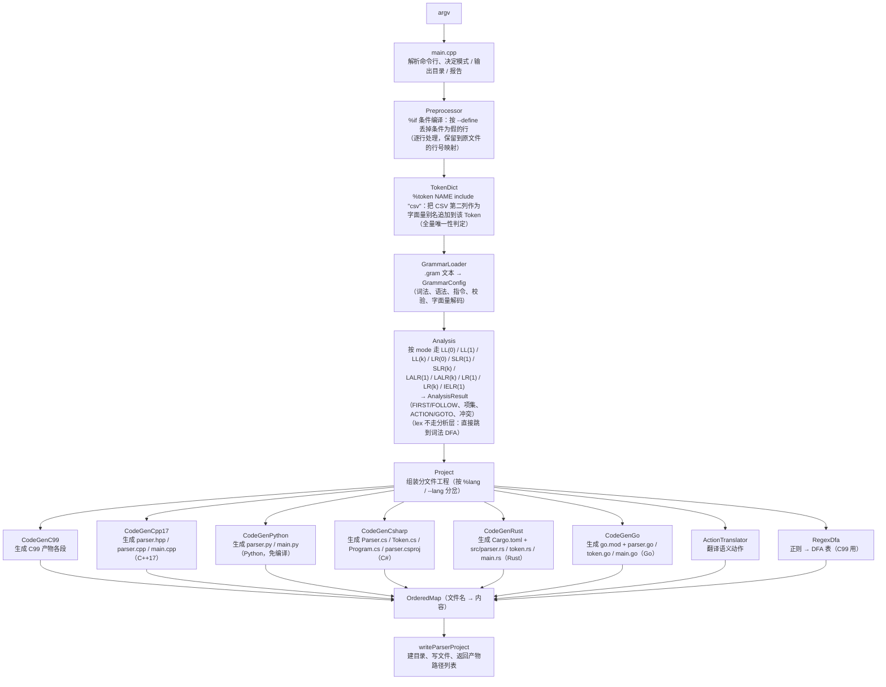

# 01 Overall Architecture

> This is the English edition. The Chinese edition is the default and is the one maintained first — see [中文文档](../README.md)。

The combination constraints of languages and modes, and the unified scope of the incremental API, are described in [12 Support Matrix](../15-language-mode-support.md).

## 1. Pipeline

A single generation run is a straight-line pipeline with no reverse dependencies:

Key points:

- **Everything is computed at generation time**: FIRST/FOLLOW sets, the item set family, ACTION/GOTO, and the regex DFA are all computed in C++; the generated artifacts depend neither on the generator nor on `source/templates/` at runtime.
- **Templates are inlined at build time**: `tools/embed_templates.py` turns the templates under `source/templates/` (**377 files, all `.tmpl`**) into a string table in `source/src/templates_data.cpp`, which is then linked into the executable; see [`07-codegen.md`](../07-codegen.md) for details.
- **Six language backends**: the default target is C++17 (`code_gen_cpp17.cpp` + `source/templates/cpp17_*`), `--lang c` uses the C99 backend (`code_gen_c99.cpp` + `source/templates/c99_*.tmpl`), `--lang python` uses the Python backend (`code_gen_python.cpp` + `source/templates/python_*`), `--lang csharp` uses the C# backend (`code_gen_csharp.cpp` + `source/templates/csharp_*`), `--lang rust` uses the Rust backend (`code_gen_rust.cpp` + `source/templates/rust_*`), and `--lang go` uses the Go backend (`code_gen_go.cpp` + `source/templates/go_*`).
  The six share no
  templates; they only reuse the generation-time results at the layers of "analysis table / lexical DFA / semantic action translation"
  (`ActionTranslator` switches dialects by target language: Python uses `python` (`$$` / `$n` translated to
  `result.value` / `values[...]`, plus `and` / `or` / `not` and no trailing semicolons), C# uses `csharpStyle`,
  Rust uses `rustStyle`, and Go uses `goStyle` (the latter three likewise use `values[...]` indexing and statements with semicolons,
  differing in the recovery functions and error-site information: C# uses `yyErrOk()` / `yyClearIn()`, Rust uses
  `self.yy_err_ok()` / `self.current_line()`, and Go uses `p.YyErrOk()` / `p.CurrentLine()`)).
- **The output artifacts are self-contained projects**: C99 depends only on libc and `libm`; C++17 depends only on the standard library and `libm`;
  the Python artifacts are just `parser.py` / `main.py` (plus files from `%mermaid` / `%copy`),
  requiring no compilation and generating no `Makefile` / `CMakeLists.txt`; the C# artifacts use only their own language's
  standard library, and the directory contains `Parser.cs` / `Token.cs` / `Program.cs` / `parser.csproj`;
  the Rust artifacts are a Cargo project (`Cargo.toml` + `src/parser.rs` / `token.rs` / `main.rs`),
  where computation uses only the standard library while **the lexical regex relies on the official `regex` crate** (the only third-party dependency for this target);
  the Go artifacts are a Go module (`go.mod` + `parser.go` / `token.go` / `main.go`), where all three `.go`
  files are `package main` and **only the standard library is used** (lexical regex uses the standard-library `regexp`, with no third-party dependency).

## 2. Generator Directory

The entry point, grammar loading, analysis, code generation, and output templates under `source/` make up the generator proper:

| Path | Responsibility |
| --- | --- |
| `source/src/main.cpp` | CLI entry point and argument parsing |
| `source/src/preprocessor.cpp`, `token_dict.cpp`, `grammar_loader.cpp` | Conditional compilation, token dictionary expansion, and grammar loading |
| `source/src/analysis*.cpp` | Mode analysis for LL, LR, GLR, Earley, CYK, etc. |
| `source/src/code_gen*.cpp`, `project.cpp` | Target-language code generation and project assembly |
| `source/templates/` | All output artifact templates |
| `source/include/ParseEngine/` | Data models and public interfaces |
| `` | Topic-specific documentation for the generator |

For the ownership of the other projects and add-on libraries in the repository, see [Repository Overview](../01-overview.md).

## 3. Module Responsibilities

### Entry Point and Core Data Models

| Module | Main types / functions | Responsibility |
| --- | --- | --- |
| `source/src/main.cpp` | `CommandLine`, `printUsage`, `main` | Parses `--grammar-file` / `--out-dir` / `--mode` / `--lang` / `--class` / `--teach` / `--no-teach` / `--mermaid` / `--no-mermaid` / `--report` / `--full-report` / `--dump-*`; the command line overrides `%mode` / `%lang` / `%class` / `%teach` / `%mermaid`, and the target language defaults to `cpp17`; `--class` applies only to Python artifacts and `%namespace` only to C++17 artifacts, and a mismatch is reported before generation begins |
| `source/include/ParseEngine/error.hpp` | `Error`, `fail`, `fatalInternal` | The generator's error value (message + original file line number) and the "internal error" fallback; the error slot shared by all failure paths |
| `source/include/ParseEngine/grammar_types.hpp` | `OrderedMap`, `Grammar`, `Production`, `PriorityConfig`, `LexSpec`, `CopySpec`, `GrammarConfig` | Pure data model, independent of other modules |
| `source/src/grammar_loader.cpp` | `GrammarLoader`, the internal `GramParser` | `.gram` lexical/syntactic parsing, directive handling, all generation-time validation, and literal and regex decoding; `%class` is validated against identifier rules plus the Python keyword table, `%lang` accepts `c` / `cpp17` / `python` / `csharp` / `rust` / `go` / `gram`, and it parses the C# / Rust / Go `%package` / `%import` / `%class_body … %endbody` |
| `source/src/preprocessor.cpp` | `Preprocessor`, `runConditions` | `%if` / `%elif` / `%else` / `%endif` conditional compilation: processed line by line **before the grammar is parsed**, dropping whole lines whose condition is false (without even parsing them), and keeping a "processed line number → original file line number" mapping for error localization; conditional expressions recognize only `\|\|` / `&&` / `!` / parentheses / variable names, with values coming from `--define` |
| `source/src/token_dict.cpp` | `TokenDict`, `TokenDictExpandResult` | `%token NAME include "csv"` expansion: a single plain-text transformation run **after** `Preprocessor` and **before** `GrammarLoader` — it reads the CSV (taking only rows whose first column equals that token name), appends the second column as a **literal** to that token's alias list, and merges them into one `%token NAME "a\|b\|c"` declaration; alias uniqueness is enforced here by a **single full scan** (dedup within a token / error on duplicates across tokens / error on collision with an already-declared token name). It does no regex and creates no new tokens |

### Analysis and Action Translation

| Module | Main types / functions | Responsibility |
| --- | --- | --- |
| `source/src/analysis*.cpp` | `Analysis`, `AnalysisResult`, `LrItem` / `Lr1Item` / `LrAction` / `LrConflict` / `LrResolution` | Eleven analyses (LL(0) / LL(1) / LL(k) / LR(0) / SLR(1) / SLR(k) / LALR(1) / LALR(k) / LR(1) / LR(k) / IELR(1)), conflict resolution, and report rendering (LR(0) and SLR share the LR(0) item set construction; LR(1) and LALR / IELR share the canonical LR(1) construction; `analysis_lrk.cpp` generalizes "one lookahead" into a k-tuple, with LALR(k) / SLR(k) / LL(k) each hooked onto the classic routes; `lr0` / `lr1` / `lrk` always permit unresolved conflicts with no switch needed, while `slr` / `lalr` / `ielr` / `lalrk` permit them only under `%teach` / `--teach`); see [`06-analysis.md`](../06-analysis.md) |
| `source/src/action_translator.cpp` | `ActionTranslator`, `ExprNode`, `translateAction` | Parsing (Pratt) of actions like `{ $$ = $1 + $3; }` and their translation to C expressions; passing `python` at construction switches to the Python dialect (`$$` → `result.value`, `$n` → `values[n-1]`, `and` / `or` / `not`, no trailing semicolons on statements, and the recovery function written as `self._yy_err_ok()`), while passing `csharpStyle` switches to the C# dialect (likewise `values[...]` indexing, but statements carry semicolons, the recovery functions are `yyErrOk();` / `yyClearIn();`, and type constructors like `int32(x)` map to C# built-in types; the last parameter is defaulted, so the C / C++17 / Python call sites are unchanged) |
| `source/src/regex_dfa.cpp` | `RegexNode`, `DfaProgram`, `CompiledRegex` | Regex literal → NFA → subset construction → minimized DFA, and DFA table generation |

### Code Generation Backends

| Module | Main types / functions | Responsibility |
| --- | --- | --- |
| `source/src/code_gen_c99.cpp` | `CodeGenC99` | Text generation for each fragment of the C99 artifacts; the branches for `%tree` / the semantic value type (`%value_type` / `%union`) are all assembled here |
| `source/src/code_gen.cpp` | `CodeGen` | The small shared portion across backends: `actionCases()` (C99 / C++17 / Python), `destructorSymbolGroups()` (C99 / C++17), the section markers `sectionMarker()` / `extractSection()`, `resolveLineDirectives()`, and the two `#line` placeholders |
| `source/src/code_gen_cpp17.cpp` | `CodeGenCpp17` | C++17 artifact generation: namespace `Parser` (changeable via `%namespace`), `class Engine` + d-pointer, `std::string_view` / `std::vector` / `std::unique_ptr`, and the analysis table re-laid-out as `inline constexpr`; **custom allocators are not supported** |
| `source/src/code_gen_python.cpp` | `CodeGenPython` | Python artifact generation: module-level constants / `Token` / `Tree` / `ParserError` plus one ordinary class (`%class` / `--class` changes the class name, defaulting to `Parser`), with `run_text` / `run` / `parse_tree` + `_apply_action`; it supports `%code ... %endcode` user code and rejects C-only constructs like `%value_type` / `%union` / `%namespace` at generation time |
| `source/src/code_gen_csharp.cpp` | `CodeGenCsharp` | C# artifact generation: `Parser.cs` / `Token.cs` / `Program.cs` / `parser.csproj` (type names capitalized, `namespace` / `using` / `List` / `Dictionary`); the entry class is named `Program` (C# does not allow a member name to equal the class name); `%package` / `%import` / `%class_body` take effect only in this backend |
| `source/src/code_gen_rust.cpp` | `CodeGenRust` | Rust artifact generation: a Cargo project (`Cargo.toml` + `src/parser.rs` / `token.rs` / `main.rs`), where computation uses only the standard library; semantic values are copied by value (requiring `Copy + Default + Debug`), and `%union` becomes a `ParserValue` with `derive`; **lexical regex uses the official `regex` crate** (there is no DFA table in the artifacts — the patterns are handed to it as-is, each compiled once inside a `OnceLock`); `%package` (crate name) / `%import` / `%class_body` take effect, while **`%destructor` is not supported** (relying on ownership reclamation) |
| `source/src/code_gen_go.cpp` | `CodeGenGo` | Go artifact generation: a Go module (`go.mod` + `parser.go` / `token.go` / `main.go`, where all three `.go` files are `package main`), using **only the standard library**; semantic values are copied by value (defaulting to `int64`), and `%union` becomes `type ParserValue struct { … }` (members are written as in C, e.g. `int64 ival;`, and the generator assembles them into Go field syntax); **lexical regex uses the standard-library `regexp`** (there is no DFA table; when no regex is written, even `regexp` is not imported — Go treats "imported and not used" as a hard error); `%package` (module path, with `::` normalized to `/`) / `%import` (`::` as the path separator, skipping packages that duplicate the standard library) / `%class_body` (a set of `func (p *Parser) …` methods) take effect, while **`%destructor` is not supported** (reclaimed by the GC) |

### Project Assembly, Directive Table, and Diagrams

| Module | Main types / functions | Responsibility |
| --- | --- | --- |
| `source/src/project.cpp` | `Project`, `ProjectRequest`, `k_projectFiles` | Determines the artifact list, dispatches by target language to `CodeGen` (C99) / `CodeGenCpp17` (C++17) / `CodeGenPython` (Python) / `CodeGenCsharp` (C#) / `CodeGenRust` (Rust) / `CodeGenGo` (Go) to assemble the files, renames artifact files according to `%namespace`, and writes out the directory; when `ProjectRequest::mermaid` is true, it appends the `mermaid/*` of `Mermaid::projectFiles` to the list (independent of `teach`); `generatorResultMd` selects the "compile / run" and syntax-tree subsections of `RESULT.md` by target language, using `generatorCsharpResultMd` for C#, `generatorRustResultMd` for Rust, and `generatorGoResultMd` for Go |
| `source/src/grammar_loader.cpp` (directive table) | `GramParser`, `GramTokenizer` | Besides the existing directives, `%lang` accepts the seven values `c` / `cpp17` / `python` / `csharp` / `rust` / `go` / `gram` (defaulting to `cpp17`, with the command-line `--lang` taking precedence); the three directives `%package NAME` (a segmented identifier, joined by `.` or `::`), `%import NAME` (repeatable, with `*` allowed in the last segment; the Go backend allows a quoted import path), and `%class_body … %endbody` take effect only for **csharp / rust / go**: C# yields a file-level `namespace NAME;`, Rust yields the crate name and `use`, and Go yields the module path and import block of `go.mod` (`%class_body` follows the same scheme as `%code … %endcode`, i.e. "the two markers each occupy their own line and the body is collected verbatim") |
| `source/src/mermaid.cpp` | `Mermaid`, `MermaidDiagram` | State machine diagrams: draws the LR automaton (LR item sets + GOTO + ACTION) and the lexical DFA as a Mermaid `flowchart`, assembling a self-contained HTML page with its own CSS served over a CDN; controlled by the independent `%mermaid` / `--mermaid` switch, unrelated to teaching mode; see [`06-analysis.md`](../06-analysis.md) §5.4 |
| `source/src/utils.cpp` | `Utils` | `loadTemplate` (the inline table + `SCRIPT_ENGINE_TEMPLATES` override), `varCString`, `collapseBlankLines` |

## 4. Code Conventions

- The namespace is uniformly `ParseEngine`; internal implementations go in an anonymous namespace or an internal header under `source/src/`.
- Naming: classes use `PascalCase`; functions/variables use `camelCase`; class members use the `m_`
  prefix; constants use the `k_` prefix; statics/globals use the `s_` prefix.
- Comments use Doxygen (`@brief` / `@param` / `@retval`), consistent with the `Qt`-style naming.
- String concatenation uniformly goes through `OrderedMap` substitution and `std::string` appending, to avoid
  repeatedly constructing temporaries at generation time; `OrderedMap` uses a `vector` + linear search to guarantee insertion order (keeping artifact order stable).
- The generator **does not use exceptions** (buildable with `-fno-exceptions`): lower-level functions that can fail uniformly
  use "a `bool` return + a trailing `Error &` out-parameter", writing a Chinese message and line number into `Error`
  (`source/include/ParseEngine/error.hpp`) on error and returning immediately, with the caller propagating it upward as-is;
  `main` checks only once at each call site, uniformly printing `错误：...` and exiting with a non-zero code.
- Only one "internal error" exit is kept: `fatalInternal()` (for situations that cannot happen by design, such as a missing
  inline template, mismatched section markers, or `OrderedMap::at` failing to find a key) prints and then terminates immediately,
  strictly separated from user input errors.

## 5. Threads and State

The generator is single-threaded and has no mutable global state: `GrammarLoader` / `Analysis` / `Project`
are all static methods or stack objects, and the only globals are the inline template table (read-only) and the template cache
(cached by name in the `SCRIPT_ENGINE_TEMPLATES` scenario). It can therefore generate multiple grammars consecutively within
a single process, although the CLI currently generates only one.
