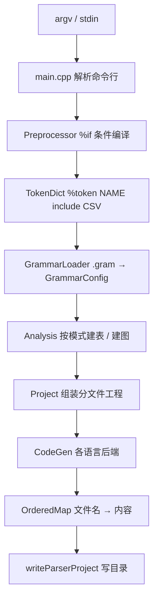

# One `.gram`, Eight Languages: The ParseEngine Story

> This is the English edition. The Chinese edition is the default and is the one maintained first — see [中文文档](../README.md)。

> This is a technical story about ParseEngine, not a user manual. The current grammar
> specification, mode coverage and language boundaries are governed by
> [`doc/`](../README.md) (especially [12 Support Matrix](../15-language-mode-support.md))
> and [`source/README.md`](../../source/README.md). For a longer fictional side story, read
> [02 Max-Level Grammar](../02-gram-legend.md).

## 1. The result first: sixteen modes, eight languages, plus one export profile

What ParseEngine does can be said in one sentence: **it takes in a `.gram` and spits out a parser project that compiles and runs.**
But behind that sentence unfolds a rather wide map.

The same grammar can be generated in sixteen modes:

- LL family: `ll0` / `ll1` / `llk`;
- LR family: `lr0` / `slr` / `slrk` / `lalr` / `lalrk` / `lr1` / `lrk` / `ielr`;
- Chart and multi-path: `glr` / `earley` / `cyk`;
- Backtracking recursive descent `dd`;
- `lex`, which exports only the lexer.

The same analysis result can be landed as a project in eight languages: C99, C++17, Python, C#, Rust, Go,
plus the narrow Java and JS-TS backends that support only `dd` / `earley` / `cyk`; besides these there is
a `--lang gram` export profile—it generates no parser, only writing the grammar source file and the analysis report into `RESULT.md`,
so all sixteen modes can be "exported" once for a human to inspect.

The default is `--lang cpp17 --mode ielr`: a grammar goes in, a C++17 project comes out. The command-line
`--lang` / `--mode` override the `%lang` / `%mode` in the grammar; whichever is written out explicitly on the command line has the final say.

## 2. A straight-line pipeline: from argv to the output directory

One generation run is a straight line with no turning back; each stop just passes its result on to the next:



`%if` conditional compilation is processed line by line **before parsing**, yet the mapping back to the original file's line numbers is preserved—so when an error is reported,
it still points at the line the user wrote. `%token NAME include "csv"` is expanded after preprocessing and before grammar loading:
the second column of the CSV is read as a literal alias and appended to that Token, and a full uniqueness check is performed. The reason for ordering these steps is plain:
**the earlier and the closer to the original file an error is reported, the easier it is to fix.**

## 3. Everything is computed at generation time

FIRST / FOLLOW, the canonical item-set family, LALR's merging of states with the same core, IELR's splitting and re-merging,
the ACTION / GOTO tables, and the conversion of lexical regexes to a DFA are all computed inside the generator process. The output artifacts do not depend on the
generator at run time, nor on `source/templates/`—delete that whole directory and the already-generated parser still runs.

This principle buys two things:

- **The output artifacts are a self-contained project.** C99 depends only on libc and `libm`, C++17 depends only on the standard library and `libm`,
  the Python output artifacts are only `parser.py` / `main.py` (no `Makefile` / `CMakeLists.txt` is generated),
  C# uses `dotnet build`, Rust is a Cargo project (the only third-party dependency is the official `regex` crate used for lexing),
  Go is a module that uses only the standard library (lexing uses `regexp`), Java is a self-contained `Parser.java`,
  and JS is a `parser.ts` with erasable TypeScript type annotations (run directly by Node.js 22+).
- **Conflicts are laid bare at generation time.** Conflicts that cannot be resolved are written into the report's `[未消解冲突]`, and with `--teach` turned on,
  `[教学提示]` and `[教学对照]` are added as well; table entries are handled the yacc default way (a shift / reduce conflict takes the shift,
  a reduce / reduce conflict takes the earlier one). Modes like `lr0` / `lr1` that "mirror the textbook" can therefore be generated in full despite conflicts,
  laying both the automaton and the conflicts themselves out for a human to see.

## 4. Sixteen modes are not sixteen switches, but four temperaments

- The **LL family** walks downward by prediction sets; `llk` uses k-tuple lookahead; `ll0` is the plainest form.
- Within the **LR family**, `lr0` / `lr1` are canonical automata (`lr1` does not merge states with the same core), `slr` / `lalr`
  are the classic state-saving schemes, `slrk` / `lalrk` / `lrk` extend lookahead to k-tuples (k takes 1..3, default 2,
  and for k=1 they equal `slr` / `lalr` / `lr1` respectively), and `ielr` is the default tier: it achieves
  LR(1) recognition power at LALR scale.
- **GLR / Earley / CYK** handle the fact that "one input can have many trees": GLR goes through GSS multi-path,
  Earley goes through chart predict / scan / complete, and CYK first converts the grammar to CNF, decides with a span table, then
  recovers the parse tree according to the original grammar.
- **`dd` and `lex`** are the two extremes: `dd` builds no tables and directly generates a backtracking recursive
  descent function for every non-terminal following the grammar; `lex` produces only a lexer, with not even an analysis stack.

Modes and languages are not paired arbitrarily: C99 offers 13 (no GLR / Earley / CYK runtime),
C++17 / Python / C# / Rust / Go each offer 16, Java and JS support only `dd` / `earley` / `cyk`,
and the `gram` export profile can export all sixteen. This matrix is maintained centrally by
[`15`](../15-language-mode-support.md); in the code it is guarded jointly by
`Project::generateParserProject` and the mode classification in `analysis.cpp`.

## 5. Eight languages, semantics aligned as closely as possible

For the same grammar and the same input, the output of the C99 / C++17 / Python tiers (including error-message text) is identical word for word;
C# uses platform CRLF line endings on Windows, normalized before comparison. Rust's and Go's line and column numbers also match C.

But "the same semantics" does not mean "the same templates". The six full backends each have their own directory and file shape:

| Target | Output artifacts |
| --- | --- |
| C99 | `parser.h` / `parser.c` / `parser_token.{h,c}` / `parser_table.c` / `main.c` / `parser_user.h` |
| C++17 | `parser.hpp` / `parser.cpp` / `main.cpp` / `parser_user.h` (default namespace `Parser`) |
| Python | `parser.py` / `main.py` |
| C# | `Parser.cs` / `Token.cs` / `Program.cs` / `parser.csproj` |
| Rust | `Cargo.toml` + `src/parser.rs` / `token.rs` / `main.rs` |
| Go | `go.mod` + `parser.go` / `token.go` / `main.go` |
| Java | `Parser.java` (narrow backend) |
| JS/TS | `parser.ts` + `package.json` (narrow backend, erasable type annotations) |

The C++17 output artifacts are not the C artifacts stuffed into `.cpp`: it has another backend, another set of templates, and the entry point is
`Engine engine; engine.runText(...)`, but a thin C-name compatibility layer is kept in the namespace,
so `Parser_RunText(...)` in older examples still works. User files are never touched: the `parser_user.h` generated by
`%code ... %endcode` and the files copied in by `%copy` keep their original names and contents—`%code` can only be on a line by itself,
and the old `%{{ ... }}%` is disabled and reports a migration error.

## 6. 384 templates, and a decision to "accept only one format"

Every piece of every output artifact lives in `source/templates/`: **384 files, all in the template-engine format `.tmpl`**
(`.template` is now down to zero); even purely static snippets go through the engine—not only because they must pass through the engine once to strip the file-header
`{# … #}` description block, but also because it turns "templates have only one way to be read" into a hard constraint.

C99 50 / C++17 68 / Python 51 / C# 49 / Rust 53 / Go 55 / Java 2 / JS 3,
plus 3 shared `code_gen_*` snippets, 8 build scripts, 1 `RESULT.md`,
21 `result_*.md` snippets and 20 `mermaid_*` templates. The format supports
`{{ 变量 }}` / `` / `` / `` / `{# 注释 #}` / `…`;
the generator always calls `tmpl::renderValues` / `renderValueTemplate` to fetch values; for example,
`code_gen_action_cases.cpp.tmpl` uses an object array + `` to generate each production's
`case Nu: { … break; }` semantic action branch.

At build time, `tools/embed_templates.py` sorts these files by filename and generates the
`R"PGX(...)PGX"` string table in `source/src/templates_data.cpp`; at run time,
`Utils::loadTemplate` looks up the inline table first, then honors a disk override via `SCRIPT_ENGINE_TEMPLATES=<directory>`—
so during development you can change a template without re-inlining. Pitfall notes are also kept in the doc: when the output artifacts need to write the target language's own `{{` / `}}`,
they must be wrapped in ``; putting `` on the same line as content drops one newline between rounds.

## 7. Semantic actions must be translated, not copied

`ActionTranslator` translates the `$$` / `$n` and language dialect in the grammar into the target language's spelling:
Python becomes `result.value` / `values[...]`, booleans become `and` / `or` / `not` and semicolons are dropped;
C# / Rust / Go likewise use `values[...]` subscripting and keep semicolons in statements, the difference lying in the call shape for error recovery
(C# is `yyErrOk()` / `yyClearIn()`, Rust is `self.yy_err_ok()` / `self.current_line()`,
Go is `p.YyErrOk()` / `p.CurrentLine()`).

So "the same grammar with a different `--lang`" is not copy-paste: **the analysis tables are reused, and the semantic actions are re-landed per target language**.
This is also why the same grammar can produce word-for-word identical output across the C99 / C++17 / Python tiers—
what is reused is the algorithms and the specification, what is translated is every line of the user's action.

## 8. Incremental parsing: only two tiers, with clearly drawn boundaries

Incremental parsing means **the generated parser handling modifications to the input text**, not Make / CMake / Cargo incremental builds.
Currently only C++17 and Rust provide this API:

- **LL / DD**: conservative cache. If the text has not changed, the previous state, semantic results, errors and `%commit` fragments are reused;
  if the text changes at all, everything is recomputed in full.
- **Deterministic LR**: token cache + prefix checkpoints. By default an LR stack snapshot is saved every 32 tokens
  (the interval is configurable; 0 means disabled); after the text changes, recovery starts from the nearest checkpoint within the common token prefix
  and only the suffix is re-run; if recovery fails it falls back to a full parse.
- **The GLR family (including Earley / CYK)**: experimental cache. The default policy is
  `GlrSemanticReusePolicy::Disabled`—semantic actions run as usual every time; only when the caller explicitly declares
  `Pure`, and neither the text nor the semantic-environment version has changed, is reuse of a successful non-tree-mode result allowed.

The GLR family's packed forest also supports parent-dependent transitive invalidation, stable node ID reuse, span remapping and
local patching: nodes are unique by `(symbol, start, end)`, `alternatives` keep the ambiguous candidates,
and a node's `id` is not reused before `clear()`. The `clear()` retention policy matches the current version; after switching from `Disabled`
to `Pure`, one recomputation is done first. **These semantic responsibilities are explicitly the caller's**: file IO, process spawning,
logging and mutable symbol-table writes should not be declared pure.

## 9. Output artifacts clean up after themselves: `.parseengine-manifest`

A generated project maintains a `.parseengine-manifest` in the output directory: on regeneration, old files that were registered by the previous version
but are no longer produced by this version are deleted, and unknown files are always kept. If the manifest contains an absolute path, `..`,
the reserved manifest name itself, or a path that passes through a symlinked parent directory, it must be rejected—**deleting files must not rely on guessing.**

To reclaim everything at once, run the maintenance command:

```bash
ParseEngine clear --out-dir 目录     # 等价于 --mode clear
```

`clear` **does not read the grammar**; it only deletes the artifacts registered in the manifest and the directories that thereby become empty, so it does not count toward the sixteen
analysis modes; when changing this chain, run `python tests/clear_mode.py`, which specifically verifies counterexamples such as "regenerating with a different language
deletes the old artifacts" and "the user's own files are left to the user".

## 10. Seeing the intermediate process: reports and diagrams

When you cannot make sense of the generated result, ParseEngine lets you print out the intermediate layers directly:

- `--report 文件` saves the grammar analysis report as UTF-8 text;
- `--dump-lr-automaton` prints LR states, item sets and transitions; `--dump-slr-tables` prints the ACTION / GOTO tables;
- `%mermaid` / `--mermaid` adds a self-contained set of `mermaid/` state-machine diagrams to the output artifacts
  (overview page + grammar automaton + lexical DFA), while `--dump-mermaid` prints them straight to standard output;
- `--preprocess-only` runs only `%if` conditional compilation and prints the processed text and line-number mapping;
- `--syntax-only` forces the syntax tree on, ignoring semantic actions and user code, for Token / syntax-tree visualization.

These switches make "what the generator is thinking" inspectable, rather than something you can only guess at from an error message.

## 11. Rules left behind by survival mode

1. Whatever can be computed at generation time is never left to run time—FIRST / FOLLOW, item sets, tables and DFAs alike.
2. Output artifacts must be self-contained: move to another machine, delete the template directory, and the generated parser still compiles.
3. The stage order matters: preprocessing → token-table expansion → grammar loading → analysis → assembly; every step keeps line numbers.
4. The restrictions on language × mode combinations must live in a single matrix, not be stated separately, scattered across the backends.
5. Command-line `--lang` / `--mode` override the grammar's `%lang` / `%mode`; whoever is written explicitly wins.
6. The eight languages share the analysis result, but semantic actions must be translated per target language, not copy-pasted.
7. Templates keep only one format; shared snippets also go into templates—do not write them back as C++ string literals.
8. Deleting output artifacts may only follow the manifest; user files outside the manifest must be kept.
9. The maintenance command (`clear`) does not read the grammar, and should not be crammed into the mode list to make up numbers.
10. Incrementality only for C++17 / Rust; the semantic responsibility of the caching policy is explicitly handed to the caller, with a disabled rather than optimistic default.
11. The intermediate process must be printable: automata, tables, preprocessing results and Mermaid diagrams are all debugging entry points.
12. The acceptance criterion is not "code was generated" but that the output artifacts actually compile, actually run, and actually line up across targets.

## 12. Epilogue: one grammar, many maps

ParseEngine's size comes from one decision—"do not hard-code the boundaries": the analysis layer knows only grammars and modes, the code generation layer
each manages one tier of language, and the two meet through `AnalysisResult` and the output-artifact templates. So adding a mode touches only the analysis layer and the
report; adding a language touches only one backend and one set of templates—Java and JS even need only two narrow backends,
and they cover the three things most in need of "seeing the result first": `dd` / `earley` / `cyk`.

It still guards a few clear boundaries: unsupported modes are explicitly rejected at the generation stage, rather than quietly generating half of something;
Rust's semantic values require `Copy + Default + Debug`; `%destructor` in Rust / Go is taken over by ownership and the GC;
GLR / Earley / CYK do not support `error` productions or `%destructor`; the Rust tier's
lexical regex depends on the official `regex` crate, while the Go tier insists on using only the standard library. These boundaries, like its capabilities,
are all written in [`15`](../15-language-mode-support.md).

So what this story most wants to say is: **translating "one grammar" into projects in eight languages relies not on eightfold repetition,
but on cutting the generation stage, the analysis layer and the output-artifact templates apart cleanly.** Once they are cut apart cleanly, a sixteenth mode, a ninth language,
are just one more stop added to this straight-line pipeline.
