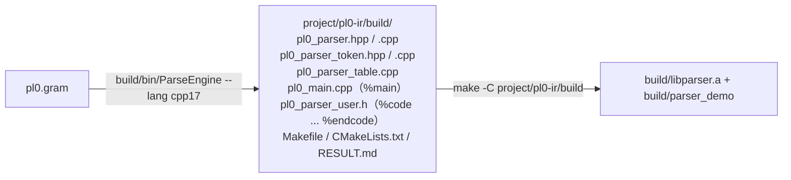

> This is the English edition. The Chinese edition is the default and is the one maintained first — see [中文文档](../README.md)。

# 08 Complete Project Example: From Grammar to a Runnable Program

[`project/pl0-ir/`](../../project/pl0-ir/) is a **complete C++17 project**: it uses ParseEngine
to generate a PL/0 parser, then uses it to compile PL/0 programs into **triples** or
**quadruples**. It is a minimal working sample of how "a generator + user semantic handling" combine into a real project —
the generator itself was not changed at all.

The project targets only the **C++17 output artifacts** (`--lang cpp17`): the usage of `%namespace pl0`, `%main` / `%epilogue`,
and the `Makefile` build all follow C++17, and it does not promise that the C99 / Python backends run as well.

## 1. Project Structure

```
project/pl0-ir/
├── pl0.gram                    完整 PL/0 文法 + 三元式生成
├── pl0_quads.gram              完整 PL/0 文法 + 四元式生成
├── Makefile                    make（生成+编译） / run / check / quads / run-quads / clean
├── check.sh                    跑全部样例并比对期望输出
├── samples/*.pl0               9 个正常样例
├── samples-error/*.pl0         13 个出错样例
├── expected/*.triples          正常样例的期望三元式（已人工核对）
├── expected-error/*.txt        出错样例的期望报错首行
├── build/                      三元式产物的生成与编译结果（.gitignore 忽略）
└── build-quads/                四元式产物的生成与编译结果（.gitignore 忽略）
```

Build chain (`make -C project/pl0-ir`):



## 2. Grammar Design: Complete PL/0

Covers the full Wirth PL/0 syntax:

| Part | Production shape | Description |
| --- | --- | --- |
| Program | `program := block DOT` | Terminated by `.` |
| Block | `block := const_part var_part proc_part stmt` | All three declaration sections may be empty, and the statement may be empty too |
| Constant declaration | `const_item := VARIABLE EQ NUMBER` | Accepts only integer literals, registers them in the symbol table and folds them directly in expressions |
| Variable declaration | `var_list := VARIABLE \| var_list COMMA VARIABLE` | Registered in the current scope |
| Procedure declaration | `proc_decl := proc_head block SEMI`, `proc_head := PROCEDURE VARIABLE SEMI` | **Nestable**; PL/0 procedures have no parameters |
| Statement | assignment / `call` / `begin…end` / `if…then` / `while…do` / `read` / `write` / **empty** | Statements are separated by `;`; `statement` may be empty |
| Condition | `odd expr` or `expr relop expr` | `relop` produces an "operator code" semantic value |
| Expression | `expr := term \| expr ± term`, `term := factor \| term ×÷ factor` | Left-recursive, left to LALR |
| Factor | variable / number / `( expr )` / unary `+` `-` | |
| Lexical | `%identifier` + `%define` | Keywords and operators use fixed literals; longest match lets `:=` `<=` `<>` win over single characters |

Three grammar details you only hit once you actually write it:

1. **You cannot list `WRITE LPAREN expr RPAREN` separately**: on `write ( expr )` it forms a genuine
   reduce/reduce conflict with `factor := LPAREN expr RPAREN` (an error is reported directly at generation time). And `write(x)`
   is already parsed as `WRITE expr` (`expr` being `(x)`), so that branch is not needed.
2. **Procedure declarations need a separate `proc_head`**: entering a procedure requires "register the procedure name + open a scope",
   and leaving it requires "close the scope + append endproc", but a semantic action in the action DSL can only be written at the end of a production
   (there is no mid-rule action), so the "enter" part goes into `proc_head := PROCEDURE VARIABLE SEMI { Pl0_BeginProc($2); }`.
3. **`statement` may be empty**, which makes `begin end` and `begin ; ; x := 1 end` both legal; under LALR there is no conflict
   (the empty statement reduces only on lookahead symbols such as `;` / `end` where the statement can only be empty).

**Not supported**: arrays (classic PL/0 has none), procedures with parameters (PL/0 has none) and `else`.

## 3. Semantic Value: a "Place", with Scope-Qualified Names

`ParserValue_T` is typedef'd by the user and **must be a POD**: the generated runtime `memset`s it as a whole
block (the semantic value stack, initial values and `error` placeholder values all need to be zeroed) and also copies it by value. So the semantic value holds only
`int`; names go into a name pool in `%epilogue`, and the place stores only indices:

```c++
typedef struct Pl0_Place_T
{
    int kind;   /* NONE / CONST / NAME / TEMP / LABEL / CODE */
    int value;  /* CONST：常量值；LABEL：标签号；CODE：算子码 */
    int index;  /* TEMP：三元式下标；NAME：名字池下标 */
} ParserValue_T;

static std::vector<std::string> g_pl0Names;   /* 名字池（去重） */
```

All dynamic data uses standard library containers in `%epilogue`: the name pool `std::vector<std::string>`,
the triple table `std::vector<Pl0_Triple_T>` (whose members are `std::string`), the symbol table
`std::vector<Pl0_Symbol_T>`, the scope stack `std::vector<Pl0_Scope_T>`,
the `while` label stack `std::vector<int>` and the current qualified-name prefix `std::string`. There are no fixed-size arrays,
no fixed limits (only memory), and no hand-written `char[]` buffers.

**Scopes** are implemented with a "stack-like array + qualified names" and no extra tree structure:

- The symbol table is just a `vector`; on entering a procedure the current `size()` is recorded, and on leaving it `resize` restores it
  — inner declarations disappear automatically;
- Lookup **scans from the tail backwards**, yielding the "nearest same-named symbol from inside out", which naturally supports shadowing;
- Only a duplicate name in the same scope reports a "duplicate declaration"; shadowing an outer one is allowed;
- The name that goes into a triple is the **qualified name**: `x` at the top level; `p.x` inside procedure p; `p.q.x` inside nested procedure p.q.

Two pitfalls related to "when to look up the table":

1. `PARSER_USER_TOKEN_VALUE` runs for **every shifted token**, including the names in `var x` / `procedure p`
   — at that point they are not yet in the symbol table. So the hook only records the lexeme text into the place, and lookup is deferred to
   where it is actually used (`Pl0_Resolve` / `Pl0_Assign` / `Pl0_Read` / `Pl0_Call`).
2. Lvalues and rvalues must be looked up separately: `Pl0_Resolve` handles rvalues (constant folding, erroring on a procedure name),
   and `Pl0_ResolveTarget` handles lvalues (a constant cannot be assigned, a procedure cannot be used as a variable). This way
   `const n = 1; n := 2` reports "cannot assign to a constant" instead of silently folding.

## 4. Triple Generation Rules

| Source | Generated |
| --- | --- |
| `x := e` | `(:=, <e 的操作数>, x)` |
| `a + b` / `-` / `*` / `/` | `(+, a, b)` etc., the result is a new temporary `(k)` |
| Arithmetic that is all constants | folded directly, no triple generated (`1 + 2 * 3` → `7`) |
| `-x` | `(neg, x, _)`; when `x` is a constant it folds to `-值` |
| `odd e` | `(odd, e, _)` |
| The six comparisons such as `a < b` | `(<, a, b)` |
| `if c then S` | after the condition's comparison/`odd`, `(jz, (c), L1)`, and after `S`, `(label, L1, _)` |
| `while c do S` | `(label, L0, _)` → condition → `(jz, (c), L1)` → `S` → `(j, _, L0)` → `(label, L1, _)` |
| `read x` / `? x` | `(read, _, x)` |
| `write e` / `! e` | `(write, e, _)` |
| `procedure p; …` | `(proc, p, _)` … `(endproc, p, _)` (when nested the name is `p.q`) |
| `call p` | `(call, p, _)` (a non-local procedure uses its qualified name) |

True/false exits use **named labels** (`L1` / `L2` …) rather than back-patched indices: triples already reference results
by "index", and mixing in a "jump to a future index" scheme would make them hard to read. The `while` start label is pushed onto a built-in small stack
(`Pl0_BeginWhile` pushes, `Pl0_EndWhile` pops), so nested loops also work correctly.

## 5. How the Three User-Code Sections Divide the Work

| Location | What goes there | Content |
| --- | --- | --- |
| `%code ... %endcode` (→ `pl0_parser_user.h`) | types, macros, declarations | `ParserValue_T`, the `PL0_*` operator codes, `PARSER_USER_TOKEN_VALUE`, helper function declarations |
| `%epilogue` (→ end of `pl0_parser.cpp`) | ordinary function definitions, static state | symbol table, triple table, comment stripping, all `Pl0_*` implementations |
| `%main` (→ `pl0_main.cpp`) | entry point | read `.pl0` → strip comments → `RunText` → print triples |

Two practical lessons:

- `%epilogue` is attached **outside** `namespace pl0`, and `%code ... %endcode` does not take part in the C++17 name
  rewriting, so do not write C-side names such as `ParserToken_T` in these two places; this project simply uses only
  fundamental types, and only the `PARSER_USER_TOKEN_VALUE` macro uses `TOKEN_NUMBER` / `TOKEN_VARIABLE` — it expands
  **inside** the namespace of `pl0_parser.cpp`, where those names resolve.
- **Comments are left for the lexer to skip**: two `%trivia` rules in the grammar (`\{[^}]*\}` and
  `\(\*([^*]|\*+[^)]+)*\*+\)`) are dropped on match; `%space` can only be configured with a whitespace character set and cannot do this.
  The benefit is that the parser itself (when called as a library via `Parser_RunText()`) understands comments, so the caller does not have to pre-strip
  the text; the `(* … *)` rule deliberately avoids a form like `\*+[^*)]` (which would generate a DFA that never accepts, see
  [`docs/09`](../12-grammar-usage.md#commit把识别但不进语法层的文本收进容器) and
  `pl0-ir/README.md`). An unterminated comment is still reported by the **read-only** `Pl0_CheckComments()`
  in `%main` as `注释没有闭合（{ 少一个 }）`.

## 6. Build, Run and Self-Check

```sh
make                       # 先在仓库根目录构建生成器
make -C project/pl0-ir            # 生成 + 编译（project/pl0-ir/build/parser_demo）
make -C project/pl0-ir run        # 用 samples/if_while.pl0 跑一遍
make -C project/pl0-ir check      # 9 个正常样例 + 13 个错误样例
make -C project/pl0-ir quads      # 四元式：生成 + 编译（build-quads/）
```

`check.sh` has two parts: normal samples must parse successfully, and their triples must match `expected/*.triples` line by line
(trailing `\r` is stripped before comparison, and Windows text-mode stdout shares the same expected files as Linux);
error samples must **exit non-zero**, and the first line of stderr must match `expected-error/*.txt`.

Test matrix (the points covered):

| Sample | Coverage |
| --- | --- |
| `expr` / `const` | assignment, parentheses, constant folding, temporary references |
| `if_while` / `odd` | conditions, loops, `odd`, `<>`, labels and jumps back |
| `proc` | procedure declaration, `call`, local variables and loops inside a procedure |
| `nested_proc` | nested procedures, declaring a procedure inside a procedure, same-name shadowing, non-local references (qualified names) |
| `ops` | all operators: the four arithmetic operations, unary plus/minus, parentheses, the six comparisons, the `#` alias, `odd 表达式` |
| `comments` | the two comment styles, empty statements, `?` / `!`, `read` / `read(x)` / `write` / `write(x)` |
| `torture` | an all-in-one: three levels of nested procedures (`outer.mid`) + recursive `call` + same-name shadowing + both comment styles + `?` / `!` + empty statements |
| 13 error samples | undeclared variable / duplicate declaration (variables and procedures) / assignment to a constant and `read` of a constant / procedure used as a variable / `call` of a variable / `call` of an undeclared procedure / constant division by zero / unterminated comment / constant rvalue that is not a number / two syntax errors (line and column reported back to `.pl0`) |

## 7. Known Limitations

- Arrays and procedures with parameters are not supported — PL/0 itself has neither; procedures communicate through outer variables
  (which is how `samples/proc.pl0` is written).
- There is no entry limit: the symbol table / triple table / `while` label stack are all `std::vector` (scope markers use
  `size()`), the name pool is `std::vector<std::string>` and the qualified-name prefix is `std::string`;
  the fixed limits such as 256 symbols / 1024 triples / 128 labels / 16 nesting levels are gone (details in §3).
- It does not generate target code, only produces triples; there is also no type checking (PL/0 has only integers).
- `read` / `write` only generate triples and do not simulate input/output; to see the running result you have to write a triple interpreter.
- It only covers the C++17 output artifacts; the C99 / Python backend conventions (such as `ParserToken_T` and how `parser_user.h` is included)
  are not specifically adapted.

## 8. If You Want to Copy This Project

1. First split the grammar into three sections — "declarations / rules / actions" — with actions only calling the helper functions declared in `%code ... %endcode`;
2. Choose a semantic value type such as a "place" from the start that can represent constants, variables, temporaries and labels at once, which saves a big rework later;
3. **Do not add an alternative form that is ambiguous with an existing branch** (this project's `write ( expr )` is an example): an error is
   reported directly at generation time as a reduce/reduce conflict, which is a good thing — it would be too late if you only found out at runtime;
4. `PARSER_USER_TOKEN_VALUE` runs for every token (including declarators), so do not put the "only-when-used"
   lookups / errors inside it;
5. Use `%namespace` to give the output artifacts their own namespace and prefix, so multiple parsers can be linked at the same time;
6. Finally write the entry point with `%main` and guard regressions with a `check.sh`-style approach of "normal samples + error samples + expected output".

## 9. Other Parser Project Examples

Everything earlier in this file is about `project/pl0-ir/`. Most example projects under `project/` use a unified
directory convention (`Makefile` + `check.sh` + `samples/` + `expected/` +
`samples-error/` + `expected-error/` + their own `README.md`); the two course-lab directories generate and
run separately according to their own READMEs. The main entry point is [`project/README.md`](../../project/README.md).

### C++17 Projects

| Project | What you learn |
| --- | --- |
| [`pl0-ir/`](../../project/pl0-ir/README.md) | How to write a complete front end: LALR + semantic actions producing intermediate code directly (triples / quadruples), scopes and symbol tables, `%trivia` comments, `#line` source location |
| [`mini-basic/`](../../project/mini-basic/README.md) | single-pass compilation + a stack VM: resolving expression ambiguity with `%left` / `%right` / `%prec`, using a mid-rule action to record a loop's start, `$line` error location |
| [`pl0-super/`](../../project/pl0-super/README.md) | two front ends for the same language: a generator-produced LALR(1) and a hand-written recursive descent; **no IR is built**, and simplified code emits target-machine assembly directly |
| [`bigint-calc/`](../../project/bigint-calc/README.md) | a **big-integer calculator**: the semantic value is directly `BigInt` from `library/big_number` (`%value_type bigint::BigInt`), and `2^10000` / `5000!` (16326 digits) / 4000-digit literals are all ordinary input; `%token regex` overrides the built-in NUMBER to bypass the int32 / double limits |

### Python Projects

| Project | What you learn |
| --- | --- |
| [`log-ir/`](../../project/log-ir/README.md) | compile-free artifacts as a script / AI interface: `%commit` hands comments out as data, and the position API feeds both output and errors |
| [`todo-scan/`](../../project/todo-scan/README.md) | the smallest one: `%mode lex` + `%commit`, scanning source into a Markdown report without writing a single production |

### DSLs and Multi-Target Code Generation

| Project | What you learn |
| --- | --- |
| [`protocol-dsl/`](../../project/protocol-dsl/README.md) | All three compilers (Python / C++17 / Rust) use ParseEngine to generate the binary-protocol DSL front end; the Python version outputs four codec variants plus documentation, and the two native versions output C++17 and `no_std` Rust respectively; it covers endianness, nested packets and dynamic byte strings |

### Course Labs

| Project | What you learn |
| --- | --- |
| [`lab_report_axhu/`](../../project/lab_report_axhu/README.md) | Three labs from the Compiler Principles course at Anhui Xinhua University: grammar type classification, PL/0 lexical analysis, PL/0 syntax analysis (LALR(1) + `error` recovery) |
| [`lab_report_nju/`](../../project/lab_report_nju/README.md) | Five labs of Compiler Principles at Nanjing University: strict C-- lexing and parsing, AST and semantic checks, quadruples, MIPS target code and optimization; includes five reports, lab guides, source and a one-click evidence script |

The first five projects above (`pl0-ir` / `mini-basic` / `pl0-super` / `log-ir` / `todo-scan`)
can all run `make -C project/<名字> check` directly;
`protocol-dsl/` can likewise run `make check` directly and compiles and runs all four generated codec variants;
`lab_report_axhu/` generates, compiles and runs lab by lab according to its own README; `lab_report_nju/` is
run from the repository root with `powershell -ExecutionPolicy Bypass -File project/lab_report_nju/run-evidence.ps1`.
