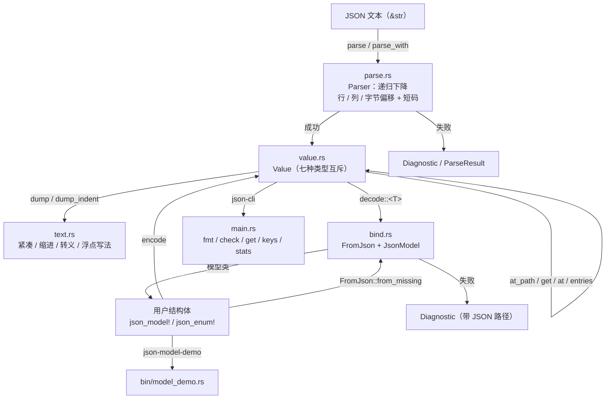

# JSON 库 · 技术报告（Rust 版）

> 本报告写的是 **`library/json-rust` 这个独立 Rust crate（`json`）**：数据模型、
> 解析器、序列化、模型投射的设计，与 C++ 版（`library/json`）的**逐项对照**，
> 自检怎么做的、实测结果如何，以及哪些事**明确不做**。
> 用法与快速开始见 [README.md](README.md)。
>
> 面向的读者：想知道「一个 JSON 库在 Rust 里该长什么样」的人——包括想照着改、
> 想对照 C++ 实现、想把它的做法搬到别处的人。

## 1. 目标与范围

**目标**：把 `library/json` 那一套语义（解析 / 序列化 / 可迭代容器 / 模型投射 /
带位置的诊断）**原样**搬到 Rust，**只用标准库**，并且做到「同一份输入，两版给出
同一个结果」——不是"看起来差不多"，而是逐条比过。

**做到什么程度**：

- 值模型：`null / bool / i64 / f64 / string / array / object` 七种互斥类型，
  **对象保序**（不是哈希表）；
- 解析：手写递归下降，UTF-8 + BOM，`\uXXXX` 与**代理对**，错误诊断带
  **行 / 列 / 字节偏移**与**短码**（12 个短码与 C++ 版逐字相同），
  可选支持注释与尾逗号；
- 序列化：紧凑 / 逐层缩进两种形态，转义规则与 C++ 版一致（非 ASCII 原样透传）；
- 容器：`Array = Vec<Value>`、`Object: Deref<Target = [Member]>`，
  标准迭代器适配器直接可用；`Value` 自身也可迭代（键 / 下标 / 值三样都给）；
- 路径查询：`a.b[0]` 语法，含空段 / 越界 / 未闭合等边界判定；
- 模型投射：`json_model!` + `json_enum!` + `encode` / `decode`，支持嵌套模型、
  `Vec`、`BTreeMap` / `HashMap`、`Option`、枚举、`Value` 透传，诊断带 **JSON 路径**；
- 命令行：`json-cli`（`fmt` / `check` / `get` / `keys` / `stats`），
  命令、选项、文案、退出码与 C++ 版一致；另有 `json-model-demo` 演示投射。

**明确不做**（不是待办）：

| 不做 | 说明 |
| --- | --- |
| 第三方依赖 | 不引 `serde` / `serde_json` / `regex`；写这个 crate 的意义之一就是"手写一遍" |
| 流式 / 零拷贝解析 | C++ 版是"整段文本进、整棵树出"，Rust 版照做。要流式该用别的库 |
| 数字精度扩展 | 不做任意精度（要那个请用 `library/big_number-rust`）；超出 `i64` 的整数退化成 `f64`，与 C++ 版一致 |
| 与 C++ 产物二进制兼容 | 只在**语义与文本**层面一致（浮点写法差一处，见 §7） |
| `unsafe` | `#![forbid(unsafe_code)]`；没有手写指针、没有 `transmute` |

## 2. 总体架构



模块与职责：

| 模块 | 职责 | 关键接口 |
| --- | --- | --- |
| `value.rs` | 值模型、对象保序容器、取值、路径、迭代、相等 | `Value` / `Object` / `Member` / `Entry` / `Error` |
| `parse.rs` | 递归下降解析、选项、诊断 | `parse` / `parse_with` / `ParseOptions` / `ParseResult` / `Diagnostic` |
| `text.rs` | 序列化 | `Value::dump` / `Value::dump_indent` / `Display` |
| `bind.rs` | 投射的方向与上下文 | `ToJson` / `FromJson` / `JsonModel` / `decode(_with)` / `encode` / `DecodeOptions` / `DecodeResult` / `Context` |
| `macros.rs` | 字段表与枚举的宏 | `json_model!` / `json_enum!` |
| `main.rs` / `bin/model_demo.rs` | 命令行与演示 | `json-cli` / `json-model-demo` |

**没有全局可变状态**：`Value`、`ParseOptions`、`Context`、`DecodeResult` 都是按值
传递的普通数据结构，同一个 `Value` 可以安全地并发读（`Value: Send + Sync`），
解析器与解码上下文都是"一次调用一份"。

## 3. 数据模型

```rust
pub enum Value {
    Null,
    Bool(bool),
    Int(i64),
    Double(f64),
    String(String),
    Array(Vec<Value>),
    Object(Object),
}

pub struct Member { pub key: String, pub value: Value }

pub struct Object { members: Vec<Member> }   // 保序；Deref 到 [Member]
```

三处值得说的取舍：

**3.1 七个变体 vs `std::variant`。** C++ 版用 `std::variant<Null, bool, int64_t,
double, string, Array, Object>`，`isNull()` 靠 `std::holds_alternative`、取值靠
`get_if` + `std::optional`。Rust 的 `enum` 是同一件事的语言级写法：模式匹配即
分派，**不需要用户自己写 `visit`**；`Null` 这个空结构体在这里换成了裸变体
`Value::Null`（不再需要"null 也算一个类型"的占位类型）。

**3.2 对象为什么还是 `Vec`。** 配置 / 报文这类场景成员不多，线性查找足够；
而**顺序本身是信息**：解析顺序 = 文件顺序、编码顺序 = 字段声明顺序、`for`
顺序 = 两者。用 `HashMap` 会把这三点一起丢掉，所以两版都选了 `Vec<Member>`。
`Deref<Target = [Member]>` 是 Rust 侧的加分项：`object[0]` / `object.len()` /
`object.iter()` / `object.first()` 都从切片来，不用手写一遍。

**3.3 相等是手写的。** `Value` 只 `impl PartialEq`（不 derive），规则与 C++ 版
`operator==` 逐条相同：

1. 两个数字按 `f64` 比 → `1 == 1.0`；
2. 类型不同就不等（`std::mem::discriminant` 对应 C++ 的 `variant::index()`）；
3. 数组逐元素比；**对象按成员集合比（顺序不影响相等）**；
4. 字符串、布尔按值比；剩下两个 `null` 相等。

`Eq` 不能实现（`f64` 不是 `Eq`），这也和 C++ 版"NaN 不等于自己"的行为一致。

**3.4 迭代把"键 / 下标 / 值"一起给出来。** C++ 版有个 `Value::Reference`
（`value` 指针 + `key` 视图 + `index`），配一个带缓存的手写迭代器，好处是
`for (auto& item : value)` 既能拿到值也能知道"这是哪个成员 / 第几个元素"。
Rust 版用 `Entry<'a>` / `EntryMut<'a>` 表达同一件事：

```rust
pub struct Entry<'a> { pub key: Option<&'a str>, pub index: Option<usize>, pub value: &'a Value }
```

- `key`：对象成员名；数组元素是 `None`（C++ 那边是空 `string_view`）。
- `index`：数组下标；对象成员是 `None`（C++ 那边是 `npos`）。
- 标量给空迭代器 —— 所以"写统计 / 格式化 / 校验"只写一套代码；
- `&Value` / `&mut Value` 都实现了 `IntoIterator`，所以 `for entry in &value`
  与 `for entry in &mut value` 都成立。可变迭代要把 `&mut Member` 拆成
  「只读的 key + 可写的 value」两个不相交借用（Rust 允许按字段拆，两行就够）。

## 4. 解析器

结构与 C++ 版一一对应：`skip_space` → `parse_value` → `parse_object` /
`parse_array` / `parse_string` / `parse_number` / `parse_literal`，
**遇错即停**，只留第一条诊断。

几个关键决定：

| 主题 | 做法 | 为什么 |
| --- | --- | --- |
| 输入表示 | `&str` → `text.as_bytes()` + 字节下标 | 行列、偏移、切片边界全部按**字节**算，与 C++ 版完全一致（自检里有列号=8 那种断言） |
| 数字 | 先收集 token，再 `str::parse::<i64>()`；失败退 `str::parse::<f64>()` | 对应 C++ 的 `from_chars` → `strtod`；超 `i64` 的大整数自动退化成浮点 |
| 字符串 | 先攒 `Vec<u8>`，遇到收尾引号再 `String::from_utf8` | 输入本身是合法 UTF-8、切点都在 ASCII 定界符上，所以一定成功；仍然留了失败分支（不给 panic 机会） |
| `\uXXXX` | 手动拼代理对（`0x10000 + (hi-0xD800)<<10 + (lo-0xDC00)`），再 `char::from_u32` | 与 C++ 的位运算逐字相同；**落单代理**（`"\udc00"`）在 Rust 里放不进 `String`，报 `bad-surrogate`（见 §7） |
| 注释 | `allow_comments` 时处理 `//` 与 `/* */`，未闭合报 `unterminated-comment` | 与 C++ 版相同；不开开关时 `/` 只是"不认识的字符" |
| 路径 | 不做正则、不做浮点 `from_chars` 的兼容层 | 与 C++ 版保持同一套边界行为 |

**短码表**（12 个，与 C++ 版逐字相同；自检逐个断言）：

```text
unexpected-end        内容在值之前就结束了
unexpected-token      JSON 值后面还有多余内容 / 这里只认 true / false / null / 不认识的字符
expected-key          对象的成员名必须是字符串
expected-colon        成员名后面要跟冒号
expected-comma        对象成员之间要有逗号 / 数组元素之间要有逗号
trailing-comma        末尾多了一个逗号（可用 --trailing-commas 允许）
bad-number            前导 0 / 小数点后面要有数字 / 指数后面要有数字 / 数字格式不对
unterminated-string   字符串没有闭合
control-char          字符串里出现了未转义的控制字符
bad-escape            \u 后面要跟 4 位十六进制 / 不认识的转义
bad-surrogate         高位代理后面缺少低位代理 / 低位代理不在 DC00..DFFF / 落单代理码点
unterminated-comment  块注释没有闭合
```

## 5. 序列化

`dump`（紧凑）/ `dump_indent(indent)`（`< 0` 紧凑、`0` 换行不缩进、`> 0` 每层
缩进），递归实现与 C++ 的 `dumpInto` 一行一行对得上：标量先写、空数组写 `[]`、
空对象写 `{}`、带缩进时冒号后加空格、成员之间逗号分隔。

**转义**：`"` / `\` / `\b` / `\f` / `\n` / `\r` / `\t` 用短转义，其余
`U+0000..U+001F` 写成 `\u00xx`（小写十六进制）；**非 ASCII 原样透传**。
C++ 是逐 `char` 扫字节，Rust 是逐 `char` 扫字符码点——对合法 UTF-8 输入两者
等价（转义集合只覆盖 ASCII），Rust 这边还顺带不可能产出半个码点。

**浮点写法**是唯一有实质差异的地方，见 §7.1：C++ 那套"17 位有效数字逐级缩短"
的循环（对 `f64` 而言第一轮就退出，于是永远印 17 位）在 Rust 这边换成了标准库的
**最短往返**写法，并补了一个"量级太极端就切指数"的判断以贴近 `%g` 的行为。
**这处差异的根在 C++ 的实现里，不在 Rust 这边**——详见 §7.1.1。

## 6. 模型投射：从成员指针到 trait

**C++ 的难处**：没有反射，所以由用户声明字段——`JSON_MODEL(T, json::field("x",
&T::x))` 展开成 `Binding<T>` 的显式特化，字段表是 `constexpr` 的 `tuple`，
编解码用 `std::apply` + 折叠表达式在编译期摊开，靠 `if constexpr` 区分
`optional` / 容器 / 枚举 / 嵌套模型。

**Rust 的对应**：trait + 宏。三个成员分工明确：

```rust
pub trait ToJson  { fn to_json(&self) -> Value; }

pub trait FromJson: Sized {
    fn from_json(value: &Value, ctx: &mut Context<'_>) -> Result<Self, ()>;
    // 字段缺席怎么办：缺省报 missing-field；Option<T> 覆盖成"置空且成功"
    fn from_missing(_out: &mut Self, ctx: &mut Context<'_>, name: &str) -> bool { … }
}

pub trait JsonModel: Default + Sized {
    fn field_names() -> &'static [&'static str];                        // strict_unknown 要用
    fn to_json_object(&self) -> Value;                                   // 模型 → 对象
    fn from_json_object(object: &Object, ctx: &mut Context<'_>) -> Result<Self, ()>;
}
```

`json_model!(Shape, "id" => id, "kind" => kind, …)` 展开出的就是上面三个
`impl` 里的**普通函数**：逐字段 `encode_field(&self.id)`、逐字段
`FromJson::from_json(value, ctx)` / `FromJson::from_missing(&mut out.kind, ctx, "kind")`。
于是：

- **不用成员指针**（Rust 没有那种东西，也不需要）；
- **不用 `if constexpr`**：`Option<T>` 的存在性判断变成了
  [`FromJson::from_missing`] 这个**可覆盖的缺省方法**——非可选类型走缺省实现
  报 `missing-field`，`Option<T>` 覆写成"置空并成功"。这正是 C++
  `if constexpr (!isOptional<MemberType>)` 那段在 Rust 里的等价物；
- **不需要运行期反射**：字段名与成员名在宏展开时就固定了，`strict_unknown`
  检查用 `field_names()` 这张静态表，只有 JSON 对象本身是线性查找。

被否掉的两种写法（都试过，记在这里免得下次再走）：

| 写法 | 否掉的原因 |
| --- | --- |
| `Field<T>` 结构体 + 函数指针表（最像 C++ 的成员指针表） | 闭包要降级成 `for<'a> fn(&mut T, Option<&Value>, &mut Context<'a>) -> bool` 这种高阶函数指针，宏生成时类型推断与生命周期很别扭；而且每个字段多一层间接调用 |
| `impl<T: JsonModel> ToJson for T` 这种"总括实现" | 与 `impl ToJson for bool` 之类的具体实现共存要靠一致性检查的"负推理"，边界情况容易踩；改成宏直接生成 `impl ToJson for Shape` 就没有这个问题 |

枚举：C++ 用 `std::is_enum` 对所有枚举统一分派，Rust 做不到（trait 实现不能
对"所有枚举"一键铺开），所以有了 `json_enum!(Kind, Line = 0, Polygon = 1)`——
顺带把变体名也记下来（`as_json_name()` / `from_json_name()`），并且给枚举一个
`Default`（第一个变体），这样模型才能 `#[derive(Default)]`。

**诊断与路径**：`Context` 负责"现在走到哪儿了"——进对象字段 `push_key`、进数组
元素 `push_index`，出来 `restore`；出错时把当前路径写进诊断。所以
`points[1].x` 这种路径是**自然长出来的**，不是事后拼的字符串。C++ 版用的是同一个
套路（RAII 前手工 save/restore），两版的诊断文案也一致：

```text
points[1].x: 期望整数，实际是 string [type-mismatch]
extra: 模型里没有字段 "extra" [unknown-field]
$: 期望对象，实际是 array [type-mismatch]
```

## 7. 与 C++ 版的逐项对照

### 7.1 有意的差异（两条）

| # | 项目 | C++ 版 | Rust 版 | 影响 |
| --- | --- | --- | --- | --- |
| 1 | 浮点写法（**差异的根在 C++ 的实现里**，见下面 7.1.1） | `formatDouble` 从 17 位有效数字逐级缩短（`%.*g` + `strtod` 回读），而 17 位必能往返 → 循环第一轮就退出，实际几乎总是印 17 位：`0.1` → `0.10000000000000001` | `format!("{}")` 直接给**最短且能往返**的那串：`0.1` → `0.1`；量级 `< 1e-4` 或 `>= 1e17` 时切指数写法（贴近 `%g`） | **值是同一个 `f64`**，两边产物都能原值解析回来；差别只在长短与可读性 |
| 2 | 落单代理（**Rust 字符串的固有约束**） | `"\udc00"` 会写出 `ED B0 80` 这几个**非法 UTF-8 字节** | 报 `bad-surrogate` 拒绝 | `String` 只能装合法 UTF-8，没有"装着非法字节的字符串"这种状态；只影响"输入本身非法"的情形，合法代理对（`"\ud83d\ude00"`）两版一致 |

`diff_with_cpp.py` 里把这两类单独归类（"浮点写法（值相同）"、"落单代理
（Rust 拒绝非法 UTF-8）"，外加"用法行的程序名"），除了它们之外**只要出现一条真差异
就退出码非 0**。平台层面的换行差异不算差异：Windows 上 C++ 的 stdout 是文本模式
（CRLF）、Rust 一律 LF，比对前先归一成 LF（`--out` 写文件时两边本来就都是 LF）。

#### 7.1.1 浮点那处的根在 C++ 侧：17 位收敛是它自己的实现产物

```cpp
// json.cpp：formatDouble
for (int precision = 17; precision >= 1; --precision) {
    std::snprintf(buffer, sizeof(buffer), "%.*g", precision, value);
    text = buffer;
    double reparsed = std::strtod(text.c_str(), &end);
    if ((end != nullptr) && (*end == '\0') && (reparsed == value)) break;   // ← 第一轮就命中
}
```

`f64` 有 53 位有效二进制位，**17 位十进制有效数字必定能唯一往返**（这是 IEEE-754
的十进制往返上界）。所以这个"逐级缩短"的循环在 `precision = 17` 那一轮就 `break`，
`0.1` 这种本来能写成 `0.1` 的值被印成 `0.10000000000000001` —— 更多位数、
更难读，而**信息量一点没多**（还是同一个 `f64`）。

Rust 版没有照抄这段：标准库 `format!("{}")`（以及 `{:e}`）给的就是
**最短且能往返**的那串，这是 Rust 格式化对浮点的语言级保证。要在 Rust 里复刻
C++ 的 17 位写法得手搓一个 `%g`（Rust 没有 `%g`：尾零消除、`-4 <= 指数 < 精度`
才用定点、指数至少两位……），收益却只是"跟一个更啰嗦的算法对齐字节"，
所以**这处差异留着**，并且按上面那样把账记在 C++ 那一侧，免得读者以为
Rust 版"算得不一样"。

> 顺带说明：`0.1` 那串 17 位输出**也是对的**（`strtod` 能原值读回），
> 两版的产物互相解析都不变；自检里既断言了"值相同"，也断言了各自的往返稳定。

### 7.2 顺手查出来的四个"宣传与行为不符"（Rust 版按实测对齐）

移植时逐条对照 C++ 版**实测行为**（不是注释里的说法），查出四处在文档里承诺、
实现里不成立的地方。Rust 版**没有照抄宣传，只照抄行为**，并在自检里钉住了：

| 位置 | 文档怎么说 | 实测行为 | Rust 版 |
| --- | --- | --- | --- |
| `json.hpp` 的 `atPath` 注释、`json/README.md` | "`[n]` 也可以直接跟在根上（`[0].name`）"、"路径语法是 `a.b[0].c`" | **`[n]` 之后不能再跟 `.`**：`tokens[1].name`、`a[0].b` 一律"路径不存在"（`[n]` 后面紧跟的 `.` 命中了"空段"规则） | 行为照搬（`get tokens[1].name` 两版输出一致），文档改成如实描述，自检里断言 `.is_none()` |
| `bind.hpp` 的 `DecodeOptions::enumAsString` | "编码枚举时用 `to_string`" | **这个字段从来没被读过**：`encode` 不接收选项、`decode` 也不看它（全仓只有声明与文档三处提到） | 不搬这个空开关；改成 `json_enum!` 生成的 `as_json_name()`，想按名字写就显式调 |
| `main.cpp` 的 `get` 分支 | `--compact` 是通用选项 | **`get` 不认 `--compact`**：它走的是 `dump(indent)`（缩进照旧） | 照搬（`get tokens[1] --compact` 两版同为缩进输出） |
| `main.cpp` 的分派顺序 | `-h` / `--help` 显示帮助 | 裸 `json --help` 会把 `--help` 当**命令名**（"不认识的命令"）；而且**先读输入再分派命令**，所以 stdin 为空时会先报解析错误 | 照搬（自检里两条都钉住了：`json-cli --help <文件>` → 2，`json-cli fmt --file --help` → 0） |

> 这几条都不是"Rust 版改了什么"，而是"**原版的行为与它自己的文档不一致**"。
> 没有把它们悄悄修掉，是因为这一步的任务是"同一个语义的两个实现"——修不修是
> 另一个决定，得由维护者拍板；真要修，两边一起改才谈得上一致。

### 7.3 逐项对照表

| 能力 | C++ 版 | Rust 版 | 一致性证据 |
| --- | --- | --- | --- |
| 解析 + 短码 + 行列 | `json.cpp` 的 `Parser` | `parse.rs` | 91 条语料里 55 条坏输入，短码与行列逐字相同 |
| 序列化 | `formatInt` / `formatDouble` / `escapeInto` / `dumpInto` | `text.rs` | 除 §7.1 第 1 条外逐字节相同 |
| 对象保序 / 查找 / 增删改 | `Object` 类 | `Object`（`Deref` 到 `[Member]`） | 自检逐条对应 `test_json.cpp` |
| 迭代 + STL 算法 | `Value::Reference` + 手写迭代器 | `Entry` / `entries()` / `IntoIterator` | 自检把 `count_if` 那批换成 `filter().count()` 等 |
| 路径查询 | `Value::atPath` | `Value::at_path` / `at_path_mut` | 含 §7.2 第 1 条的行为 |
| 投射 | `JSON_MODEL` + 成员指针 + `std::apply` | `json_model!` + trait | 字段顺序、诊断路径、往返稳定性逐条对应 |
| 命令行 | `main.cpp` | `main.rs` | 25 条命令 / 选项 / 错误分支，24 条逐字相同（第 25 条是程序名） |
| 投射演示 | `examples/model_demo.cpp` | `bin/model_demo.rs` | 输出逐行相同（同一份 `examples/config.json`） |
| 单元自检 | `test_json.cpp`（174 条断言） | `tests/*.rs`（52 个测试） | 期望字符串逐字相同；断言被拆成 `#[test]`，失败时直接点名 |

## 8. 自检与实测

### 8.1 三层自检

```text
cargo test                                  52 个测试
  ├── tests/core.rs     10  解析 / 序列化 / 对象 / 值 / 路径 / 比较 / 迭代
  ├── tests/bind.rs      6  投射往返 / 诊断路径 / 算法 / 字段类型矩阵 / 枚举 / 只编码
  ├── tests/readme.rs    4  README 四段示例的可运行副本
  ├── tests/cli.rs      10  json-cli 与 json-model-demo 的端到端（真跑进程）
  └── 文档示例          22  每个 `///` 例子都当 doctest 跑（Macro、路径、迭代、投射…）
```

`tests/cli.rs` 用 `env!("CARGO_BIN_EXE_json-cli")` 拿到 cargo 编好的可执行文件，
把 `fmt` / `check` / `get` / `keys` / `stats` / `--out` / 标准输入 / 用法错误
全跑一遍，并且**把 README 里写死的输出当基准比**（对应 C++ 版 `make check`）。

### 8.2 与 C++ 版的逐条比对（工具化）

```text
$ python library/json-rust/tools/diff_with_cpp.py

【语料】共 91 条：一致 86，有意差异 5，真差异 0
【命令行】共 25 条：一致 24，有意差异 1，真差异 0

结论：逐条比对无实质差异（只剩上面标出的有意差异）。
```

- **语料 91 条**：标量 / 数字边界（`-0`、`9007199254740993`、`1e300`、`1e-300`、
  30 位大整数）/ 转义（`\ud83d\ude00`、`\u0000`、`\/`）/ 容器与顺序（重复键、
  空键、深嵌套）/ BOM / 换行 / 注释与尾逗号，以及 **55 条坏输入**（空输入、
  半截对象、前导 0、`1.`、`+-`、未闭合字符串、坏转义、落单代理、闭合不了的
  块注释……）。每一条都比 stdout + stderr + 退出码。
- **命令行 25 条**：README 里出现的每条命令、`--indent 0/4/x`、`--compact`、
  `--raw`、`--out`、路径不存在、未知选项 / 命令、缺取值、位置参数过多、
  打不开文件。
- 有意差异**全部**落在 §7.1 那两条里（外加"用法行的程序名"这种与库无关的显示差异，
  以及比对前已经归一的 CRLF）；脚本给它们单独归类，因此"真差异 0"
  是有意义的结论，而不是"差异被忽略掉了"。

### 8.3 自检之外还做了什么

- `cargo clippy --all-targets` 无告警（唯一的提示是 `Result<_, ()>`，
  已在 trait 上写明理由：失败细节都在 `Context` 里，`Err(())` 只是"别往下走了"）；
- `#![forbid(unsafe_code)]`，库内不出现 `unwrap` / `expect` / `panic!`
  （仅有的几处 `unwrap` 在测试与示例里）；
- 边界值手算过：`2^63` 取不到整数、`-2^63` 取得到；`0.1` 往返；
  `1e300` 切指数；空数组 / 空对象 / 空字符串的 `len` / `is_empty` 语义。

## 9. 目录与阅读顺序

| 文件 | 作用 |
| --- | --- |
| `src/value.rs` | 值模型与容器（建议先读） |
| `src/parse.rs` | 解析器与诊断 |
| `src/text.rs` | 序列化 |
| `src/bind.rs` | 投射的 trait 与上下文 |
| `src/macros.rs` | 两个宏的展开结果 |
| `src/main.rs` | 命令行 |
| `tests/*.rs` | 30 个可执行用例（另有 22 个文档示例写在 `src/` 的 `///` 注释里） |
| `tools/diff_with_cpp.py` | 与 C++ 版逐条比对 |
