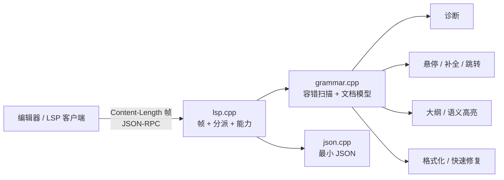
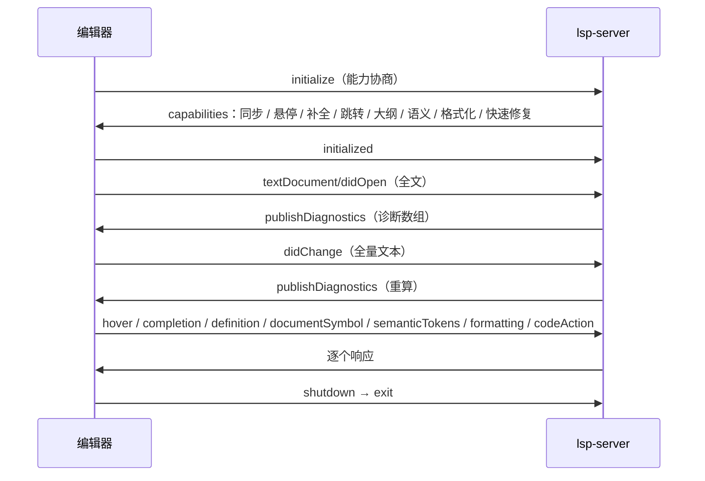

# `.gram` 语言服务器 · 技术报告

报告里的图用代码生成（Mermaid），公式用 LaTeX。

## 1. 目标与范围

`library/lsp` 为 ParseEngine 的 `.gram` 文件提供编辑器支持：**诊断、悬停、
补全、跳转定义、文档大纲、语义高亮、保守格式化、快速修复**。设计约束有三条：
只用 C++17 标准库（含自带 JSON 与 LSP 帧）、对**不完整 / 写错的文法**容错、
与生成器的真实语法一致（诊断不误报）。

## 2. 架构



分层：`json`（报文）→ `grammar`（文法模型与语言特性）→ `lsp`（协议与分派）→
`main`（标准输入输出）。`grammar` 不依赖协议，`lsp` 不依赖生成器，二者都能单独测试。

## 3. 协议层

### 3.1 帧

LSP 在 stdio 上用 `Content-Length` 头分帧：

$$
\text{message} = \texttt{"Content-Length: "} \Vert n \Vert \texttt{"\textbackslash r\textbackslash n\textbackslash r\textbackslash n"} \Vert \text{body},\qquad
n = |\text{body}| \ \text{(字节数)} .
$$

头部按大小写不敏感解析并支持多行头；`Content-Length` 缺失或字节数不足都当作
流结束（服务器退出），不会把半截报文写回。

### 3.2 报文

自带 JSON 实现覆盖对象（**保持插入顺序**，输出稳定，便于测试与差分）、数组、
字符串（`\uXXXX` 与 UTF-16 代理对还原成 UTF-8）、数字、布尔与 `null`。
请求/通知/响应按 JSON-RPC：有 `id` 是请求，无 `id` 是通知；未知方法对请求回
`-32601`、对通知静默忽略（编辑器会发不少 `$/` 通知）。

### 3.3 会话



采用**全量同步**（`change: 1`）：`.gram` 文件通常几 KB，重扫成本远低于维护增量，
也让"写错的中间状态"永远能被正确解析。

## 4. 文法模型

### 4.1 与生成器一致的真实语法

`.gram` 没有 `%%` 分段：`%` 开头且在**行首**的 token 是指令；`Ident :=` 开启一条
产生式，到 `;` 结束（也可不写 `;`，遇到下一条 `Ident :=` 结束），候选之间用 `|`，
右部可以夹 `{ … }` 语义动作与 `%empty` / `%prec`。同名产生式**分行累加**是合法的，
模型里合并成一条并累加候选数与行号：

$$
\text{alternatives}(A) = \sum_{k} \bigl(1 + |\{\,| \text{ in line}_k \,\}|\bigr) .
$$

旧 `%{{ … }}%` 会产生 `disabled-user-code` 错误；`%code` / `%class_body`（到
`%endcode` / `%endbody`）、`%main` / `%epilogue`（到下一个标记行）的正文一律
当**不透明文本**：只产出一个 Code token，不解析里面的内容——所以动作里写什么
都不会造成误报。

### 4.2 容错扫描

扫描器对每一段都能在出错时继续：注释、字符串、代码块与段标记都会给出
`unterminated-*` 诊断并把扫描位置推进到安全点。产出的 token 流带三类信息：
种类（指令 / 标识符 / 字符串 / 注释 / 代码 / 数字 / `$n` / `<成员>` / 标点）、
**范围**（行 + UTF-16 列）、是否位于行首（用来区分指令与规则里的 `%empty`）。

### 4.3 位置换算

LSP 的列是 **UTF-16 代码单元**偏移，而文件是 UTF-8 字节：

$$
\text{col}_{16}(p) = \sum_{i < p} w(b_i),\qquad
w(b) = \begin{cases}
1, & \text{ASCII 或 2/3 字节序列},\\
2, & \text{4 字节序列（非 BMP，UTF-16 里是代理对）}.
\end{cases}
$$

因此中文一个字算 1 列、emoji 算 2 列，与编辑器的光标一致；`--check` 文本报告
才换算成 1 基行列给人看。

## 5. 语言特性

### 5.1 诊断（错误 / 警告 / 提示三级）

| 诊断码 | 级别 | 触发条件 |
| --- | --- | --- |
| `unknown-directive` | error | `%` 指令不在指令表里 |
| `unknown-value` | error | `%mode` / `%lang` 取值不在合法集合里 |
| `unknown-start` | error | `%start` 指向的名字不是任何产生式 |
| `unknown-sync` | error | `%sync` 的 Token 没有声明 |
| `undefined-symbol` | error | 规则右部的小写名既不是 Token 也不是产生式 |
| `implicit-token` | info | 规则右部的大写名没显式声明（生成器按隐式 Token 处理） |
| `unused-token` | warning | Token 声明了但规则与 `%prec` 都没用到（`%mode lex` 下不报） |
| `unused-rule` | warning | 产生式既没被引用也不是起始符号 |
| `disabled-user-code` / `unterminated-*` | error | 使用禁用的旧代码块，或注释 / 字符串 / 段标记 / 语义动作没闭合 |

关键是"与生成器一致"：规则里直接用的大写名（`VARIABLE` / `NUMBER` / `STRING`）
在生成器里是合法的隐式 Token，所以这里只给 **info 提示**并附一条"显式声明"的
快速修复，不报错；同名产生式分行累加也不报错。实测 6 份真实文法
（`calc` / `mini_lang` / `json` / `pl0` / `c89_subset` / `if_demo`）**0 个 error**，
只有 1 条确实没被用到的 `UPLUS` 警告与若干隐式 Token 提示。

### 5.2 悬停与补全

悬停按命中 token 查三张表：指令表（47 条，与 `../../doc/12-grammar-usage.md` 的指令表
对齐）、Token 表（字面量 / 正则 / `%union` 成员 / CSV 别名来源 / `alias` 显示名 /
来自哪条指令）、产生式表（候选数、是否起始符号），另外覆盖 `$n`、`$$`、`$line`、
`$token`、`$code`、`<成员>`，以及 `%token` 的两个**行内关键字** `include`
（`%token NAME include "表.csv"`：从 CSV 追加字面量别名）与 `alias`（显示名）。
这两个词不是 Token 名，所以位置另记一张小表（`inlineKeywords_`），悬停与语义高亮
按位置命中——一条恰好叫 `include` 的规则因此不会被误当关键字。补全按上下文分支：

$$
\text{items}(p) =
\begin{cases}
\{\text{指令表}\}, & \text{光标在行首且该行还没有别的 token},\\
\{\text{模式名}\}, & \text{同一行前面出现过 } \%mode,\\
\{\text{语言名}\}, & \text{同一行前面出现过 } \%lang,\\
\{include, alias\} \cup \{\text{Token} \cup \text{产生式} \cup \%empty \cup \%prec\}, & \text{同一行前面是 } \%token \text{ 且已有名字},\\
\{\text{Token} \cup \text{产生式} \cup \%empty \cup \%prec\}, & \text{其它（规则区）}.
\end{cases}
$$

### 5.3 跳转、大纲与语义高亮

跳转把命中位置的标识符映射到声明范围：Token → `%token` / `%define` / `%regex` /
`%left` 等声明行，非终结符 → 规则左部（`%prec` 的参数也算使用，能跳过去）。
大纲按位置排序输出指令、Token、产生式三类符号。语义高亮把 token 流映射成
`keyword / type / function / string / number / comment / operator / variable /
parameter / macro`，并按 LSP 的 `deltaLine / deltaStart / length / tokenType`
编码；因为语义 token 不能跨行，多行代码块按行拆开。

### 5.4 保守格式化与快速修复

格式化只做三件不改变语义的事：去行尾空白、把连续 3 行以上空行折成 1 行、保证
文件以单个换行结尾。**不动缩进与动作正文**——动作是 C / Python 代码，编辑器
不该替用户重排。幂等：`format(format(x)) = format(x)`（单元测试里断言）。

快速修复由诊断驱动：`implicit-token` → 在指令区末尾插入 `%token X`；
`undefined-symbol` → 在文件末尾追加 `X := %empty;`。插入位置用"第一条产生式之前
最后一条指令的下一行行首"计算，保证插在指令区而不是规则区。

## 6. 测试与实测

`make -C library/lsp check` 做两件事：

1. `lsp-tests`：JSON（转义 / 代理对 / 非对象拒绝）、LSP 帧往返、干净文法
   （0 诊断、Token / 产生式计数、悬停、补全、跳转、大纲、语义 token、格式化幂等）、
   坏文法（六类诊断 + 快速修复 + `--check` 文本）、一次完整会话
   （initialize → didOpen → diagnostics → hover → 未知方法 → shutdown / exit）；
2. `examples/client.py` 驱动**真的服务器进程**：干净示例应 0 error、坏示例应
   4 error + 2 warning（并打印快速修复标题）。

```text
lsp-tests：全部通过
诊断：0 个 error，0 个 warning          （examples/sample.gram）
诊断：4 个 error，2 个 warning          （examples/sample_broken.gram）
真实文法 6 份：0 个 error
```
