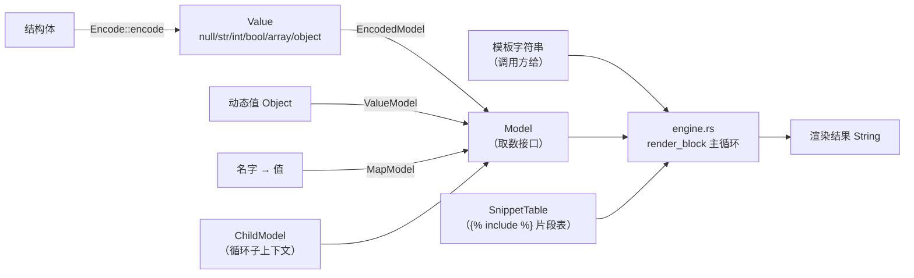

# 文本模板引擎 · 技术报告（Rust 版）

> 本报告写的是 **`library/template-rust` 这个独立 Rust crate（`template_engine`）**：
> 它的模块划分、渲染流水线、与 C++ 版的类型映射、自检方式，以及**范围边界**
> （哪些明确不做）。用法与快速开始见 [README.md](README.md)。
>
> 面向的读者：想知道「`library/template` 那套模板引擎搬到 Rust 里长什么样」的人——
> 包括想照着改、想对照两份实现、想拿它做代码生成的人。

## 1. 目标与范围

**目标**：把 [`library/template`](../template/README.md)（C++17 纯头文件模板引擎，
`tmpl` 命名空间）翻译成 Rust，**只用标准库**，并且做到"翻译不走样"——语法一样、
语义一样、**自检用例一样**。

**做到什么程度**：

- 语法全集：`{{ 变量 }}`（多级路径）、`` / `` / ``、
  `` / ``、``、`` / ``、
  `{# 注释 #}`；
- 缩略规则全套：块标签**独占一行时整行删除**、路径两端 trim、紧贴写法
  （``）也认；
- 循环元信息：`loop_index` / `loop_first` / `loop_last` / `loop_count`；
- 作用域链：循环体里能取外层变量，嵌套循环里外层循环变量仍可用；
- 四套取数方式：`Encode` 模型（`template_model!` / 手写 `impl Encode`）、
  名字 → 值（`MapModel` / `render_values`）、动态值（`ValueModel`）、
  循环子上下文（`ChildModel`）；
- 片段（``）：片段表由调用方给，片段按模板渲染、共用同一上下文、
  可嵌套，深度上限 32；
- 自检：14 个 `#[test]` / 100 处断言（覆盖 C++ 版 96 项检查）+ 20 个**真跑**的
  文档示例；demo 输出与 C++ 版逐行一致。

**明确不做**（不是待办）：

| 不做 | 说明 |
| --- | --- |
| 表达式求值 | `` 只做**单路径真值判断**（`` 可以，`` 不认）。C++ 版就没有，Rust 版保持一致——引擎只管排版，不管逻辑 |
| 下标 / 算术 / 比较 | 同上；`a[0]` 会被当成一个名字，取不到就是空串。`resolve` 只按点号切段 |
| 引擎读文件 / 懒加载片段 | 片段表是调用方的（名字 → 正文）。想从磁盘读就在填表前自己读——引擎不碰路径、编码、权限 |
| 浮点值 | 值与 C++ 版一致只有 `int64`：代码生成里够用，省掉浮点格式化的坑 |
| `serde` 之类第三方依赖 | 一个都不引；`Cargo.lock` 里只有本 crate 自己。投射走 `Encode` trait + 两个 `macro_rules!` 宏 |
| 属性宏 / derive | 用 `macro_rules!`（标准库范围）实现，不引入 proc-macro crate，也不接线 `syn` |
| 与生成器接线 | ParseEngine 的六档后端仍用 C++ 版；本 crate 独立，改它不影响产物 |

## 2. 总体架构



两条正交的链路：

```text
数据侧：结构体 / 动态值 / 名字值表  →  Model  →  Value
渲染侧：模板字符串 + Model + 片段表  →  render_block  →  文本
```

数据侧的关键取舍是 **"先投射成 `Value` 再渲染"**：C++ 版靠成员指针表让
`ModelAdapter<T>` 能"按名字取一个字段"，Rust 没有成员指针，于是 `Encode` 一次性把
整个模型投成 `Value`，再由 `EncodedModel` 提供 `Model` 接口（见 §5）。

## 3. 模块划分

| 文件 | 行数 | 职责 | 公开项 |
| --- | --- | --- | --- |
| `src/lib.rs` | 61 | crate 文档、模块声明、再导出 | — |
| `src/value.rs` | 360 | `Value` 枚举、`Object`（保序成员表）、`Array`、真值与文本化、`From` 便捷转换 | 30 |
| `src/naming.rs` | 106 | `to_snake_case` / `to_camel_case` | 2 |
| `src/bind.rs` | 159 | `Encode` trait + 标量 / 字符串 / 容器 / `Option` 的内置实现 | 3 |
| `src/macros.rs` | 112 | `encode_object!`（字段表 → 对象值）、`template_model!`（结构体 + 投射） | 2 宏 |
| `src/model.rs` | 254 | `Model` trait、`ValueModel`、`MapModel`、`EncodedModel`、`resolve` | 16 |
| `src/engine.rs` | 888 | `TemplateEngine`、`render_block` 与全部标签处理 / 空白规则、`ChildModel`、`render*` 便捷函数、`TemplateError` | 13 |
| `src/main.rs` | 187 | demo：同一份模型渲染成两份目标语言代码（含片段） | — |
| `tests/engine.rs` | 532 | 自检：14 个 `#[test]` / 100 处断言 | — |

公开 API 一览（`lib.rs` 的再导出）：

```rust
pub use bind::{encode_into, Encode};
pub use engine::{
    no_snippets, render, render_values, render_values_with, render_with, snippet_table,
    ChildModel, SnippetTable, TemplateEngine, TemplateError,
};
pub use model::{resolve, EncodedModel, MapModel, Model, ValueModel};
pub use naming::{to_camel_case, to_snake_case};
pub use value::{Array, Object, Value};
// 外加两个 #[macro_export] 宏：encode_object! / template_model!
```

## 4. 渲染流水线

### 4.1 停-回机制：`render_block`

引擎**不建语法树**。整个引擎就是一个主循环：

```rust
fn render_block(
    source: &str,
    pos: &mut usize,
    ctx: &dyn Model,
    stop_tag: &str,
    env: &Env<'_>,
) -> Result<String, TemplateError>
```

从 `pos` 往下扫，遇到 `stop_tag` 就"吃掉它、返回、并让 `pos` 停在它之后"，把控制权
交回上层。于是：

- `` 的分支内容 = 用 `stop_tag = ""` 或 `""` 再调一次自己；
- `` 的循环体 = 每轮换一个 `ChildModel`、用 `stop_tag = ""` 再调一次自己；
- 嵌套是天然的：内层的 `` 由内层那次调用负责收尾。

主循环的五个步骤（与 C++ 版逐条对应）：

1. 到达停止标签 → 吃掉并返回（含"整行删除"，见 4.3）；
2. 找下一个 `{{` / `{%` / `{#`，取最近的那个；
3. 后面没有标签了 → 剩下的全是纯文本，输出完收工；
4. 先把标签之前的纯文本原样输出；
5. 按标签种类分发：注释 / 变量 / `if` / `for` / `raw` / `include` / 其它（安全跳过）。

停止判定有两道：字面匹配（`is_stop_tag`）与指令名匹配（`matches_stop_command`），
所以 `` 这种不留空格的写法也能停住。

### 4.2 嵌套配对

`find_matching(source, pos, open_tag, close_tag)` 按**嵌套深度**找配对的结束标签：
遇到同类开始标签深度 +1、结束标签 -1，回到 0 的那个才是答案——内层的
`` 不会被当成外层的结束。找不到就返回 `TemplateError::UnclosedTag`。

`find_top_level_else(source, from, to)` 找 `[from, to)` 之间**顶层**的第一个
``（只数 `if` 嵌套深度，`depth == 0` 才算）：内层 if 自己的 else 不算，
否则双分支的 `` 会被判错。

两个函数都通过 `next_tag` 扫描标签，而 `next_tag` **会沿途跳过 `{# … #}` 注释**
——注释里写的 `` 只是文字，不算标签（自检里有这条用例）。

### 4.3 整行删除规则

写代码生成模板时最实用的一条：块标签**独占一行**（前面只有缩进、后面只有行尾空白）
时，连这一行带换行一起删掉，产物里不会多出空行。

```text
条件：标签前面（本行内）只有空格 / 制表符，标签后面只有空格 / 制表符 + 换行 / 结束
```

实现拆成三个小函数：

- `is_standalone_line(source, tag_start, tag_end)` —— 判定；
- `trim_right(out, out.len())` —— 把**已经写进输出**的本行缩进收回来（换行保留）；
- `skip_line_end(source, tag_end)` —— 吃掉标签之后的空白与一个换行。

`consume_block_tag_line` 把后两步串起来，返回"标签之后该从哪继续"；`after_tag` 是
给"跳到某个标签之后"用的（`Some(pos)` / `None` 两个分支，`None` 表示落到模板末尾，
对应 C++ 版传 `npos` 的行为）。

于是 `public class` 这种**同行里还有别的内容**的标签不受影响
（不是独占一行，只删标签本身），而

```text
class {{ name }} {

    {{ m.ret_type }} {{ m.name }}({{ m.args }});

};
```

渲染出来是干净的三行加壳，没有空行。`` 独占一行时同一条规则也生效：
那一行整个换成片段正文，不会多出缩进，也不会多出空行。

### 4.4 `` 的环境传参

片段表与嵌套深度**不放进成员**（那样引擎就不是无状态的了），而是打包成
`Env { snippets, include_depth }` 当参数一路跟着递归走：

```rust
let nested = Env { snippets, include_depth: env.include_depth + 1 };
let mut snippet_pos = 0usize;
out.push_str(&render_block(snippet, &mut snippet_pos, ctx, "", &nested)?);
```

每进一层 `` 换一个 `include_depth + 1` 的副本，这就是循环包含的刹车：
超过 `TemplateEngine::MAX_INCLUDE_DEPTH`（32）就返回
`TemplateError::IncludeTooDeep`，写坏的互相包含不会把栈转爆。片段正文用的是**同一个
`ctx`**，所以片段里能用外层变量、放进 `` 里也能取到循环变量与 `loop_*`。

片段正文**按模板渲染**（不是原样贴），因此片段里的 `` / `` 照常
解析、片段里还能再 include；片段自己的注释也被丢掉。

### 4.5 错误口径

| 情况 | 行为 |
| --- | --- |
| `{{` 没有 `}}` | `TemplateError::UnclosedVariable` |
| `{#` 没有 `#}` | `TemplateError::UnclosedComment` |
| `` / `` 没有 `` 等 | `TemplateError::UnclosedTag("")`（带标签名） |
| 片段互相包含 / 嵌套超过 32 层 | `TemplateError::IncludeTooDeep("a")`（带片段名） |
| 缺变量 / 空列表 / 缺片段 / 片段名写坏 / 不认识的指令 / 游离的 `` | **不是错误**：输出空串、安全跳过 |

只有前四类会让 `render` 返回 `Err`，其余一律输出空串——和 C++ 版"只抛未闭合标签"
的口径完全一致。

## 5. 类型与语义映射（C++ → Rust）

| 概念 | C++ 版 | 本 crate | 备注 |
| --- | --- | --- | --- |
| 动态值 | `tmpl::Value`（`std::variant`：monostate / string / int64 / bool / `shared_ptr<Array>` / `shared_ptr<Object>`） | `Value`（枚举：`Null` / `Str` / `Int` / `Bool` / `Array(Arc<Vec<Value>>)` / `Object(Arc<Object>)`） | `Arc` 对应 `shared_ptr`：拷贝是共享不是深拷贝，顺带给出 `Send + Sync` |
| 数组 | `struct Value::Array { std::vector<Value> items; }` | `type Array = Vec<Value>` | Rust 里 `Vec<Value>` 本身就是指针，不需要额外包一层 |
| 对象 | `struct Value::Object { std::vector<std::pair<std::string, Value>> members; }` | `struct Object { members: Vec<(String, Value)> }` | 都**保插入顺序**：模板遍历顺序 = 模型字段声明顺序 |
| 取值 | `asString() -> optional<string_view>` | `as_str() -> Option<&str>` | `optional` → `Option` |
| 真值 / 文本化 | `truthy()` / `toString()` | `truthy()` / `to_text()`（并实现 `Display`） | 规则逐条相同：bool 按值、空串空数组空对象为假、整数 0 为假、null 为假 |
| 模型投射 | `TEMPLATE_MODEL(T, tmpl::field("x", &T::x), …)`（成员指针表） | `impl Encode` + `encode_object!` / `template_model!` | Rust 没有成员指针，改为"声明字段名 → 取值表达式" |
| 取数接口 | `class Model` 虚基类 | `trait Model` | 都是"一个名字 → 一个值"，取不到给空值 |
| 模型 → Model | `ModelAdapter<T>`（每次 `get` 只投射命中的字段） | `EncodedModel`（构造时投射一次并缓存） | 唯一一处**实现**差异，语义（取到的值）相同 |
| 动态值 → Model | `ValueModel`（持指针） | `ValueModel<'a>`（持引用） | 生命周期由借用检查器接管 |
| 名字值表 | `MapModel` | `MapModel` | `set` 都是"同名覆盖" |
| 循环子上下文 | `ChildModel`（持有 `const Model &parent`） | `ChildModel<'a>`（持有 `&'a dyn Model`） | `loop_*` 的查找顺序也相同：先循环变量、再 `loop_*`、最后往上找 |
| 路径求值 | `resolve(root, "a.b.c")` | `resolve(root, "a.b.c")` | 都只按点号切段，中间级不是对象就返回空值 |
| 片段表 | `std::map<std::string, std::string>` | `BTreeMap<String, String>` | 都用**键有序**的容器（不是哈希表），调试时顺序稳定 |
| 报错 | 抛 `std::runtime_error` | 返回 `Result<_, TemplateError>` | Rust 侧只有两类错误，见 §4.5 |
| 无状态 | 全静态方法 | 全关联函数 + 自由函数 | 没有全局状态，同一份模板可并发渲染 |

### 关于 `template_model!` 与 `encode_object!`

C++ 的 `TEMPLATE_MODEL` 展开的是**显式特化**，只能写在全局作用域；Rust 版是两个
`macro_rules!`：

```rust
// ① 已经有结构体：手写投射（"TEMPLATE_MODEL 的直译"，字段名可以跟 Rust 字段名不同）
impl Encode for Token {
    fn encode(&self) -> Value {
        encode_object! { "name" => &self.name, "priority" => self.priority }
    }
}

// ② 还没写结构体：结构体 + new() + 投射一起展开
template_model! {
    /// 一个方法。
    pub struct Method {
        /// 方法名。
        name: String,
        /// 返回类型。
        ret: String,
    }
}
```

`encode_object!` 的值部分走 `Encode`，所以标量、`&str`、`Vec<T>`、`Option<T>`、别的
模型都能直接填；`Vec<模型>` 变数组、模型变对象。空表 `encode_object! {}` 得到一个
空对象，正是"纯静态片段"要的占位模型（模板里任何变量都取不到 → 输出空串）。

## 6. 自检与实测

自检就是 `cargo test`，没有第三方测试框架（crate 本身零依赖）。两部分：

- `tests/engine.rs`：14 个 `#[test]` / 100 处断言，按 C++ 版的章节分组
  （变量 / 条件 / 独占一行 / 循环 / 注释 / raw / 片段 / 循环元信息 / 健壮性与无状态 /
  `Value` 与 `encode` / `ValueModel` / 零字段模型 / 命名转换 / `MapModel` 与
  `render_values`）；
- 文档示例 20 个，**真跑**（不是 `no_run`）：示例里的 `assert_eq!` 也是自检的一部分。

实测输出：

```text
     Running tests\engine.rs
running 14 tests
test result: ok. 14 passed; 0 failed; 0 ignored; 0 measured; 0 filtered out

   Doc-tests template_engine
running 20 tests
test result: ok. 20 passed; 0 failed; 0 ignored; 0 measured; 0 filtered out
```

`cargo clippy --all-targets`（clippy 0.1.98）无提示；`cargo build --release` 无警告。

**与 C++ 自检的对齐**：`library/template/test_template.cpp` 跑出 96 项检查
（`make -C library/template check` → `全部通过：96 项检查`）；Rust 侧 100 处断言
把 96 项全覆盖，另有 4 条新增/拆分：

| 差项 | 数量 | 说明 |
| --- | --- | --- |
| `encode：对象保序` 拆成 3 条 | +2 | 长度、第 1 个键名、第 2 个键名分开断言 |
| `MapModel::set` 同名覆盖 | +1 | C++ 自检没覆盖这条语义，Rust 侧补上 |
| 错误信息带标签名 | +1 | 校验 `UnclosedTag` 的 Display 文案 |

6 处**措辞**改写（等价替换，不是漏项）：`Value：string_view` → `Value：字符串`、
`（size_t）` → `（usize）`、`vector → 数组` → `Vec → 数组`、include 互相包含的报错
措辞、`renderValues：` → `render_values：`。核对方式：`tmp/template_rust_case_check.py`
把两侧的用例标签抽出来做集合比对，输出"缺 6 / 补 10"，逐条核对后全部是有意改写。

**demo 与 C++ 版逐行一致**：`library/template/main.cpp` 与本 crate 的 `src/main.rs`
是同一份 demo（同一批模板、同一份模型数据、六个输出小节）。两边各跑一次后
`diff --strip-trailing-cr` 无差异；唯一的字节差异是换行符——C++ demo 的模板字符串
来自 CRLF 的 `.cpp`（本仓 `core.autocrlf=true`），本 crate 的 `.rs` 在磁盘上是 LF，
所以渲染结果一个带 `\r`、一个不带。**引擎本身与行尾无关**，产物行尾 = 模板字符串
的行尾（这也是 `include/templates/` 里 `.tmpl` 一律保持 LF 的原因）。

## 7. 已知边界与差异

| 事情 | 说明 |
| --- | --- |
| 语义与 C++ 版 | 除 §5 表里注明的"实现差异"外，逐条对齐；未发现行为差异 |
| `Value` 的相等 | Rust 侧派生了 `PartialEq` / `Eq`（C++ 版没有 `operator==`）：`assert_eq!` 用起来方便，比较是**深比较**（数组 / 对象按内容比） |
| `Some/None` | `Encode for Option<T>`：`None` 变成 null（`` 判假）。这是 Rust 侧的新增能力，C++ 版没有对应物 |
| `i128` / `u128` | 不收进 `Value`（值只有 `i64`），与 C++ 版一致 |
| 非 ASCII 字符 | 命名转换只看 ASCII 字母 / 数字，中文等原样透传；标签扫描按字节做，但所有切点都落在 ASCII 边界上（`{{` / `{%` / `{#` 都是 ASCII），UTF-8 模板安全 |
| 与生成器 | **没有接线**：生成器仍用 C++ 版 `library/template`。本 crate 独立演化 |
| 模板不读文件 | 有意为之：引擎不碰路径 / 编码 / 权限，片段表由调用方给 |

## 8. 复现步骤

```sh
# 1. 自检（14 个 #[test] + 20 个真跑的文档示例）
cd library/template-rust && cargo test

# 2. demo
cd library/template-rust && cargo run

# 3. lint
cd library/template-rust && cargo clippy --all-targets

# 4. 与 C++ 版交叉验证：两边各跑一次 demo 再比对
make -C library/template check                       # C++ 自检：96 项检查
./build/template/template-demo            > /tmp/cpp_demo.txt
(cd library/template-rust && cargo run --quiet) > /tmp/rust_demo.txt
diff --strip-trailing-cr /tmp/cpp_demo.txt /tmp/rust_demo.txt   # 应无输出

# 5. 用例覆盖核对（C++ 的用例标签 vs Rust 的断言标签）
python tmp/template_rust_case_check.py
```

Cargo 产物落点：在 crate 目录里跑时按 `.cargo/config.toml` 落到仓库
`build/template/rust/`；从仓库根用 `--manifest-path` 跑时 cargo 读不到这份配置，
落在 `library/template-rust/target/`。两者都在 `.gitignore` 范围内。
