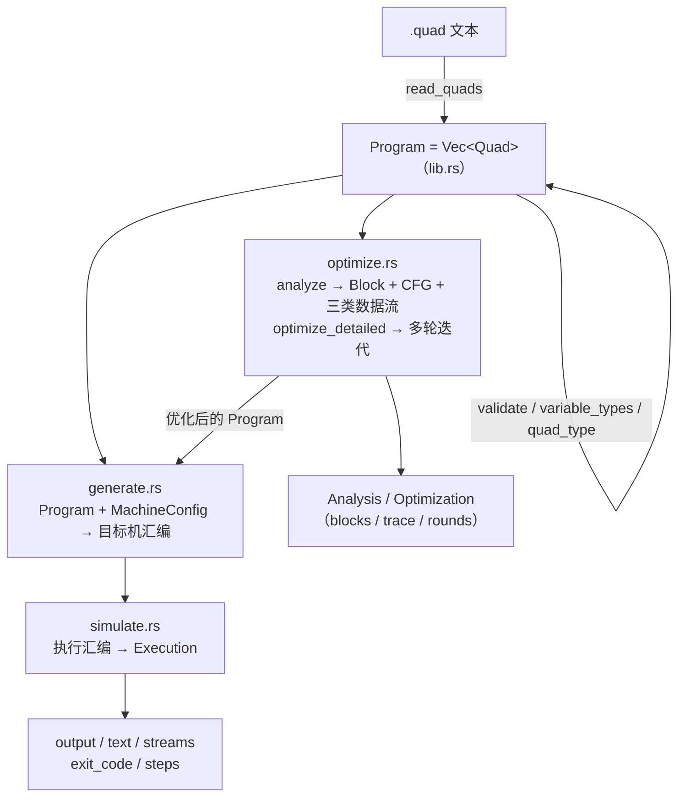

# 四元式优化与目标代码转换器 · 技术报告（Rust 版）

> 本报告写的是 **`library/transfer-rust` 这个独立 Rust crate（`quad_transfer`）**：
> 它的数据模型、指令集、机器模型、优化流水线、代码生成与模拟执行，以及**范围边界**
> （哪些明确不做）。用法与快速开始见 [README.md](README.md)。
>
> 面向的读者：想知道「一套四元式后端在 Rust 里长什么样」的人——包括想照着改、
> 想对照别的实现、想拿它做编译器实验的人。

## 1. 目标与范围

**目标**：用 Rust 把「四元式 → 分析 / 优化 → 教学目标机汇编 → 模拟执行」这条链
完整走一遍，并且**只用标准库**。

**做到什么程度**：

- 四元式模型：13 种类型、带类型后缀的运算符、双结果指令、标签与跳转、调用与中断、
  字符串 / 流 / 向量 / 文件 / 系统调用指令族、**数据区三件套
  `addr` / `load` / `store`**（配 `.data.bin` / `.layout` 读写数据区）；
- 分析：基本块与 CFG，到达定值 / 活跃变量 / 可用表达式三套数据流；
- 优化：常量折叠、常量传播、代数化简、局部 / 全局 CSE、复制传播、DCE、
  安全的循环优化，**多轮迭代到不动点**（`rounds` 记轮数）；
- 代码生成：MIPS / 8086 / ARM 三种目标机的教学汇编，指令模板可配；
- 执行：自带模拟器（带步数上限），返回寄存器 / 内存 / 输出 / 退出码。

**明确不做**（不是待办）：

| 不做 | 说明 |
| --- | --- |
| `# 期望错误:` 负例校验 | Rust 版只把该字段读进 `QuadFile`，不做比对（C++ 版会校验生成期报错）；这类示例在自检里跳过 |
| SSA / 寄存器分配 / `t1t` 命令行 | 属于 `library/transfer` 里另外几块的范围，本 crate 只到「四元式 core」这一层 |
| 真实 ABI / 指令调度 / 目标文件格式 / 优化正确性证明 | 从头到尾都是**教学与参考实现**的定位：产物是"教学目标机汇编 + 模拟器"，不是能上真机的机器码 |

## 2. 总体架构



（同一张流程用文字写一遍：`.quad` 文本 → `read_quads` 得到 `Program` → `validate`
校验 → `optimize_detailed` 做分析 + 多轮优化 → `generate` 出目标机汇编 →
`simulate` 执行得到 `Execution`；`MachineConfig` 从默认值或 `.ini` 来，管目标机、
字长、寄存器与指令模板。）

四个模块与三个可执行目标：

| 模块 | 职责 | 关键接口 |
| --- | --- | --- |
| `lib.rs` | 模型、数值语义、读写与校验、配置装载 | `read_quads` / `write_quads` / `validate` / `default_config` / `load_config(_file)` |
| `optimize.rs` | 基本块与 CFG、三套数据流、多轮优化 | `analyze` / `report` / `optimize_detailed` / `optimize` |
| `generate.rs` | 四元式 → 目标机汇编 | `generate` |
| `simulate.rs` | 汇编 → 执行结果 | `simulate` / `simulate_streams` |
| `main.rs` / `bin/*.rs` | 最小示例 / 示例集运行器 / 运算符自检 | `quad-transfer-{example,suite,operators}` |

**没有全局可变状态**：`Program`、`MachineConfig`、`Analysis`、`Optimization`、
`Execution` 都是按值传递的普通数据结构，多个线程可以各自处理自己的 `Program`。

## 3. 数据模型

```rust
pub struct Quad {
    pub op: String,
    pub a: String,
    pub b: String,
    pub result: String,
    /// 双结果指令的第二目标（`mul` 的高半、`div` 的余数）。
    pub extra: String,
}
pub type Program = Vec<Quad>;
```

- 字段全是字符串：四元式是**文本到文本**的 IR，读写与打印不失真（`write_quads`
  会把类型后缀与双结果字段原样写回）；
- `Quad::new` 把 `extra` 初始化成 `"_"`（表示"这一格没意义"）；
- 变量类型不写在四元式里，而是通过 `decl` 维护一张**声明表**
  （`variable_types(program) -> HashMap<String, String>`），
  `quad_type(quad, declared)` 再据此推断一条四元式的运算类型。

类型推断的口径：**结果变量类型 → 第一个操作数类型 → `i16`**；运算符后缀优先于
推断（`+:u32` 就是 u32 加法）。

## 4. 类型系统与数值语义

**13 种类型**：`i8 u8 i16 u16 i32 u32 i64 u64 i128 u128 f32 f64 str`；
`str` 之外都是标量，`i128` / `u128` 用一对 64 位字拼出来（`Value` 内部表示）。

数值语义（`eval_typed` 是入口，整数 / 浮点 / 字符串分流）：

| 类别 | 规则 |
| --- | --- |
| 整数 | 按**类型宽度**取模回绕；有符号用二进制补码（`is_unsigned_type` 决定比较与移位口径） |
| 无符号 | 比较、除 / 取余、右移按逻辑语义 |
| 浮点 | IEEE-754 语义（`f32` / `f64` 各自精度） |
| 转换 | `cvt:<类型>` 做位宽与符号转换（`convert_value`） |
| 字符串 | `str` 是「字节长度 + 文本」；比较 / 拼接 / 子串 / 查找都有对应函数，越界报错 |
| 128 位 | `multiply_wide` / `divide_wide` / `add_with_carry` / `sub_with_borrow` 提供宽运算原语，分片与进位链都建在它们之上 |

**文字量**：`is_integer_literal` / `is_float_literal` / `is_string_literal`
判定，`literal_value` / `literal_for` 按类型取值；数字 Token 的十进制 / 十六进制
写法都在这里解析。

## 5. 机器字长与展开策略

机器模型的核心参数是 `MachineConfig::word_bits`（8 / 16 / 32 / 64）——**机器原生
字长**，与变量类型宽度是两件事。设类型宽度 `W`、字长 `M`：

| 情况 | 后端做法 | 例子 |
| --- | --- | --- |
| `W == M` | 一条原生指令；`i16` 省略类型后缀以保持老产物逐字不变 | `i16` 在 16 位机上 |
| `W < M` | 一条指令 + **按类型归一化**（模拟器用掩码 / 算术移位合成） | `i8` 在 32 位机上 |
| `W > M` | **多字展开**：变量按 `M` 位分片（`x#0` 是低字，`x#1` 是次低字 …），加减写 `+c` / `-b` 进位链，乘除等交给运行时例程 | `u64` 在 16 位机上（示例 `04_wide`） |

乘除走**固定的命名寄存器对**（IR 里叫 `HI` / `LO`）：`HI` 放高半 / 余数，
`LO` 放低半 / 商；生成时映射成目标机约定（MIPS `HI:LO`、8086 `DX:AX`、ARM `r12:r14`）。
这也是示例 `06_muldiv` 的看点。

## 6. 指令集

指令按**类别**组织，`op_base(op)` / `op_type(op)` 负责拆出「基本名 + 类型后缀」：

| 类别 | 写法 |
| --- | --- |
| 声明 / 赋值 | `decl`、`:=` |
| 算术 | `+ - * / %`；进位 `+c` `-b` |
| 双结果 | `(mul, a, b, lo, hi)`、`(div, a, b, q, r)` |
| 一元 | `neg` `odd` `~` |
| 转换 | `cvt:<类型>` |
| 关系 | `== != < <= > >=`（结果 0/1，默认 `i8`） |
| 移位与按位 | `<< >> & \| ^`（右移按有符号 / 无符号分流，位数按类型宽度取模） |
| 控制 | `label` `j` `jz` `jnz` `halt` |
| 调用 / 中断 | `param` `call` `ret`、`int` `iret` |
| 输入输出 | `read` `write` `print` `putc` `getc` |
| 字符串 / 流 / 向量 / 文件 / 系统调用 | 各自的指令族（见 README 表与 `example/13_strings` … `17_file.quad`） |
| 数据区 | `(addr, 符号, _, 目标)` / `(load, 指针, _, 目标)` / `(store, 指针, 值, _)` → 伪指令 `ADDR` / `LOADAT` / `STOREAT.<类型>`，见 §6.1 |
| 低层回退 | 运行时伪指令 `RCALL` / `RCALLW`：把整条运算交给运行时例程，供机器字不够宽或机器缺指令族时使用 |

### 6.1 数据区三件套的实现

数组 / 结构体在 IR 里被降级成「基址 + 偏移」，真实值放在数据区**字节镜像**里，
符号基址放在**布局表**里。三条指令串起这条链：

| 四元式 | 校验要求 | 生成的伪指令 | 模拟器语义 |
| --- | --- | --- | --- |
| `(addr, 符号, _, 目标)` | 符号是标识符、`b` 是 `_`、目标是变量 | `ADDR 目标, 符号` | 从 `data_area_symbols` 取基址，按**目标变量的类型**写入（`i64` 时窄机器上自动分片） |
| `(load, 指针, _, 目标)` | 指针是值操作数、目标是变量 | `LOADAT 目标, 指针` | 把指针当 `u64` 取出整值地址 → 读 8 字节**小端**：目标是浮点按 IEEE-754 位模式重新解释，否则按 `u64` 收进目标类型 |
| `(store, 指针, 值, _)` | 两个操作数都是值、`result` 是 `_` | `STOREAT.<值类型> 指针, 值` | 值按**自己的类型**转成 8 字节：浮点写 `real.to_bits()`，整型转 `u64`（有符号符号扩展）后小端写回 |

几个设计点：

- **`addr` 的第一个操作数是数据区符号，不是变量** —— 它不参与变量类型推断。
  而 `addr` / `load` 的**结果**统一按 `i64` 处理（8 字节句柄），窄机器上自动分片，
  这样指针能整值还原、和 `library/stackvm` 的 8 字节槽位对齐。
- **三条都是运行时伪指令**（与 `VLOAD` / `FOPEN` 同类）：地址可能是多字变量，
  由**模拟器**拼出完整地址再去读写数据区，所以三套目标机生成的是同一条指令；
  机器能力由指令族 **`data`** 表示，配置里 `feature.data=off` 就报
  「四元式存在，但目标机没有实现指令族 'data'」（§8 的第二类报错）。
- **字节镜像与符号表分两个文件**：`# 数据:` 给字节，`# 布局:` 给符号（留空时按
  `<镜像>.layout` 找）。布局表是 `simple_ast` 的 `exportDataLayout()` 输出，
  只认 `符号名 offset=N` 两个字段；装载入口是 `load_data_bin` /
  `load_data_layout` / `load_data_area`。
- **汇编里是独立一段** `.dataarea <字节数>`：`.sym 符号 偏移` 一行一个符号，
  字节用 `.hex 起始偏移 十六进制串` 紧凑写出（16 字节一行）；段头声明的字节总数
  与 `.hex` 没写满的部分由模拟器补零，越界判定因此有确定的口径。
- **报错文案**与 `library/stackvm` 的 `ADDR` / `LOADAT` / `STOREAT` 对齐：
  没装数据区 / 符号不在表里 / 地址越界各有专门的消息（见 README 的「数据区」一节）。

示例：`core/example/21_data_area.quad`（`arr[0..3]` 读出来、写回一个再读回来验证，
期望 `30 30`）；`23_data_missing.quad` 演示 `feature.data=off`。


配置里的 `features=…` 声明「这台机器有哪些指令族」，`feature.<族>=off` 单独关掉
某一族。于是生成期有两种性质不同的失败，**必须区分**：

| 报错 | 含义 |
| --- | --- |
| 「未知四元式 / 操作 'x' 不存在」 | IR 本身就非法——**程序写错了** |
| 「四元式存在，但目标机没有实现指令族 'y'」 | IR 合法，**这台机器干不了**（例如 `no_muldiv.ini` 关掉乘除） |

`validate(program)` 负责第一类（顺带检查标签、跳转目标、操作数形态）；
`generate` 在查 `commands` / `features` 时负责第二类。示例
`18_machine_missing`（负例）与 `19_unknown_quad`（负例）演示的正是这两种。

## 7. 数据流分析与优化

`analyze(program)` 切出基本块与 CFG，每个 `Block` 带：

- `successors` / `predecessors` / `reachable` —— 图结构；
- `reaching_in` / `reaching_out` —— 到达定值；
- `live_in` / `live_out` —— 活跃变量；
- `available_in` / `available_out` —— 可用表达式。

`call` / `int` 连到被调用函数，`ret` / `iret` 是出口（跨函数的数据流因此不会被
当成同一个过程）。`report(program, analysis)` 把这些集合渲染成可读的分析报告。

`optimize_detailed(program)` 在**多轮迭代**里跑：常量折叠（类型与浮点都参与）、
常量传播、代数化简、局部 / 全局公共子表达式、复制传播、死代码消除，以及与循环
有关的安全优化；**每轮次都重建 CFG 再迭**，直到不再变化为止，返回：

```rust
pub struct Optimization {
    pub program: Program,  // 优化后的四元式
    pub trace: Vec<String>,// 每轮一行（例："round 2: constant/algebra/strength optimization"）
    pub rounds: usize,     // 迭代轮数
}
```

`optimize(program)` 是只要结果的简写。

## 8. 目标代码生成

`generate(program, config)` 把优化后的四元式逐条展开成目标机汇编文本：

- **一条四元式往往展开成多条指令**：窄类型要归一化、宽类型要分片、乘除要摆
  寄存器对；
- 具体助记符来自 `MachineConfig::commands`（`cmd.add=ADD {dst}, {lhs}, {rhs}` 这种
  模板，占位符 `{dst}` / `{lhs}` / `{rhs}` / `{name}` / `{value}`），
  取内存 / 存内存 / 立即数各有自己的模板，且可以按类型覆盖（`load.i32=…`）；
- 产物头部带元信息段：`.bits`（机器字长）、`.mulpair`（固定结果对）、
  `.reg`（寄存器名，模拟器据此区分"寄存器"与"变量"），后面是数据区 / 只读区 /
  栈 / 代码几段；
- 目标机缺指令族或变量宽度超出机器能展开的范围时，**这里报错**（见 §8），
  或退回 `RCALL` / `RCALLW` 运行时例程。

三套默认目标的寄存器与指令风格（`default_config`）：MIPS（`$t0` / `$t1` / `$t2`、
`LH` / `SH` / `LI`）、8086（`AX` / `BX` / `CX`、`MOV` 带 `[name]` 内存操作数）、
ARM（`r0` / `r1` / `r2`、`LDRSH` / `STRH` / `MOV … #imm`）。

## 9. 模拟执行

`simulate(assembly, input, step_limit)` 自己解析生成的汇编并执行
（`Machine` / `Frame` 两个结构承载寄存器、内存、栈与调用帧），返回：

| 字段 | 内容 |
| --- | --- |
| `memory` | 变量 → 值（保留类型） |
| `output` | `write` 写出的值序列 |
| `text` | `print` / `putc` 的文本 |
| `stream_text` / `streams` | 非 STDOUT 流的文本 / 数值输出 |
| `exit_code` | `system exit` 的退出码 |
| `steps` | 实际执行的指令条数 |

`step_limit` 是**硬上限**：超了就报错返回（死循环不会挂住调用方）——示例集用的是
1,000,000 步。`render_output(execution)` 把 `output` 渲染成一行空格分隔的文本，
正好能和 `.quad` 文件里的 `# 期望:` 直接比对。

## 10. 示例与验证

`library/transfer/core/example/` 下 26 份 `.quad` 就是测试集，每份自带
`# 名称:` / `# 期望:`（有的还有 `# 输入:` / `# 期望文本:` / `# 配置:`）。
`quad-transfer-suite` 的流程是：读文件 → `optimize_detailed` → 按
`# 配置:`（缺省 ARM）`load_config_file` → `generate` → `simulate` →
`render_output` 与 `# 期望:` 比对（有 `# 期望文本:` 时再比 `execution.text`）。

实测结果：

```text
共 26 个示例：23 通过，0 失败。
```

- 跳过 3 份：`18_machine_missing` / `19_unknown_quad` / `23_data_missing` —— 都是
  **负例**（`# 期望错误:`，指望读入期或生成期报错）。Rust 版不校验这个字段，
  负例一律跳过（由 C++ 版校验）；
- 覆盖到：类型与符号（`01` / `10` / `02`）、浮点（`03`）、宽类型与进位
  （`04` / `05` / `12`）、双寄存器乘除（`06`）、I/O 与字符串 / 流（`07` / `13` / `14`）、
  调用与中断（`08` / `09`）、数据区配置与命名数据（`11`）、向量（`15`）、
  系统调用（`16`）、文件（`17`）、低层回退（`20`）、**数据区三件套（`21`）**、
  跨 `call` 的循环变量（`22`）、移位与按位（`operators`）、最小流程（`minimal`）、
  外部配置（`config`）。

**没有 `#[test]` 单元测试**：这个示例集运行器就是自检入口，失败时返回 `Err`
（退出码非 0），适合挂在 CI 里。

## 11. 与 C++ 版的关系

同一套模型的两个实现，`library/transfer-rust` 只覆盖 C++ 版 `core` 这一层的范围：

| 方面 | C++ `library/transfer/core` | Rust `library/transfer-rust` |
| --- | --- | --- |
| 覆盖 | core + dataflow + SSA + regalloc + irbridge + 命令行 `t1t` | 只到 core：四元式 / 优化 / 三套目标机 / 模拟器 |
| 数据区三件套 | 有（`addr` / `load` / `store` + `.data.bin` / `.layout`） | **也有**（同一套语义：伪指令 `ADDR` / `LOADAT` / `STOREAT`、`.dataarea` 段、`feature.data` 开关，见 §6.1） |
| 负例校验 | 会校验 `# 期望错误:` | 只读不校验 |
| 错误表示 | 异常 / 错误码 + 文本 | 统一 `Result<T, String>`，诊断文本保持中文口径 |
| 模块划分 | 头文件 + 多个实现文件 | 一个 crate：`lib.rs` + `optimize` / `generate` / `simulate` / `quadfile` |
| 依赖 | C++17 标准库 | Rust 2021 标准库（无第三方 crate） |

两边跑的是**同一批 `.quad` 示例**，所以对照起来很方便：Rust 版通过的那 23 份，
C++ 版也应该通过；C++ 版另外多覆盖 SSA / 寄存器分配 / `t1t` 那几块，以及
`# 期望错误:` 负例的校验（Rust 版把它们跳过）。

## 12. 接口一览

```rust
// lib.rs —— 模型与数值
TYPE_NAMES / default_type() / is_type_name(name)
Value（类型化数值）
read_quads(text) / write_quads(program) / validate(program)
variable_types(program) / quad_type(quad, declared) / op_base(op) / op_type(op)
literal_value / literal_for / convert_value / display_value / eval_typed
add_with_carry / sub_with_borrow / multiply_wide / divide_wide
is_integer_literal / is_float_literal / is_numeric_literal / is_string_literal
string_value / string_length / string_compare / string_concat / substring / string_find
value_is_zero / value_low_byte
default_config(target) / load_config(text, fallback) / load_config_file(path, fallback)
load_data_bin(path)

// optimize.rs / generate.rs / simulate.rs
analyze(program) -> Analysis
report(program, analysis) -> String
optimize(program) / optimize_detailed(program) -> Optimization
generate(program, config) -> String
simulate(assembly, input, step_limit) -> Execution
simulate_streams(...) -> Execution

// quadfile.rs
load_quad_file(path) -> QuadFile
resolve_config_path(quad_file, config_path) -> String
render_output(execution) -> String
```

## 13. 构建与自检

```sh
cargo build   --manifest-path library/transfer-rust/Cargo.toml
cargo run     --manifest-path library/transfer-rust/Cargo.toml                  # 最小示例
cargo run     --manifest-path library/transfer-rust/Cargo.toml --bin quad-transfer-suite
cargo run     --manifest-path library/transfer-rust/Cargo.toml --bin quad-transfer-operators
```

状态：**26 份示例 23 通过 / 0 失败 / 3 跳过**（跳过的是负例，见 §10）；
crate 无第三方依赖，冷编译约 15 秒。
