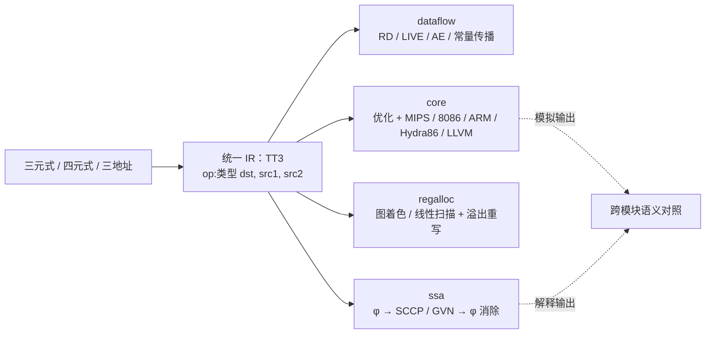

# 单线程后端工具链（`library/transfer`）

> **定位：编译器工具链的参考实现。** 本库用同一份四元式把"优化的后半段 + 三套
> 教学目标机代码生成 + 模拟执行"完整走一遍，并可降低到 Hydra86 原生汇编或 LLVM IR；它不是
> 生产级编译器（不做真实 ABI / 寄存器约束 / 目标文件格式 / 优化正确性证明），
> 也不参与 `ParseEngine` 生成器的构建。评估它的产出时按"参考实现 + 自检全绿"
> 来看，不要按"能编译真实程序"来要求；完整说明见 [技术报告.md](技术报告.md)。

五个后端库合成的一个库：**一套 IR + 一个命令行 `t1t` + 一条端到端流水线**，
从三元式 / 四元式一路走到寄存器分配与模拟执行；整库是单线程、单进程、只用
C++17 标准库。

> **同一套四元式模型还有一个 Rust 版**：crate `quad_transfer` 在
> [`../transfer-rust/`](../transfer-rust/README.md)——四元式 → 优化 → MIPS / 8086 /
> ARM → 模拟执行，只用 Rust 标准库、无第三方依赖，自检跑的是 `core/example` 里
> **同一批 `.quad`**（26 份：23 通过 / 0 失败 / 3 跳过，跳过的是负例——Rust 版不校验
> `# 期望错误:`）。数据区三件套（`addr` / `load` / `store` + `.dataarea`）也实现了。
> 想对照「同一份设计在两种语言里怎么落地」可以从它入手。



```text
make -C library/transfer check      # 全部自检
t1t pipeline examples/03_loop.quad             # 一条流水线跑完五块
t1t ssa --mode=dom ssa/examples/03_const_branch.ssa
```

## 内部只有一套 IR

全库共用 `ir/typed_ir.hpp` 的**带位数三地址指令**（TT3）：三地址的 `dst, src1, src2`
形状 + 四元式的类型信息。指令类型、基本块类型、解析器、打印器各只有一份，
`dataflow` / `ssa` / `regalloc` 只是在同一份 `Program` 上做不同的分析。

```text
decl i32 t1                      ; 声明（不写按 i16）
  add:i32 t1, t2, 3              ; op:类型 dst, src1, src2
  ld:u16  v, [slot:u16]          ; 内存操作数自带位数
  jz:i32  t1, L1                 ; jmp 标号在 src1、jz/jnz 标号在 src2
```

类型 = 位宽 + 符号（`i8…u128`、`f32/f64`）。**输入语言由命令行区分，转换只在入口做一次**：

| `--from=` | 输入 | 入口 |
| --- | --- | --- |
| `quads`（缺省） | 四元式 | 降级到 TT3（保留位数） |
| `triples` | 三元式 | 三元式 → 四元式 → TT3 |
| `3addr` | 已经是三地址 / TT3 | 不转换，直接进后半段 |

## 目录与模块

| 目录 | 内容 | 文档 |
| --- | --- | --- |
| `ir/` | 统一 IR：指令、基本块、解析、打印、CFG | 本文 |
| `irbuild/` | 四元式 / 三元式**构建器**（链式 API） | [`irbuild/README.md`](irbuild/README.md) |
| `core/` | 带类型四元式：优化、MIPS / 8086 / ARM / Hydra86 / LLVM 代码生成、执行器 | [`core/README.md`](core/README.md) |
| `irbridge/` | 三元式 ↔ 四元式互转 | [`irbridge/README.md`](irbridge/README.md) |
| `dataflow/` | 数据流框架：格 + 传递函数 + 两种求解器 + 单调性检查 | [`dataflow/README.md`](dataflow/README.md) |
| `ssa/` | 支配树 / φ / SCCP / GVN / φ 消除 | [`ssa/README.md`](ssa/README.md) |
| `regalloc/` | 图着色 / 线性扫描 + 溢出重写 | [`regalloc/README.md`](regalloc/README.md) |
| `app/` | `t1t` 命令行、`pipeline`、`transfer` 子命令 | 本文 |
| `examples/` | 端到端流水线示例 + 自检 | [`examples/README.md`](examples/README.md) |

各模块的设计细节见同目录的技术报告（`<模块>/技术报告.md`）；合并后的整体设计见
[`技术报告.md`](技术报告.md)。

## 命令行

```text
t1t irbridge …   三元式 ↔ 四元式        t1t irbuild  …   用构建器造四元式 / 三元式
t1t ssa      …   SSA / SCCP / GVN / φ
t1t dataflow …   四个数据流分析         t1t regalloc …   寄存器分配
t1t transfer …   四元式 → 目标代码 → 模拟
t1t pipeline …   一条流水线跑完上面五块，并做跨模块语义对照
t1t pipeline 文件.ast   直连前端：AST → 四元式 → 优化 → 后端 → 分析一条命令跑完
t1t transfer --no-opt …   跳过优化（地址模型（指针元素数组的两条并行向量）会被优化器过度折叠时用）
t1t transfer 文件.quad --data=数据.bin --layout=布局表   挂数据区，跑 addr / load / store 三件套
t1t pipeline 文件.quad --data=数据.bin --layout=布局表   同一条流水线跑带数据区的程序（三件套进"跳过"表，第 ⑦ 步不对照）
```

每个子命令与单独跑那一步的命令行完全一致（`-h` 看用法）。

### Hydra86 后端

`--target=hydra86` 生成 Hydra86 的 `.data` / `.code` 原生汇编。后端覆盖不超过
64 位的整数、算术与位运算、比较、跳转、函数调用（含递归）以及整数输出；尚未映射的
浮点、字符串、向量、文件、数据区和输入指令会在生成期明确报错。

Hydra86 已拆分为独立仓库 <https://gitee.com/rabbitc999/hydra-86>。CMake 按以下顺序
寻找 Hydra86 源码：显式的 `T1T_HYDRA86_ROOT`（缓存变量或环境变量）→ 同级的
`../hydra-86` 或 `../../hydra-86` 目录。目录中存在 `CMakeLists.txt` 时，CMake
自动链接稳定接口 `pvm_cli`，CLI 和 pipeline 会调用 `Hydra86::runAssembly` 真正装配并
运行；源码找不到时仍可生成汇编，并给出未嵌入提示。也可以显式指定源码位置：

```text
cmake -S library/transfer -B build/transfer -DT1T_HYDRA86_ROOT=/path/to/hydra-86
cmake --build build/transfer
build/transfer/t1t transfer demo.quad --target=hydra86 --asm \
  --asm-out=demo.hydra86.asm --bin-out=demo.bin
```

`--asm-out` 保存不含命令行日志的纯汇编；`--bin-out` 调用 Hydra86 官方汇编器，写出
v2 变长指令镜像，并从该二进制镜像执行。`--bin-out` 仅在嵌入 Hydra86 的 CMake 构建中可用。

`Makefile` 构建保持零外部依赖，只提供 Hydra86 汇编生成；需要同进程执行时使用 CMake。

### LLVM 后端

`--target=llvm` 把不超过 64 位的整数四元式直接降低为 LLVM IR 文本，覆盖声明、赋值、
整数算术与位运算、比较、跳转、函数调用（含递归）、返回、整数输出和停机。生成结果通过
`--asm-out` 保存为 `.ll`，再交给 Clang 编译：

```text
t1t transfer examples/01_arith.quad --target=llvm --asm-out=demo.ll
clang demo.ll -O2 -o demo.exe
demo.exe

# 同一份、未经改写的 transfer LLVM IR 可继续导出 Hydra86：
t1t transfer demo.ll --from=llvm --target=hydra86 \
  --asm-out=demo.hydra86.asm --bin-out=demo.bin
```

LLVM 后端不调用教学模拟器；CMake 能找到 `clang` 时会自动注册 `llvm-clang-e2e`，实际编译并
运行直线算术与递归程序。当前不映射 128 位整数、浮点、字符串、输入、数据区、文件与中断，
遇到这些指令会在生成阶段明确报错。生成 `.ll` 本身不需要 LLVM SDK 或链接 LLVM 库。
生成器会在 `.ll` 中保留 Base64 四元式载荷及 LLVM 正文的 FNV-1a 校验，供 Hydra86 桥接
复用既有 lowering；正文被 LLVM 优化器或人工修改后会因校验不符而拒绝。该功能是本项目
LLVM IR 的受控桥接，不等同于完整的 LLVM Target，也不提供 `llc -march=hydra86`。
**结论（2026-09-19）：四元式优化引擎可以用，扁平化不可以用。**

- **推荐**：`core/`（带类型四元式 + 优化器 + 五套目标代码生成 + 执行器）、
  `irbridge/`、`dataflow/`、`ssa/`、`regalloc/`——它们都直接吃四元式，不依赖任何语言前端。
- 要做“从语言到代码”这件事，改用 [`project/pl0-super/`](../../project/pl0-super/README.md) 那条
  **不建中间表示、简化代码直接出目标代码**的路子。

## 自检跑什么

`make check` 分三层：

- **模块单测**：irbridge / dataflow / ssa / regalloc / irbuild、Hydra86 汇编与 v2 镜像，
  以及 LLVM IR 结构检查；找到 Clang 时再做真实编译与运行；
- **示例集**：core 26 个、dataflow 5 个、ssa 5 个、端到端流水线 3 个；
- **命令演示**：regalloc / ssa / dataflow / irbridge / irbuild 各跑一条。

端到端流水线要求 **transfer 模拟输出 == 三地址解释输出 == 文件里声明的期望**。

`examples/` 实测：`01_arith` → `7 6`、`02_branch` → `10`、`03_loop` → `15 5`（φ 2、用色 3）。
