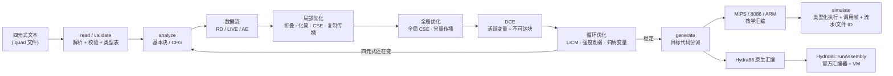
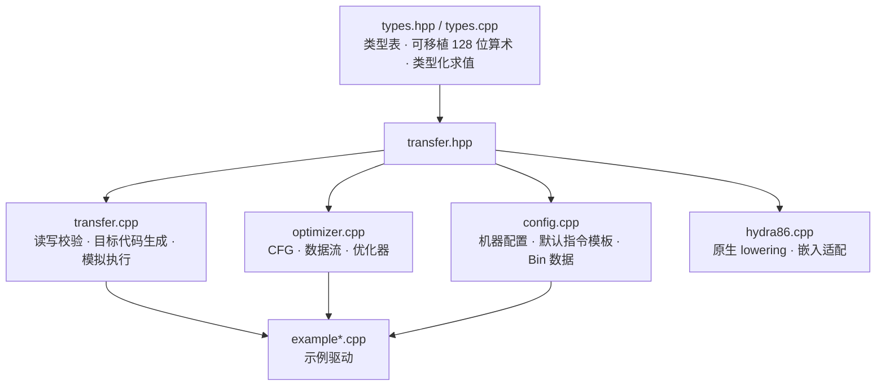
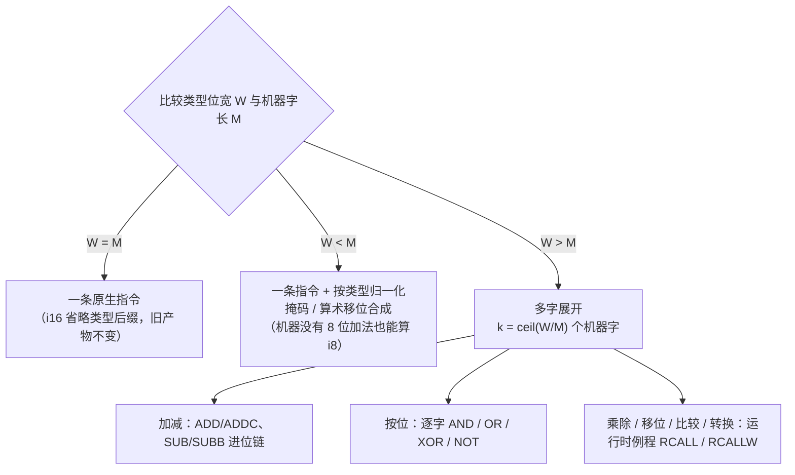
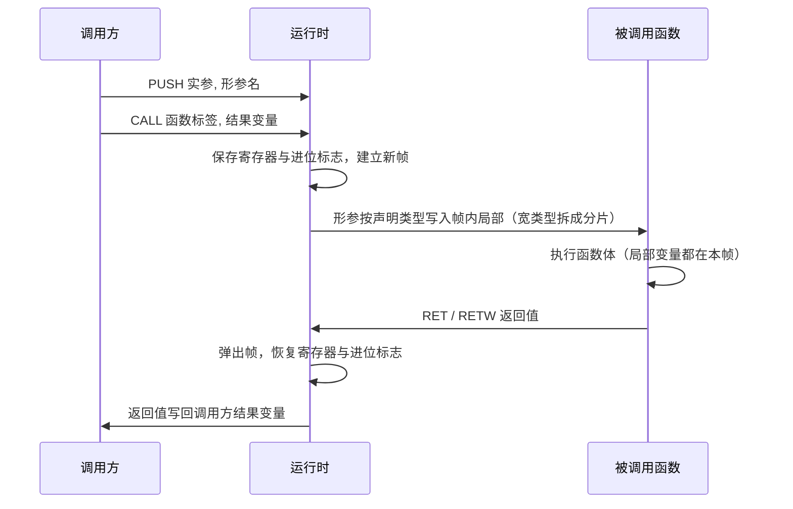
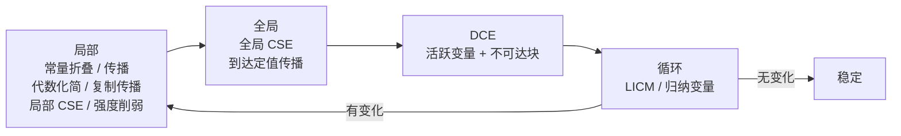
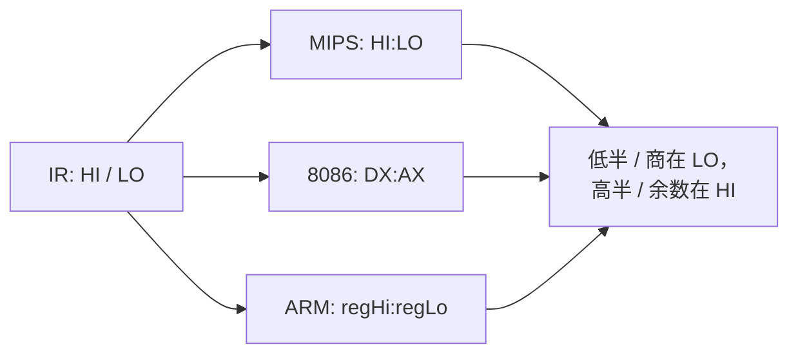
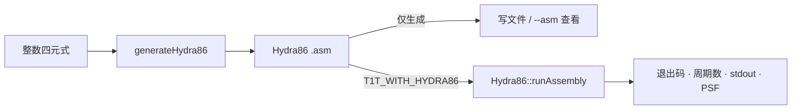
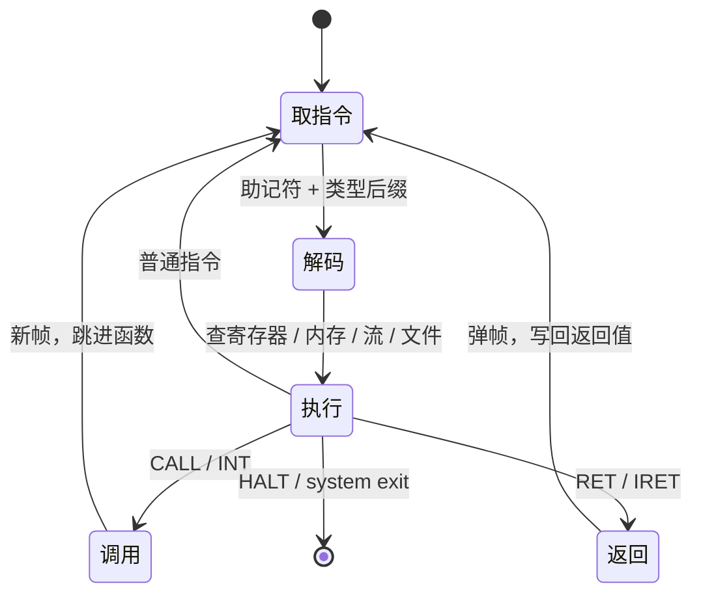

# 四元式优化与目标代码转换库 · 技术报告

> 该模块已在合并库 [library/transfer](../README.md) 内，与 irbridge / core / dataflow / ssa / regalloc 共用**一套带位数信息的三地址 IR**（`ir/typed_ir.hpp`，指令类型、基本块类型、解析与打印各只有一份）。本文里的命令按**单模块**写；整条流水线用 `make -C library/transfer check` 或 `build/transfer-one-thread/t1t pipeline <file>`。

本报告说明 `library/transfer` 的设计与实现：它把**带类型**的四元式
`(op, arg1, arg2, result[, extra])` 经过基本块 / CFG、数据流分析与多轮优化，
转换成 MIPS / 8086 / ARM 风格的教学汇编并由内置模拟器执行，也可以转换成
Hydra86 原生汇编。汇编生成只依赖 C++17 标准库；需要同进程装配执行 Hydra86 时，
CMake 可选链接其稳定嵌入库 `pvm_cli`。

**定位：编译器工具链的参考实现**（教学 / 对照 / 做实验用）。产出是教学目标机
汇编 + 执行器，不追求通用真实 CPU ABI、指令调度、目标文件格式与优化正确性的形式化证明；
读完能照着做一遍，就是它的目标。

报告里的图都用代码生成：流程图与结构图是 **Mermaid** 源码（GitHub 与多数
Markdown 渲染器可直接渲染），公式用 **LaTeX** 写成。

## 1. 目标与范围

| 目标 | 做法 |
| --- | --- |
| 变量带类型 | `i8/u8/i16/u16/i32/u32/i64/u64/i128/u128/f32/f64/str`，`decl` 声明，未声明按 i16 |
| 机器字长可配置 | `word_bits ∈ {8,16,32,64}`，决定一条运算是一条指令还是多字展开 |
| 高位宽 / 窄位宽都要能算 | 更宽：分片 + 进位链 + 运行时例程；更窄：按类型归一化 |
| 常见运算符齐全 | 算术、关系、移位、按位、进位加 / 借位减、无符号、浮点、类型转换 |
| 乘除法用固定寄存器 | IR 写 `HI`/`LO`，目标机映射成 `HI:LO` / `DX:AX` / `regHi:regLo` |
| 高级指令 | 输入输出、流、字符串、向量、外部文件、系统调用、函数调用与中断 |
| 一条命令可由多条指令完成 | 配置里的 `cmd.*` 模板支持多行（重复键追加或写 `\n`） |
| 报错要能区分 | ①四元式合法但机器没有该指令；②四元式本身不存在 |

## 2. 总体架构



模块划分（C++ 侧）：



## 3. 类型系统

每个类型有**位宽** $W$ 与**种类**（有符号整数 / 无符号整数 / 浮点 / 字符串）。
整数按位宽截断到二补码，回绕定义为

$$
\operatorname{wrap}_W(v) \;=\; \bigl((v + 2^{W-1}) \bmod 2^{W}\bigr) - 2^{W-1},
\qquad v \in \mathbb{Z}.
$$

同一段位模式按不同种类解释：

$$
\operatorname{unsigned}_W(b) = \sum_{i=0}^{W-1} b_i 2^{i},
\qquad
\operatorname{signed}_W(b) = \operatorname{unsigned}_W(b) - b_{W-1}\,2^{W}.
$$

字面量的合法性按类型检查：有符号 $iW$ 允许
$[-2^{W-1},\,2^{W-1}-1]$，无符号 $uW$ 允许 $[0,\,2^{W}-1]$；无符号上下文里
写负数时先按同宽有符号解析再按位转换（`-1` 在 `u32` 里就是 `0xFFFFFFFF`）。

浮点用 IEEE-754：`f32` 每步舍入到单精度，`f64` 用双精度；整数与浮点之间的
`cvt` 按 C 语义——浮点转整数向零截断，越界报错。

字符串类型是 `str`，值是字节串，字面量写 `"..."`（支持 `\n` `\t` `\r`
`\\` `\"`）；`slen` 按字节数计，`scmp` 按字典序，都是**字节序**语义，
UTF-8 文本按字节处理。

## 4. 机器字长与展开策略

机器有原生字长 $M$（`word_bits`），类型位宽 $W$。后端三分支：



宽类型的变量按机器字**分片**存储：低字是 `x#0`，次低字是 `x#1`，……
分片个数

$$
k = \left\lceil \frac{W}{M} \right\rceil .
$$

多字加法的进位关系是逐字串起来的：

$$
s_i = (a_i + b_i + c_i) \bmod 2^{M},
\qquad
c_{i+1} = \left\lfloor \frac{a_i + b_i + c_i}{2^{M}} \right\rfloor ,
\qquad c_0 = 0 ,
$$

最低字用不进位的 `ADD`（$c_0 = 0$），其余字用带进位的 `ADDC`；减法同理用
`SUB` / `SUBB`。这正是"加法分进位 / 不进位"和"机器不一定有 64 位运算"
两条需求的落点。

**取内存分位数**：窄类型一条 `LD.<类型>` / `ST.<类型>`；宽类型逐字搬运，
每次只走一个机器字。**立即数不一定凑得够机器字长**：常量按字拆开，逐字
写入分片：

$$
v = \sum_{i=0}^{k-1} v_i \, 2^{iM},
\qquad v_i = \left\lfloor \frac{v}{2^{iM}} \right\rfloor \bmod 2^{M}.
$$

## 5. 指令集

### 5.1 四元式操作一览

| 家族 | 写法 | 语义要点 |
| --- | --- | --- |
| 声明 | `(decl, i32, global, x)` | 类型 + 作用域（`global` / `local` / `_`） |
| 算术 | `+ - * / %` | 整数按 $\operatorname{wrap}_W$ 回绕；浮点 IEEE-754；除零 / 除溢出报错 |
| 进位 | `+c`、`-b` | 带进位加 / 带借位减，进位标志串起多字加减链 |
| 双寄存器乘除 | `(mul, a, b, lo, hi)`、`(div, a, b, q, r)` | 乘法进高低半，除法进商和余数 |
| 一元 | `neg`、`odd`、`~`、`cvt:i32` | 取负 / 奇偶 / 按位取反 / 类型转换 |
| 关系 | `== != < <= > >=` | 结果 0/1（默认 i8），有符号 / 无符号按类型 |
| 移位按位 | `<< >> & \| ^` | 右移：有符号算术、无符号逻辑；移位位数按 $W$ 取模 |
| 控制 | `label`、`j`、`jz`、`jnz`、`halt` | 基本块边界与跳转 |
| 调用 | `param`、`call`、`ret` | 实参绑定形参名，返回值写回调用方变量 |
| 中断 | `int`、`iret` | 中断帧进出 |
| 输入输出 | `read`、`write`、`print`、`putc`、`getc` | 数值 / 字符串 / 字符 |
| 流 | `stream`、`sread`、`swrite`、`sclose` | 流句柄就是流名：`STDIN` / `STDOUT` / `STDERR` / 自定义 |
| 字符串 | `scopy`、`slen`、`scmp`、`scat`、`ssub`、`sfind` | 复制 / 长度 / 比较 / 拼接 / 子串（地址+长度）/ 查找 |
| 向量 | `vload`、`vstore`、`vcopy`、`vfill`、`vsum`、`vmax`、`vmin` | 操作数是"地址 + 下标或长度"，元素位数写在指令后缀里 |
| 文件 | `fopen`、`fread`、`fwrite`、`fclose`、`feof` | 真实宿主文件读写，路径相对当前工作目录 |
| 系统调用 | `(system, getpid, _, p)` | `exit` / `time` / `ticks` / `getpid` / `rand` / `brk` / `putchar` / `getchar` |
| 数据区 | `addr`、`load`、`store` | 取数据区符号基址 / 按地址读 8 字节小端 / 按地址写 8 字节小端 |
| 伪指令 | `decl`（声明） | 不产生指令，只建立类型 / 作用域表 |

数据区三件套与 `library/stackvm` 的 `ADDR` / `LOADAT` / `STOREAT` 同义：地址是
数据区里的**字节偏移**，读写都是 8 字节小端。`--data=<bin> --layout=<file>`
把 `simple_ast` 生成的 `.data.bin` 与 `.layout` 挂进来，生成器再写进汇编的
`.dataarea 字节数` 段（`.sym 符号 基址` + `.hex 偏移 十六进制串`），模拟器据此
执行。地址可能是窄机器上的多字变量（`i64` 分片），所以三条都是运行时伪指令，
由模拟器按整值凑出地址 —— 与 `VLOAD` / `FOPEN` 同理，三种目标机生成同一条指令，
机器能力用指令族 `data` 表示。

### 5.2 字符串语义

设字符串 $s = c_0 c_1 \dots c_{n-1}$（字节）：

$$
\operatorname{slen}(s) = n, \qquad
\operatorname{ssub}(s, p, \ell) = c_p c_{p+1} \dots c_{p+\ell-1}\ (\text{越界截断}),
$$

$$
\operatorname{scmp}(a,b) =
\begin{cases}
-1, & a < b \quad (\text{字典序}),\\
0, & a = b,\\
1, & a > b.
\end{cases}
\qquad
\operatorname{sfind}(h,n) = \min\{\,i \mid h[i..i+|n|) = n \,\}\ \text{（找不到给 } -1\text{）}.
$$

### 5.3 向量语义

向量是"基地址 + 元素位宽 + 长度"的视图：元素地址记作 `base.i`，元素类型由
类型后缀给出（例如 `vsum:i32`）。批量运算按元素逐一规约：

$$
\operatorname{vsum}(v, \ell) = \sum_{i=0}^{\ell-1} v_i ,
\qquad
\operatorname{vmax}(v, \ell) = \max_{0 \le i < \ell} v_i ,
\qquad
(\operatorname{vcopy}(d, s, \ell))_i = s_i .
$$

### 5.4 机器能力与两类报错

每台机器用一个**指令族集合**描述（配置键 `features=...` 或
`feature.<族>=off`）：`carry`、`shift`、`bitwise`、`mul`、`div`、`float`、
`string`、`vector`、`stream`、`file`、`system`。当四元式合法但机器没有对应
指令族时，生成阶段报"指令存在、机器不存在"：

```text
四元式 2 (*:i32) 存在，但目标机 mips 没有实现指令族 'mul'
（配置里可用 feature.mul=on 打开）
```

而当操作名本身不是本库的四元式时，校验阶段报"未知四元式"：

```text
第 1 条四元式的操作 'frobnicate' 不存在（未知四元式）
```

机器缺少 `vector` / `string` 指令族时，后端尽量用**低级指令替代**：

缺什么指令族就用低级指令补什么，能展开的都展开：

| 缺的指令族 | 低级替代 | 覆盖范围 |
| --- | --- | --- |
| `mul` | 常量乘数展开成移位加 $x \cdot \sum 2^{k} = \sum (x \ll k)$；变乘数用**移位加循环**（`if (b \& 1) acc += a; a \ll= 1; b \gg= 1;` 循环 $W$ 次） | 类型不超过机器字长 |
| `div` | 常量 2 的幂除数：`/` 用逻辑右移、`%` 用按位与掩码；一般除数（含变除数）用**移位减循环**（逐位试商：`r = (r \ll 1) \| bit; if (r \ge b) { r -= b; q \|= 1 \ll i; }`） | 无符号类型 |
| `float` | 常量浮点运算在生成期折叠；运行时浮点转成**运行时软浮点例程调用**（`RCALL`，例程内部用整数加减、移位与分支实现，等价于 libgcc 的 `__addsf3` 一类） | 常量 + 软浮点例程 |
| `vector` | 下标 / 长度是常量且元素不超过机器字长时展开成逐元素的类型化取内存、存内存与标量运算 | 常量下标 / 长度 |
| `string` | 操作数是常量时在生成期算好：数值结果（`slen` / `scmp` / `sfind`）退化成常量赋值，字符串结果用一条字符串常量装载写进目标变量 | 常量字符串 |

仍然需要该指令族（或手写循环）的情形会明确报错，并说明缺什么：

- 有符号除法（`div` 缺失时只做无符号；有符号要自己处理符号位）；
- 宽类型（比机器字还宽）的乘除——分片乘除要走运行时例程；
- 变下标 / 变长度的向量——符号化内存没有地址运算，需要先换成"基址 + 偏移"
  的数组模型；
- 变量字符串运算——`str` 是不透明值，需要先换成字节数组再写逐字节循环。

## 6. 调用、中断与栈帧



一帧的内容：

$$
\mathcal{F} = \bigl(\underbrace{r}_{\text{返回地址}},\;
\underbrace{d}_{\text{结果变量}},\;
\underbrace{\{v \mapsto \text{值}\}}_{\text{局部变量}},\;
\underbrace{\sigma(R)}_{\text{保存的寄存器}},\;
\underbrace{c}_{\text{进位标志}},\;
\underbrace{\text{flags}}_{\text{中断帧标记}}\bigr).
$$

因为局部变量按帧存放、寄存器与进位标志在调用时保存，**递归**是安全的；
`int` / `iret` 复用同一套机制，只是用中断帧标记区分，`IRET` 遇到调用帧会报错。

## 7. 数据流分析与优化

基本块由 leader 划分：入口、标签、跳转 / 停机 / 返回之后的第一条指令。
CFG 的边：条件 / 无条件跳转连到目标块，`call` / `int` 连到被调用函数标签
（保证函数体可达、不被当死代码删掉），`ret` / `iret` 是出口。

三种数据流方程（$IN$ / $OUT$ 为块入口 / 出口集合）：

$$
\begin{aligned}
\text{到达定值：} \quad & OUT_{RD}(B) = GEN_{RD}(B) \cup \bigl(IN_{RD}(B) \setminus KILL_{RD}(B)\bigr),
& IN_{RD}(B) = \bigcup_{P \in pred(B)} OUT_{RD}(P);\\[2mm]
\text{可用表达式：} \quad & OUT_{AE}(B) = GEN_{AE}(B) \cup \bigl(IN_{AE}(B) \setminus KILL_{AE}(B)\bigr),
& IN_{AE}(B) = \bigcap_{P \in pred(B)} OUT_{AE}(P);\\[2mm]
\text{活跃变量：} \quad & IN_{LIVE}(B) = USE(B) \cup \bigl(OUT_{LIVE}(B) \setminus DEF(B)\bigr),
& OUT_{LIVE}(B) = \bigcup_{S \in succ(B)} IN_{LIVE}(S).
\end{aligned}
$$

优化器每轮跑四遍，四元式文本不再变化就停：



保守之处：`call` / `int` 视为"可能改写任意全局变量"——杀掉到达定值、清空
常量 / 复制缓存、把全部可观察变量算作活跃，这样调用点前后不会做错误传播，
也不会删掉调用前可能被读取的定义。

## 8. 目标代码生成

### 8.1 一条命令 = 多条指令

配置里的每个模板（`cmd.*`、`memory_load` / `memory_store` / `immediate_load`、
`load.<类型>` / `store.<类型>`）都可以由**多条指令**组成：写 `\n` 分隔，或者
重复写同一个键追加。生成阶段逐行展开，每行各自替换占位符、各自加类型后缀。

例如 8086 的除法要三条指令：

```ini
cmd.div=CWD
cmd.div=IDIV {rhs}
cmd.div=MOV {dst}, AX
```

MIPS 的 32 位除法要两条：

```ini
cmd.div=DIV {lhs}, {rhs}
cmd.div=MFLO {dst}
```

### 8.2 固定寄存器对

乘法与除法的结果进**固定的命名寄存器对**，IR 里写 `HI` / `LO`，生成时换成
目标机寄存器名：



类型后缀规则：类型是 `i16` 时不写后缀（保持旧产物逐字不变），其余类型把
后缀加在助记符上——

$$
\text{指令} = \text{助记符} \;[\;.\;\text{类型}\;] \quad
\text{例如 } \texttt{MULU.u32},\ \texttt{LH.i8},\ \texttt{FCMP.f64},\ \texttt{VSUM.i32}.
$$

### 8.3 Hydra86 原生后端

Hydra86 不走 `MachineConfig::commands` 的教学指令模板，而由 `generateHydra86()` 单独
lowering。它输出 Hydra86 汇编器直接接受的 `.data` / `.code`：变量与大立即数放在
`dq` 槽位，`r8` 到 `r12` 是 lowering 临时寄存器，入口固定为 `_start`。



| 项目 | 当前实现 |
| --- | --- |
| 数据 | 每个变量一个 `dq`；标签和变量名重新编码，避免源名字污染汇编符号 |
| 算术 | `+ - * / %`、移位、按位与一元运算；有符号除法先处理符号再用 Hydra86 `div/mod` |
| 控制流 | `label/j/jz/jnz` 与六种比较，关系结果物化成 0 / 1 |
| 调用 | `param/call/ret`；调用前保存非全局槽位，参数经暂存槽传递，因此递归可用 |
| 输出 | `write` 调用内置十进制转换例程，再以 `stdout_write` syscall 输出 |
| 当前边界 | 不超过 64 位的整数标量；浮点、字符串、向量、文件、数据区和输入指令生成期报错 |

对接层只有 [hydra86.hpp](hydra86.hpp) 中三个入口：`generateHydra86()`、
`hydra86Embedded()`、`runHydra86()`。后者返回 `Hydra86Execution`，保留 VM 的退出码、
周期数、标准输出、PSF 与错误信息。CMake 按 `T1T_HYDRA86_ROOT`（显式指定或环境变量）
→ 同级 `../hydra-86` / `../../hydra-86`（Hydra86 独立仓库的常见克隆位置）的顺序查找，
也接受 `-DT1T_HYDRA86_ROOT=/path/to/hydra-86`；找不到源码时不定义 `T1T_WITH_HYDRA86`，
生成汇编的能力仍然存在。

## 9. 模拟执行

本节描述 MIPS / 8086 / ARM 三套教学机的内置模拟器。它直接执行生成的汇编：
解析头部（`.target` / `.bits` / `.mulpair` /
`.reg`）、四个段（`.data` / `.rodata` / `.stack` / `.code`），然后逐条执行。



执行状态：寄存器表（值是带类型的 `Value`）、内存（符号名 → 值）、进位标志、
比较结果、调用帧栈、流游标 / 输出、打开的文件表。关键语义：

- **类型化算术**：整数按位宽回绕，右移按符号性选算术 / 逻辑，浮点按精度舍入；
- **宽类型**：分片拆装，`RCALL` / `RCALLW` 等运行时伪指令按整值计算；
- **字符串 / 流 / 向量 / 文件 / 系统调用**：按第 5 节语义实现，文件是真的
  宿主文件（路径相对当前工作目录），`system exit` 结束程序并给出退出码；
- **防呆**：步数上限、未初始化读取报错、只读区写入报错、类型宽度超过机器字长
  的指令报错、未知指令报错，`TRANSFER_TRACE=1` 可打印每条执行过的指令。

## 10. 示例与验证

示例程序全部**从文件读取**（`example/*.quad`，元信息写在注释里），由
`transfer-examples`（C++）逐个运行并比对期望。

| 示例 | 覆盖内容 |
| --- | --- |
| `minimal.quad` / `operators.quad` | 最小流程、移位按位与强度削弱 |
| `01_types.quad` / `10_signed.quad` | 类型声明、有符号 / 无符号解释 |
| `02_unsigned.quad` / `06_muldiv.quad` | 无符号乘除、双寄存器结果 |
| `03_float.quad` | f32 / f64 与 `cvt` |
| `04_wide.quad` / `12_word32.quad` | 同一段 u64 程序在 16 位 / 32 位机器上的展开 |
| `05_carry.quad` | 进位加 / 借位减 |
| `07_io.quad` / `14_streams.quad` | 输入输出与 STDIN / STDOUT / STDERR 流 |
| `08_call.quad` / `09_interrupt.quad` | 递归调用与中断 |
| `11_data.quad` | 命名数据、只读区、Bin 数据区 |
| `13_strings.quad` | 字符串复制 / 长度 / 比较 / 拼接 / 子串 / 查找 |
| `15_vector.quad` | 向量填充 / 存取 / 复制 / 求和 / 最大值 |
| `16_syscall.quad` | 系统调用 |
| `17_file.quad` | 外部文件写读与 EOF |
| `18_machine_missing.quad` / `19_unknown_quad.quad` | 两类报错的负例 |
| `20_low_level_fallback.quad` | 只有加减 / 移位 / 按位 / 进位的机器上，用常量展开与循环代替乘除法 |
| `21_data_area.quad` | 数据区三件套（`.data.bin` + `.layout`）：取基址、按地址读、按地址写 |
| `22_loop_call.quad` | 循环 + 调用：跨 `call` 的循环变量不参与常量传播（优化器回归） |
| `23_data_missing.quad` | 负例：`feature.data=off` 的机器没有数据区指令族 |

教学后端实测结果（`make -C library/transfer check`，2026-09-19）：

```text
共 26 个示例：26 通过，0 失败（C++ 版）。
三种目标机结果一致（operators 示例在 MIPS / 8086 / ARM 上输出相同）。
```

Hydra86 嵌入回归（2026-09-27）另测四条路径：直线算术输出 `20`、循环 / 调用输出
`10`、递归阶乘输出 `120`、负数除法输出 `-3 -1`。链接 Hydra86 源码的 CMake 构建中，
整个 `library/transfer` CTest 为 **9 / 9 通过**；`minimal.quad` 经 Hydra86 VM 输出 `5`，
`03_loop.quad` 经 pipeline 输出 `15 5`，与 TT3 解释器一致。

## 11. 实现说明

- **宽类型乘除**：双寄存器乘法支持到 64 位（乘积正好放进 128 位）；128 位用
  单寄存器 `*` `/` `%`。宽类型的乘除交给运行时例程，真实后端可换成移位减循环。
- **字符串是字节串**：按字节计数与比较，不区分 Unicode 码点。
- **向量的低级替换**：没有 `vector` 指令族时只展开常量长度的情形；非常量
  长度、`vmax` / `vmin` 会报错（需要循环展开或运行时支持）。
- **文件 IO 是真实宿主 IO**：路径相对当前工作目录，请用示例里那种构建目录
  路径，避免写进源码树。
- **教学模拟器不是真机**：MIPS / 8086 / ARM 档的 `ADDC` / `SUBB` / `RCALL` 等
  是为了讲清语义而设计的；Hydra86 档则使用 Hydra86 自己的汇编器、syscall 与 VM。

## 12. 目录与接口

```text
library/transfer/
├── core/types.hpp / types.cpp        类型表、可移植 128 位算术、类型化求值与字符串运算
├── core/transfer.hpp / transfer.cpp  四元式读写校验、目标代码生成、模拟执行
├── core/hydra86.hpp / hydra86.cpp    Hydra86 lowering 与可选嵌入适配
├── core/hydra86_test.cpp             生成、循环、递归与有符号除法回归
├── core/optimizer.cpp                CFG、数据流与优化器
├── core/config.cpp                   机器配置（含 features）、默认多指令模板、Bin 装载
├── core/example*.cpp                 四个示例驱动（都从 example/*.quad 读程序）
├── core/example/                     26 个 .quad 示例 + 机器配置 + Bin 数据 + 索引
└── Makefile                     C++ 构建与自检（make check）
```

主要入口（C++）：`read` / `write` / `validate` / `variableTypes` / `quadType` /
`analyze` / `report` / `optimizeDetailed` / `optimizeParallel` / `generate` /
`simulate` / `defaultConfig` / `loadConfig` / `loadConfigFile` / `loadDataBin`，以及
Hydra86 专用的 `generateHydra86` / `hydra86Embedded` / `runHydra86`。
类型与数值层另外提供 `types` / `typeInfo` / `U128` / `Value` / `evalTyped` /
`addWithCarry` / `subWithBorrow` / `multiplyWide` / `divideWide` /
`stringLength` / `stringCompare` / `stringConcat` / `substring` / `stringFind`。
