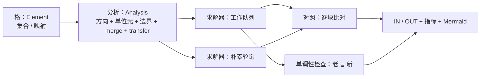
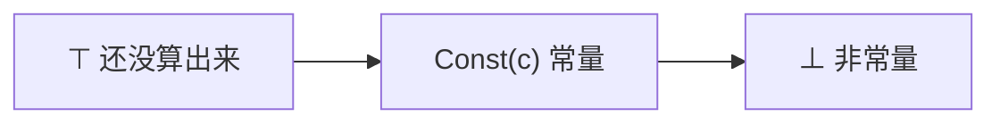
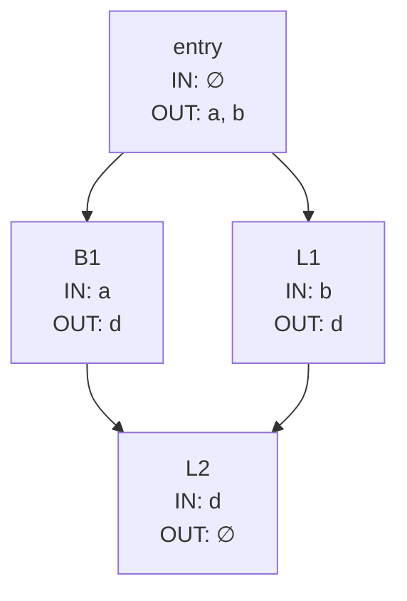

# 数据流框架 · 技术报告

> 该模块已在合并库 [library/transfer](../README.md) 内，与 irbridge / core / dataflow / ssa / regalloc 共用**一套带位数信息的三地址 IR**（`ir/typed_ir.hpp`，指令类型、基本块类型、解析与打印各只有一份）。本文里的命令按**单模块**写；整条流水线用 `make -C library/transfer check` 或 `build/transfer-one-thread/t1t pipeline <file>`。

图用代码生成（Mermaid），公式用 LaTeX。

## 1. 要解决的问题

`library/transfer` 的优化器里手写了三个数据流分析（到达定值、活跃变量、可用表达式），
每一个都各自写着"初始化、迭代到不动点、取并集 / 交集"。这种写法的代价是：
换一个新分析就要重写一遍迭代逻辑，而且**算法里的错**（格写反、方向搞反、
忘了传播一次）不会有任何提示。

`library/transfer/dataflow` 把可复用的部分抽出来：



新分析只写"格与函数"这一列，右边的对照、检查、指标、打印全部复用。

## 2. 框架模型

### 2.1 格

一个分析给的是格 $\langle L,\sqsubseteq,\sqcup,\top\rangle$：偏序、合并
（上确界）、单位元。框架要求三条代数律（`test_dataflow.cpp` 对四个实例逐个断言）：

$$
x\sqcup\top=x,\qquad x\sqcup x=x,\qquad x\sqcup y=y\sqcup x .
$$

格的顺序不必单独实现：只要合并是幂等、交换的，就可以用

$$
a\sqsubseteq b\ \Longleftrightarrow\ a\sqcup b=b
$$

反推出来——框架默认就是这么算 `lessEqual` 的，所以"顺序与合并自洽"是结构性保证，
而不是靠人记得对齐。

### 2.2 方程组

前向分析（$\mathrm{pred}$ 是前驱，$\mathrm{succ}$ 是后继）：

$$
\mathrm{IN}(b)=
\begin{cases}
\text{boundary}, & b=\text{entry},\\[2pt]
\bigsqcup\limits_{p\in \mathrm{pred}(b)}\mathrm{OUT}(p), & \text{其它},
\end{cases}
\qquad
\mathrm{OUT}(b)=f_b\bigl(\mathrm{IN}(b)\bigr),
$$

后向分析把 $\mathrm{IN}\leftrightarrow\mathrm{OUT}$、$\mathrm{pred}\leftrightarrow
\mathrm{succ}$、入口 $\leftrightarrow$ 出口同时对调：

$$
\mathrm{OUT}(b)=
\begin{cases}
\text{boundary}, & b\ \text{是出口（无后继）},\\[2pt]
\bigsqcup\limits_{s\in \mathrm{succ}(b)}\mathrm{IN}(s), & \text{其它},
\end{cases}
\qquad
\mathrm{IN}(b)=f_b\bigl(\mathrm{OUT}(b)\bigr).
$$

块内的传递函数是逐条指令的复合（前向从头到尾，后向反过来）：

$$
f_b =
\begin{cases}
f_{i_n}\circ\cdots\circ f_{i_1}, & \text{前向},\\
f_{i_1}\circ\cdots\circ f_{i_n}, & \text{后向}.
\end{cases}
$$

注意合并从**单位元**开始累加：
$\bigsqcup_{p\in P}\mathrm{OUT}(p)$ 实现成
`acc = identity; for p: acc = merge(acc, OUT[p])`。
这样做一举两得：单位元写错会立刻让结果偏掉（而不是悄悄对），而且没有前驱的块
自然得到单位元。

## 3. 求解器

### 3.1 工作队列

```text
IN[b] = OUT[b] = identity          （所有块）
队列 = 边界块（前向：入口；后向：所有出口块）
while 队列非空:
    b = 取出一个块
    重算 IN[b]（或 OUT[b]）与 OUT[b]（或 IN[b]）
    if 这个块变了 或 这是它的第一次处理:
        把它的后继（前向）/ 前驱（后向）入队
```

单调性给出终止性：状态只在格上往上走，而格的高度有穷，
所以每个块最多被"真正更新" $h$ 次（$h$ 是格的高度，集合格上 $h\le |U|$），
总块访问数上界是 $O(|B|\cdot h)$。框架另外有 `maxRounds` 兜底：不收敛就报
`收敛 ✗`，而不是转不出来。

### 3.2 朴素轮询（对照组）

不做队列，反复按块序扫一遍，直到某一轮谁也没变。它一定收敛到同一个不动点
（同一个方程组、同一个初值），所以两种求解器的结果**必须逐块相同**——
这正是框架的自检点：`sameSolution()`。它同时也是最朴素的参考实现，
新分析的期望值可以先拿它对照。

### 3.3 两个坑

**坑一：第一次处理必须传播。**"变了才传播"在只播边界种子的模式下是错的：
块的初值是**单位元**，第一次算出来的结果可能正好等于它——
比如出口块的 `OUT = boundary = ∅` 就等于单位元 `∅`。于是"没变"⇒ 不传播 ⇒
它的前驱 / 后继一次也不会被处理。实测（`--seed=boundary`）：

```text
有传播：分析 reach：两种求解器一致，块访问 4 / 8
没有传播：分析 reach：两种求解器不一致！，块访问 1 / 8   ← 只处理了入口块
```

触发条件是"入口块自己没有定义"（例如一上来就是 `jz`）或"出口块自己没有使用"。
修法是在队列里记住 `visited`：**第一次处理某个块时，无论有没有变化都要传播一次**。

**坑二：`seed=all` 不一定更快。**把所有块一开始就塞进队列，看起来"公平"，
但会让每块先白跑一遍；实测 `02_loop.df` × `reach`：

| 种子策略 | 取块顺序 | 块访问 |
| --- | --- | --- |
| 边界（缺省） | FIFO（缺省） | **5** |
| 边界 | LIFO | 6 |
| 全部 | FIFO | 6 |
| 全部 | LIFO | 10 |

所以缺省选了 `--seed=boundary --order=fifo`：既省，又是教科书里的顺序。

## 4. 四个实例

记 $\mathrm{def}(i)$ / $\mathrm{use}(i)$ 为一条指令定义 / 使用的变量集合。

| 分析 | 方向 | 格 | 单位元 / 边界 | 传递函数 |
| --- | --- | --- | --- | --- |
| `live` 活跃变量 | 后向 | 集合 $\subseteq$ | $\varnothing$ / $\varnothing$ | $f_i(S)=\bigl(S-\mathrm{def}(i)\bigr)\cup\mathrm{use}(i)$ |
| `reach` 到达定值 | 前向 | 集合 $\subseteq$ | $\varnothing$ / $\varnothing$ | $f_i(S)=\bigl(S-\{d'\mid\mathrm{var}(d')=d\}\bigr)\cup\{d@i\}$ |
| `avail` 可用表达式 | 前向 | 集合 $\supseteq$ | $U$ / $\varnothing$ | $f_i(S)=\bigl(S-\mathrm{kill}(i)\bigr)\cup\{\mathrm{expr}(i)\}$ |
| `const` 常量传播 | 前向 | $\top<\mathrm{Const}(c)<\bot$ | 全 $\top$ / 全 $\top$ | $f_i(\sigma)=\sigma[d\mapsto\mathrm{eval}]$ |

几条说明：

- `reach` 把每条定值编号成"变量@全局指令下标"，所以同一个变量的两个定值在汇合点
  会同时出现在集合里（`{a@0, b@1, c@2, d@4, d@6}`）。
- `avail` 的 $\mathrm{kill}(i)$ 有两部分：定义 $v$ 会杀掉**所有含 $v$ 的表达式**；
  `store [m], _` 会杀掉所有含 $[m]$ 的表达式。表达式键里 `add` / `mul` 的操作数
  先排序（`b add a` 与 `a add b` 同键），所以交换律不丢冗余。
- `const` 的合并是逐变量的：

$$
\mathrm{Const}(a)\sqcup\mathrm{Const}(b)=
\begin{cases}\mathrm{Const}(a),&a=b,\\ \bot,&\text{否则},\end{cases}
\qquad
\top\sqcup x=x,\qquad \bot\sqcup x=\bot .
$$



- `const` 与 `library/transfer/ssa` 的 SCCP 不同：这里**稠密**（每块都算，不折叠分支），
  SCCP 是 SSA 上的**稀疏**算法（格值一变只重解用到它的块，还会折掉常量分支）。

## 5. 单调性检查

抽象解释的正确性建立在"传递函数单调"之上：$x\sqsubseteq y\Rightarrow
f(x)\sqsubseteq f(y)$。破坏它会得到"看起来跑完了、其实是错的"结果。
框架在每次写回槽位前检查

$$
\text{老}\ \sqsubseteq\ \text{新}
\quad\bigl(\Longleftrightarrow\ \text{老}\sqcup\text{新}=\text{新}\bigr),
$$

不满足就把这次求解标成 `单调 ✗`。

`test_dataflow.cpp` 里的 `BrokenAnalysis` 是一个**故意写错**的格：并集格上的传递
函数，输入攒到 3 个元素就"清空重来"（`{"z"}`）。在

```text
label entry
  mov i, 0
label L1
  add i, i, 1
label L2
  jnz i, L1
  halt
```

上，`L1` 的输入会随 `L2` 的输出长大：2 个元素 → 3 个元素，而输出从两个元素缩成
`{"z"}`，检查器必须报出来（测试断言 `!solution.monotone`）。

## 6. 与 `library/transfer`、`library/transfer/ssa` 的关系

- **与 `transfer`**：三个实例与 `transfer/optimizer.cpp` 里手写的那三个是**同一套
  方程**，本库把它们重新实现成框架的实例。`transfer` 用自己的版本（它的 IR 是四元式）。
- **与 `ssa`**：`ssa` 的 SCCP 是同一个格（$\top$ / 常量 / $\bot$）的**稀疏**
  版本，跑在 SSA 的 def-use 图上（值一变只重解用到它的块）；本库的 `const` 是
  稠密版本，跑在 CFG 上（每块都算）。两者的对照方式：本库比"两种求解器之间"，
  `ssa` 比"优化前后解释执行"。

## 7. 实测

`--mode=mermaid` 的输出（`01_diamond.df` × `live`，直接就是 Mermaid 源码）：



块访问次数（工作队列 / 朴素轮询，缺省参数）与传递函数调用次数：

| 示例 | live | reach | avail | const |
| --- | --- | --- | --- | --- |
| `01_diamond` | 4 / 12（9 / 27） | 4 / 8（9 / 18） | 4 / 8（9 / 18） | 4 / 8（9 / 18） |
| `02_loop` | 6 / 9（21 / 27） | 5 / 9（19 / 27） | 4 / 6（14 / 18） | 7 / 12（26 / 36） |
| `03_avail` | 4 / 12（8 / 24） | 4 / 8（8 / 16） | 4 / 8（8 / 16） | 4 / 8（8 / 16） |
| `04_memory` | 1 / 1（6 / 6） | 1 / 2（6 / 12） | 1 / 2（6 / 12） | 1 / 2（6 / 12） |

四个分析在同一份程序上给出的结论（`01_diamond.df` 的汇合点 `L2`）：

```text
live   L2 IN = {d}
reach  L2 IN = {a@0, b@1, c@2, d@4, d@6}
avail  L2 IN = {a add b}
const  L2 IN = {a=1, b=2, c=3, d=⊥}
```

四行读同一张 CFG，结论各不相同——这就是为什么"方向 + 格 + 传递函数"三件套必须
分别说清楚，也是框架把这三件套显式化的价值。

```text
make -C library/transfer/dataflow check

dataflow-tests：全部通过
[通过] 01_diamond.df —— 两条路径同时定义 d：…（6 条期望；4 个分析自洽，块访问 16 vs 朴素 36）
[通过] 02_loop.df —— 循环：…（4 条期望；4 个分析自洽，块访问 22 vs 朴素 36）
[通过] 03_avail.df —— 一条路径上算过的表达式：…（4 条期望；4 个分析自洽，块访问 16 vs 朴素 36）
[通过] 04_memory.df —— 内存的读与写：…（4 条期望；4 个分析自洽，块访问 4 vs 朴素 7）
[通过] 05_roots.df —— 两个根块（主流程 + halt 之后的死块）：…（3 条期望；4 个分析自洽，块访问 8 vs 朴素 12）
共 5 个示例：5 通过，0 失败。
```
