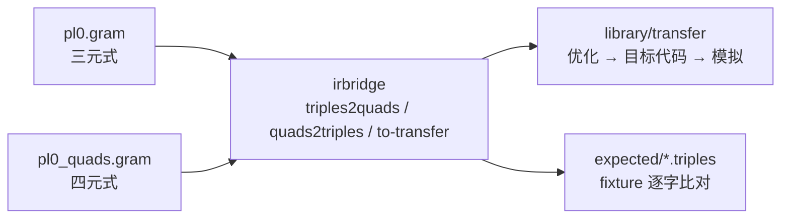
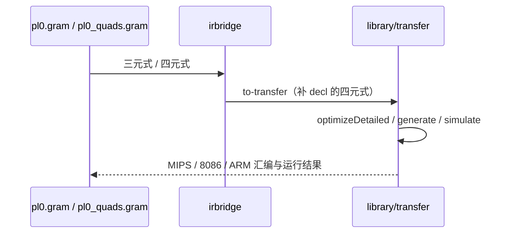

# 前端胶水（三元式 ↔ 四元式）· 技术报告

> 该模块已在合并库 [library/transfer](../README.md) 内，与 irbridge / core / dataflow / ssa / regalloc 共用**一套带位数信息的三地址 IR**（`ir/typed_ir.hpp`，指令类型、基本块类型、解析与打印各只有一份）。本文里的命令按**单模块**写；整条流水线用 `make -C library/transfer check` 或 `build/transfer-one-thread/t1t pipeline <file>`。

图用代码生成（Mermaid），公式用 LaTeX。

## 1. 要解决的问题

仓库里有两条前端路线：

- `project/pl0-ir/pl0.gram` → **三元式**：`i: (op, arg1, arg2)`，结果用下标引用；
- `project/pl0-ir/pl0_quads.gram` → **四元式**：`i: (op, arg1, arg2, result)`，结果显式写名字；
- `library/transfer` 只吃**带类型四元式**（可带 `(decl, …)` 声明）。

三者缺一座桥：同一段程序在两种形状之间怎么无损互转、前端产物怎么喂给后端。
`library/transfer/irbridge` 就是这座桥。



## 2. 两种中间表示的差别

设第 $i$ 条指令的结果为 $r_i$。三元式**不写** $r_i$，而是规定
"第 $i$ 条的结果"就是 $r_i$，引用时写下标：

$$
\text{三元式}_i = (\mathrm{op},\, a,\, b), \qquad
\text{引用第 } k \text{ 条} = (k) .
$$

四元式把结果写成独立名字：

$$
\text{四元式}_i = (\mathrm{op},\, a,\, b,\, r_i), \qquad
\text{引用} = r_i .
$$

差别只有一个——**引用是指令位置还是名字**——但代价不同：三元式里 `(3)` 的含义
绑定在"第 3 条"这个位置上，指令一移动就要重编号；四元式里 `t3` 是稳定名字，
常量传播、公共子表达式删除、循环外提、调度、寄存器分配都要求这种稳定性。
这正是 `project/pl0-ir/README.md` 里"四元式为什么更适合做优化"的解释，本库把它
变成可执行、可往返验证的转换。

## 3. 转换规则

### 3.1 三元式 → 四元式

被引用过的条目要有一个名字，于是

$$
r_i = \begin{cases}
\texttt{t}i, & \text{第 } i \text{ 条被任何 } (k) \text{ 引用},\\
\_, & \text{没被引用（值没人要）}.
\end{cases}
$$

`label` / `j` / `write` 不产生值，被 `(k)` 引用属非法输入，直接报错；`(k)` 越界
同样报错——这样错误信息停在转换器里，而不是等到后端生成出一堆垃圾。

### 3.2 四元式 → 三元式

反过来要把"名字"折回"下标"。关键是区分**值名**与**变量**：

- 值名（临时量 `tN`，或被表达式定义的名字）→ 引用写成 $(i)$，其中 $i$ 是它的
  定义所在的三元式下标；
- 变量（被 `:=` 写在目标上的名字）→ 按名字保留，因为三元式的第三个字段就是
  赋值目标。

如果一条非 `:=` 的四元式把结果落在**变量**上（`(+, x, 1, y)`），单个三元式装不下，
就拆成两条：

$$
(\texttt{+},\, x,\, 1),\; (\texttt{:=},\, (i),\, y) .
$$

这正是 `pl0.gram` 与 `pl0_quads.gram` 逐条对照时看到的样子（`(c)` 引用 + 紧跟一条
赋值）。转换器因此不丢语义，也不会把变量悄悄降级成临时量。

### 3.3 往返恒等

对形如

$$
(\texttt{<=},\, i,\, 10) \;\Rightarrow\; (\texttt{<=},\, i,\, 10,\, \texttt{t3})
\;\Rightarrow\; (\texttt{<=},\, i,\, 10)
$$

的序列，只要输入已经是"折好的"三元式（值只用下标引用、变量只用名字），往返就是
恒等的。仓库 fixture `expected/if_while.triples` 正是这种形式，自检里逐字比对：

```text
三元式：共 15 条
  3: (<=, i, 10)
  ...
四元式：共 15 条
  3: (<=, i, 10, t3)
  ...
往返后：与 examples/if_while.triples 逐字相同
```

## 4. 导出到 `library/transfer`

`to-transfer` 输出的是 transfer 的 `read()` 直接能吃的文本：先给非临时变量补
声明，再给四元式：

```text
(decl, i16, global, i)
(decl, i16, global, sum)
0: (:=, 1, _, i)
3: (<=, i, 10, t3)
4: (jz, t3, _, L2)
```

PL/0 只有整数，所以声明统一是 `i16`；临时量不声明（transfer 的默认类型就是 i16，
而且它们由表达式定义，不需要 `decl`）。于是下面这条链路是通的：



## 5. 实现要点

- **解析容错**：表头（`三元式：共 N 条` / `四元式：共 N 条`）、`#` 注释、
  行首下标的缺省、CRLF 都接受；字段用逗号分隔，允许空字段写成 `_`。
- **不引入状态**：转换是纯函数 `Triples → Quads` / `Quads → Triples`，
  便于单测与并行。
- **错误带位置**：越界引用与非值引用都给出"第几条 + 原因"，`--check` 可在 CI 里跑。
- **逐字对齐**：写出格式与仓库 fixture 一致（`%3d` 对齐的下标），所以可以直接
  `diff` 现有产物，不需要"人眼比对"。

## 6. 实测

```text
make -C library/transfer/irbridge check
  irbridge-tests：全部通过
  examples/if_while.triples → quads → triples：与 fixture 逐字相同
  examples/if_while.quads：与仓库里那份逐字相同
  stats：总条数 15 / 算术 2 / 比较 2 / 跳转 3 / 标签 3 / 赋值 4 / 输入输出 1 / 临时量 7
```

## 7. 转换说明

- 不做常量折叠与作用域解析：`p.x` 原样保留，折叠属于前端（两份 `.gram`）。
- 三元式没有类型，导出统一 `i16`；需要更宽的类型先用 `transfer` 的 `decl`/`cvt`。
