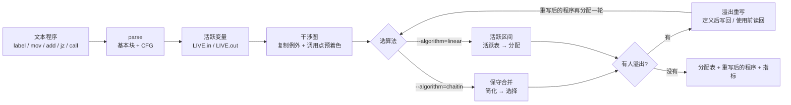
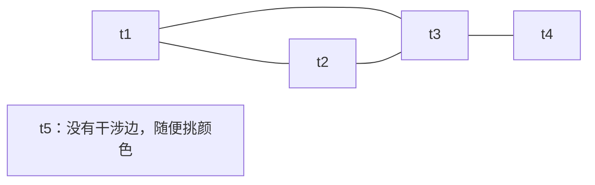
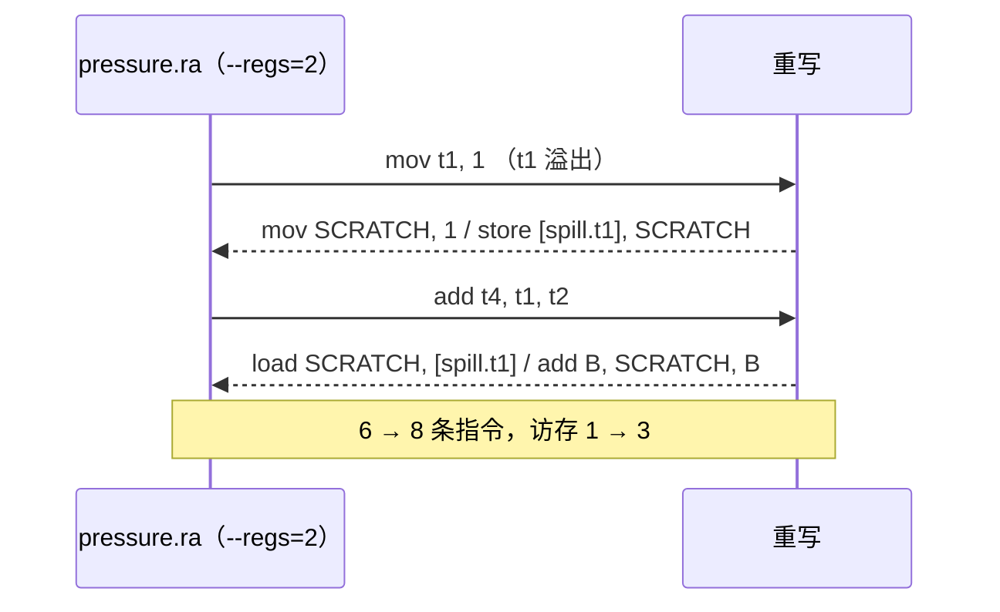

# 寄存器分配 · 技术报告

> 该模块已在合并库 [library/transfer](../README.md) 内，与 irbridge / core / dataflow / ssa / regalloc 共用**一套带位数信息的三地址 IR**（`ir/typed_ir.hpp`，指令类型、基本块类型、解析与打印各只有一份）。本文里的命令按**单模块**写；整条流水线用 `make -C library/transfer check` 或 `build/transfer-one-thread/t1t pipeline <file>`。

图用代码生成（Mermaid），公式用 LaTeX。

## 1. 要解决的问题

前端的中间代码（四元式 / 三地址码）里虚拟寄存器是无限的，目标机只有有限的 K 个
物理寄存器。分配器要在两个矛盾之间找平衡：

$$
\underbrace{\min |\text{用到的物理寄存器}|}_{\text{省寄存器}}
\qquad\text{vs}\qquad
\underbrace{\min |\text{插入的 load/store}|}_{\text{少访存}} .
$$

值的存活区间重叠时不能共用一个寄存器，于是要么**多占用一个寄存器**，要么把某个值
**溢出（spill）到栈上**、用的时候再读回来。`library/transfer/regalloc` 把这条流水线做成了
可跑、可量、可对照的教学实现：



两头都是纯文本：进去是一段带标签的虚拟寄存器程序，出来是分配表、重写后的程序和
一组对比指标。所以每次改动都能用同一批示例量出"指令数 / 访存次数"的变化。

## 2. 模型

**机器** $M=(R,\;C,\;\pi)$：可用物理寄存器集合 $R=\{r_1,\dots,r_K\}$（颜色数
$K=|R|$）、被调用者保存的子集 $C\subseteq R$、溢出槽前缀 $\pi$（缺省 `spill`，
写出的槽名是 $[\pi.v]$）。教学机 $R=\{\texttt{A},\texttt{B},\texttt{C},\texttt{D}\}$，
$C=\{\texttt{A},\texttt{B}\}$。

**程序** $P=(B_0,\dots,B_{n-1})$ 是基本块序列，$B_0$ 是入口；每块有标号、指令序列
和后继集合 $\mathrm{succ}(B)$。块尾是 `jmp` / `jz` / `jnz` 就连到目标块，否则顺序
落到下一块，`halt` 不连。

**指令**统一写成三地址形式 `op dst, src1, src2`（不用的操作数留空）。可分配的
虚拟寄存器集合是

$$
V=\Big(\bigcup_{i}\big(\mathrm{def}(i)\cup\mathrm{use}(i)\big)\Big)
\setminus\Big(\text{标号}\cup\{\texttt{SCRATCH},\texttt{SCRATCH2}\}\Big).
$$

`load d, [x]` / `store [x], s` 里的 $[x]$ **保留方括号**，这样内存符号 $x$ 与虚拟
寄存器 $x$ 不会混淆（名字规则不接受以 `[` 开头的名字，分配器自然跳过它）。
`SCRATCH` / `SCRATCH2` 是溢出重写的保留名：它们不参与分配、也不会再被溢出，
否则"溢出 → 插入 load/store → 再分配 → 再溢出"会雪球式膨胀。

## 3. 活跃变量分析

反向数据流，迭代到不动点：

$$
\mathrm{LIVE.out}(B)=\bigcup_{S\in \mathrm{succ}(B)}\mathrm{LIVE.in}(S),
\qquad
\mathrm{LIVE.in}(B)=\mathrm{USE}(B)\cup\bigl(\mathrm{LIVE.out}(B)-\mathrm{DEF}(B)\bigr).
$$

$\mathrm{USE}(B)$ 只算"用之前没在本块里被定义过"的名字，$\mathrm{DEF}(B)$ 是本块
所有定义。峰值活跃数按块内逐指令回放统计：

$$
\text{peakLive}=\max_{i}\bigl|\mathrm{LIVE}^{\text{after}}(i)\bigr| ,
$$

它是"至少需要多少个寄存器"的直接下界——`pressure.ra` 的 peakLive 是 3，所以
`--regs=2` 必然溢出，这一条不需要跑算法就能预判。

## 4. 干涉图

两个名字只要有**同时活着**的时刻就必须分到不同寄存器，为此加一条边。构造时反向
扫描每块：$i$ 的定义 $d$ 与**指令 $i$ 之后**的活跃集合里的名字干涉，

$$
E=\bigcup_{i}\Bigl\{(d,v)\;\Big|\;d\in\mathrm{def}(i),\;
v\in\mathrm{LIVE}^{\text{after}}(i),\;v\ne d,\;
\neg\bigl(\text{$i$ 是 } \texttt{mov}\ \wedge\ v=\mathrm{src}_1(i)\bigr)\Bigr\}.
$$

两个约定值得单独说：

1. **取"之后"的活跃集合**：`add t5, t4, t3` 里 $t_4$、$t_3$ 的最后一个使用点就在
   本条指令，之后它们就死了，所以 $t_5$ 与它们**不**加边，可以直接复用同一个寄存器。
   `pressure.ra` 因此只用 3 个颜色；如果按"之前"的活跃集合算，会多出
   $t_5\!-\!t_4$、$t_5\!-\!t_3$、$t_4\!-\!t_1$、$t_4\!-\!t_2$ 四条边，颜色数
   也从 3 涨到 4（$t_5$ 被 $t_4$ 顶开，只能另找一个颜色）——把这一行改掉实测，
   指标从"干涉图边数 4 / 用到的颜色 3 / 4"变成"干涉图边数 8 / 用到的颜色 4 / 4"，
   $K=4$ 的教学机刚好被吃满。
2. **复制例外**：`mov d, s` 不给 $d$ 与 $s$ 加边（见第 5 节），留给合并。

`pressure.ra` 的图（4 条边）：



$\{t_1,t_2,t_3\}$ 是三角形，**至少**要 3 个颜色：$K=4$ 时刚好够用（实测用 3 个），
$K=2$ 时一定有人溢出（实测溢出 1 个）。

## 5. 图着色（Chaitin-Briggs）

要找一个映射 $c:V\to R\cup\{\bot\}$，满足

$$
\forall (u,v)\in E:\;c(u)\ne c(v),\qquad
S=\{v\in V: c(v)=\bot\}\ \text{最小}.
$$

四步流水线：

**① 保守合并.** 对每条 `mov d, s`（两端都得是可分配的虚拟寄存器），按 Briggs
判据合并——只要求合并后的高度数邻居不多于颜色数：

$$
\bigl|\{n\in N(a)\cup N(b): \deg(n)\ge K\}\bigr|<K
\quad\text{且}\quad (a,b)\notin E .
$$

合并即"把 $b$ 的邻居接给 $a$、删掉 $b$"。**注意**：这条判据是合并的充分条件而非
必要，本实现比标准的 Briggs 更保守（不做 George 判据、不跨越物理寄存器预着色
节点合并），所以"合并掉的 mov"条数通常小于复制总数。

**② 简化.** 反复把度数 $<K$ 的节点压栈并移出图；卡住（剩下的是 $K$-核）时选一个
**最便宜**的候选当溢出：

$$
v^\*=\arg\max_{v\in V\setminus \text{stack}}\frac{\deg(v)}{\mathrm{cost}(v)+1},
\qquad
\mathrm{cost}(v)=2\cdot|\mathrm{use}(v)|+1\cdot|\mathrm{def}(v)| .
$$

使用比定义更贵（读回一次的值马上又要写回），所以权重差一倍；块里有回边
（后继编号 $\le$ 自己的块）时该块的代价再翻一倍，粗略体现"循环里的值更值得留在
寄存器里"。**度大而便宜的先溢出**。

**③ 选择.** 逆序弹栈上色：预着色节点（物理寄存器）占用的颜色不能用，否则取
$R$ 里第一个空闲颜色——这一"取第一个"的策略正是复制能同色的原因之一。栈里
所有邻居都被删光的节点总能上色，所以简化阶段的压栈顺序决定了谁是溢出。

**④ 判溢出.** 弹栈时确实没有颜色可用的节点进 $S$，交给第 6 节重写。

`pressure.ra --regs=2` 的完整轨迹（$K=2$，$\mathrm{cost}\equiv 3$）：

| 步骤 | 结果 |
| --- | --- |
| 干涉图 | $t_1\!-\!t_2$、$t_1\!-\!t_3$、$t_2\!-\!t_3$、$t_3\!-\!t_4$，$t_5$ 无边 |
| 简化 | $\deg(t_4)=1<2$ → 压栈；剩下的三角形每个点度都是 2，卡住 |
| 选溢出候选 | $\deg/\mathrm{cost}$：$t_1,t_2,t_3$ 都是 $2/4$，并列 → 按名字取 $t_1$ |
| 继续简化 | 移走 $t_1$ 后 $\deg(t_2)=1$、$\deg(t_3)=0$ → 依次压栈 |
| 选择 | $t_3\to\texttt{A}$、$t_2\to\texttt{B}$、$t_1$ 的邻居占了 A、B → **溢出**、$t_4\to\texttt{B}$、$t_5\to\texttt{A}$ |

## 6. 溢出重写

设溢出集合为 $S$，$v\in S$ 的槽名 $[\pi.v]$。重写规则是"定义后写回、使用前读回"：

$$
\frac{\;i:\ d\leftarrow f(s_1,s_2),\quad d\in S\;}{\;
i:\ \texttt{SCRATCH}\leftarrow f(s_1',s_2');\ \texttt{store}\ [\pi.d],\texttt{SCRATCH}\;},
\qquad
\frac{\;s\in S\;}{\;\texttt{load}\ \texttt{SCRATCH},\ [\pi.s]\;}.
$$

同一条指令的两个操作数都用 $\texttt{SCRATCH}$ 会互相覆盖，所以第二个用
$\texttt{SCRATCH2}$。`store [x], s` 只需要处理 $s$（$[x]$ 不是寄存器）。

重写只做**一次**局部替换，代价是可计算的：

$$
|P'|=|P|+\#\text{load}+\#\text{store}-\#\text{删掉的 mov},\qquad
\text{访存}=|\{i: \mathrm{op}(i)\in\{\texttt{load},\texttt{store}\}\}| .
$$

重写后的程序里只剩下物理寄存器与保留名，再跑一轮分配通常立刻收敛（不再有虚拟
寄存器），所以 `allocate()` 最多迭代 `maxSpillRounds`（缺省 8）轮，报告里保留
**第一轮**的分配与溢出决定，各项计数跨轮累加。



## 7. 冗余复制删除

合并（或"取第一个空闲颜色"）之后，`mov d, s` 的两端常常落到同一个物理寄存器：

$$
c(d)=c(s)\;\Longrightarrow\;\texttt{mov}\ r,r\ \text{整条删除}.
$$

这一步在重写阶段做，前提是两端都**没有**溢出——溢出的 `mov` 还承担着搬进 / 搬出
内存的作用，不能删。`copy.ra` 实测 5 → 3 条指令：两条复制直接消失。

值得写清的一点是：因为干涉图对复制是**例外**的（第 4 节约定 2），着色本来就允许
复制两端同色，所以即使加 `--no-coalesce`（合并计数 0），复制照样会在重写阶段被
删掉。合并的作用是把这件事**提前到着色之前**（少一个节点要处理），而不是决定
复制能不能消失：

| `copy.ra --regs=2` | 合并掉的 mov | 删除的冗余 mov | 指令数 |
| --- | --- | --- | --- |
| 缺省 | 2 | 2 | 5 → 3 |
| `--no-coalesce` | 0 | 2 | 5 → 3 |

## 8. 线性扫描（Poletto-Sarkar）

把程序按块顺序打平成指令序号 $0..m-1$，每个虚拟寄存器的活跃区间取首次出现到末次
出现：

$$
\mathrm{live}(v)=\Bigl[\min_{i:\,v\in \mathrm{def}(i)\cup \mathrm{use}(i)} i,\;
\max_{i:\,v\in \mathrm{def}(i)\cup \mathrm{use}(i)} i\Bigr].
$$

按起点排序后依次分配，维护一张"活跃表"：起点已经越过某个区间终点的条目就退休，
空出来的颜色可以复用。没有空闲颜色时，溢出**单位长度代价最低**的区间：

$$
\text{score}(v)=\frac{\mathrm{cost}(v)}{\mathrm{end}(v)-\mathrm{start}(v)+1},
$$

并且允许把当前区间自己作为牺牲者（新来的比谁都便宜就溢出新来的）。调用约束按
区间判断：**区间里夹着 `call`** 的值不能占用调用者保存的颜色——`call.ra` 里
$t_1,t_2,t_3$ 的区间都盖住调用点，于是 $K=4$ 时只剩 A、B 可用，溢出 1 个；
$K=2$ 时三个都溢出（7 → 13 条指令，访存 1 → 7）。

线性扫描不做合并，也不做区间分裂，所以它和 Chaitin 的结果**不保证一样**——同一批
示例两种算法各跑一遍，正是本库提供 `--algorithm=` 的意义。

## 9. 实测

```text
make -C library/transfer/regalloc check

regalloc-tests：全部通过
../../build/regalloc/regalloc --regs=4 examples/pressure.ra
../../build/regalloc/regalloc --regs=2 examples/pressure.ra
../../build/regalloc/regalloc --algorithm=linear --regs=3 examples/loop.ra
../../build/regalloc/regalloc --regs=2 examples/copy.ra
../../build/regalloc/regalloc --regs=3 examples/redef.ra
../../build/regalloc/regalloc --regs=4 examples/call.ra
```

| 示例 | 命令行 | 峰值活跃 | 干涉边 | 颜色 | 溢出 | 合并 / 删除 mov | 指令数 | 访存 |
| --- | --- | --- | --- | --- | --- | --- | --- | --- |
| `pressure.ra` | `--regs=4` | 3 | 4 | 3 / 4 | 0 | 0 / 0 | 6 → 6 | 1 → 1 |
| `pressure.ra` | `--regs=2` | 3 | 4 | 2 / 2 | 1 | 0 / 0 | 6 → 8 | 1 → 3 |
| `loop.ra` | `linear --regs=2` | 2 | 1 | 2 / 2 | 0 | 0 / 0 | 7 → 7 | 1 → 1 |
| `loop.ra` | `linear --regs=3` | 2 | 1 | 2 / 3 | 0 | 0 / 0 | 7 → 7 | 1 → 1 |
| `copy.ra` | `--regs=2` | 1 | 0 | 1 / 2 | 0 | 2 / 2 | 5 → 3 | 1 → 1 |
| `copy.ra` | `--no-coalesce` | 1 | 0 | 1 / 2 | 0 | 0 / 2 | 5 → 3 | 1 → 1 |
| `redef.ra` | `--regs=3` | 2 | 1 | 2 / 3 | 0 | 0 / 0 | 5 → 5 | 1 → 1 |
| `call.ra` | `--regs=4` | 3 | 4 | 2 / 4 | 1 | 0 / 0 | 7 → 9 | 1 → 3 |
| `call.ra` | `linear --regs=4` | 3 | 4 | 3 / 4 | 1 | 0 / 0 | 7 → 9 | 1 → 3 |
| `call.ra` | `linear --regs=2` | 3 | 4 | 2 / 2 | 3 | 0 / 0 | 7 → 13 | 1 → 7 |

读表得到的几条结论：

- **peakLive 是下界**：`pressure.ra` 的峰值 3，`--regs=2` 必溢出，实测溢出 1 个；
- **K 变大不一定都用上颜色**：`call.ra` 有 4 个寄存器，但调用点把调用者保存的
  两种颜色排除在外，实际只用 2 个（`用到的颜色 2 / 4`），指标行会提示"所有物理
  寄存器都用上了"；
- **合并让代码变短，不会让溢出变多**：本实现在这批示例上，合并前后溢出数完全相同
  （合并是"提前同色"，不是"强行同色"）；
- **溢出代价是二次的**：`call.ra --regs=2` 从 1 个溢出涨到 3 个，指令数 7 → 13、
  访存 1 → 7，比溢出数涨得更快。

## 10. 说明

- **物理寄存器是模拟的**：`--regs=N` 只改颜色数；名字与"谁是调用者保存"来自
  `Machine::teaching()`，真实目标机（如 MIPS 的 `$t0..$t9`、8086 的 `AX..DI`）
  只需换一份机器描述。
- **指标不含时间**：本库只报指令数、访存次数与颜色数这类**静态**指标；要报运行时
  收益，把重写后的程序交给 `library/transfer` 的模拟器跑一遍即可。
