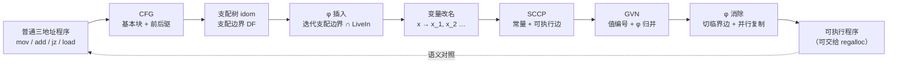
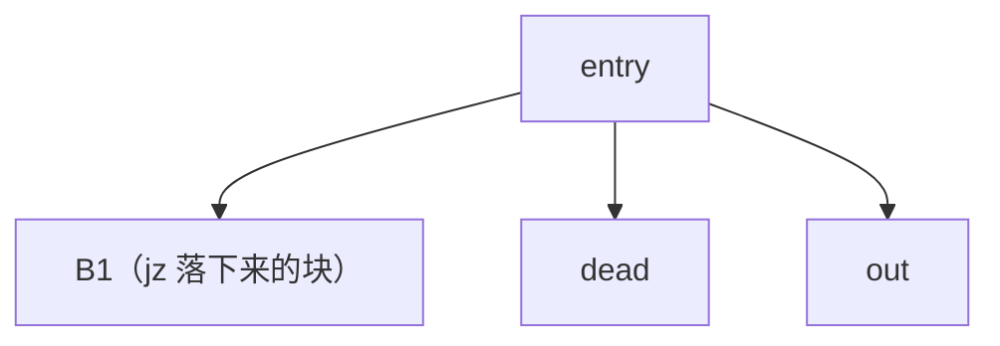
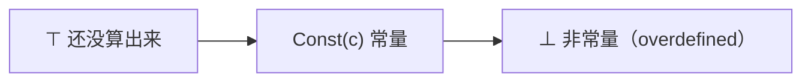

# SSA 与稀疏优化 · 技术报告

> 该模块已在合并库 [library/transfer](../README.md) 内，与 irbridge / core / dataflow / ssa / regalloc 共用**一套带位数信息的三地址 IR**（`ir/typed_ir.hpp`，指令类型、基本块类型、解析与打印各只有一份）。本文里的命令按**单模块**写；整条流水线用 `make -C library/transfer check` 或 `build/transfer-one-thread/t1t pipeline <file>`。

图用代码生成（Mermaid），公式用 LaTeX。

## 1. 要解决的问题

优化器喜欢"每个名字只被赋值一次"的程序：这样"定义在哪"与"值是多少"一一对应，
常量传播、值编号、寄存器分配都变成对一个**稀疏**的 def-use 图做运算，而不是对
每条指令做数据流迭代。SSA（Static Single Assignment）形式就是这件事的标准做法，
代价是汇合点要插 φ 函数、退出时要把 φ 消掉。

`library/transfer/ssa` 把整条路走完，并且每一步都能单独打印：



最后那条虚线是本库的验收方式：φ 消除之后的程序**再解释执行一遍**，输出必须与
原程序逐字相同。第 5、8 节会看到它抓到过什么。

## 2. 模型与输入语言

**程序** $P=(B_0,\dots,B_{n-1})$：基本块序列，`label` 开一个块，分支 / `halt`
之后自动开下一个块（所以"`jz` 后面直接写落下的代码"也成立）。

**指令**统一是三地址形式 `op dst, src1, src2`，操作数可以是常量、变量、内存符号
`[x]`：

| 类别 | 指令 |
| --- | --- |
| 复制 / 运算 | `mov`、`add`、`sub`、`mul`、`div` |
| 内存 | `load d, [x]`、`store [x], s` |
| 控制 | `jmp L`、`jz v, L`、`jnz v, L`、`halt` |
| 观察 | `print v` |
| SSA 专用 | `phi d, a₁, a₂, …`（实参按前驱顺序） |

**可改名变量**是普通名字；`[x]` 是内存符号，**不做内存 SSA**——`store` / `load`
原样保留，别名分析不在本库范围。这也是后面 GVN 遇到 `store` 就把 `load` 的值编号
全部作废的原因。

## 3. CFG 与支配关系

后继由块尾指令决定：`jmp` 连目标，`jz` / `jnz` 连目标**加**顺序落下的块，
`halt` 不连，其它指令顺序落到下一块。反序后序编号（RPO）用来做支配迭代。

支配集合的定义是

$$
\mathrm{dom}(\text{entry})=\{\text{entry}\},\qquad
\mathrm{dom}(b)=\{b\}\cup\bigcap_{p\in \mathrm{pred}(b)}\mathrm{dom}(p),
$$

实现上不必真的存集合：用 Cooper-Harvey-Kennedy 的迭代算法只维护**直接支配者**
$\mathrm{idom}$，把两个前驱的交集算成"沿 $\mathrm{idom}$ 链往上走，直到相遇"：

$$
\mathrm{idom}(b)=\bigcap_{p\in \mathrm{pred}(b)}p
\quad\text{（按 RPO 编号从大到小走，迭代到不动点）},
$$

$$
\mathrm{intersect}(a,b)=
\begin{cases}
a, & a=b,\\
\mathrm{intersect}(\mathrm{idom}(a),b), & \mathrm{rpo}(a)>\mathrm{rpo}(b),\\
\mathrm{intersect}(a,\mathrm{idom}(b)), & \mathrm{rpo}(b)>\mathrm{rpo}(a).
\end{cases}
$$

支配边界是"$\mathrm{dom}$ 在这里断掉"的块：

$$
\mathrm{DF}(b)=\bigl\{y\ \big|\ \exists p\in \mathrm{pred}(y):\
b\in \mathrm{dom}(p),\ b\notin \mathrm{dom}(y)\bigr\},
$$

计算时不用枚举集合：对每个多前驱块 $y$，从它的每个前驱 $p$ 沿 $\mathrm{idom}$
往上走，直到走出 $\mathrm{idom}(y)$，沿途每个块都把 $y$ 收进自己的 $\mathrm{DF}$：

```text
for y in 块:
    if preds(y) < 2: continue
    for p in preds(y):
        runner = p
        while runner != idom(y):
            DF(runner) += y
            runner = idom(runner)
```

`examples/03_const_branch.ssa` 的支配树（`--mode=dom` 的实际输出，Mermaid 源码）：



`entry` 直接支配所有块，因为它是唯一入口；`out` 的两个前驱（`B1` 与 `dead`）的
$\mathrm{idom}$ 都是 `entry`，所以 $\mathrm{idom}(\text{out})=\text{entry}$。

## 4. φ 插入与变量改名

### 4.1 插在哪里

变量 $v$ 的定义块集合记为 $A(v)=\mathrm{defBlocks}(v)$。φ 要插在**迭代支配边界**
上，并且只在该处"用得上"时才插（剪枝 SSA）：

$$
P_\varphi(v)=\mathrm{DF}^{+}\!\bigl(A(v)\bigr)\ \cap\ \bigl\{b\ \bigl|\ v\in \mathrm{LiveIn}(b)\bigr\}.
$$

$\mathrm{DF}^+$ 用工作队列迭代：从 $A(v)$ 出发，遇到 $y\in \mathrm{DF}(x)$ 就插一条
φ，并把 $y$ 放进队列继续看它的边界。`LiveIn` 是按
$\mathrm{LiveIn}(b)=\mathrm{USE}(b)\cup(\mathrm{LiveOut}(b)-\mathrm{DEF}(b))$
在**原程序**上迭代出来的（还没有 φ 的版本），这是保守近似。

剪枝的效果在 `examples/04_loop_swap.ssa` 上可以直接量出来：

| 版本 | φ 条数 |
| --- | --- |
| 最小 SSA（只看迭代支配边界） | 10 |
| 剪枝 SSA（再要求块入口活跃） | **6** |

多出来的 4 条是 `t`、`k` 在循环头与出口的 φ：它们在该块入口并不活跃（都是"先定义
再使用"），插了也是死 φ。`--mode=summary` 的 SSA 一栏里会直接写出来：
"插入 φ：6 / 剪枝掉的 φ：4"。

### 4.2 怎么改名

沿支配树 DFS，每个变量一个名字栈，栈底是入口初值 $v_0$：

$$
\text{遇到 } v \text{ 的定义} \Rightarrow \text{push}(v_{k+1}),\qquad
\text{遇到 } v \text{ 的使用} \Rightarrow \text{用栈顶}.
$$

块 $b$ 处理完之后，对它的每个后继 $s$：把 $s$ 里每条 φ 中"来自 $b$ 的那一位"
填成当前栈顶（这就是 φ 实参为什么要按前驱顺序排）。离开 $b$ 时把自己压进去的
名字全部弹出。不可达块不参与 DFS，也不改名（SCCP 之后它们会被删掉）。

`examples/02_diamond.ssa` 的 SSA 形式（实际输出）：

```text
label entry
  load x_1, [slot]
  jz x_1, L1
  mov y_1, 2
  jmp L2
label L1
  mov y_2, 3
label L2
  phi y_3, y_1, y_2    ; ← B1, L1
  print y_3
  halt
```

`y` 有三条定义（两条 `mov` 加一条 φ），所以要三个名字；`phi y_3, y_1, y_2` 的第一位
对应前驱 `B1`（未命名的落下块），第二位对应 `L1`。

## 5. SCCP：稀疏条件常量传播

### 5.1 格与传播

每个 SSA 名字取三档之一（Wegman-Zadeck 的格）：



$$
\mathrm{meet}(\top,x)=x,\qquad \mathrm{meet}(\bot,x)=\bot,\qquad
\mathrm{meet}\bigl(\mathrm{Const}(a),\mathrm{Const}(b)\bigr)=
\begin{cases}\mathrm{Const}(a), & a=b,\\ \bot, & a\ne b.\end{cases}
$$

传播是**稀疏**的：维护"名字 → 用到它的块"，某个名字的格一变，只把用到它的块重新
入队。指令的求值规则：

$$
\frac{\nu(s_1)=c_1,\ \nu(s_2)=c_2}{\nu(d)=\mathrm{Const}(c_1\oplus c_2)}
\quad(\oplus\in\{+,-,\times,\div\}),\qquad
\frac{\nu(s_i)=\bot}{\nu(d)=\bot},
$$

φ 只对**可执行前驱**求交：$\nu(\varphi)=\mathrm{meet}$ 所有可执行前驱那一侧的实参。

### 5.2 可执行边

边 $b\to s$ 可执行，当且仅当 $b$ 可执行，且满足

$$
\begin{cases}
\text{终结指令是 } \texttt{jmp}\ \text{或顺序落下}, & \text{直接可执行},\\
\texttt{jz}\ v,L:\ \nu(v)=\mathrm{Const}(0), & \text{只留 } L \text{ 这条},\\
\texttt{jz}\ v,L:\ \nu(v)=\mathrm{Const}(c\ne 0), & \text{只留顺序落下那条},\\
\texttt{jz}\ v,L:\ \nu(v)=\bot, & \text{两条都留},\\
\nu(v)=\top, & \text{先不定，等 } v \text{ 有结论再说}.
\end{pmatrix}
$$

最后一行是这个算法能保持"稀疏且正确"的关键：条件还没算出来时**一条边都不标**，
等它的格升高以后再回来算。而"格一定会升高到有结论"靠两条初始化：

1. 程序里**没有定义的名字**（入口初值、`undef`）直接是 $\bot$——它们是运行期才
   知道的未知值，不可能是编译期常量；
2. `load` 的结果是 $\bot$（内存内容不追踪）。

由此每个定义最终都会落到 $\mathrm{Const}$ 或 $\bot$；又因为 SSA 的支配性质
（可执行块用到的定义一定也可执行），不会出现"永远等不到"的值。

### 5.3 两个坑

- **顺序落下的边也必须标可执行**。第一版实现只在 `jmp` / `jz` 上标边，漏了"块尾
  不是终结指令"这种顺序边，于是 `02_diamond.ssa` 里 φ 少算一个前驱，
  `phi(y_1,y_2)`（实参 2 和 3）被算成常量 2，优化后打印 2 而原程序打印 3。
  语义对照当场报错，现在有 `testFallthroughPhi()` 钉住。
- **不能把"不是常量"当成 $\top$**。如果把未初始化 / 未知的输入也当 $\top$，条件
  永远不满足 5.2 的最后一行，边就永远标不上，可达代码会被误删。

### 5.4 结果

SCCP 之后程序做三件事：把已知常量的操作数替换成字面量；把操作数全是常量的算术折成
`mov d, 常量`；把条件已知的分支折成 `jmp` 或直接删掉。不可执行的块连同它们的边
一起删掉（φ 的实参按新前驱表重排）。

`examples/03_const_branch.ssa`：`x` 是常量 1 → `jz x, dead` 不跳 → `dead` 块被删
（7 → 5 条指令），`out` 处的 φ 只剩一个实参，接着被 GVN 归并。

## 6. GVN：全局值编号

值编号用哈希合一（hash consing）：表达式的编号只由"操作符 + 操作数的编号"决定，

$$
\mathrm{VN}(d)=H\bigl(\mathrm{op},\ \mathrm{VN}(s_1),\ \mathrm{VN}(s_2)\bigr).
$$

交换律的 `add` / `mul` 先把两个操作数按名字排序再做键，所以 `add a, b` 与
`add b, a` 编号相同。

**关键约束：只有代表支配当前块时才敢复用。** 只看编号是不安全的：两条分支上各算
一次 `a + b`，编号相同，但先算的那条并不支配后一条，直接复用会把另一条路径上
不存在的值当成本路径的值。所以复用条件是

$$
\exists\, d'\ \text{同编号}:\quad \mathrm{block}(d')\ \text{支配}\ \mathrm{block}(d).
$$

φ 的处理是"实参全同就归并"：

$$
\forall i:\ \mathrm{VN}(\mathrm{arg}_i)=x\ \Longrightarrow\ \mathrm{VN}(\varphi)=x ,
$$

这也正是 φ 消除之后 `05_redundant.ssa` 里 `add q, s, s` 能与 `add r, s, s`
同号的原因。`mov d, s` 直接令 $\mathrm{VN}(d)=\mathrm{VN}(s)$（复制传播）；
`load` 用 `[x]` 作键，遇到 `store` 就把所有 `load` 键清空（没有别名分析，只能保守）。
整个过程迭代到不动点（最多 8 轮），因为 φ 归并之后常常又能消掉一批表达式。

## 7. φ 消除

φ 不是机器指令，退出 SSA 时要把"每个前驱一份"的赋值变成**并行复制**：

$$
\varphi:\ d\leftarrow \mathrm{arg}(\text{来自 } p)\ \Longrightarrow\
\text{在边 } p\to b \text{ 上插入一条 } d\leftarrow \mathrm{arg}.
$$

两条实现约束：

1. **临界边要切开**：若 $p$ 有多个后继、$b$ 有多个前驱，直接往 $p$ 末尾插复制会
   污染另一条出边，所以要新建一个 `splitN` 块（内容是复制 + `jmp b`）；
2. **并行复制要排序**：复制之间会互相覆盖，甚至成环（`a←b, b←a` 就是交换）。
   排序规则是反复发射"目标不再是任何待发射复制的源"的那条；剩下的一定是环，
   在环上借一个临时变量先把某个源存下来。

`examples/04_loop_swap.ssa` 的 φ 消除输出（实际输出，节选）：

```text
label loop
  add n_3, n_2, 1
  sub k_2, n_3, 3
  jnz k_2, split1
label done
  print b_2
  print a_2
  print n_3
  halt
label split1
  mov n_2, n_3
  mov tmp_1, b_2
  mov b_2, a_2
  mov a_2, tmp_1
  jmp loop
```

回边 `loop → loop` 是临界边，被切成 `split1`；交换用的三条复制成环，
`tmp_1` 就是打破环的临时变量。这一步**会让指令条数变多**（16 → 19），
换来的是后面寄存器分配不用再为"同一个变量名的多个版本"发愁。

## 8. 语义对照与实测

每个示例最后都做一次差分测试：

$$
\mathrm{run}(P)\ \overset{?}{=}\ \mathrm{run}\bigl(\text{φ 消除后的 } P\bigr)
\qquad(\text{输出序列与内存都相同}).
$$

```text
make -C library/transfer/ssa check

ssa-tests：全部通过
[通过] 01_assign.ssa —— 直线赋值：…（φ 0，折叠 1，不可达 0，GVN 0，输出 7）
[通过] 02_diamond.ssa —— 菱形汇合：…（φ 1，折叠 0，不可达 0，GVN 0，输出 3）
[通过] 03_const_branch.ssa —— 条件在编译期已知：…（φ 1，折叠 0，不可达 1，GVN 0，输出 2）
[通过] 04_loop_swap.ssa —— 循环里的交换：…（φ 6，折叠 0，不可达 0，GVN 0，输出 2 1 3）
[通过] 05_redundant.ssa —— 重复表达式与冗余 φ：…（φ 1，折叠 0，不可达 0，GVN 1，输出 24 24）
共 5 个示例：5 通过，0 失败。
```

| 示例 | 基本块 | φ | 改名（新名字） | SCCP 折叠 | 删块 | GVN 表达式 / φ / 复制 | φ 消除复制 / 切边 / 临时 | 指令数 |
| --- | --- | --- | --- | --- | --- | --- | --- | --- |
| `01_assign` | 1 | 0 | 4 | 1 条 | 0 | 0 / 0 / 0 | 0 / 0 / 0 | 6 → 6 |
| `02_diamond` | 4 | 1 | 4 | 0 | 0 | 0 / 0 / 0 | 2 / 0 / 0 | 7 → 9 |
| `03_const_branch` | 4 | 1 | 4 | 0 | 1 | 0 / 1 / 0 | 0 / 0 / 0 | 7 → 5 |
| `04_loop_swap` | 3 | 6 | 16 | 0 | 0 | 0 / 3 / 4 | 7 / 1 / 1 | 16 → 19 |
| `05_redundant` | 4 | 1 | 11 | 0 | 0 | 1 / 1 / 2 | 0 / 0 / 0 | 17 → 14 |

读表得到的几条结论：

- **SCCP 与 GVN 分工不同**：SCCP 管"编译期已知的值"（`01`、`03`），GVN 管"算过
  一遍的值"（`05`）。`05` 里 φ 的实参本来是两条 `mov t, s`，GVN 把复制传播掉之后
  φ 的实参全同，φ 才跟着消失——顺序反了就不成立。
- **φ 消除的代价可以量**：`02` 加 2 条复制，`04` 加 7 条复制 + 1 个切分块 + 1 个
  临时变量；这些都是后面寄存器分配要消化掉的搬动。
- **剪枝是真的有用**：`04` 从 10 条 φ 降到 6 条，直接少掉 4 组并行复制。

## 9. 与其它库的接口

- **与其它库的接口**：`--mode=destroy` 的输出就是普通三地址程序（`label` / `mov`
  / `add` / `jz` / `jmp`），去掉 `print` 之后可以直接喂给
  [`library/transfer/regalloc`](../regalloc/README.md) 做寄存器分配；反过来，
  `library/transfer/irbridge` 能把前端的四元式送进这条流水线（补 `decl` 之后即 `transfer`
  可读的形式）。
