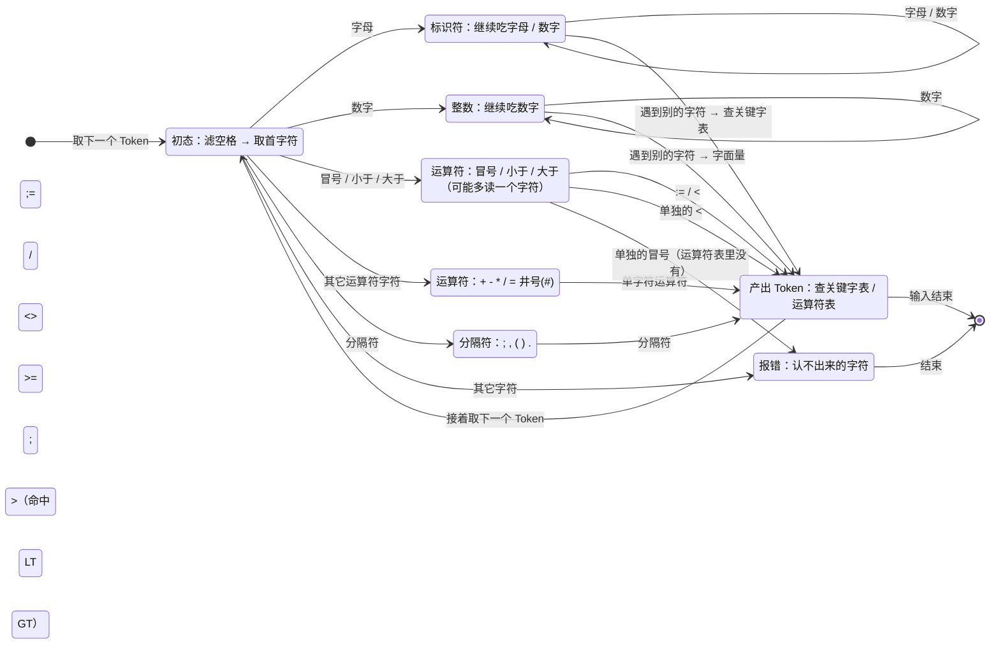
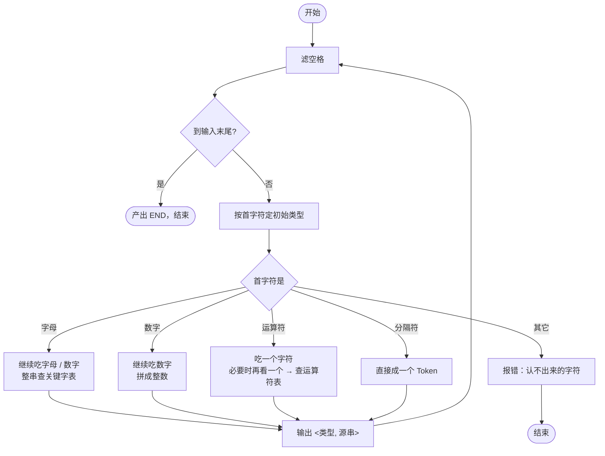

# 实验二 · PL/0 词法分析程序

安徽新华学院编译原理课程实验报告。

## 一、实验目的

实现 PL/0 的词法分析程序：把源程序切成一个个 Token，记录每个 Token 的**类型**
与**源串**，并按行分组输出（关键识别元素的行号）。

## 二、实验仪器

Windows 电脑；本仓库的 **ParseEngine**（`make` 编译生成器）；产物用 gcc
（MinGW-w64）编译。

## 三、实验原理、思路

PL/0 编译程序词法分析的任务：

1. **滤空格**：词法器取 Token 前先跳过空白；
2. **根据字符判断初始类型**：字母开头按标识符走、数字开头按整数走、其余按
   运算符 / 分隔符表查；
3. **最终修正类型**：标识符拼完后查关键字表，命中就改成关键字；数字拼完后
   转成整数。

在本实验里，这三步全部写进 `.gram` 的**词法规则**，由生成器在生成期编译成
DFA，不再手写状态机：

```gram
%mode lex                     /* 只导出词法器：产物里没有解析器 */

%define CONST "const"         /* 关键字：固定字面量 */
%define VAR   "var"
%define PEND  "end"           /* 见下面「踩坑」一节：关键字 end 的 Token 不能叫 END */
...
%define ASSIGN ":="           /* 双字符运算符 */
%define LE     "<="
%define GE     ">="
%define NE     "#"
%define PLUS   "+"            /* 单字符运算符 */
...
%define SEMI   ";"            /* 分隔符 */
%define COMMA  ","
%define DOT    "."
%define LP     "("
%define RP     ")"
```

几条要点：

- **最长匹配优先**：`:=`、`<=`、`>=` 都是两个字符，词法器会优先匹配长的，
  所以 `c:=b` 不会被切成 `:` 和 `=`；`<` 与 `<=` 同理。
- **标识符与整数用内建规则**：字母开头的字母数字串命中 `VARIABLE`，无符号整数
  命中 `NUMBER`（对应实验要求里的标识符与字面量），不必自己再写正则。
- **关键字靠固定字面量**：`%define CONST "const"` 之后，`const` 直接切出
  `TOKEN_CONST`，不用先当标识符再查表——但效果与「先拼标识符再查关键字表」一致。
- `%mode lex` 的产物**没有分析器**：只有 `lexer.c` / `lexer.h` 和驱动 `main.c`。

`main.c` 由 `.gram` 里的 `%main` 提供：一次读完整个源程序，循环调用
`Parser_NextToken`，按 `token.line` 分组打印；Token 名字到「关键字 / 标识符 /
运算符 / 分隔符 / 字面量」五个大类的映射写在 `CategoryOf()` 里（按 Token 名判定，
增删 `%define` 不用改枚举顺序）。

## 四、状态图

词法器的状态图（就是 `.gram` 里那几十条 `%define` / 内建规则被生成期编译成的
那个扫描器）。「初态」负责滤空格并取首字符，之后按首字符分四路：字母走标识符、
数字走整数、运算符看要不要多读一个字符、其余分隔符直接成 Token。

> 两张图都是 Mermaid 源码，GitHub / VS Code / Typora 等能直接渲染成图；
> 也可以把图里的内容贴到 <https://mermaid.live> 在线预览。



两条容易忽略的边：

- **`ID → DONE` 要回退一格**：标识符是靠「读到第一个不是字母数字的字符」结束的，
  那个字符不属于标识符，要留给下一轮重新判断（滤空格也一样）。
- **`OP2` 是「最多看两个字符」**：`: < >` 后面再跟 `=` / `>` 就合成 `:=` `<=`
  `<>` `>=`；否则退回单字符，查运算符表命中就成 Token、不命中就报错。

## 五、流程图

主循环（`%main` 里的驱动 + `Parser_NextToken` 一次取一个 Token）的流程：



按行号分组是在这一层做的：每取到一个 Token 就比对它的 `line` 与上一行的行号，
变了就先打一个 `Line N:` 头（所以「第 N 行没有 Token」的行不会出现在输出里）。

## 六、程序代码

完整程序见同目录的 [`lab2_lexer.gram`](lab2_lexer.gram)（词法规则 + `%main` 驱动）。

```bash
make
build/bin/ParseEngine project/lab_report_axhu/lab2_lexer/lab2_lexer.gram --lang c --out-dir out/lab2
make -C out/lab2
./out/lab2/lexer_demo < project/lab_report_axhu/lab2_lexer/pl0_sample.pl0
```

## 七、实验结果

输入 PL/0 源程序 `pl0_sample.pl0`（与实验讲义里的一致）：

```text
const a=10;
var b,c;
procedure p;
begin
c:=b+a
end;
begin
read(b);
while b#0 do
begin
call p; write(2*c); read(b)
end
end.
```

输出：

```text
-----------------------------------------------------------------
词法分析结果
<类型, 源串>
-----------------------------------------------------------------
Line 1: 
<关键字, "const">
<标识符, "a">
<运算符, "=">
<字面量, "10">
<分隔符, ";">
Line 2: 
<关键字, "var">
<标识符, "b">
<分隔符, ",">
<标识符, "c">
<分隔符, ";">
Line 3: 
<关键字, "procedure">
<标识符, "p">
<分隔符, ";">
Line 4: 
<关键字, "begin">
Line 5: 
<标识符, "c">
<运算符, ":=">
<标识符, "b">
<运算符, "+">
<标识符, "a">
Line 6: 
<关键字, "end">
<分隔符, ";">
Line 7: 
<关键字, "begin">
Line 8: 
<关键字, "read">
<分隔符, "(">
<标识符, "b">
<分隔符, ")">
<分隔符, ";">
Line 9: 
<关键字, "while">
<标识符, "b">
<运算符, "#">
<字面量, "0">
<关键字, "do">
Line 10: 
<关键字, "begin">
Line 11: 
<关键字, "call">
<标识符, "p">
<分隔符, ";">
<关键字, "write">
<分隔符, "(">
<字面量, "2">
<运算符, "*">
<标识符, "c">
<分隔符, ")">
<分隔符, ";">
<关键字, "read">
<分隔符, "(">
<标识符, "b">
<分隔符, ")">
Line 12: 
<关键字, "end">
Line 13: 
<关键字, "end">
<分隔符, ".">
```

与讲义里给出的期望输出逐行一致：`:=` 被识别成一个运算符（没有拆成 `:` 和 `=`）、
`#` 是运算符、`;` `(` `)` `.` 是分隔符、关键字与标识符区分正确、行号按关键字
出现的位置分组。

### 词法错误的处理

把源程序里塞一个词法层面就不合法的东西（例如 `9a`：数字后面直接跟字母），词法器
在切到出错位置时返回错误码并停下，前面已经切好的 Token 照常打印、出错位置（行、
列）也一并给出：

```text
Line 3: 
<标识符, "c">
<运算符, ":=">
词法错误: code=-22 line=3 column=8 message=词法解析失败
```

（`-22` 是词法错误，另外还有 `-28` 未闭合字符串、`-29` 认不出来的字符这两个细分
码；可以用 `Parser_GetErrorCount()` / `Parser_GetError(i)` 逐条取。）

## 八、实验总结

词法分析的结果与讲义里的期望输出完全一致。相比手写状态机，把规则写进 `.gram`
的好处是：**最长匹配、关键字边界、行号列号维护**都由生成器负责，规则本身就是
文档。

踩到的一个坑值得记下来：**关键字 `end` 的 Token 不能起名叫 `END`**。
`END` 是运行时「输入结束」这个哨兵 Token 的保留名，`%define END "end"` 之后两者
会合并成同一个 Token，词法器就分不出「读到 `end`」和「读到文件末尾」了——表现
是程序读到 `end` 就直接结束、后面全被丢掉。按实验里的写法改叫 `PEND` 就正常了。
