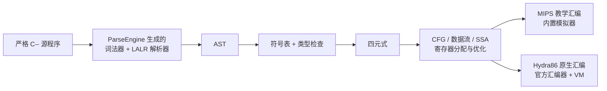

# 南京大学编译原理实验：严格 C-- 编译器

本目录整理南京大学编译原理课程的五次实验。实现从严格 C-- 源程序开始，使用本仓库的
ParseEngine 生成词法器和 LALR 解析器，再完成 AST、语义检查、四元式、目标代码与优化；
实验报告中的主要输出都可以由仓库内源码重新生成。

这里不包含理论讲义、课程概览、习题或答案。保留内容只有实验指导、完成报告、源码、
实验框架、平台手册和提交要求。

## 实验链路



前端由 [`source/frontend/cminus.gram`](source/frontend/cminus.gram) 唯一定义，不接受
`for`、指针、`switch`、容器或接口等 C-- 之外的扩展语法。

## 完成报告

| 实验 | 报告 | 实现重点 |
| --- | --- | --- |
| 一 | [词法与语法分析](reports/01-lexical-syntax-report.md) | Token、LALR 文法、AST、语法错误定位 |
| 二 | [语义分析](reports/02-semantic-analysis-report.md) | 符号表、作用域、类型推导与错误分类 |
| 三 | [中间代码生成](reports/03-ir-generation-report.md) | AST 到四元式、控制流、调用与返回 |
| 四 | [目标代码生成](reports/04-code-generation-report.md) | 基本块、指令选择、MIPS 生成与模拟、Hydra86 对接验证 |
| 五 | [代码优化](reports/05-optimization-report.md) | 数据流、SSA、局部 / 全局优化与执行对照 |

## 目录

| 位置 | 内容 |
| --- | --- |
| [`doc/`](doc/README.md) | 五次实验指导、实验五框架、OJ 手册、提交要求与 C-- 文法附录 |
| [`reports/`](reports/01-lexical-syntax-report.md) | 五份完成报告 |
| [`source/frontend/`](source/frontend/README.md) | 严格 C-- 文法、AST、语义检查、四元式生成与边界样例 |
| [`source/backend/`](source/backend/README.md) | IR、CFG、数据流、SSA、寄存器分配、优化、MIPS 后端与测试 |
| [`run-evidence.ps1`](run-evidence.ps1) | 重新生成报告主要证据的一键脚本 |

## 重新验证

先在仓库根目录构建 ParseEngine，并保证 `g++` 与 CMake 可用，然后运行：

```powershell
powershell -ExecutionPolicy Bypass -File project/lab_report_nju/run-evidence.ps1
```

脚本会生成并编译严格 C-- 前端，验证四个合法样例和四个拒绝样例，构建目录内附带的
后端并运行八项测试，最后把前端产生的四元式送入完整流水线和 MIPS 优化前后对照。
生成物全部写入 `tmp/nju_lab/`，不会覆盖报告或源码。

