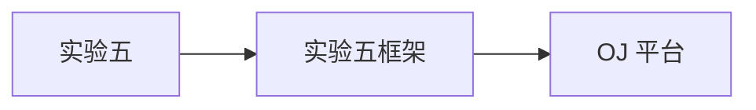

# 实验五代码框架

- 类型：框架说明
- 来源整理：`framework_intro.md`
- 处理：已剔除纯作业题单、习题章节和答案内容。

## 公式整理

实验五框架中的数据流求解接口可对应到统一的传递函数：

$$
F_B(x)=gen_B\cup(x-kill_B)
$$

公共子表达式消除中的临时表达式抽取可表示为：

$$
v:=v_1+v_2\quad\Rightarrow\quad expr_i:=v_1+v_2,\ v:=expr_i
$$

## 本节位置



该仓库为南京大学编译原理课程实验五代码框架，需要同学们补全数据流分析求解器
以及活跃变量分析，复制传播，可用表达式分析，赋值传播四个数据流分析应用的具
体实现，以此来中间代码优化工作。

## 安装与下载

1. git clone
```bash
git clone https://github.com/tianxinghe/cmmagel_optimizer.git
```

2. 下载压缩包 8
进入 git 网址并下载 zip
```bash
https://github.com/tianxinghe/cmmagel_optimizer.git
```

## C 语言面向对象编程

使用 c 语言实现面向对象编程请自行 STFW
本实验用到的面向对象编程相关宏定义
```c
// 返回已执行init 构造函数的指针, 类似于C++的 new obj 语句
#define NEW(TYPE, ...) ({ \
TYPE *TMP = (TYPE*)malloc(sizeof(TYPE)); \
concat(TYPE, _init) (TMP, ##__VA_ARGS__); \
TMP; \
})
// 从虚函数表vTable 中调用函数, 指针需要解引用
#define VCALL(obj, func, ...) \

(((obj).vTable)->func(&(obj), ##__VA_ARGS__))
// 执行teardown 析构函数并free, 类似于C++的 delete obj 语句
#define DELETE(obj_ptr) \
do { VCALL(*obj_ptr, teardown); free(obj_ptr); } while(0)
// 虚函数表中没有teardown, 需要显式调用特定类型的析构函数
#define RDELETE(type, obj_ptr) \
do { concat(type, _teardown)(obj_ptr); free(obj_ptr); }
while(0)
```

## 模板宏与泛型容器

### Vec：变长动态数组

#### 头文件与模板定义

```c
#include <container/vector.h>
```

#### 定义模板类型

```c
DEF_VECTOR(int) // 全局定义
```

#### 宏展开结果

```c
typedef struct Vec_int {
struct Vec_int_virtualTable {
void (*teardown)(Vec_int *vec);
void (*resize)(Vec_int *vec, vec_size_t new_size);
void (*push_back)(Vec_int *vec, int item);
void (*pop_back)(Vec_int *vec);
vec_size_t (*find)(Vec_int *vec, bool (*check)(int
*arr_item, void *arg), void *arg);

vec_size_t (*lower_bound)(Vec_int *vec, bool (*check)(int
*arr_item, void *arg), void *arg);
void (*insert)(Vec_int *vec, vec_size_t idx, int item);
void (*delete)(Vec_int *vec, vec_size_t idx);
} const *vTable;
vec_size_t len; // arr_len
int *arr;
...
} Vec_int;
void Vec_int_init(Vec_int *vec);
```

#### 迭代

迭代器 it 为 TYPE* 指针, 解引用 *it 为内容
```c
for_vec(int, it, vec)
```

#### 宏展开结果

```c
for(int *it = vec.arr; it != vec.arr + vec.len; it ++)
```

#### 使用示例

```c
void func() {
Vec_int v;
Vec_int_init(&v);
// do somthing
Vec_int_teardown(&v);
// 或者
Vec_int *v = NEW(Vec_int);

// do somthing
// 例如需要调用虚函数表中的函数, 可使用宏定义
VCALL(v, pushback, 1);

// 等价于
v.vTable->push_back(&v, 1);

DELETE(v); // v->vTable->teardown(v); free(v);
}
```

### List：双向链表与队列

#### 头文件与模板定义

```c
#include <container/list.h>
```

#### 定义模板类型

```c
DEF_LIST(int) // 全局定义
```

#### 宏展开结果

```c
typedef struct ListNode_int {
struct ListNode_int *pre, *nxt;
int val;
} ListNode_int;
struct List_int {
struct List_int_virtualTable {
void (*teardown)(List_int *l);
void (*insert_front)(List_int *l, ListNode_int *x, int
val);
void (*insert_back)(List_int *l, ListNode_int *x, int
val);
void (*push_front)(List_int *l, int val);
void (*push_back)(List_int *l, int val);
ListNode_int *(*delete)(List_int *l, ListNode_int *x); //
// 返回nxt 节点(迭代器)

void (*pop_front)(List_int *l);
void (*pop_back)(List_int *l);
} const *vTable;
struct ListNode_int *head, *tail; // 当 list 为空时, head 与 tail 均为 NULL
};
void List_int_init(List_int *l);
```

#### 迭代

迭代器 it 为 ListNode_TYPE* 链表节点指针, it->val 为内容
```c
for_list(int, it, list)
```

#### 宏展开结果

```c
for(ListNode_int *it = list.head; it; it = it->nxt)
```

### Map：映射

#### 头文件与模板定义

```c
#include <container/treap.h>
```

#### 定义模板类型

```c
DEF_MAP(int, double) // 全局定义
DEF_MAP_CMP(int, double, CMP_FUNC)
// CMP_FUNC 为自定义比较函数, 返回值为 a == b ? -1 : a < b
```

#### 宏展开结果

```c
typedef struct MapNode_int_double {
...
int key;
double val;
} MapNode_int_double;
struct Map_int_double {
struct Map_int_double_virtualTable {
void (*teardown)(Map_int_double *t);
bool (*insert)(Map_int_double *t, int key, double val); //
// 若key 已存在则不修改值, 并返回false
bool (*delete)(Map_int_double *t, int key); // 若key 不存在
```

则返回false
bool (*exist)(Map_int_double *t, int key);
double (*get)(Map_int_double *t, int key); // 需保证 key 已
经存在
void (*set)(Map_int_double *t, int key, double val); // //
若key 已存在则修改val 值, 否则等价于insert
} const *vTable;
...
};
void Map_int_double_init(Map_int_double *t);

#### 迭代

迭代器 it 为 MapNode_KEY_TYPE_VAL_TYPE* 平衡树节点指针, {it->key, it->val} 为
映射内容
```c
for_map(int, double, it, map) ...
```

#### 宏展开结果

```c
for(
MapNode_KEY_TYPE_VAL_TYPE *it =
TreapNode_first_iter(map.root);
it != NULL;

it = TreapNode_next_iter(it)
)
```

### Set：集合

#### 头文件与模板定义

```c
#include <container/treap.h>
```

#### 定义模板类型

```c
DEF_SET(int) // 全局定义
DEF_SET_CMP(int, CMP_FUNC) // 自定义比较函数
```

#### 宏展开结果

```c
typedef struct SetNode_int {
...
int key;
} SetNode_int;
struct Set_int {
struct Set_int_virtualTable {
void (*teardown)(Set_int *t);
bool (*insert)(Set_int *t, int key); // 已存在返回false
bool (*delete)(Set_int *t, int key); // 不存在返回false
bool (*exist)(Set_int *t, int key);
} const *vTable;
...
};
void Set_int_init(Set_int *t);
```

#### 迭代

迭代器 it 为 SetNode_KEY_TYPE* 平衡树节点指针, it->key 为内容
```c
for_set(int, it, set) ...
```

#### 宏展开结果

```c
for(
MapNode_KEY_TYPE_VAL_TYPE *it =
TreapNode_first_iter(set.root);
it != NULL;
it = TreapNode_next_iter(it)
)
```

## IR 数据结构

实验框架已经完成 IR 输入解析、基本块划分和控制流图构建。IR 的层次如下：

- `IR_program`：整个程序。
- `IR_function`：函数。
- `IR_block`：基本块。
- `IR_stmt`：基本语句；`def` 表示定义的变量，`use_vec` 表示使用的变量数组。

### IR_stmt 类型

```text
IR_op_stmt:     rd := rs1 op rs2
IR_assign_stmt: rd := rs
IR_load_stmt:   rd := *rs_addr
IR_store_stmt:  *rd_addr := rs
IR_call_stmt:   (ARGS argv[argc]{rs1, rs2, ...}) rd := CALL func
IR_if_stmt:     IF rs1 relop rs2 GOTO true_label ELSE false_label
IR_goto_stmt:   GOTO label
IR_return_stmt: RETURN rs
IR_read_stmt:   READ rd
IR_write_stmt:  WRITE rs
```

## IR 结构

```c
//// ================================== IR var & label
==================================

typedef unsigned IR_var; // 数字表示 v1, v2...
typedef unsigned IR_label; // 数字表示 L1, L2...
typedef unsigned IR_DEC_size_t;
enum {IR_VAR_NONE = 0};
enum {IR_LABEL_NONE = 0};

DEF_VECTOR(IR_var)

extern IR_var ir_var_generator(); // 获取新变量编号
extern IR_label ir_label_generator(); // 获取新label 编号

//// ================================== IR
==================================

//// IR_val

typedef struct IR_val { // 常量或变量
bool is_const;
union {
IR_var var;
int const_val;
};
} IR_val;

//// IR_stmt

typedef enum {
IR_OP_STMT, IR_ASSIGN_STMT, IR_LOAD_STMT, IR_STORE_STMT,
IR_IF_STMT, IR_GOTO_STMT, IR_CALL_STMT, IR_RETURN_STMT,
IR_READ_STMT, IR_WRITE_STMT
} IR_stmt_type;

// use 数组, 需要手动忽略常量
typedef struct IR_use {
unsigned use_cnt; // use 个数
IR_val *use_vec; // use 数组
}IR_use;

struct IR_stmt_virtualTable {
void (*teardown) (IR_stmt *stmt);
void (*print) (IR_stmt *stmt, FILE *out);
IR_var (*get_def) (IR_stmt *stmt); // def 最多只有一个,
不存在则返回 IR_VAR_NONE
IR_use (*get_use_vec) (IR_stmt *stmt);
};

struct IR_stmt {
struct {
struct IR_stmt_virtualTable const *vTable;
IR_stmt_type stmt_type;
bool dead;
};
};

//// IR_block

typedef struct {
IR_label label;
bool dead;
List_IR_stmt_ptr stmts;
} IR_block, *IR_block_ptr;

//// IR_function

typedef struct {
IR_var dec_addr;
IR_DEC_size_t dec_size;
} IR_Dec;

typedef List_IR_block_ptr *List_ptr_IR_block_ptr;

typedef struct IR_function{
char *func_name;
Vec_IR_var params;
Map_IR_var_IR_Dec map_dec; // dec_var => (addr_var, size)
List_IR_block_ptr blocks;
// Control Flow Graph
IR_block *entry, *exit;
Map_IR_label_IR_block_ptr map_blk_label; // Label -> Block 指
针
Map_IR_block_ptr_List_ptr_IR_block_ptr blk_pred, blk_succ; //
Block 指针 -> List<前驱后继Block> 的指针
} IR_function, *IR_function_ptr;

//// IR_program

typedef struct IR_program {
Vec_IR_function_ptr functions;
} IR_program;

//// ================================== Stmt
==================================

typedef enum {
IR_OP_ADD, IR_OP_SUB, IR_OP_MUL, IR_OP_DIV
} IR_OP_TYPE;
typedef struct {
CLASS_IR_stmt
IR_OP_TYPE op;
IR_var rd;
union {
IR_val use_vec[2];
struct { IR_val rs1, rs2; };
};
} IR_op_stmt;

typedef struct {
CLASS_IR_stmt
IR_var rd;
union {
IR_val use_vec[1];
struct { IR_val rs; };
};

} IR_assign_stmt;

typedef struct {
CLASS_IR_stmt
IR_var rd;
union {
IR_val use_vec[1];
struct { IR_val rs_addr; };
};
} IR_load_stmt;

typedef struct {
CLASS_IR_stmt
union {
IR_val use_vec[2];
struct { IR_val rd_addr, rs; };
};
} IR_store_stmt;

typedef enum {
IR_RELOP_EQ, IR_RELOP_NE, IR_RELOP_GT, IR_RELOP_GE,
IR_RELOP_LT, IR_RELOP_LE
} IR_RELOP_TYPE;
typedef struct {
CLASS_IR_stmt
IR_RELOP_TYPE relop;
union {
IR_val use_vec[2];
struct { IR_val rs1, rs2; };
};
IR_label true_label, false_label;
IR_block *true_blk, *false_blk;
} IR_if_stmt;

typedef struct {
CLASS_IR_stmt
IR_label label;
IR_block *blk;
} IR_goto_stmt;

typedef struct {
CLASS_IR_stmt
union {
IR_val use_vec[1];

struct { IR_val rs; };
};
} IR_return_stmt;

typedef struct {
CLASS_IR_stmt
IR_var rd;
char *func_name;
unsigned argc;
IR_val *argv;
} IR_call_stmt;

typedef struct {
CLASS_IR_stmt
IR_var rd;
} IR_read_stmt;

typedef struct {
CLASS_IR_stmt
union {
IR_val use_vec[1];
struct { IR_val rs; };
};
} IR_write_stmt;

```

## 数据流分析求解算法框架

框架代码将每个数据流分析抽象成了对应的子类, 并使用统一的求解器进行求解
以活跃变量分析为例, 其主要提供的方法为
```c
typedef struct LiveVariableAnalysis {
struct LiveVariableAnalysis_virtualTable {
bool (*isForward) (LiveVariableAnalysis *t); // 前向/后向数
据流分析
Set_IR_var *(*newBoundaryFact) (LiveVariableAnalysis *t,
IR_function *func);

Set_IR_var *(*newInitialFact) (LiveVariableAnalysis *t);
bool (*meetInto) (LiveVariableAnalysis *t, Set_IR_var
*fact, Set_IR_var *target);
bool (*transferBlock) (LiveVariableAnalysis *t, IR_block
*block, Set_IR_var *in_fact, Set_IR_var *out_fact);
// 若结果发生改变则返回true
...
} const *vTable;
} LiveVariableAnalysis;
```

若使用迭代求解器求解, 求解器算法如下

此处 meetInto() 的设计可能与你设想的稍有差别：它接受 fact 和 target 两个参数
并把 fact 集合并入 target 集合。这个函数有什么用呢？考虑一下上图中
meetInto() 附近的那行伪代码，它会取出 B 的所有后继，然后把它们 IN facts 的
并集赋给 OUT[B]。如果这行代码用 meetInto() 来实现，那么我们就可以根据下图所
示，用 meetInto(IN[S], OUT[B]) 把 B 的每个后继 S 的 IN fact 直接并入到
OUT[B] 中：

这样设计 meetInto() 是出于效率考量。首先，在一个控制流合并节点多次调用
meetInto() 时，我们都在改写同一个对象。这样，我们可以避免像伪代码 OUT[S] =
U… 所描述的那样，每次合并两个集合就会创建出一个新的 SetFact 对象保存结果。
当然，为了实现上面所说的 meet 策略，你需要在初始化阶段给每条语句的 OUT[S] 赋
上和 IN[S] 一样的初值。

`src/IR_optimze/solver.c` 提供前向分析的迭代求解器和 worklist 求解器。具体的数据流分析包括活跃变量分析、常量传播、可用表达式分析和复制传播，各分析器均提供结果输出函数以便调试。

## 可用表达式分析

框架先为相同表达式引入统一的表达式变量：

```text
v := v1 + v2
=>
expr1 := v1 + v2
v := expr1
```

随后为表达式变量构造 `e_gen` 与 `e_kill` 集合，再执行数据流分析。相关实现位于 `src/IR_optimze/available_expressions_analysis.c`。

## 复制传播

复制传播使用数据流分析结果，将仅用于传递值的临时变量替换为其来源变量。相关实现位于 `src/IR_optimze/copy_propogation.c`。

## 全局公共子表达式消除示例

优化前：

```text
FUNCTION main:
READ v1
READ v2
v3 := v1 + v2
v4 := v1 + v2
IF v1 < v2 GOTO L1
v5 := v1 - v2
GOTO L2
LABEL L1:
v6 := v1 - v2
LABEL L2:
v7 := v1 - v2
WRITE v4
WRITE v7
RETURN #0
```

合并公共子表达式、消除重复计算并完成复制传播后：

```text
FUNCTION main:
READ v1
READ v2
expr1 := v1 + v2
IF v1 < v2 GOTO L1
expr2 := v1 - v2
GOTO L2
LABEL L1:
expr2 := v1 - v2
LABEL L2:
WRITE expr1
WRITE expr2
RETURN #0
```

## 死代码与不可达代码

死代码消除依赖活跃变量分析。常量传播还能确定部分 `IF` 语句的跳转结果，据此标记并删除不可达基本块。

## 框架的数据流粒度

当前框架以 `Stmt` 为单位维护 `gen/kill` 和 `use/def` 关系。也可以先合并一个 `Block` 内所有语句的集合，建立从基本块到 `gen/kill`、`use/def` 的映射，从而减少 `transferBlock` 的计算开销。
