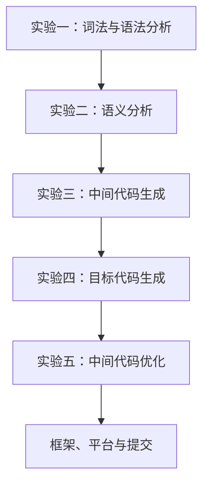

# 南京大学编译原理实验资料

本项目仅保留实验指导、完成报告、实验框架和提交说明。理论讲义、课程概览、作业题、习题答案及独立参考资料均已删除。

## 实验流程



## 实验指导

1. [实验一：词法分析和语法分析](00-lab-1-lexical-and-syntax.md)
2. [实验二：语义分析](01-lab-2-semantic-analysis.md)
3. [实验三：中间代码生成](02-lab-3-ir-generation.md)
4. [实验四：目标代码生成](03-lab-4-code-generation.md)
5. [实验五：中间代码优化](04-lab-5-optimization.md)

## 完成报告

以下报告基于本目录的严格 C-- 文法、本仓库的 `ParseEngine` 和 `library/transfer` 实际生成、运行与测试结果编写：

1. [实验一：词法分析与语法分析实验报告](../reports/01-lexical-syntax-report.md)
2. [实验二：语义分析实验报告](../reports/02-semantic-analysis-report.md)
3. [实验三：中间代码生成实验报告](../reports/03-ir-generation-report.md)
4. [实验四：目标代码生成实验报告](../reports/04-code-generation-report.md)
5. [实验五：中间代码优化实验报告](../reports/05-optimization-report.md)

## 源代码

- [实验源代码说明](../source/README.md)
- `source/frontend/`：严格 C-- 文法、ParseEngine 归约动作、语义实现和边界测试
- `source/backend/`：IR、数据流、SSA、寄存器分配、优化和 MIPS 后端

在仓库根目录运行以下命令可以重新生成报告中的主要证据：

```powershell
powershell -ExecutionPolicy Bypass -File project/lab_report_nju/run-evidence.ps1
```

## 配套文档

- [实验五代码框架](05-lab-5-framework.md)
- [实验平台学生使用手册](06-oj-platform-guide.md)
- [实验提交要求](07-submission-requirements.md)
- [附录：C-- 语言文法](08-appendix-cminus-grammar.md)
