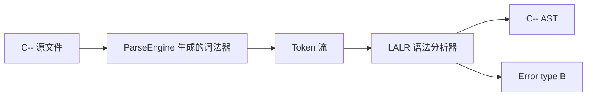

# 实验一：C-- 词法与语法分析

## 1. 实验目标

使用本仓库的 ParseEngine 解析器生成器实现附录 A 定义的 C--，完成词法分析、LALR 语法分析、抽象语法树构造和语法错误定位。实现文件为 `source/frontend/cminus.gram`，不接受 C-- 之外的 `for`、指针、`switch` 等扩展语法。

## 2. 实现流程



生成命令：

```powershell
build/bin/ParseEngine.exe `
  project/lab_report_nju/source/frontend/cminus.gram `
  --lang cpp17 --out-dir tmp/nju_lab/cminus-generated
```

该命令实际生成 `cminus_parser.cpp`、`cminus_parser.hpp`、`cminus_parser_user.h` 和 `cminus_main.cpp`。

## 3. 词法规则

| 类别 | 规则 |
|---|---|
| 标识符 | `[A-Za-z_][A-Za-z0-9_]*` |
| 十进制整数 | `0` 或非零数字开头的数字串 |
| 八进制整数 | `0[0-7]*` |
| 十六进制整数 | `0[xX][0-9A-Fa-f]+` |
| 浮点数 | 含小数点，可带 `e`/`E` 指数 |
| 注释 | `//...` 与 `/*...*/`，由 `%trivia` 丢弃 |

关键字和运算符由 `%define` 声明，因此 `int`、`float`、`struct`、`return`、`if`、`else`、`while` 不会被识别为普通标识符。

## 4. 文法与冲突处理

文法逐条对应附录 A。例如函数、复合语句与数组声明为：

```bnf
FunDec ::= ID LP VarList RP | ID LP RP
CompSt ::= LC DefList StmtList RC
VarDec ::= ID | VarDec LB INT RB
```

表达式采用二义写法，优先级由生成器在生成期消解：

$$
\{\text{调用}, [\ ], .\} > \{-_{\text{unary}},!\} > \{*,/\} > \{+,-\} > RELOP > \&\& > \|\| > =
$$

赋值和一元运算右结合，其余二元运算左结合。悬空 `else` 使用两个优先级符号处理，使 `else` 总与最近的未匹配 `if` 结合。

## 5. AST 构造

语义值是整数下标，节点正文存放在节点池中，避免生成器语义栈保存非 POD 对象。归约动作只调用构造函数，例如：

```text
Exp PLUS Exp      -> Binary("+", left, right)
WHILE (Exp) Stmt  -> While(condition, body)
Exp [Exp]         -> Index(array, index)
```

AST 输出到 `<前缀>.ast`，节点包含种类、词素、源代码行号和子节点。

## 6. 边界测试

| 输入 | 预期 |
|---|---|
| `valid_loop.cmm` | 接受，生成 AST 和四元式 |
| `valid_complete.cmm` | 接受结构体、数组、函数和成员访问 |
| `reject_for.cmm` | 拒绝，报告 `Error type B` |
| `reject_pointer.cmm` | 拒绝，报告 `Error type B` |

运行结果：

```text
C-- frontend checks passed: 4 accepted, 4 rejected as expected.
```

这组负例专门证明可接受语言是 C-- 本身，而不是 C-- 的超集。

## 7. 结论

ParseEngine 已被实际用于生成词法器和 LALR 解析器；生成代码通过 C++17 编译，严格 C-- 正例可建立 AST，超集语法在语法阶段被拒绝。
