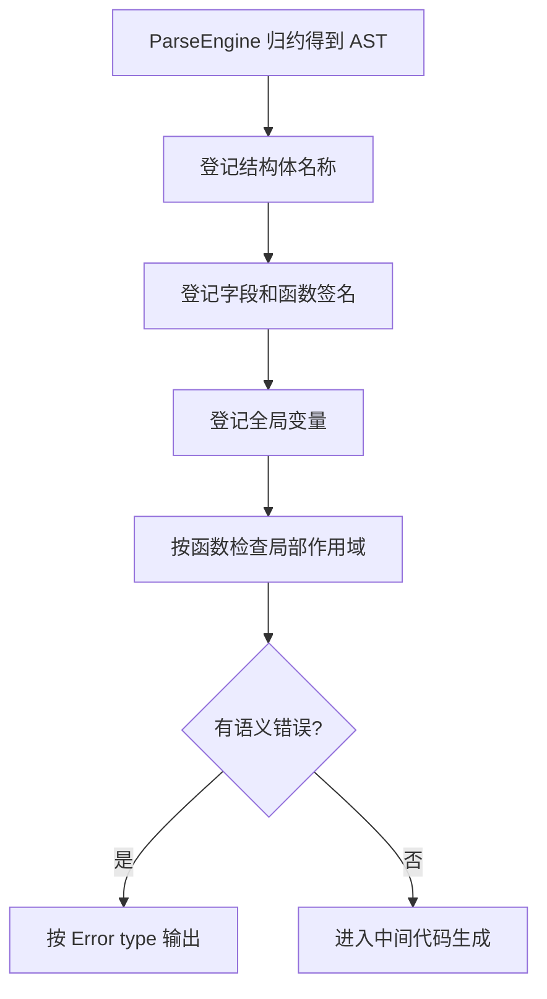

# 实验二：C-- 语义分析

## 1. 实验目标

在实验一生成的 C-- AST 上建立符号表和类型系统，检查变量、函数、数组、结构体、表达式与返回语句的静态语义。实现位于 `source/frontend/cminus_epilogue.inc`。

## 2. 分析流程



采用多遍处理，是为了允许函数在定义出现前被调用，并使结构体引用在检查字段前已知。

## 3. 符号表与作用域

作用域表示为映射栈：

$$
Scopes=[S_0,S_1,\ldots,S_n],\qquad S_i:Name\to Type
$$

声明只检查当前层，引用则从 $S_n$ 向 $S_0$ 查找。进入复合语句压入新映射，离开时弹出，因此允许内层遮蔽外层变量，但禁止同一作用域重复声明。

函数表保存返回类型、形参类型序列和形参名称：

$$
F:f\mapsto(T_1,T_2,\ldots,T_k)\to T_r
$$

实验运行时预定义 `read() -> int` 和 `write(int) -> int`，二者仍按普通 `ID LP Args RP` 产生式解析。

## 4. 类型表示与推导

基本类型为 `int`、`float`，复合类型采用规范字符串表示：

```text
struct Point
array[4] of int
array[3] of array[2] of float
```

主要推导规则为：

$$
\frac{\Gamma(x)=T}{\Gamma\vdash x:T}
$$

$$
\frac{\Gamma\vdash e_1:T\quad\Gamma\vdash e_2:T\quad T\in\{int,float\}}
     {\Gamma\vdash e_1+e_2:T}
$$

$$
\frac{\Gamma\vdash a:array[n]\ of\ T\quad\Gamma\vdash i:int}
     {\Gamma\vdash a[i]:T}
$$

赋值左侧必须是变量、数组元素或结构体字段，且左右类型一致。条件表达式要求为 `int`。

## 5. 错误分类

实现覆盖实验约定的主要错误类别：未定义变量/函数、变量/函数重定义、赋值类型不匹配、非法左值、运算分量类型错误、返回类型错误、实参与形参不匹配、非数组下标、下标非整数、非法成员访问、字段不存在、字段重定义、结构体名称重复和结构体未定义。

错误格式示例：

```text
Error type 5 at Line 4: Type mismatched for assignment.
Error type 1 at Line 5: Undefined variable "missing".
```

## 6. 测试

`semantic_errors.cmm` 同时包含 `float` 赋给 `int` 和使用未声明变量。测试脚本要求编译器返回非零状态并匹配 `Error type 1` 或 `Error type 5`。

合法综合样例还覆盖：

- 结构体定义及 `point.x`、`point.y`；
- 定长数组声明和下标访问；
- 函数签名登记与参数匹配；
- 块作用域和循环条件检查。

## 7. 结论

语义分析直接消费 ParseEngine 归约产生的 C-- AST，不重新解析源码。错误在进入 IR 阶段前集中报告，合法程序才允许生成四元式。
