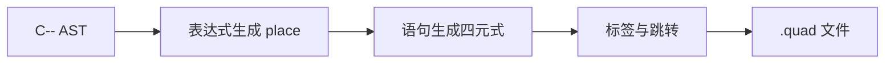

# 实验三：C-- 中间代码生成

## 1. 实验目标

将通过语义检查的 C-- AST 翻译为四元式，完成临时变量分配、控制流标签生成、函数调用和返回翻译。输出可直接交给仓库 `transfer` 后端。

## 2. 四元式形式

统一格式为：

$$
(op,arg_1,arg_2,result)
$$

例如 `sum = sum + i` 生成：

```text
(+:i32, sum, i, t3)
(:=, t3, _, sum)
```

临时变量按 `t1`、`t2` 顺序编号；控制流标签按 `while1`、`endwhile2` 等顺序编号。

## 3. 语法制导翻译



算术表达式的翻译模式为：

$$
place(e_1\ op\ e_2)=t_k
$$

```text
emit(op, place(e1), place(e2), tk)
```

`while (B) S` 翻译为：

```text
(label, _, _, begin)
... B ...
(jz, condition, _, end)
... S ...
(j, _, _, begin)
(label, _, _, end)
```

函数调用先发出 `param`，再发出 `call`；`return` 生成 `ret:i32`。实验预定义的 `write` 直接映射到 `write:i32`。

## 4. 实际输出

对 `valid_loop.cmm` 生成的关键四元式如下：

```text
0: (call, main, _, _)
1: (halt, _, _, _)
2: (label, _, _, main)
3: (decl, i32, local, i)
4: (:=, 0, _, i)
5: (decl, i32, local, sum)
6: (:=, 0, _, sum)
7: (label, _, _, while1)
8: (<:i32, i, 5, t1)
9: (jz, t1, _, endwhile2)
10: (+:i32, i, 1, t2)
11: (:=, t2, _, i)
12: (+:i32, sum, i, t3)
13: (:=, t3, _, sum)
14: (j, _, _, while1)
15: (label, _, _, endwhile2)
16: (write:i32, sum, _, _)
17: (ret:i32, 0, _, _)
```

## 5. 端到端验证

将该文件送入：

```powershell
tmp/nju_lab/bundled-transfer-build/t1t.exe pipeline `
  tmp/nju_lab/cminus-checks/valid_loop.quad
```

后端模拟结果为：

```text
四元式 18 条（基本块 5）
模拟步数 162
输出：15
```

输出 `15` 与源程序计算 $1+2+3+4+5$ 的预期一致。

## 6. 结论

中间代码不是手写示例：它由 ParseEngine 生成的 C-- 前端从 `.cmm` 文件实际产生，并能被仓库后端读取、划分基本块和执行。
