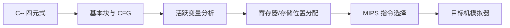

# 实验四：目标代码生成

## 1. 实验目标

把实验三生成的 C-- 四元式转换为 MIPS 风格目标代码，完成基本块划分、变量存储分配、
指令选择、标签映射和模拟执行。实验附带后端源码位于 `source/backend/`；同一份四元式
另外使用仓库当前的 `library/transfer` 验证 Hydra86 原生后端。

## 2. 总体流程



基本块入口包括程序第一条指令、跳转目标和跳转后继。若四元式 $q_i$ 定义变量 $x$，其活跃性方程为：

$$
OUT[B]=\bigcup_{S\in succ(B)}IN[S]
$$

$$
IN[B]=USE[B]\cup(OUT[B]-DEF[B])
$$

## 3. 指令选择

核心映射如下：

| 四元式 | MIPS 风格代码 |
|---|---|
| `(:=, a, _, x)` | 装载 `a` 后存入 `x` |
| `(+:i32, a, b, t)` | 分片装载并执行 `ADD`/`ADDC` |
| `(<:i32, a, b, t)` | 关系比较，结果写入布尔临时量 |
| `(jz, c, _, L)` | 比较零并 `BEQ L` |
| `(j, _, _, L)` | `J L` |
| `(call, f, _, r)` | `CALL f` |
| `(ret:i32, v, _, _)` | 返回值装入约定寄存器后 `RET` |

目标机字长为 16 位，因此 `i32` 值分为两个字处理。加法低半部分使用 `ADD`，高半部分使用带进位的 `ADDC`。

## 4. 生成结果

循环样例的目标代码片段为：

```asm
L_while1:
    RCALL.i32 <, t1, i, 5
    LB.i8 $t0, t1
    CMP.i8 $t0, #0
    BEQ L_endwhile2
    LHU.u16 $t0, i#0
    LI.u16 $t1, 1
    ADD.u16 $t0, $t0, $t1
    SH.u16 $t0, t2#0
    LHU.u16 $t0, i#1
    LI.u16 $t1, 0
    ADDC.u16 $t0, $t0, $t1
    SH.u16 $t0, t2#1
```

生成统计：

```text
四元式：18 条（基本块 5）
目标机：mips（字长 16）；汇编 67 行
模拟：步数 162
输出：15
```

## 5. 正确性验证

验证采用两层对照：

1. `ctest` 对 IR 桥接、数据流、SSA、寄存器分配和流水线执行 8 项测试；
2. 对前端真实生成的 `valid_loop.quad` 进行 MIPS 生成与模拟，检查输出为 `15`。

后端测试结果为：

```text
100% tests passed, 0 tests failed out of 8
```

## 6. Hydra86 对接验证

为了验证中间代码没有绑定 MIPS，使用当前 `library/transfer` 的独立 Hydra86 lowering
处理严格 C-- 前端实际生成的 `valid_optimize.quad`。CMake 找到 Hydra86 源码后会链接
`pvm_cli`，由 `Hydra86::runAssembly` 完成汇编和 VM 执行：

```powershell
cmake -S library/transfer -B tmp/transfer-hydra `
  -DT1T_HYDRA86_ROOT=hydra-86
cmake --build tmp/transfer-hydra --config Debug
tmp/transfer-hydra/Debug/t1t.exe transfer `
  tmp/nju_lab/cminus-checks/valid_optimize.quad `
  --target=hydra86 --asm
```

优化后的核心代码使用 Hydra86 的数据段、调用指令和 syscall，而不是把 8086 文本改名：

```asm
.data
__t1t_const_0 dq 5
v_1 dq 0 ; t1
v_0 dq 0 ; value

.code
_start:
    call L_main
    mov r1, 0
    mov r2, 0
    syscall
L_main:
    mov r8, [__t1t_const_0]
    mov [v_1], r8
    mov r8, [v_1]
    mov [v_0], r8
    mov r2, [v_0]
    call __t1t_print_i64
```

实跑结果：

```text
四元式：8 条（基本块 2）
优化：8 → 8 条（2 轮）
目标机：hydra86（字长 64）；汇编 85 行
Hydra86：周期 140，退出码 0
输出：5
```

该结果来自 C-- 源文件经 ParseEngine 前端生成的四元式。Hydra86 档当前覆盖本实验用到的
整数标量、控制流、调用、返回和整数输出；浮点、字符串、向量、文件、数据区与输入指令
尚未纳入这次实验范围。

## 7. 结论

目标代码输入来自严格 C-- 前端，而不是单独手写的四元式。生成的 MIPS 风格程序保持
循环控制流和 32 位算术语义，模拟输出与源程序一致；同一份前端四元式也能降低成
Hydra86 原生汇编，并由 Hydra86 官方汇编器和 VM 得到相同结果。
