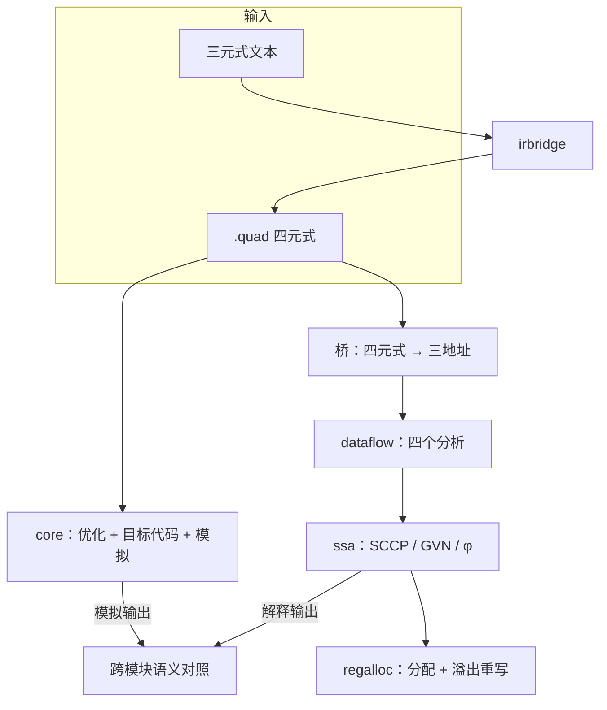

# 单线程后端工具链 · 技术报告

> **定位：编译器工具链的参考实现。** 这里的目标是"把一条完整的后端链路讲清楚、
> 跑通、可复现"：同一份四元式走优化 / 三地址 / 数据流 / SSA / 寄存器分配 /
> 三套教学目标机 / 模拟器，每一步都有实测数字。它**不是生产级编译器**——不追求
> 真实 ABI、指令调度、目标文件格式或优化正确性的形式化证明。

图用代码生成（Mermaid），公式用 LaTeX。本文只讲**合并之后**的架构与实测；
各模块自己的设计见同目录下的 `core/技术报告.md`、`irbridge/技术报告.md`、
`dataflow/技术报告.md`、`ssa/技术报告.md`、`regalloc/技术报告.md`；
（链接它的静态库，命令行实现只有一份），报告见
**结论（2026-09-19）：四元式优化引擎可以用，扁平化不可以用。** `core/`（四元式 + 优化器 +
三套目标代码生成 + 模拟器）与 `irbridge/` / `dataflow/` / `ssa/` / `regalloc/` 保留；
`typebuild/` 与 `astbuild/`（AST 的**扁平化**路线）已删除，改用
[`../../project/pl0-super/`](../../project/pl0-super/README.md) 那条不建 IR、简化代码直接出码的路子。

## 1. 为什么要合成一个库

五个库原来是各自独立的：`transfer`（带类型四元式 → 目标代码 → 模拟器）、
`dataflow`（数据流框架）、`ssa`（SSA 与稀疏优化）、`regalloc`（寄存器分配）、
`irbridge`（三元式 ↔ 四元式）。它们的接口本来就是一条链上的相邻环节，但各自
自带 Parser、自带命令行、自带示例集，**拼起来跑一遍**这件事反而没人做。

合并之后多出来的东西就是这件事：



一条命令 `t1t pipeline x.quad` 就把整张图跑完，并在最后做一次**跨模块语义对照**：
同一份程序的两种执行路径必须给出同一串输出。

## 2. 内部只有一套 IR（TT3）

早期版本是"四元式 + 无类型三地址"两套 IR，中间靠一层会丢类型的桥连接。
现在全库共用 `ir/typed_ir.hpp` 的**带位数三地址指令**：三地址的 `dst, src1, src2`
形状 + 四元式的类型信息。

```text
decl i32 t1                         ; 声明（不写按 i16）
  add:i32 t1, t2, 3                 ; 类型 = 位宽 + 符号（i8…u128 / f32 / f64）
  ld:u16  v, [slot:u16]             ; 内存操作数自带位数
  jz:i32  t1, L1                    ; jmp 标号在 src1、jz/jnz 标号在 src2
```

统一到什么程度：

| 层面 | 情况 |
| --- | --- |
| 指令类型 | 一份：`t1t::TypedInstruction`；三个模块都是 `using Instruction = …` |
| 基本块类型 | 一份：`t1t::Block`；三个模块都是 `using Block = …` |
| 解析 / 打印 | 一份：`t1t::parseProgram` / `t1t::plainText`（模块里的 `parse`/`print` 只是薄包装） |
| Program | 流水线**只解析一次**，`shared.blocks` 直接交给 ssa / dataflow / regalloc |
| 位数信息 | 四元式降级时保留；下游模块把它们记在 `Instruction::type` 里 |

统一过程中修掉的两个真问题：

1. **跳转标号约定不一致**——TT3 原先把标号放 `dst`，而三个模块一直把 `jmp` 标号放
   `src1`、`jz/jnz` 标号放 `src2`，共享 blocks 交给 ssa 时 CFG 全连错（`equivalent ✗`）。
2. **共享 Makefile 没有头文件依赖**——改头文件后旧 `.o` 未重编，同一次链接混用两种
   结构体布局，堆损坏（`0xC0000374`）。现在对象规则依赖 `HEADERS := $(wildcard ir/*.hpp) …`。

输入语言由命令行区分，**转换只在入口做一次**：

| `--from=` | 输入 | 入口做什么 |
| --- | --- | --- |
| `quads`（缺省） | 四元式 | 一次降级到 TT3 |
| `triples` | 三元式 | 三元式 → 四元式 → TT3（一次连续转换） |
| `3addr` | 已经是三地址 / TT3 | **不转换**，直接进 dataflow / ssa / regalloc |

下面这张表是老的"两套 IR"对照，保留下来解释为什么当初要分家（类型 / 目标机
那一侧 vs 名字与数据流那一侧）：

| | 四元式（`core`） | 三地址文本（`dataflow` / `ssa` / `regalloc`） |
| --- | --- | --- |
| 形状 | `(op, a, b, result)`，可带类型后缀 `mul:u16` | `op dst, src1, src2`，每行一条 |
| 关心什么 | 类型、字长、目标机、I/O 与调用 | 名字与名字之间的数据流 |
| 谁在用 | 代码生成、模拟器 | 数据流分析、SSA、寄存器分配 |

桥的规则是**能翻就翻、不能翻就计数**：

$$
\begin{aligned}
(\texttt{:=}, a, \_, r) &\rightarrow \texttt{mov } r, a, &
(\oplus, a, b, r) &\rightarrow \texttt{op } r, a, b\ (\oplus\in\{+,-,\times,\div\}),\\
(\texttt{label}, \_, \_, L) &\rightarrow \texttt{label } L, &
(\texttt{j}, \_, \_, L) &\rightarrow \texttt{jmp } L,\\
(\texttt{jz}, v, \_, L) &\rightarrow \texttt{jz } v, L, &
(\texttt{write}, v, \_, \_) &\rightarrow \texttt{print } v,\\
(\texttt{halt}, \_, \_, \_) &\rightarrow \texttt{halt}, &
\text{其它（read / cvt / 进位 / 浮点 / 字符串 / 向量 / 调用 / 中断 …）} &\rightarrow \text{跳过并计数}.
\end{aligned}
$$

另外两条约束：**双结果指令**（乘法的另一个半、除法的余数）与 `decl` 一律跳过；
操作数必须"干净"（普通名字或整数字面量），带 `.`、`[`、引号的字面量不猜语义。
跳过数不为 0 时，流水线第 ⑦ 步会直接说明"降级后的程序与原程序不等价，跳过对照"——
宁可少做一步，也不给一个假的"一致"。

数据区三件套（`addr` / `load` / `store`）与 `call` / `param` / `ret` 都落在这条
"跳过并计数"里：统一 IR 只覆盖两套 IR 的交集，所以带数据区的程序用
`t1t pipeline xxx.quad --data=… --layout=…` 跑到第 ⑥ 步拿到每步指标即可，
语义对照交给 `t1t transfer` 与 `library/stackvm` 两条同源路径。

## 3. 流水线的七步

```text
① transfer  transfer::read → analyze → optimizeDetailed
② transfer  transfer::generate（MIPS / 8086 / ARM）→ transfer::simulate
③ 桥        lowerQuads（计数 + 列出跳过的操作）
④ dataflow  ssa::parse 出来的三地址文本再用 dataflow::parse 解析一次
            四个分析（live / reach / avail / const）各跑 worklist + naive 并比对
⑤ ssa       optimize()：φ 插入 → SCCP → GVN → φ 消除，自带解释执行的语义对照
⑥ regalloc  去掉 print 之后交给 allocate()：图着色 + 溢出重写
⑦ 对照      transfer 的 write 输出 == 三地址解释器的 print 输出
```

第 ④ 步之所以"解析两次"，是因为 `dataflow` 与 `ssa` 的 `Program` 是各自独立的类型：
两行代码换来模块之间零耦合，比强行统一类型更划算（这是合并时的取舍，写在 README 里）。

## 4. 实测

```text
make -C library/transfer check

irbridge-tests / dataflow-tests / ssa-tests / regalloc-tests   全部通过
共 26 个示例：26 通过，0 失败。      （core：类型 / 无符号乘除 / 浮点 / 宽类型 / 进位 /
                                     双寄存器 / IO / 调用 / 中断 / 字符串 / 向量 / 系统调用 /
                                     文件 / 数据区三件套 addr·load·store …）
共 5 个示例：5 通过，0 失败。        （dataflow）
共 5 个示例：5 通过，0 失败。        （ssa）
共 3 个示例：3 通过，0 失败。        （端到端流水线）
```

| 端到端示例 | 四元式 | 桥翻译 / 跳过 | 三地址 → φ 消除后 | φ | 用色 | 输出 |
| --- | --- | --- | --- | --- | --- | --- |
| `01_arith.quad` | 7 → 7 | 7 / 0 | 7 → 7 | 0 | 1 | `7 6` |
| `02_branch.quad` | 9 → 6 | 6 / 0 | 5 → 5 | 0 | 1 | `10` |
| `03_loop.quad` | 12 → 12 | 12 / 0 | 10 → 14 | 2 | 3 | `15 5` |

`03_loop` 是三个示例里唯一带循环的：桥翻译 12 条，SSA 在循环头插 2 条 φ，
φ 消除后指令从 10 涨到 14（回边上的并行复制），寄存器分配用 3 个颜色、无溢出，
最后两条执行路径都给出 `15 5`。

## 5. 合并时抓到的一个真 bug（SCCP）

`03_loop.quad` 第一次跑 `t1t pipeline` 时，第 ⑤ 步报 `SSA 自己的语义对照：不一致 ✗`，
第 ⑦ 步却"一致"——正是**跨模块对照**把这个矛盾暴露出来的：`transfer` 的模拟走的是
原四元式，没受 SSA 影响；而 `ssa` 的 SCCP 把循环出口的 `jz t, done` 折死了
（`t` 在第一次迭代里等于常量 4），优化后的程序变成死循环。

根因：SCCP 的 `markEdge` 只在"目标块还没被标成可执行"时才把它入队。循环头这种
**已经被处理过**的块，一旦回边在稍后才变成可执行，就不会被重新处理，
它的 φ 于是少算一个前驱：

$$
\nu(\varphi)=\mathrm{meet}\bigl(\{\nu(\mathrm{arg}_p)\mid p\ \text{可执行}\}\bigr)
\quad\text{少一个前驱} \Rightarrow \nu(\varphi)\ \text{停在}\ \mathrm{Const}(0)\ \text{而不是}\ \bot .
$$

修法一行：新边一律把目标块重新入队（`queued` 标志保证不会重复入队）。回归测试
`ssa/test_ssa.cpp::testLoopEdgeReprocess()` 断言 `equivalent` 且输出 `15 5`。

## 6. 合并时的三处工程改动

1. `core/example/quad_file.hpp`：`QuadFile` 增加 `path` 字段，并加
   `resolveConfigPath()`（现为 `resolveRelativePath()` 的别名）——`# 配置:` /
   `# 数据:` / `# 布局:` 是相对路径时，先按当前目录找，再相对 .quad 文件所在
   目录（含只用文件名）找；
2. `core/config.cpp`：`data_bin=` 用同一套回退规则解析；
3. 四个模块的 `main` 改名为 `xxxMain`，由 `app/main.cpp` 按子命令分发；
   模块自己的 Makefile / CMakeLists 保留（`ROOT_DIR` 改为 `../../..`）。
