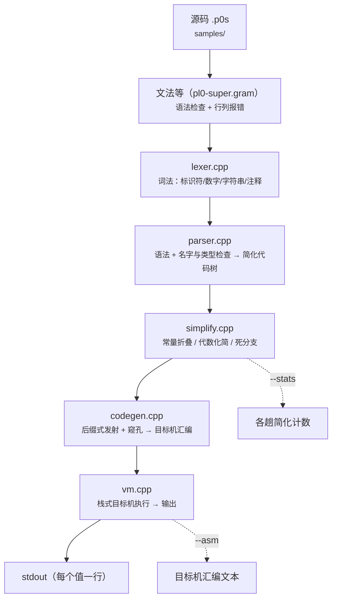
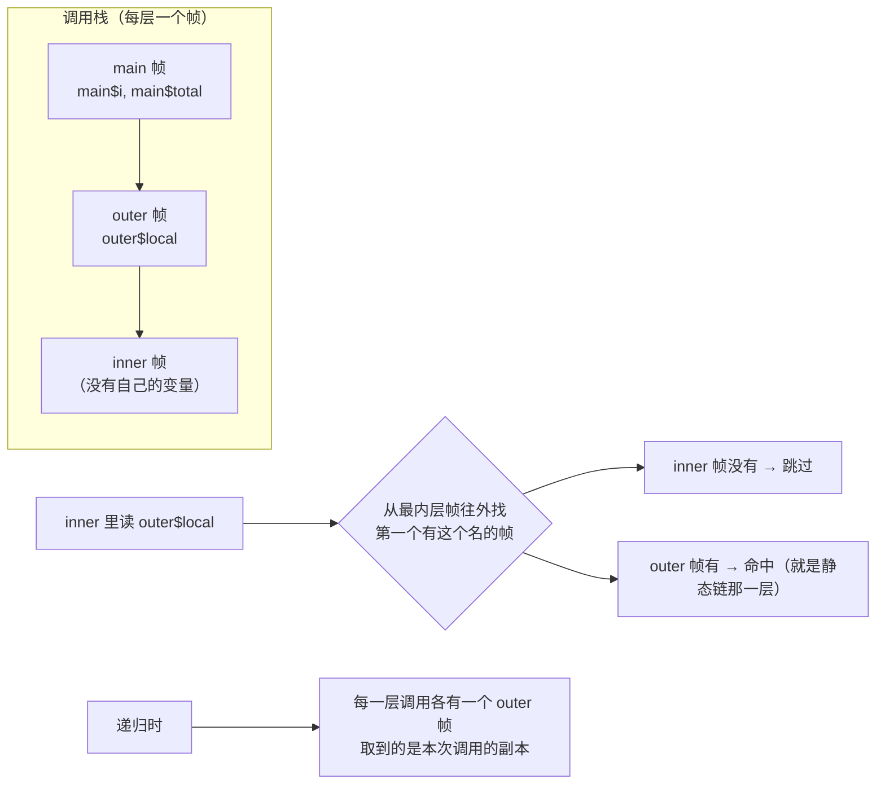

# pl0-super · 技术报告

## 1. 目标与取舍

这份工程的对手是 `library/transfer` 那条**四元式 / IR 流水线**。那条线的结论是：
层次多、每改一处要同时理解四五层，而真正挡住样例的是优化器自己的缺陷（并行向量的
常量传播、`cvt` 折叠不截断、常量传播漏掉赋值语句的源操作数）——**成本来自 IR，
收益没有兑现**。

于是这里的取舍是反过来的：

| 不做的 | 换来的 |
| --- | --- |
| 没有中间表示（不产四元式 / 三地址） | 语义动作归约完，树就是最终表示，改一处只改一个文件 |
| 没有全局数据流 / SSA / 寄存器分配 | 目标机是**栈式**的，表达式一律后缀式压栈，没有"分配"这一步 |
| 不做多维数组、不做指针算术 | 数组一维定长；地址模型只有"数组下标"这一种，行为可预期 |
| 结构体不落成运行时对象 | 按字段扁平化，目标机只认标量与数组 |

## 2. 流水线

（下图由 `tools/gen_diagrams.py` 生成，`--check` 会拿本报告里的图与代码生成的结果逐字比对。）



文法那一格**不只是语法检查**：产生式的动作在归约时就把"简化代码"建进语义值池
（语义值 = 池子下标，POD 的 `double` 装得下），`%main` 拿池子拼出的 `pl0s::Program`
直接交给库。手写前端 `parser.cpp` 保留作参考实现，两条路径的输出由同一批样例比对。

## 3. 语义约定

### 3.1 结构体 = 按字段扁平化

设结构体 $S=\langle f_1:T_1,\dots,f_n:T_n\rangle$，声明 `var p: S;` 之后，
程序里这个对象的名字集合被替换成

$$
\mathrm{vars}(p:S) \;=\; \{\, p\$f_1,\ \dots,\ p\$f_n \,\}
$$

`$` 不在标识符里出现，所以拼出来的名字永远不歧义，而且能直接当目标机的变量名。
数组同理，每个字段一条数组：`array ps[N]: S` 就是每个字段一条 `decla ps$f_i N`。
于是 `p.f`、`ps[i].f` 在语法期就变成普通的变量名 / 数组下标，
**目标机不需要任何"结构体"概念**；结构体整体赋值 `q := p` 展开成逐字段 `load/store`。

### 3.2 引用 = 绑定一次的名字别名

`ref r := 设计式;` 记下目标的表达式树，之后每次用 `r` 都**克隆**一份目标展开
（克隆是为了不让同一棵子树被多处共享，简化那一趟是原地改的）。因为绑定只发生在声明处，
"没有改地址的权力"是**语法**保证的：写 `r := 别的变量` 就是"给被引对象赋值"，
想改绑定没有语法可用。

$$
\mathrm{expand}(r) = \mathrm{clone}(\mathrm{target}(r)), \qquad
\mathrm{writeable}(r) = \mathrm{writeable}(\mathrm{target}(r))
$$

代价写在明处：目标的**下标表达式每次使用都会重算**（`ref r := ps[i].a` 里 `i` 变了 `r`
跟着变），所以引用指的是"这个名字指向的那个位置"，不是"绑定时那一次求值结果"。

### 3.3 帧模型：不用传链指针的静态链

目标机的变量名是 `过程$变量$字段`（过程名也是 `外层$内层`），每次过程调用压一层帧。
**查找规则：从最内层帧往外，找第一个有这个变量的帧。**



为什么它和静态链等价：变量名在**一个过程内唯一**（内层过程带前缀，遮蔽时名字不同），
所以"最近的有这个名字的帧"必然就是词法上包围它的那次激活；递归时最内层就是本次调用。
好处是指令里不用带链指针，`call` / `ret` 只负责压帧、弹帧。

## 4. 简化（本工程的主菜）

四趟都计数，`--stats` 打印。约定 $c$ 是常量、$x$ 是任意子表达式。

| 趟 | 规则（节选） | 计数键 |
| --- | --- | --- |
| 常量折叠 | $c_1 \oplus c_2 \Rightarrow c$：`+ - * / %`、比较、`and/or/not`、字符串拼接、`float(c)` / `int(c)` | `folded` |
| 代数化简 | $x+0 \Rightarrow x$、$0+x \Rightarrow x$、$x-0 \Rightarrow x$、$x \cdot 1 \Rightarrow x$、$1 \cdot x \Rightarrow x$、$x \cdot 0 \Rightarrow 0$、$x/1 \Rightarrow x$、$--x \Rightarrow x$、$\lnot\lnot x \Rightarrow x$ | `algebra` |
| 死分支 | `if c then A else B`：$c \neq 0$ 只留 $A$；`while 0` 整块删；`for` 的初值终值都是常量且方向已走完就整块删 | `deadBranch` |
| 窥孔 | 指令流相邻两条：`push 0; add/sub` 与 `push 1; mul/div` 删两条；`push N; drop` 删两条；`load X; store X` 删两条 | `peephole` |

折叠只在**同类型常量**之间做：整数除法向零截断、浮点不做代数化简（怕改求值顺序）、
常量除零在编译期就报错（`第 N 行：除数是常量 0`）。

实测：`samples/simplify_demo.p0s` 一个样例里同时踩满四条 ——

```text
简化：折叠 6，代数 2，死分支 3，窥孔 2
46
```

## 5. 目标机（pl0s）

栈式：一条指令一个栈动作；操作数类型跟着**值**走（整数 / 浮点 / 文本），
所以没有"指令变体"要挑。帧里放变量与数组，`call` 压帧、`ret` 弹帧。

| 组 | 指令 | 说明 |
| --- | --- | --- |
| 压栈 | `push N` / `pushf F` / `pushs sN` | 整数 / 浮点 / 字符串（字符串常量在 `.data` 里去重） |
| 栈操作 | `dup` / `swap` / `drop` | 窥孔会删掉多余的那些 |
| 算术 | `add sub mul div mod neg` | 整数对整数出整数，沾浮点就提升；`add` 对文本是拼接 |
| 转换 | `tof` / `toi` | `float(x)` / `int(x)`（向零截断） |
| 比较 | `lt le gt ge eq ne` | 数字按大小，文本按字典序 |
| 逻辑 | `and or not` | 0/1 |
| 变量 | `decl` / `load` / `store` | `decl` 弹一个值当**初值**并声明 |
| 数组 | `decla X N` / `aload X` / `astore X` | 下标越界在这里报（`数组 X 下标越界：i`） |
| 控制 | `label L:` / `jmp` / `jz` / `jnz` / `call` / `ret` | `for` / `while` / `if` / `goto` 都由这几个拼 |
| 输出 | `write` / `halt` | `write` 弹一个值打印一行 |

生成的汇编长这样（`struct_ref.p0s` 的开头）：

```asm
.data
s0: .str "hello"
.text
p_main:
push 0
decl main$p$x
pushf 0
decl main$p$y
```

## 6. 实测

`make -C project/pl0-super check`（构建 + 13 个正常样例 + 2 个出错样例）：

```text
[通过] array_sum / bool_logic / downto_loop / float_div / float_ops / nested_proc
[通过] proc_rec / ref_swap / simplify_demo / string_cat / struct_array / struct_ref / while_if
[通过] div_zero_const（报错）/ ref_rebind（报错）
pl0-super：全部样例通过
```

| 样例 | 覆盖 | 期望 | 折叠/代数/死分支/窥孔 | 汇编行数 |
| --- | --- | --- | --- | --- |
| `array_sum` | 数组 + `for to` + 浮点 | `30 16` | 2 / 0 / 0 / 0 | 57 |
| `nested_proc` | 嵌套过程读外层局部 | `10` | 0 / 0 / 0 / 0 | 27 |
| `struct_ref` | 结构体 + 引用 + 整体复制 | `7 1.5 7` | 0 / 0 / 0 / 0 | 69 |
| `struct_array` | 结构体数组 + 引用指向元素字段 | `6 8` | 2 / 0 / 0 / 0 | 69 |
| `simplify_demo` | 四条简化 | `46` | **6 / 2 / 3 / 2** | — |
| `proc_rec` | 过程 + 递归 | `120` | 0 / 0 / 0 / 0 | — |
| `float_ops` / `float_div` | 浮点运算与截断 | `7.5 7 1` / `3.5 3` | 0 / 0 / 0 / 0 | — |
| `string_cat` | 字符串拼接 | `hello-world-42` | 0 / 0 / 0 / 0 | — |
| `while_if` / `bool_logic` / `downto_loop` | 控制流与逻辑 | `55 100` / `1 2` / `6` | 0 / 0 / 0 / 0 | — |

## 7. 语言与目标机约定
 
- **语义动作就在 `.gram` 里**（`%code ... %endcode` 放类型与钩子宏、`%epilogue` 放池子与动作函数、
  `%main` 放驱动）：`make grammar` 出前端、`make check` 走的就是它，13 个样例全绿，
  且**没有重复解析**。手写 `parser.cpp` 只作为参考实现与对照路径保留。
- 语言限制：过程**无参数**（用全局变量与嵌套作用域传值）、数组**一维**、结构体字段不能是
  `str`、字符串只能与字符串比较、`ref` 的目标必须是设计式、结构体不能当值整体传参。
- `if` / `while` / `for` 的分支**强制写 `begin … end`**：悬挂 `else` 的移进/归约冲突在文法
  结构上就不存在，不需要优先级硬掰（`pl0-super.gram` 与手写 `parser.cpp` 两边一致）。
- 目标机是**栈式**的，不做寄存器分配；`call` / `ret` 用值栈放返回地址，所以过程体必须保持
  栈平衡（所有语句都是平衡的，表达式临时量在归约时就被弹掉）。

## 8. 两份前端的效率对比（实测）

同一台机器、同一个 **2007 行**样例（`build/bench_big.p0s`：`s := s + i;` ×2000 + 输出一次），
串行跑 5 次取 min/avg；两份可执行都链同一批 `-O2` 编出来的库对象（简化 / 代码生成 / 目标机）。

| 指标 | 生成的前端（`build/pl0-super`） | 手写前端（`build/pl0-super-lib`） |
| --- | --- | --- |
| 端到端（语法 → 简化 → 出汇编 → 目标机执行 → 输出） | min **20.7 ms** / avg **21.3 ms** | min **18.5 ms** / avg **19.6 ms** |
| 等价解析吞吐（按 2007 行估） | ≈ **94 千行/秒** | ≈ **102 千行/秒** |
| 可执行大小 | 2,055,291 B | 1,202,195 B |
| 前端源码 | 3940 行（`pl0sgram_parser.cpp`，机器产出，含动作层） | `lexer.cpp` 156 行 + `parser.cpp` 894 行（人写） |
| 前端编译时间（`-O2`，串行单次） | **801 ms** | 441 ms + 1206 ms = 1647 ms |

怎么读这组数（比数字本身重要）：

1. **生成的那份慢 ~8%**（21.3 vs 19.6 ms）：表驱动 LALR 每次归约查表 + 语义值要经池子下标
   间接寻址，而手写递归下降是直接指针。语义动作搬进 `.gram` 之前这个差距是 ~25%
   （那时它要解析两遍）；搬进来之后重复解析没了，剩下的就是这一层"查表 + 间接"的固定开销。
2. **生成的那份大一倍**（2.06 MB vs 1.20 MB）：LALR 分析表 + 动作层（池子、类型、作用域）
   都编进了同一个可执行；手写那份的语义层在 `parser.cpp` 里，体量本来就小。
3. **但生成的那份编译更快**（801 ms vs 1647 ms）：单个大文件，没有手写递归下降那堆
   内联与模板展开。总结一句：**跑得快赢在手写，编得快与改文法只改一处赢在生成。**
4. **维护成本是两类**：手写前端零运行时依赖，但文法改一处要同时改 `pl0-super.gram`（定义）
   与 `parser.cpp`（实现），两边容易走偏；生成的那 2966 行是自动产出，改完文法
   `make grammar` 重出即可，代价是构建依赖仓库里的 ParseEngine。
5. 这些数字只说明量级（这台机器、这个样例、这一版实现），绝对值没有意义；
   样例是"同一形状语句重复 2000 次"，不代表真实程序的分布。
