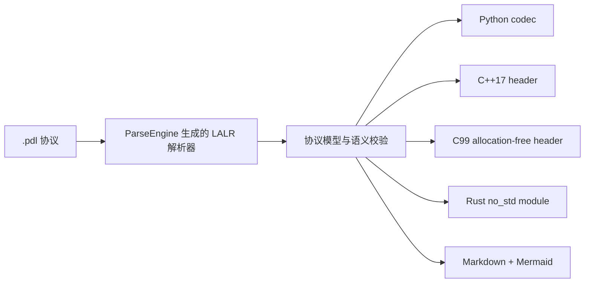

# protocol-dsl：二进制协议描述语言与代码生成器

用一份紧凑的 `.pdl` 描述二进制线格式，生成四档可直接使用的编解码器。项目同时提供
**Python、C++17、Rust 三套 protocol-dsl 编译器实现**，三套语法前端都由 ParseEngine
生成，不是手写递归下降解析器。

| 目标 | 产物 | 运行时模型 |
| --- | --- | --- |
| Python | `<协议>_protocol.py` | `dataclass` + `IntEnum`，便于调试和测试 |
| C++17 | `<协议>_protocol.hpp` | 单头文件，`std::vector<uint8_t>` |
| C99 | `<协议>_protocol.h` | 单头文件、零堆分配、字节字段借用输入缓冲区 |
| Rust | `<协议>_protocol.rs` | 只用 `core`、兼容 `#![no_std]`、字节字段使用借用切片 |

同时生成 `PROTOCOL.md` 与 `protocol.mmd`，前者是字段表，后者是可单独渲染的 Mermaid
类型关系图。DSL 的词法与 LALR(1) 语法分析器由仓库自己的 **ParseEngine** 从
[`protocol.gram`](protocol.gram) 生成；协议校验和多目标生成在
[`protocol_runtime.py`](protocol_runtime.py)，产物骨架在 [`templates/`](templates/)。

## 快速开始

先在仓库根目录构建 ParseEngine，然后运行本库：

```sh
make
make -C project/protocol-dsl

# 生成解析器，再把示例协议生成到 build/generated/
python project/protocol-dsl/build/main.py \
  project/protocol-dsl/examples/telemetry.pdl \
  --out-dir project/protocol-dsl/build/generated --target all

# 四档编解码往返、错误路径、C99/C++17 编译与 Rust no_std 编译
make -C project/protocol-dsl check
```

`--target` 可选 `all`、`python`、`cpp17`、`c99`、`rust`、`docs`。生成器自身只依赖
Python 标准库；生成出的 C99 / C++17 / Rust 代码也没有第三方依赖。

### C++17 与 Rust 原生版

```sh
# 生成两套原生解析器并构建 CLI
make -C project/protocol-dsl native

# C++17 实现：生成 C++17 单头文件 codec
project/protocol-dsl/build/protocol-dsl-cpp \
  project/protocol-dsl/examples/telemetry.pdl \
  --out-dir project/protocol-dsl/build/from-cpp

# Rust 实现：生成 no_std Rust codec
project/protocol-dsl/build/protocol-dsl-rust \
  project/protocol-dsl/examples/telemetry.pdl \
  --out-dir project/protocol-dsl/build/from-rust
```

| 编译器实现 | ParseEngine 产物 | 当前输出 |
| --- | --- | --- |
| Python | `--lang python`，语义动作直接构建 schema | Python / C++17 / C99 / Rust / 文档 |
| C++17 | `--lang cpp17 --tree`，遍历生成的 CST | C++17 单头文件 codec |
| Rust | `--lang rust --tree`，遍历生成的 CST | `no_std` Rust codec |

C++17 与 Rust 版均独立完成 schema 构建和语义校验，运行时不调用 Python。Rust 编译器
使用 ParseEngine Rust 后端所需的官方 `regex` crate；其生成的协议 codec 仍然只使用
`core`。`make check` 会把两套原生 CLI 生成的代码再次交给 `g++` / `rustc` 编译并做
逐字节往返，同时验证非法长度引用会被拒绝。

首次构建 Rust 原生版需要 Cargo 获取官方 `regex`；已有本机缓存时可运行
`make -C project/protocol-dsl native-rust CARGO_FLAGS=--offline`。

## DSL

```text
protocol Telemetry;
endian little;

enum MessageKind : u8 {
    heartbeat = 1;
    sample = 2;
};

packet Header {
    u16 sequence;
    MessageKind kind;
    u8 flags;
};

packet Sample {
    Header header;
    u32 timestamp;
    u16 payload_length;
    bytes payload[payload_length];
    u16 checksum;
};
```

支持的整数是 `u8/u16/u32/u64` 与 `i8/i16/i32/i64`；协议统一选择 `little` 或
`big` 字节序。`bytes data[16]` 是定长字节串，`bytes data[length]` 引用同一 packet
中更早出现的无符号整数字段。枚举底层类型必须是无符号整数。packet 可以引用已经声明的
enum 或 packet，因此声明顺序同时就是依赖顺序。

生成前会检查：

- 类型、字段、枚举项和值重复；
- 枚举值超出底层整数范围；
- 未知类型和前向类型引用；
- 动态字节串引用尚未出现、非整数或有符号的长度字段；
- 会与 Python/C++/C/Rust 关键字或生成方法冲突的名称。

## 嵌入式接口

C99 解码器不复制 `bytes`：`telemetry_bytes.data` 指向传入的报文缓冲区，所以该缓冲区
必须活得比解码结果久。编码器由调用方提供输出数组和容量，不调用 `malloc`：

```c
uint8_t output[128];
size_t written = 0;
telemetry_error error = TELEMETRY_ERROR_NONE;
telemetry_Sample value = {0};

if (!telemetry_Sample_encode(&value, output, sizeof(output), &written, &error)) {
    /* error: CAPACITY / LENGTH / ENUM */
}
```

Rust 产物只引用 `core`，字节串类型为 `&'a [u8]`，编码同样写入调用方切片：

```rust
let value = telemetry_protocol::Sample::decode(input)?;
let mut output = [0u8; 128];
let written = value.encode(&mut output)?;
```

C99 和 Rust 均对截断输入、输出容量、动态长度不符、非法枚举和尾随字节返回显式错误。
生成代码不使用动态分配、文件系统、线程或浮点环境，适合 MCU 固件、驱动与裸机 crate。

## 生成链路



## 文件

| 路径 | 内容 |
| --- | --- |
| `protocol.gram` | DSL 词法、LALR 文法、生成器 CLI；用 `%copy` 带上运行时与模板 |
| `protocol_syntax.gram` | C++17 / Rust 原生实现共用的 `%tree` 文法 |
| `protocol_runtime.py` | schema 数据模型、语义校验、四档代码生成 |
| `native/cpp/main.cpp` | C++17 原生编译器：CST → schema → C++17 codec |
| `native/rust/main.rs` | Rust 原生编译器：CST → schema → `no_std` Rust codec |
| `templates/*.tmpl` | Python / C++17 / C99 / Rust / Markdown / Mermaid 产物骨架 |
| `examples/telemetry.pdl` | 小端、嵌套 packet、动态字节串 |
| `examples/control.pdl` | 大端、有符号整数、定长字节串 |
| `tests/` | 三套编译器、四档 codec 的编译与逐字节往返、截断和非法协议诊断 |

## 当前边界

当前版本刻意保持线格式简单、静态且容易审计：尚不支持位域、浮点、字符串编码、校验和
自动计算、条件字段、tagged union、packet 数组、对齐填充和字段级字节序覆盖。校验和仍可作为
普通整数承载，由业务层计算。协议演进建议新增 packet 或在尾部追加由版本字段约束的内容，
不要依赖 C/C++ 结构体内存布局。
