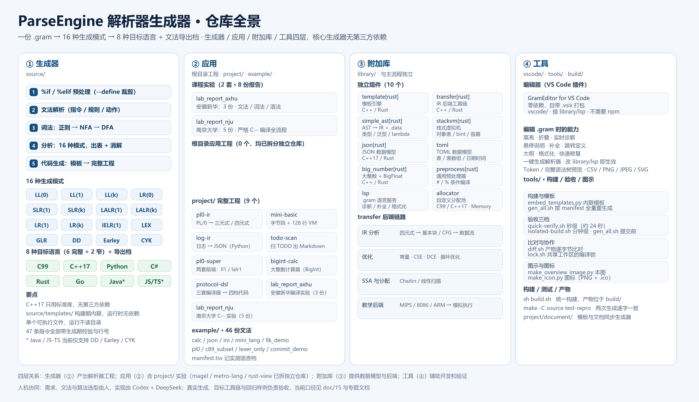
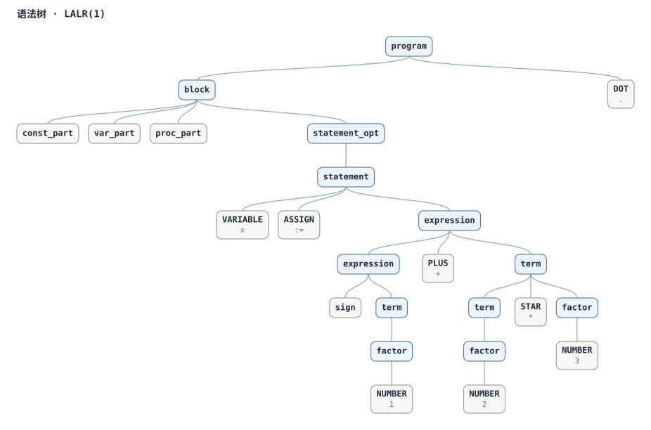
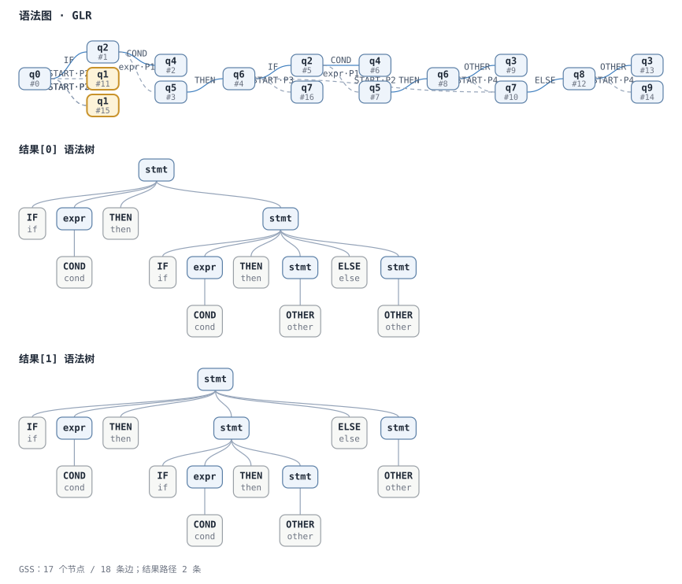
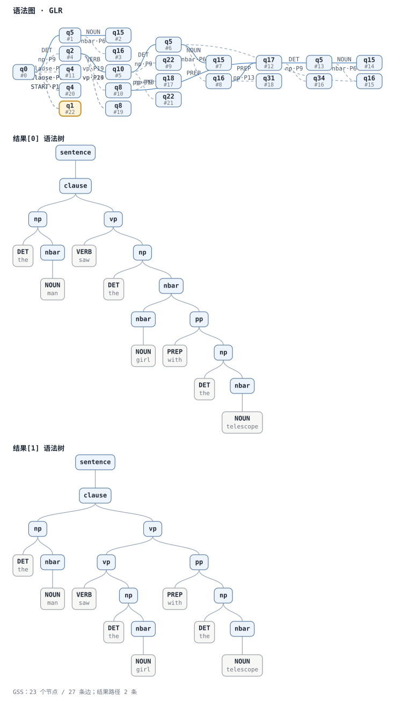

# ParseEngine 生成器本体（`source/`）

> 这是**生成器本体**的说明文档（命令行、模板、产物形态、构建与小测）。
> 项目总览、Magel 语言与全仓目录见根目录 [README](../README.md)。

命令行支持 `--ui-lang zh|en|auto`，独立于 `--lang` 代码生成目标。内嵌手册（`ParseEngine man`）、内嵌语言服务器（`ParseEngine lsp`）、Windows Unicode 输出与 Python ZIP 发布脚本见 [16 显示语言、内嵌资产与发布](../doc/16-i18n-and-packaging.md)。


Yacc 风格的解析器生成器：一份 `.gram` 文法，十六种生成模式，输出 C99 / C++17 / Python / C# / Rust / Go / Java / JavaScript-TypeScript 解析器。八种目标语言 + 一个「只要文法与分析报告、不要代码」的导出档由 `--lang {c,cpp17,python,csharp,rust,go,java,js,gram}` / `%lang` 选（命令行优先，缺省 `cpp17`；Java 与 JS 当前支持 DD / Earley / CYK，`--lang gram` 只导出 `.gram` 原文件 + 分析报告）。

各语言可用模式并不相同，完整清单见 [12 各语言支持的模式与增量 API](../doc/15-language-mode-support.md)：
C99 支持 13 种，C++17 / Python / C# / Rust / Go 各支持 16 种；Java / JS-TS
各支持 DD、Earley、CYK 三种，`gram` 可导出全部 16 种。




### LL 家族

| 模式 | 分析表 | 适用场景 |
| --- | --- | --- |
| **LL(1)** | 预测分析表 | 已消除左递归、提取左公因子的 DSL 文法，产物小、表直观 |
| **LL(k)**（教学/救急） | 预测分析表按 k 元组建列 | 按 k 个 Token 选产生式（`Select_k(A→α) = FIRST_k(α·FOLLOW_k(A))`），含左递归消除 |
| **LL(0)**（教学） | 预测分析表只有一列 | 不看 lookahead，每个非终结符只能有一条产生式 |

增量解析只提供给 C++17 / Rust：LL/DD 同文本复用、变更后重算；确定性 LR 从公共前缀内最近的 checkpoint 恢复。GLR 家族（含 Earley/CYK）保存 packed forest，支持父依赖传递失效、稳定节点 ID 复用、后缀跨度重映射和局部 forest 修补；GSS 控制流程与图表判定仍完整执行，Tree 结果重新物化。GLR 默认禁用语义复用，显式 `GlrSemanticReusePolicy::Pure` 且语义环境版本一致时才允许同文本成功结果复用，有歧义回调时禁用。具体 API、指标及完整增量解析尚未覆盖的边界见 [doc/12](../doc/15-language-mode-support.md)。

### LR 家族

| 模式 | 分析表 | 适用场景 |
| --- | --- | --- |
| **LR(0)**（教学） | LR(0) 项集，完整项在整行归约 | 讲清 LR 自动机与「移进/归约」的最简模型 |
| **SLR(1)** | LR(0) 项集 + FOLLOW | 含直接左递归的文法，无需改写文法；C++17 / Rust 产物可从 token cache + checkpoint 恢复 |
| **LALR(1)** | LR(1) 项集 + 同心合并 lookahead | 复用 SLR 的 LR 运行时，处理 lookahead 更细的文法 |
| **LR(1)**（教学） | 规范 LR(1) 项集（不合并） | 与 LALR 对照「合并省下多少状态、代价是什么」 |
| **IELR(1)**（默认） | LALR 项集 + 按需拆分冲突状态 | 处理全部 LR(1) 文法，表规模仍与 LALR 同量级 |

### LR(k) 与教学对照

| 模式 | 分析表 | 适用场景 |
| --- | --- | --- |
| **LR(k)**（教学/救急） | 规范 LR(k) 项集 + 两层 ACTION 表 | 一个展望符不够用时把窗口放宽到 k 个 Token；k = 1 时就是 LR(1) |
| **LALR(k)**（教学/救急） | LR(k) 项集 + 同心合并 lookahead | 对照合并引入的归约/归约冲突；严格弱于 LR(k) |
| **SLR(k)**（教学/救急） | LR(0) 项集 + FOLLOW_k | SLR(1) 的推广，归约只看左部的 `FOLLOW_k`；C++17 / Rust 产物同样可从 LR 前缀 checkpoint 恢复 |

### 歧义与回溯

| 模式 | 分析表 | 适用场景 |
| --- | --- | --- |
| **GLR** | LR(0) 项集 + 冲突候选表 | 歧义文法、要**保留全部解释**：运行时用图结构栈（GSS）同时探索多条路径，五档均用动态容器保留结果（C++17 / Python / C# / Rust / Go） |
| **Earley** | 输入位置上的预测 / 扫描 / 完成图表 | 直接识别含左递归、空产生式的原文法；C++17 / Python / C# / Rust / Go 用 GLR 结果机制保留歧义树与语义动作 |
| **CYK** | 生成期自动转换为 CNF，运行时按跨度填表 | 对任意普通上下文无关文法做图表判定；C++17 / Python / C# / Rust / Go 用 GLR 结果机制保留歧义树与语义动作 |
| **递归下降（DD）** | 不建表，每个非终结符一段解析逻辑 | 歧义文法、要**人手可控的取法**：按产生式声明顺序逐条试，失败回退输入位置再试下一条，只保留第 1 条匹配路径（八档全支持；增量入口目前只给 C++17 / Rust） |

### 词法模式

| 模式 | 分析表 | 适用场景 |
| --- | --- | --- |
| **lex**（词法模式） | 没有分析表 | 只要词法器、不要解析器；可以一条产生式都不写，见[词法模式](../doc/13-modes.md#词法模式mode-lex) |

生成器只用 C++17 标准库，无第三方依赖；`source/templates/` 下的模板（**384 份，
全部 `.tmpl`**，走 `library/template` 模板引擎）在构建期被内联进可执行文件，产出单个可执行文件
`ParseEngine`，运行时不依赖 `source/templates/`
目录。产物是自包含的分文件工程，C / C++17 产物附带 `Makefile` 与 `CMakeLists.txt`，不依赖
外部库（语义值类型 `ParserValue_T` 由你在文法里用 `%value_type` 声明，或自己
在 `%code ... %endcode` / `%union` 里给出）；Python 产物只有 `parser.py` / `main.py`，
用 `python3` 直接跑，不需要编译。生成内容都在模板文件里，改模板即可定制产物。

这个项目采用人机协同开发：需求、文法设计、算法选型与代码取舍由人决定，AI 协助实现，
最终由构建、目标工具链和回归样例验收。当前支持范围以
[`doc/12`](../doc/15-language-mode-support.md) 为准。

图里每一条都能在仓库里查到：模式表见下面的「特性」，目标语言与产物形态见
[`14 目标语言、产物与 API`](../doc/14-languages-and-products.md)，多份完整工程示例
（`pl0-ir` / `mini-basic` / `log-ir` / `todo-scan` / `bigint-calc` …）见
[`project/README.md`](../project/README.md)。
矢量版是同目录下的 [`tools/overview/ParseEngine-overview.svg`](../tools/overview/ParseEngine-overview.svg)，
两张图都可以用 `python tools/make_overview_image.py` 重新生成（改文案后跑一次即可；
仓库里没有 `image/` 目录时，这条命令会自己建目录并写出这两个文件）。

下面按“条目 + 表格”的方式重排这一节，尽量保留原意，只改排版。

## 目录

- 本页：[特性](#特性) · [快速开始](#快速开始) · [给 AI 用（`SKILL.md`）](#给-ai-用快速分析日志--dslskillmd) · [示例](#示例) · [命令行选项](#命令行选项) · [构建与小测](#构建与小测) · [目录结构](#目录结构) · [技术文档](#技术文档) · [附加教学库](#附加教学库四元式优化与目标代码转换librarytransfer) · [依赖与构建](#依赖与构建) · [开发方式](#开发方式) · [许可证](#许可证)
- 用户手册与支持矩阵：
  - [`11 目标语言、产物与 API`](../doc/14-languages-and-products.md)：八种目标语言（含 DD/Earley/CYK 专用 Java 与 JS/TS 窄后端）+ `--lang gram` 文法导出档的产物形态与选择
  - [`09 用 .gram 写文法`](../doc/12-grammar-usage.md)：指令表、语义动作、语义值类型（`%value_type` / `%union` / `%type`）、`%tree` / `%copy`、冲突消解、错误恢复、条件编译（`%if`）、`%main` / `%epilogue`、报错定位（`#line`）
  - [`10 生成模式与运行时`](../doc/13-modes.md)：LL / LR / GLR / Earley / CYK / 递归下降（DD）/ `lex` 十六种模式、教学模式、Mermaid 状态机图、词法匹配顺序
  - [`12 各语言支持的模式与增量 API`](../doc/15-language-mode-support.md)：八种语言与 `gram` 的模式矩阵、C++17 / Rust 增量能力及纯度策略边界
- 实现与规范：[`doc/01` 架构](../doc/03-architecture.md) · [`doc/02` 文法规范](../doc/05-grammar.md) · [`doc/03` 分析算法](../doc/06-analysis.md) · [`doc/04` 代码生成](../doc/07-codegen.md) · [`doc/05` 产物 API](../doc/08-generated-code.md) · [`doc/06` 构建与测试](../doc/09-build-and-test.md) · [`doc/07` 示例导读](../doc/10-examples.md) · [`doc/08` 工程示例](../doc/11-project-examples.md) · [`library/transfer` 教学库](../library/transfer/README.md) · [编辑器](#编辑器vs-code-插件)

## 特性

### 目标语言与产物

| 项目 | 说明 |
| --- | --- |
| 支持语言 | `--lang {c,cpp17,python,csharp,rust,go,java,js}` / `%lang`（命令行优先）；Java/JS 仅 DD/Earley/CYK，另有导出档 `--lang gram` |
| 默认语言 | C++17 |
| 产物一致性 | 同一份文法各种产物的语义（含错误消息）逐字一致；C# / Rust 在 Windows 上是平台 CRLF 行尾，比对前统一归一化 |
| 专有特性挡板 | 依赖 C++17 专有东西的文法可以写 `%cpp_only`，挡住 `--lang c` / `python` / `csharp` / `rust` / `go` |
| Java / JS 窄后端 | `--lang java` 生成自包含 `Parser.java`；`--lang js` 生成带 TypeScript 类型标注、Node.js 22+ 可直接运行的 `parser.ts`；当前仅支持 DD / Earley / CYK 与 `%tree`，不执行语义动作 |
| 指令集 | 文法只用生成器实际实现并测试的指令；完整清单见 [`doc/05-grammar.md`](../doc/05-grammar.md) |

各语言产物形态：

| 语言 | 产物 | 说明 |
| --- | --- | --- |
| C++17 | `parser.hpp` / `parser.cpp` / `main.cpp` | Qt 风格 `Engine`（d-pointer）+ `std::string_view` / `std::vector` / `std::unique_ptr`，常量用 `inline constexpr`，内存全交给标准库（不支持自定义分配器） |
| C99 | 10 个文件、下划线 API | 纯 C99 产物（不依赖 C++ 运行时） |
| Python | `parser.py` / `main.py` | 免编译、给文法做快速分析，也能让 AI / 脚本直接跑命令拿结果（类名用 `%class` / `--class` 改） |
| C# | `Parser.cs` / `Token.cs` / `Program.cs` / `parser.csproj` | 类名首字母大写；`%package` / `%import` / `%class_body` 三个指令对这一档有效 |
| Rust | `Cargo.toml` / `src/parser.rs` / `src/token.rs` / `src/main.rs` | Cargo 工程，计算只用标准库、**词法正则用官方的 `regex` crate**（唯一的第三方依赖）；语义值按值拷贝，`%package` / `%import` / `%class_body` 有效，**不支持 `%destructor`** |
| Go | `go.mod` / `parser.go` / `token.go` / `main.go` | Go 模块，**只用标准库**（词法正则用标准库 `regexp`，没有 DFA 表）；`go build` / `go run .`；`%package`（module path）/ `%import` / `%class_body` 有效，**不支持 `%destructor`** |
| Java | `Parser.java` | DD / Earley / CYK 窄后端；JDK 17+ 自包含单文件，支持 `%tree`，不执行语义动作 |
| JS-TS | `parser.ts` / `package.json` | DD / Earley / CYK 窄后端；保留可擦除 TypeScript 类型标注，Node.js 22+ 可直接运行，支持 `%tree`，不执行语义动作 |

### 文法导出档（`--lang gram`）

- **不生成代码**：产物目录里只有输入的那份 `.gram` 原文件（逐字节导出，文件名沿用输入文件）。
- **分析报告**：`<文法名>.analysis.md`（冲突消解 / 未消解冲突 + `--report` 那份报告全文）。
- **说明文件**：`RESULT.md`（生成信息 + 产物清单 + 怎么用）。
- **用途**：把「文法 + 它的分析结果」一起归档、提交或交接；换 `--mode` 再导一次就是另一套分析。
- **边界**：这一档没有解析器、没有词法器、也没有构建脚本。

### 前端与执行模型

| 项目 | 说明 |
| --- | --- |
| 共用前端 | 十六种模式共用一套前端：词法、`.gram` 加载、`%define` / `%value_type` / `%tree` / `%example` 与语义动作翻译完全共用，只换分析表构造（`lex` 只到词法层为止）；`%example "..."` 为生成文档提供支持转义的示例输入 |
| 规则写法 | 规则 `\|` 分支写法：同一左部的多个候选写成一条以 `;` 结束的规则，每个分支各带自己的动作；`example/` 下多数示例都采用这种写法 |
| 非递归执行 | LL(1) 用显式分析栈 + 语义帧；LR(0)/SLR/LALR/LR(1)/IELR 用 LR 状态栈 + 语义值栈 |
| 栈深控制 | 栈深由 `PARSER_MAX_STACK_DEPTH` 控制，可用 `%max_stack_depth` 在文法里定，或编译期 `-D` 覆盖 |
| 语义动作 | 语义动作翻译成普通 C：`$1 + $3`、`$$ = $1`、`$$.字段 = $3` 就是 C 的表达式与赋值 |
| 语义值类型 | `ParserValue_T` 由你用 `%value_type` 声明（或 `%union` / `%code` 自己给），生成器不做类型检查，交给 C 编译器 |

### 语法树

| 项目 | 说明 |
| --- | --- |
| 可选语法树（`%tree`） | 生成 CST API，除 `%mode lex` 外的所有模式接口一致；树节点是 `ParserTree_T`，只保存符号名与 Token 词素，不保存语义值，与语义值类型无关 |

### 冲突与错误恢复

| 项目 | 说明 |
| --- | --- |
| 优先级消解 | `%left` / `%right` / `%nonassoc` / `%prec` / `%expect`：移进/归约冲突按 yacc 规则在生成期消解，未消解的冲突可用 `%expect` 显式放行 |
| 错误恢复 | `error` 产生式 / `%sync` / LL 的 FOLLOW 集：LR 家族可以写 `stmt := error SEMI { yyerrok; }`，也能用 `%sync SEMI` 声明恢复锚点；自顶向下（LL）什么都不用写，运行时自动按 FOLLOW 集放弃出错的那一层构造，一次解析报多个错（最多 `PARSER_MAX_ERRORS` 条） |
| 丢弃清理 | `%destructor <成员> { ... }`：写了 `%union` 的文法可以给成员登记清理片段，错误恢复弹栈 / 解析失败收尾清栈时按「栈上那个符号绑的是哪个成员」调对应片段；没登记的成员退回 `PARSER_USER_DISCARD_VALUE` 钩子（C++17 产物靠 RAII，不需要） |

### 条件编译与用户代码

| 项目 | 说明 |
| --- | --- |
| 条件编译 | `%if` / `%elif` / `%else` / `%endif`：同一份文法按场景产出不同内容——`--define DEBUG` 这类开关控制哪些 `%token` / 产生式 / 语义动作片段进产物，条件为假的整行连解析都不做 |
| 辅助函数与入口 | `%epilogue` / `%main`：普通函数定义用 `%epilogue` 贴到 `parser.c`（C++17 是 `parser.cpp`）末尾——C++17 下贴在命名空间之外、正文前自动补一行 `using namespace`，正文原样保留（`Parser_RunText` 这些 C 名字靠兼容层可用），`main` 用 `%main` 替换内建 demo main，还能用 `%if` 表达多套入口 |
| 报错定位 | `#line`：语义动作、`%code`、`%union`、`%epilogue`、`%main` 前后都插了成对 `#line`，`gcc` / `g++` 报错直接给 `.gram` 的行号与源码 |

### 词法

| 项目 | 说明 |
| --- | --- |
| 正则 Token | `%token regex` 与 `%identifier`：正则在生成期编译成极小 DFA（正则 → NFA → 子集构造 → 最小化），运行期只查表；标识符识别接口生成在 `parser_token` 模块里 |
| **CSV 别名表** | `%token NAME include "词表.csv"`：从 CSV 里**追加**字面量别名（只取第一列等于 `NAME` 的行的第二列），关键字表 / 指令表 / 枚举名表这类海量别名不用往 `.gram` 里堆 `"a\|b\|c"`。只追加别名、不新建 Token，第二列一律按**字面量**处理（不编译正则），别名必须唯一。见 [`doc/09`](../doc/12-grammar-usage.md#用-csv-维护字面量别名表) |
| 内建词法可覆盖 | `STRING` / `NUMBER` / `VARIABLE` 的默认词法规则，在用户用 `%define` / `%token NAME "..."` / `%token regex NAME "..."` 为同名 Token 声明规则后自动让位，完全由用户规则接管 |
| 空白也能当 Token | `\b` / `%space`：`%token NL "\n"` 让换行变成真实 Token（按行写的 DSL 就这么写），`%token SP "\b"` 用 `\b` 通配「一个空白字符」来强制空白，`%space " \t"` 决定取 Token 前跳过哪些空白 |
| 只要词法器 | `%mode lex`：产物里没有解析器，只有 `lexer.c` / `lexer.h`（C++17 是 `lexer.hpp` / `lexer.cpp`，Python 是 `lexer.py`）+ 演示入口，可以一条产生式都不写；命令行跑词法模式时直接读输入逐个打印 Token 类型，适合先验证词法规则 |

### `%commit` 容器（六档：C99 / C++17 / Python / C# / Rust / Go）

| 项 | 内容 |
| --- | --- |
| 用途 | 把「识别但不进语法层」的文本（典型是注释）收集到容器里，元素带行号、类型与原文 |
| 写法 | `%commit block "/\*…\*+/"`、`%commit line "//…"`、`%commit "0x[0-9a-fA-F]+"`（类型缺省 `default`）、`%commit skip "…"`（匹配即丢） |
| 等价写法 | 「匹配即丢」推荐写 `%trivia "…"`（与 `%commit skip` 完全等价，两种写法生成的词法表逐字相同） |
| 匹配顺序 | 与 `%token` 共用同一份最长匹配顺序：同长度按声明先后，先声明优先；同一个模式不能既当 Token 又当 commit |

各档 API：

| 语言 | API |
| --- | --- |
| C99 | `Parser_GetCommits()` / `Parser_FreeCommits()`（`text` 要显式释放） |
| C++17 | `Engine::commits()` → `ParserCommit{line, type, text}` |
| Python | `engine.commits`（`ParserCommit` namedtuple 列表） |
| C# | `engine.Commits` |
| Rust | `engine.commits()` → `ParserCommit{line, kind, text}` |
| Go | `engine.Commits()` → `ParserCommit{Line, Type, Text}` |

### 位置信息 API（六档：C99 / C++17 / Python / C# / Rust / Go）

| 项 | 内容 |
| --- | --- |
| 结构 | `ParserLocation { line, column, offset }`：行 / 列 1 起、`offset` 是 UTF-8 字节偏移 |
| 动作里的 `$line` / `$column` | 内部就是读它（`$token` / `$code` / `$message` 不变） |
| 语法树节点 | 带自己覆盖文本的起点（叶节点是 Token 起点，分支节点退到第一个有位置的子节点） |

各档 API：

| 语言 | API |
| --- | --- |
| C99 | `Parser_CurrentLocation()` + `Parser_TreeGetLocation()` |
| C++17 | `Engine::currentLocation()` + `Tree::location()` |
| Python | `engine.current_location()` + `Tree.location` |
| C# | `engine.CurrentLocation` + `Tree.Location` |
| Rust | `engine.current_location()` + `Tree::location()` |
| Go | `engine.CurrentLocation()` + `Tree.Location()` |

### 错误消息具体化（六档逐字一致，除 Windows 平台行尾 CRLF 外）

| 项 | 内容 |
| --- | --- |
| 格式 | 不再只说「分析表没有匹配项」，而是报「期望 A / B 之一，实际是 C」 |
| 期望集来源 | 生成期算好的那一行动作——LL 取预测分析表该非终结符的列集合、LR 取 ACTION 表该状态的 shift / reduce 终结符（最多列 4 个，其余用「等 N 个之一」带过） |
| 期望集为空 | LL 说「该状态下无可用产生式」、LR 说「该状态下无可用动作」 |
| 行列号格式 | 统一成「第 N 行第 M 列：…」，错误码保持 `-26` / `-27` 细分 |

### 绘图（Python 产物）

| 能力 | 适用模式 | 产物里的接口 |
| --- | --- | --- |
| **语法树绘图** | `lalr` / `lr1` / `ielr`（白名单） | `Tree.to_svg()` / `to_dot()` / `write_svg(path)` / `write_dot(path)` |
| **语法图**（GSS + 各结果树） | `glr` / `earley` / `cyk` | `Parser.syntax_graph_svg()` / `syntax_graph_dot()` / `write_syntax_graph_svg(path)` / `write_syntax_graph_dot(path)` |

**自绘 SVG，只用标准库**（不装任何第三方模块），布局确定性（同一棵树每次画出的文本
完全一样）；另外给一份 Graphviz DOT 文本，装了 Graphviz 就能直接渲染成图片。
演示程序认 `--svg <路径>` / `--dot <路径>`：不给开关时输出与从前**逐字相同**。白名单外的
模式产物里连这些方法都没有（生成期决定，不留运行时开关）。





### 工程与构建

| 项目 | 说明 |
| --- | --- |
| 分文件工程 + Makefile / CMake | 一次生成 `parser.h` / `parser.c` / `parser_token.h` / `parser_token.c` / `parser_user.h`（写了 `%code` / `%value_type` / `%union` 时）/ `parser_table.c` / `main.c` / `Makefile` / `CMakeLists.txt` / `RESULT.md`（默认输出到当前目录 `./`，可用 `--out-dir` 改），`make` 或 `cmake` 都能编译出静态库 `libparser.a` 与演示程序 `parser_demo` |
| 模板化生成内容 | 生成源码与 README 骨架都在 `source/templates/`（当前 384 份全是 `.tmpl` 模板引擎格式），用普通编辑器即可修改生成内容；无 `--grammar-file` 时的默认文法放在 `source/templates/c99_default_grammar.gram.tmpl` |
| 语义值类型可声明 | `%value_type`：写一行 `%value_type double`（或 `%value_type struct AstNode *`）即可，生成器补 `typedef … ParserValue_T;`；也可以走 `%union` 的按符号成员，或自己在 `%code ... %endcode` 里 typedef |
| `%copy` 拷贝库文件 | `%copy [file\|dir] 路径` 把外部文件 / 目录拷进产物目录（缺省 `file`），拷进来的 `.c` / `.h` 会自动进生成的 `Makefile` / `CMakeLists.txt` |

## 快速开始

### 1. 生成工程

```sh
make                          # 构建出 build/bin/ParseEngine（Windows 下是 .exe）
./build/bin/ParseEngine example/calc.gram --out-dir example/calc_out
# 等价写法：--grammar-file example/calc.gram；不写文件时从标准输入读文法
cd example/calc_out
make                          # 编译出 libparser.a 与 parser_demo
printf '1+2*3' | ./parser_demo          # 解析成功 / 解析结果: 7
printf 'X:=3*4; X/2' | ./parser_demo    # 6

# 或者用生成目录自带的 CMakeLists.txt（与 make 等价）
cmake -S source -B build
cmake --build build
printf '1+2*3' | ./build/parser_demo    # 7
```

不带 `--out-dir` 时默认输出到**当前目录 `./`**（想另开目录就写 `--out-dir 目录`）。默认生成的是 **C++17** 产物（文件是
`parser.hpp` / `parser.cpp` / `main.cpp`，用 `g++ -std=c++17` 编译）；要回到
C99 产物，在命令行加 `--lang c`，此时可以直接
`gcc -std=c99 -Wall -Wextra -O2 *.c -lm -o parser_demo`。C 与 C++17 产物都自带
`Makefile` 与 `CMakeLists.txt`，`make lib` 只编译静态库 `libparser.a`；不想装
编译器时用 `--lang python` 出 `parser.py` / `main.py`（见
[Python 产物](../doc/14-languages-and-products.md#python-产物给文法做快速分析--lang-python)）。

每次生成都会在输出目录写入 `.parseengine-manifest`，切换目标语言或重新生成时会据此
删除已经过期的旧产物。要只清空该目录中由生成器登记的文件，可执行
`ParseEngine clear --out-dir <目录>`（也可写成 `--mode clear`）；用户自行放入且未登记的
文件不会被删除。`clear` 是维护命令，不属于十六种语法分析模式。

生成的演示程序从**标准输入读一行**：到换行（或 EOF）就开始解析；`%tree` 文法
打印语法树，带语义动作的文法打印解析结果（`%main` 覆盖入口时按你自己的写法来）。

### 2. 最小文法

```gram
%define PLUS "+"
%start expr

expr := expr PLUS term { $$ = $1 + $3; }
expr := term           { $$ = $1; }
term := NUMBER         { $$ = $1; }
```

## 给 AI 用：快速分析日志 / DSL（[`SKILL.md`](../SKILL.md)）

想让 AI（Codex、Claude Code 这类带终端的编码代理）**自己**用这个工具理解一批结构化文本
——日志、DSL、配置文件、协议报文——而不是把整份文本读进上下文：把 [`SKILL.md`](../SKILL.md)
交给它即可。它是一份操作手册：

| 项 | 内容 |
| --- | --- |
| 三条命令的循环 | 写小 `.gram` → `--lang python` 生成免编译的 `parser.py` → `printf '…' \| python3 main.py`，或 `python3 -c "import parser; …"` 只回一行 |
| 起步模板与套路表 | 一个十来行起步的模板（`%define` 字面量 + `%token regex` + `%identifier` + `%tree`），以及按格式特点选套路的对照表（优先级、嵌套、多错误、二义、空白当 Token……） |
| 输出怎么读 | 状态码 / `errors` / `result` / `tree`；「只 `head -n 20`、逐行解析只打印失败行号」这类让命令自己收敛、不往上下文里灌整份日志的用法 |
| 止损信号（最重要） | 七条「立即止损信号」：目标在语义层 / 状态层 / 逆向层、输入太「平」、真正要看的字段在注释里、需要命令表 / 状态机 / 回归样本、一次性任务净节省为负、连续几轮改文法仍分不开有效 / 无效输入、开始写大动作补业务规则——**命中任意两条就停止扩文法**，转状态机 / 逆向 / 样本对比 |

一句话：**用几十 token 的命令输出，换掉把整份日志读进上下文；能解析 ≠ 能归因，
该停的时候它也告诉你怎么停。**

## 示例

`example/` 下共 46 份文法。下面按用途分组，完整清单与实测语言矩阵以
[`example/manifest.tsv`](../example/manifest.tsv) 为准。

### 表达式、分支与 LR 基础

| 文法 | 说明 | 产物目录 |
| --- | --- | --- |
| `example/calc.gram` | 计算器：`+ - * / %`、括号、一元正负号、`sqrt/abs/pow`、变量 `:=` 赋值 | `example/calc_out/` |
| `example/calc_prec.gram` | 二义表达式文法 + `%left/%right/%prec` 优先级消解 | `example/calc_prec_out/` |
| `example/calc_branch.gram` | 同上，但候选全部写成一条 `\|` 分支规则 | `example/calc_branch_out/` |
| `example/or_branch.gram` | `\|` 分支写法的对照示例：每个候选一条分支、各带动作 | `example/or_branch_out/` |
| `example/logic.gram` | 布尔表达式，`%mode slr` + `%left/%right` 优先级 + `\|` 分支 | `example/logic_out/` |
| `example/lr0.gram` | 真 LR(0) 文法（5 个状态、无冲突），`%mode lr0` + `%teach` + `%mermaid`，用来讲 LR 自动机、整行归约与[状态机图示](../doc/13-modes.md#状态机图示mermaid) | `example/lr0_out/` |

### LL 与树结构

| 文法 | 说明 | 产物目录 |
| --- | --- | --- |
| `example/pl0_ll1.gram` | PL/0 的 LL(1) 写法（尾递归 + 显式消除左递归） | `example/pl0_ll1_out/` |
| `example/json.gram` | JSON，LL(1) + `%tree` + `\|` 分支（可选部分用尾链 `%empty`） | `example/json_out/` |
| `example/ini.gram` | INI 配置（段 + 键值对），LL(1) + `%tree` + `\|` 分支 | `example/ini_out/` |
| `example/mini_lang.gram` | 迷你语言 let/print/if/while，LL(1) + `%tree` + `\|` 分支 | `example/mini_lang_out/` |
| `example/ll0_demo.gram` | LL(0) 对照：不看任何 lookahead（每个非终结符只能有一条产生式） | `example/ll0_demo_out/` |
| `example/llk_demo.gram` | LL(k) 对照：LL(2) 而不是 LL(1) 的文法（`--mode 'LL(1)'` 报冲突、`LL(2)` 通过） | `example/llk_demo_out/` |

### LR(1)、LR(k) 与完整语言

| 文法 | 说明 | 产物目录 |
| --- | --- | --- |
| `example/pl0.gram` | PL/0 左递归写法，`%mode lalr` + `%tree` | `example/pl0_out/` |
| `example/ielr_demo.gram` | 经典非 LALR 文法（Bison 的 def/param_spec/return_spec），`%mode ielr`，LALR 会报归约/归约冲突 | `example/ielr_demo_out/` |
| `example/ielr_split.gram` | 非 LALR 且需要**两个**状态拆分才能消解冲突的 LR(1) 文法 | `example/ielr_split_out/` |
| `example/lrk_demo.gram` | LR(k) 对照：对任何 k 都不是 LALR(k) 的文法（`%mode lrk` / `lalrk`） | `example/lrk_demo_out/` |
| `example/c89_subset.gram` | C89 子集，`%mode lalr` + `%tree`，规模最大的示例 | `example/c89_subset_out/` |

### 词法与文本容器

| 文法 | 说明 | 产物目录 |
| --- | --- | --- |
| `example/lex_demo.gram` | `%token regex` 正则 Token + `%identifier` 标识符识别 + 关键字 | `example/lex_demo_out/` |
| `example/lexer_only.gram` | `%mode lex`：只导出词法器，产物里没有解析器 | `example/lexer_only_out/` |
| `example/alias_demo.gram` | `%mode lex` 下的 Token、正则 Token、`%identifier`、`%commit` 与 `%trivia` 别名示例，覆盖六种目标语言 | `example/alias_demo_out/` |
| `example/commit_demo.gram` | `%commit` 容器：块注释 / 行注释 / 缺省类型 / `skip` 与 `%trivia` 写法，演示六档的 commits 容器与当前位置（C99 / C++17 / Python / C# / Rust / Go 输出逐字一致，Windows 平台行尾 CRLF 除外） | `example/commit_demo_out/` |
| `example/token_dict_demo.gram` | `%token NAME include "csv"`：把字面量别名表放进 CSV 追加到 Token 上（含带 `%token <ival>` 成员、未导入的对照组行、第 3/4 列噪音） | `example/token_dict_demo_out/` |

### 树、语义值与空白 Token

| 文法 | 说明 | 产物目录 |
| --- | --- | --- |
| `example/custom_tree.gram` | `%tree` + `%copy` 自定义指令示例 | `example/custom_tree_out/` |
| `example/union_demo.gram` | `%union` + `%type` / `%token <成员>`：按符号分 C 类型的语义值，`$1 + $3` 自动展开成 `values[1].ival` | `example/union_demo_out/` |
| `example/destructor_demo.gram` | `%destructor <成员> { ... }`：错误恢复弹栈丢语义值时按成员调清理片段（示例用计数器自检「清了几次」） | `example/destructor_demo_out/` |
| `example/space_demo.gram` | 空白 / 换行当 Token：`%token NL "\n"` + `%token SP "\b"`（`\b` 通配一个空白字符）+ `%space " \t"` | `example/space_demo_out/` |

### 错误恢复

| 文法 | 说明 | 产物目录 |
| --- | --- | --- |
| `example/error_recovery.gram` | `%mode lalr` + `stmt := error SEMI { yyerrok; }`：坏语句整条丢掉，一次解析报多个错 | `example/error_recovery_out/` |
| `example/sync_recovery.gram` | `%mode lalr` + `%sync SEMI`：panic mode 恢复，锚点 Token 选在语句分隔符上 | `example/sync_recovery_out/` |
| `example/ll_follow_recovery.gram` | `%mode ll1`，**不写任何恢复指令**：自顶向下靠 FOLLOW 集恢复（放弃出错那一层构造），坏语句丢掉后继续 | `example/ll_follow_recovery_out/` |

### 歧义与回溯

| 文法 | 说明 | 产物目录 |
| --- | --- | --- |
| `example/english-clauses.gram` | 英语句法中的介词短语附着与从句歧义；示例输入得到两棵语法树（GLR，C++17 / Python / C# / Rust / Go） | `example/english-clauses_out/` |
| `example/english-syntax.gram` | 受控英语句法：主谓宾、定状补、祈使句、虚拟语气与三类从句；Earley / CYK（C++17 / Python / C# / Rust），可切换 GLR | `example/english-syntax_out/` |
| `example/glr_dangling_else.gram` | 悬垂 else 的两棵语法树（GLR） | `example/glr_dangling_else_out/` |
| `example/chart_nullable.gram` | Earley / CYK 共用回归文法：空产生式、单元规则、长右部和左递归；用 `--mode cyk` 切换 | `example/chart_nullable_out/` |

`the man saw the girl with the telescope` 的两种介词短语附着方式（由 [`english-clauses.gram`](../example/english-clauses.gram) 生成）：



### 用户代码、入口与目标语言

| 文法 | 说明 | 产物目录 |
| --- | --- | --- |
| `example/if_demo.gram` | `%if` 条件编译：`--define LOG` / `--define TRACE` 控制 `%token`、产生式与动作片段 | `example/if_demo_out/` |
| `example/epilogue_demo.gram` | `%epilogue`：声明放 `%code`、函数定义贴到 `parser.c` 末尾、语义动作里调用 | `example/epilogue_demo_out/` |
| `example/main_demo.gram` | `%main`：`--define PROD` 换成生产入口，不传则回落内建 demo main | `example/main_demo_out/` |
| `example/line_demo.gram` | `#line`：动作 / `%code` / `%epilogue` 的报错都指回 `.gram` 的行号（注释里写了怎么故意写错来看效果） | `example/line_demo_out/` |
| `example/namespace_demo.gram` | `%namespace myapp`：C++17 产物换成 `myapp_parser.hpp` / `myapp_parser.cpp` / `myapp_main.cpp` / `myapp_parser_user.h`，命名空间 `myapp`（配 `--lang c` 会报错） | `example/namespace_demo_out/` |
| `example/prefix_demo.gram` | `%prefix Demo`：C99 产物的公开符号前缀从 `Parser` 换成 `Demo`（只对 `--lang c` 生效） | `example/prefix_demo_out/` |
| `example/code_demo.gram` | `%code ... %endcode`：唯一的用户代码块语法，放 typedef / 宏 / 声明（非 inline 函数定义请用 `%epilogue`） | `example/code_demo_out/` |
| `example/include_demo.gram` | `include "…"`：`%code include "user.h"` / `%epilogue include "epi.cpp"` / `%main include "main.cpp"`，段正文放外部文件，`.gram` 只留文法 | `example/include_demo_out/` |
| `example/python_demo.gram` | Python 产物示例（`%class PyCalc` + Python 动作，`--lang python` 生成 `parser.py` / `main.py`） | `example/python_demo_out/` |

产物目录不在版本库里（`.gitignore` 忽略），随时可以重新生成。生成任意示例：

```sh
./build/bin/ParseEngine --grammar-file example/calc_prec.gram --out-dir example/calc_prec_out
cd example/calc_prec_out && make          # 或 gcc -std=c99 -Wall -Wextra *.c -lm -o parser_demo
```

实跑结果（先按上面的方式在对应目录里编译出 `parser_demo`）：

```sh
cd example/calc_out        && printf "X:=3*4; X/2" | ./parser_demo           # 6
cd example/calc_prec_out   && printf "-2+3" | ./parser_demo                  # 1
                              printf "2^3^2" | ./parser_demo                 # 512（幂右结合）
cd example/lex_demo_out    && printf "begin x := 1.5 end" | ./parser_demo    # 99.5（FLOAT 正则命中）
                              printf "begin 2024-09-10 end" | ./parser_demo  # 20240101（DATE 正则命中）
cd example/pl0_out         && printf "x := 1 + 2 * 3 ." | ./parser_demo      # program 开头的 CST
cd example/custom_tree_out && printf "a + b * c" | ./parser_demo             # 打印 CST（只含 Token 信息）
cd example/json_out        && printf '{"a": [1, 2, true]}' | ./parser_demo    # JSON 的 CST
cd example/ini_out         && printf "[server] host = localhost port = 8080" | ./parser_demo  # 段/键值对 CST
cd example/mini_lang_out   && printf "let a = 1 + 2 * 3; print a;" | ./parser_demo            # 迷你语言 CST
cd example/logic_out       && printf "true && !false || 0" | ./parser_demo   # 1
cd example/calc_branch_out && printf "-2^2" | ./parser_demo                  # -4
cd example/ielr_demo_out  && printf "int a : int ," | ./parser_demo            # 0（非 LALR 文法）
cd example/ielr_split_out && printf "a c d" | ./parser_demo                   # 11（需要两个状态拆分）
cd example/lr0_out        && printf "a b" | ./parser_demo                     # 3（真 LR(0) 文法）
cd example/union_demo_out && printf "1 + 2 * 3" | ./parser_demo               # 解析成功（语义值在 result.ival：7）
cd example/error_recovery_out && printf "1+2; 3; 4 5; 6 7; 8;" | ./parser_demo # 8（报 2 条错，恢复后继续）
cd example/sync_recovery_out && printf "1 + + 2 ; 3" | ./parser_demo           # 3（%sync 命中 ; 锚点）

# 条件编译：同一份 if_demo.gram，两份不同产物
cd example/if_demo_out && printf "1+2*3" | ./parser_demo                       # 7（默认文法）
# 生成调试版：--define LOG 后 1+2! -> 3，并打印 [if_demo] number = …

# 自定义入口与 epilogue
cd example/epilogue_demo_out && printf "1+2*3" | ./parser_demo                 # 13（epilogue 里的函数被调用）
cd example/main_demo_out && printf "1+2*3" | ./parser_demo                    # 不传 --define PROD：回落内建 demo main → 7
# 换成 --define PROD 时换成生产入口，自己跑固定输入并打印 prod: 7

# C# 产物（文法里的用户代码要写成目标语言；示例里 json / pl0 /
# lexer_only / llk_demo 这几份不写 C 专属用户代码）
ParseEngine example/pl0.gram --out-dir /tmp/pl0_cs --lang csharp
cd /tmp/pl0_cs && dotnet build
printf 'x := 1 + 2 * 3 .' | dotnet run

```

## 命令行选项

```
用法：ParseEngine [文法文件] [选项]
      ParseEngine clear --out-dir 目录

  文法文件              直接写在命令行上（等价于 --grammar-file 文件），例如
                        ParseEngine example/calc.gram --out-dir out --lang c；
                        不写就从标准输入读整个文法（cat x.gram | ParseEngine …）；
                        与 --grammar-file 同时给会报「给了两个」
  --out-dir 目录        输出目录（默认 . 当前目录），生成分文件工程；clear 模式下
                        只删除产物清单登记的生成文件，保留其他文件
  --grammar-file 文件   输入 .gram 文法（与位置参数等价，二者只能留一个）
  --report 文件         把文法分析报告另存为 UTF-8 文本
  --full-report         RESULT.md 里带上完整分析报告：默认是简化版，写到
                        「未消解冲突」就收尾，省略末尾的「## 文法分析报告」
                        （那一节的正文随时可以用 --report 文件单独导出）
  --mode {ll0,ll1,llk,lr0,slr,slrk,lalr,lalrk,lr1,lrk,ielr,glr,earley,cyk,dd,lex}
                        生成模式（默认 ielr；覆盖 %mode；语言支持范围见 doc/12）
                        lr0 / lr1 算规范 LR(0) / LR(1) 自动机与分析表：不用任何
                        开关就能用，未消解冲突只报不中止；
                        lex 是词法模式，只生成词法器
                        clear 是维护模式，不读取文法，也不计入十六种分析模式
  --lookahead K         lrk / lalrk（以及 slrk / llk / ll0）的 k（也可用 %lookahead
                        指定；命令行优先）。K 取 0..INT_MAX、默认 2，**没有策略
                        上限**（大 k 的 FIRST_k / FOLLOW_k 与列数指数级膨胀，代价
                        自负；k = 0 只对 LL 家族有意义，就是 LL(0)）；k = 1 时
                        lrk / lalrk 分别等于 lr1 / lalr
  --lang {c,cpp17,python,csharp,rust,go,java,js,gram}  目标语言（默认 cpp17；覆盖 %lang）。
                        python 产物是 parser.py + main.py，不需要编译；
                        csharp 产物是 Parser.cs / Token.cs / Program.cs /
                        parser.csproj（dotnet build + dotnet run）；
                        gram 档不生成解析器：只把文法原文件与分析报告
                        （<文法名>.analysis.md）导出到 --out-dir
  --namespace NAME      C++17 产物的命名空间名与文件名前缀（覆盖 %namespace；
                        默认不传 = 命名空间 Parser、文件名不带前缀；空串同默认）
  --prefix NAME         C99 产物公开符号前缀（覆盖 %prefix；只对 --lang c 生效）
  --class NAME          Python 产物的解析器类名（覆盖 %class；默认 Parser；
                        只对 --lang python 有效，配 C / C++17 会报错）
  --teach / --no-teach  教学模式开关（也可用 %teach 指定；默认关闭）
                        开启后 slr / lalr / ielr 的未消解冲突不再中止生成，
                        报告多出 [教学提示] 与 [教学对照]
  --mermaid / --no-mermaid  生成 Mermaid 状态机图（也可用 %mermaid 指定；默认
                        关闭），写进产物的 mermaid/ 目录；与教学模式无关
  --define NAME[=VALUE] 条件编译变量（%if 用）；NAME 等价 NAME=1，0/false/no/off
                        为假（大小写不敏感），其余非空为真；可重复，后传覆盖先传
  --syntax-only         预览生成：强制建树，忽略语义动作、用户代码与目标语言专属类型
  --preprocess-only     [调试] 只跑 %if 条件编译预处理，打印处理后的文本与行号映射
  --dump-sections       [调试] 只打印收集到的 %epilogue / %main 段（含行号），不生成产物
  --dump-lr-automaton   打印 LR(0)/SLR/LALR/LR(1)/IELR 状态、项集与转移
  --dump-slr-tables     打印 ACTION / GOTO 表
  --dump-mermaid        打印 Mermaid 状态机图（文法自动机 + 词法 DFA；任何模式下
                        都能用，没有可画的图时提示一句）
  lsp [--stdio|--check FILE...]  内嵌的 `.gram` 语言服务器（编辑器用法；与
                        library/lsp 独立构建的 lsp-server 同参数同输出）
  man [目标] [--json]   内嵌手册：文档页 / %指令 / 生成模式 / 目标语言 / 示例
                        （`man <页>` 看正文，`man --search <词>` 搜关键词）
  zip [out FILE.zip]    用 Python 3.11+ 发布脚本打包当前可执行文件
  -h, --help            显示帮助
```

文法指令（`%token` / `%define` / `%mode` / `%if` …，含 `%token NAME include "csv"`
这种从 CSV 追加字面量别名的写法）见 [`doc/12-grammar-usage.md`](../doc/12-grammar-usage.md)
与 [`doc/05-grammar.md`](../doc/05-grammar.md)。

生成完成后控制台只打一行 `解析完成，解析详情参考 <out-dir>/RESULT.md`：产物清单、
生成信息、冲突消解与未消解冲突都写在产物目录的 `RESULT.md` 里，不再往终端倒。
**`RESULT.md` 默认是简化版**——末尾的「文法分析报告」（最终产生式 / FIRST /
FOLLOW / 自动机 / 冲突明细）不写进去；要它就用 `--full-report`（贴进 `RESULT.md`）
或 `--report 文件`（单独存一份，两者正文逐字相同）。要在终端看自动机或表用
`--dump-lr-automaton` / `--dump-slr-tables`。

## 构建与小测

**一键构建**（只编译、不跑测试；缺工具链的部分自动跳过）：

```sh
sh build-all.sh            # 生成器 + 8 个 C++ 库 + 5 个 Rust crate + example/ 全量产物 + 7 个工程
sh build-all.sh --list     # 只看环境检测结果与将要构建的清单
sh build-all.sh --release  # 生成器走 release 构建
```

Windows PowerShell 也可直接运行同等入口：

```powershell
.\build-all.ps1
.\build-all.ps1 -List
.\build-all.ps1 -NoRust -NoExamples -NoProjects
```

**清理全部可再生成文件**（只处理 `.gitignore` 已忽略的构建产物与缓存，不删除普通未跟踪文件）：

```sh
sh clear.sh --dry-run     # 先预览
sh clear.sh               # Git Bash / Linux / macOS 实际清理
```

```powershell
.\clear.ps1 -DryRun       # 先预览
.\clear.ps1               # PowerShell 实际清理
```

若 `tmp/build.lock` 存在，清理脚本会拒绝执行，以免删除正在使用的共享生成物；嵌套 Git
仓库也会保留。清理范围随 `.gitignore` 自动更新，包括根 `build/` / `tmp/`、Rust `target/`、
编辑器缓存和各项目自己的生成目录。

```text
== 环境检测 ==
  g++      /c/MINGW64_YACC/bin/g++
  gcc      /c/MINGW64_YACC/bin/gcc
  make     /c/MINGW64_YACC/bin/make
  python   /c/Program Files/Python312/python
  cargo    /c/Users/rabbitc/.cargo/bin/cargo        # 缺了就跳过 5 个 Rust crate 与 Rust 档产物
  rustc    /c/Users/rabbitc/.cargo/bin/rustc
  dotnet   /c/Program Files/dotnet/dotnet           # 缺了就跳过 C# 档产物
  go       /c/Program Files/Go/bin/go               # 缺了就跳过 Go 档产物
== 汇总 ==
  步骤：22，全部成功
  没有跑任何测试（要跑测试用 make -C source test-smoke / 各工程的 make check）
```

（g++ / gcc / make / python 是必需项，缺了直接退出；cargo / rustc / dotnet / go 缺失时
相关部分跳过并在清单里标出来。日志会边构建边写入 `tmp/build-all/logs/`，每一步显示耗时。
脚本会记录 Windows MinGW / WSL / Linux 构建平台；平台切换时在持锁状态下清理旧对象，
避免把 ELF 与 PE/COFF `.o` 混在同一个 `build/` 目录。）

生成器只用 C++17 标准库，无第三方依赖；`source/templates/` 下的模板（当前 384 份全是
`.tmpl`）在构建期被 `tools/embed_templates.py` 内联进可执行文件，运行时不依赖
`source/templates/` 目录，产出单个可执行文件。

```sh
# 构建（二选一）
cmake -S source -B build && cmake --build build -j # 产物 build/ParseEngine
make -C source                                    # 产物 build/bin/ParseEngine，中间文件在 build/make/
make -C source help                               # 打印 make 能做的事

# 运行
./build/bin/ParseEngine --grammar-file example/calc.gram --out-dir /tmp/calc_out

# 小测：生成 + 编译 + 喂输入（demo main 读到换行 / EOF 就解析）
make -C /tmp/calc_out
printf '1+2*3' | /tmp/calc_out/parser_demo          # 解析成功 / 解析结果: 7

# 小测：%tree 文法打印语法树
./build/bin/ParseEngine --grammar-file example/pl0.gram --out-dir /tmp/pl0_out --lang c
make -C /tmp/pl0_out
printf 'x := 1 + 2 * 3 .' | /tmp/pl0_out/parser_demo

# 小测：C# 产物（不写 C 专属用户代码的文法）
./build/bin/ParseEngine example/pl0.gram --out-dir /tmp/pl0_cs --lang csharp
dotnet build /tmp/pl0_cs
printf 'x := 1 + 2 * 3 .' | dotnet run --project /tmp/pl0_cs
# 小测：文法导出档（--lang gram）——没有代码，只有原文件 + 分析报告
./build/bin/ParseEngine example/pl0.gram --out-dir /tmp/pl0_gram --lang gram
ls /tmp/pl0_gram            # pl0.gram  RESULT.md
head -n 20 /tmp/pl0_gram/pl0.analysis.md
```

`example/` 下 46 份文法覆盖 LL(1) / LR(0) / SLR / LALR / LR(1) / IELR / GLR / Earley / CYK / 词法模式（`%mode lex`）与
`%union` / `%tree` / `%copy` / 条件编译 / `%epilogue` / `%main` /
`%class` / `%space`（空白当 Token）/ `%destructor` / `%commit` / `%trivia` /
`%token ... include`（CSV 别名表），
改完生成器后跑一遍冒烟测试就能挡住大部分回归：

```sh
make -C source test-smoke     # 遍历 example/manifest.tsv：生成 + 编译 + 喂输入 + 比对期望输出
                    # （**`tools/smoke.sh` 目前是「禁止跑冒烟测试」的桩**，见下面「冒烟测试」）
make -C source test-repro     # 同一份文法生成到两个目录，产物与输出逐字一致（重构时用）
```

### 冒烟测试

> ⚠️ **`tools/smoke.sh` 目前是个「禁止跑冒烟测试」的桩**（文件里只有一句 echo），下面的用法
> 要等它放行后才可用。**当前验收姿势**：[`tools/gen_all.sh`](../tools/gen_all.sh) 全量重生成 +
> [`tools/diff.sh`](../tools/diff.sh) 逐字节比对（循环里用 [`tools/quick-verify.sh`](../tools/quick-verify.sh)），
> 再加自己挑几份**手工跑**「生成 → 目标工具链编译 → 喂 manifest 的输入 → 比对 `.expected`」。

| 项 | 内容 |
| --- | --- |
| 脚本 | [`tools/smoke.sh`](../tools/smoke.sh)（POSIX shell） |
| 直接调用 | `tools/smoke.sh [smoke\|repro\|capture] [生成器路径]` |
| 清单来源 | 按 [`example/manifest.tsv`](../example/manifest.tsv) 逐份文法挑选**实测支持**的语言档（现在是六档） |
| 期望文件 | 读 `example/<name>.expected`；需要按语言分开时是 `<name>.<lang>.expected` |
| 缺工具链 | 某档的工具链（gcc / g++ / python / dotnet / cargo / go）没装就整档跳过并打印一句，缺工具链不算失败 |
| 重录期望 | 改了期望行为后用 `tools/smoke.sh capture` 重录（取该行第一个可用的语言档；与其它档输出不同时另存 `<name>.<lang>.expected`） |
| 细节 | 见 [`doc/09-build-and-test.md`](../doc/09-build-and-test.md) §4 |

### 实测覆盖（按 `example/manifest.tsv`）

| 语言 | 覆盖份数 | 例外说明 |
| --- | --- | --- |
| C | **37** | 以清单的 `langs` 列为准；`%namespace`、`%class` 等语言专属写法不在此档 |
| C++17 | **43** | GLR / Earley / CYK 均有对应示例；Python 专属动作不在此档 |
| Python | **20** | `--lang python` 只适用于不写 C 专属语义值的文法，`example/python_demo.gram` 是现成例子 |
| C# | **18** | GLR / Earley / CYK 均可生成；C 专属用户代码仍不适用 |
| Rust | **17** | `union_demo.gram` 这类 C 语义值文法不适用；支持 GLR / Earley / CYK |
| Go | **16** | `destructor_demo.gram` 的 `%destructor` 在 Go 下由生成期拒绝；支持 GLR / Earley / CYK |
| 合计 | **155** 个（文法, 语言）组合 | 六个完整后端加 Java/JS 的 DD、Earley、CYK 样例 |

C# 少得多的原因：

- 不少示例的用户代码（`%code` / `%main` / `%epilogue`）写的是 C，只列语言中立的文法。
- `%mode lex` 已经六档都支持，各自的词法导出见 [`doc/13-modes.md`](../doc/13-modes.md#词法模式mode-lex)。
- 完整的例外逐条写在 manifest 表头。

### 编译参数

| 场景 | 参数 |
| --- | --- |
| 手工编这些产物 | `-Wall -Wextra -O2` |
| `tools/smoke.sh` | `-O1`（为了跑得快） |

C 侧的额外处理：

- 可能用不到的静态函数 / 参数用 `PARSER_UNUSED` / `(void)` 标掉。
- `Parser_SetError` 按消息字段容量自截断。

Python 产物检查：

```sh
python3 -m py_compile parser.py main.py
```

准确的语言档清单在 [`example/manifest.tsv`](../example/manifest.tsv)，不靠猜。

### C# 的适用条件

这一档只适用于**不写 C 专属用户代码**的文法：

- `%code` / `%class_body` / `%epilogue` / `%main` 的正文是原样贴进产物的，里面必须是目标语言自己的代码。

`example/` 下可以直接出这一档的现成例子：

| 文法 | 说明 |
| --- | --- |
| `json.gram` | LL(1) + `%tree` + `\|` 分支 |
| `ini.gram` | LL(1) + `%tree` + `\|` 分支 |
| `mini_lang.gram` | LL(1) + `%tree` + `\|` 分支 |
| `ll0_demo.gram` | LL(0) 对照 |
| `llk_demo.gram` | LL(k) 对照 |
| `lrk_demo.gram` | LR(k) 对照 |
| `lexer_only.gram` | `%mode lex` |
| `commit_demo.gram` | `%commit` 容器 |
| `pl0.gram` 这类只有 `%tree` 的文法 | 可以；但 `custom_tree.gram` 的 `%code` 里是 C 的 `#include`，所以不行 |

带 `%value_type` / `%union` 的动作类文法（`calc.gram` …）把 `%code` 正文换成目标语言的写法之后同样能出。

### 模板内联

- `source/src/templates_data.cpp` 由脚本生成，仓库里已包含生成结果。
- 改了 `source/templates/` 下的 `.tmpl` 模板后需要重新生成再编译：

```sh
python3 tools/embed_templates.py   # 等价于 make -C source templates
```

- 开发期想临时改用磁盘上的模板（不必重新内联），可以设置 `SCRIPT_ENGINE_TEMPLATES=<模板目录>` 指向 `source/templates/`。

### 异常与构建

- 生成器自身不开异常：会失败的下层函数统一是「`bool` 返回 + `Error &` 出参」。
- 用户输入错误由 `main` 打印 `错误：...`（带行号时是 `错误：第 N 行：...`）并以退出码 1 结束。
- 因此 `-fno-exceptions` 下也能构建，例如：

```sh
make -C source CXXFLAGS='-std=c++17 -O2 -fno-exceptions'
```

### Windows 控制台编码

源码、运行时提示与报告都是 UTF-8，而 Windows 简体中文控制台的默认代码页是
GBK(936)，按默认设置直接输出会显示成乱码，所以构建与运行两侧都做了处理：

- 构建侧：MSVC 加 `/utf-8`，GCC/MinGW 加 `-finput-charset=UTF-8
  -fexec-charset=UTF-8`（见 `source/CMakeLists.txt` / `source/Makefile`），编译期不按 GBK
  解码源文件；生成产物自带的 `CMakeLists.txt` 同样给 MSVC 加 `/utf-8`，
  所以产物也能直接拿 MSVC 编译（否则产物里的中文会被读坏、报 C2001）；
- 运行侧：`ParseEngine` 启动时把控制台代码页切到 UTF-8(65001)，退出时还原
  成原来的代码页，无需手工 `chcp 65001`，也不影响同一窗口里的后续命令。

## 目录结构

```
.
├── build-all.sh             一键构建：生成器 + 所有库 + 所有工程（只编译不跑测试，缺工具链自动跳过）
├── clear.sh / clear.ps1     安全清理 .gitignore 已忽略的构建产物与缓存（支持预览）
├── source/                  生成器源码与构建入口
│   ├── CMakeLists.txt       CMake 构建脚本
│   ├── CMakePresets.json    CMake release preset
│   ├── Makefile             简易构建（make -C source / templates / build-all / clean）
│   ├── include/ParseEngine/ 生成器公开头文件
│   ├── templates/           产物模板（C / C++17 / Python / C# / Rust / Go 六套 + README / Makefile / CMake / 默认文法）
│   └── src/                 生成器实现（*.cpp + templates_data.cpp）
│   └── ...                  其余模块与内联模板 templates_data.cpp
├── tools/
│   ├── embed_templates.py   把 source/templates/ 下的模板内联成 source/src/templates_data.cpp
│   ├── gen_all.sh           按 manifest 全量生成一遍产物（重构前后逐字节比对用）
│   ├── smoke.sh             冒烟测试：生成 + 编译 + 喂输入 + 比对（make -C source test-smoke）；**目前是「禁止跑」的桩**
│   └── make_overview_image.py  重新生成 image/ 里的项目总览图（标准库 + Pillow）
├── example/                 示例文法（多数示例用规则 `|` 分支写法）
│   ├── pl0_ll1.gram
│   ├── pl0.gram
│   ├── c89_subset.gram     规模最大的示例：C89 子集 + %tree
│   ├── calc.gram
│   ├── calc_prec.gram
│   ├── calc_branch.gram    `|` 分支 + 优先级
│   ├── or_branch.gram      `|` 分支最小示例
│   ├── logic.gram          SLR(1) + 优先级 + `|` 分支
│   ├── lr0.gram            真 LR(0) 文法（5 状态、无冲突）
│   ├── json.gram           LL(1) + %tree + `|` 分支
│   ├── ini.gram            LL(1) + %tree + `|` 分支
│   ├── mini_lang.gram      LL(1) + %tree + `|` 分支
│   ├── ll0_demo.gram       LL(0) 对照：不看 lookahead 的文法
│   ├── llk_demo.gram       LL(k) 对照：LL(2) 而不是 LL(1) 的文法
│   ├── lex_demo.gram
│   ├── lexer_only.gram     %mode lex：只导出词法器（没有解析器）
│   ├── alias_demo.gram     %mode lex 的 Token / 正则 / %commit 别名示例
│   ├── custom_tree.gram    %tree + %copy
│   ├── union_demo.gram     %union + %type / %token <成员>：按符号分 C 类型
│   ├── destructor_demo.gram %destructor <成员>：弹栈丢语义值时按成员清理
│   ├── ielr_demo.gram      非 LALR 文法 + %mode ielr，演示状态拆分
│   ├── ielr_split.gram     非 LALR 文法，需要两个独立拆分
│   ├── lrk_demo.gram       LR(k) 对照：对任何 k 都不是 LALR(k) 的文法
│   ├── error_recovery.gram `error` 产生式 + yyerrok，一次解析报多个错
│   ├── sync_recovery.gram  %sync panic mode 恢复
│   ├── ll_follow_recovery.gram  LL(1) 的 FOLLOW 集恢复，不写恢复指令
│   ├── if_demo.gram        %if 条件编译（--define LOG / TRACE 控制产物）
│   ├── epilogue_demo.gram  %epilogue：函数定义贴到 parser.c 末尾
│   ├── main_demo.gram      %main：用自己的 main 替换内建 demo main
│   ├── line_demo.gram      #line：报错指回 .gram 的示例
│   ├── namespace_demo.gram %namespace：C++17 命名空间 + 文件名前缀
│   ├── prefix_demo.gram    %prefix：C99 公开符号前缀
│   ├── code_demo.gram      %code ... %endcode：用户代码块
│   ├── include_demo.gram   include "…"：用户代码块 / %epilogue / %main 的正文放外部文件
│   ├── space_demo.gram     空白 / 换行当 Token：\b 通配 + %space
│   ├── commit_demo.gram    %commit：注释等不进语法层的文本收进容器
│   ├── token_dict_demo.gram %token NAME include "csv"：从 CSV 追加字面量别名
│   ├── python_demo.gram    %class + Python 动作，--lang python 专用示例
│   ├── manifest.tsv        冒烟清单：每份文法实测支持的语言档 + 固定输入
│   ├── <名字>.expected     冒烟期望输出（需要按语言分开时是 <名字>.<语言>.expected）
│   └── lib/parser_value.h  %copy 示例库文件
├── magel/        Magel 语言：C 风格虚拟机语言（规范、实现与完整回归）
│   ├── magel-generator/  C++ 工具链生成器：导出可构建的 Magel 编译器或带胶水的 VM 工程
│   ├── magel-emit/  VM 导出器：把 .quad 导出为 C++、Rust 或嵌入式 C++
│   ├── glue/          标准宿主胶水与应用胶水（手写 C++，导出时原样内嵌）
│   ├── samples/ expected/  70 个正常样例及固定输出
│   └── samples-error/ expected-error/  105 个错误路径及诊断
├── project/         九个完整工程示例（总入口 project/README.md，详述见 ../doc/11-project-examples.md）
│   ├── pl0-ir/      PL/0 → 三元式 / 四元式（C++17，LALR，注释走 %trivia）
│   ├── mini-basic/  Mini-BASIC → 栈式字节码 + 128 行虚拟机（C++17，%left/%prec、$line）
│   ├── log-ir/      结构化日志 → JSON（Python，%commit 收注释 + 位置 API）
│   ├── todo-scan/   扫 TODO / FIXME / NOTE 出 Markdown（Python，%mode lex + %commit）
│   ├── pl0-super/   PL/0 超集 → 目标机汇编（C++17，两套前端：ll1/ 与 lalr1/）
│   ├── bigint-calc/ 大整数计算器：2^10000 / 5000!（16326 位）/ 4000 位字面量
│   │                （C++17；语义值是 library/big_number 的 BigInt，自检 9 + 8 个样例）
│   ├── protocol-dsl/ 二进制协议 DSL → Python / C++17 / 零分配 C99 / no_std Rust
│   │                编解码器 + Markdown / Mermaid 协议文档
│   ├── lab_report_axhu/  安徽新华学院编译原理实验报告三份（lab1 / lab2 / lab3）
│   └── lab_report_nju/   南京大学编译原理五次实验：严格 C-- 前端、后端源码、指导与报告
├── library/         附加库（与生成器主流程独立，16 个）
│   ├── template/    纯头文件模板引擎（`{{ 变量 }}` / `` / `` / ``，
│   │                只用标准库）：生成器本身的产物模板就由它渲染
│   ├── template-rust/ 上述模板引擎的 Rust 版（独立 crate `template_engine`）
│   ├── transfer/    单线程后端工具链（五合一）：带位数三地址 IR、优化、SSA、
│   │                寄存器分配、MIPS / 8086 / ARM 教学后端与 LLVM 后端
│   │                用法见 library/transfer/README.md
│   ├── transfer-rust/ 上面那套四元式后端的 **Rust 版**（独立 crate `quad_transfer`，
│   │                无第三方依赖）：四元式 → 优化 → MIPS / 8086 / ARM → 模拟执行；
│   │                26 份示例 23 通过 / 0 失败 / 3 跳过（跳过的都是负例）
│   │                用法见 library/transfer-rust/README.md
│   ├── lsp/         `.gram` 语言服务器（诊断、悬停、补全、格式化等）
│   ├── preprocess/  通用预处理器：`#` / `%` 指令、条件编译、include / import
│   ├── preprocess-rust/ 上面那套预处理器的 **Rust 版**（独立 crate `preprocess`，
│   │                只用标准库、零依赖）：同一套指令、诊断短码与输出规则（56 组 CLI
│   │                参数的产物 / stdout / stderr / 退出码与 C++ 版逐字节一致）
│   │                用法见 library/preprocess-rust/README.md
│   ├── json/        现代 C++17 JSON：STL 友好迭代器 + 模型类投射
│   ├── json-rust/   上面那套 JSON 库的 **Rust 版**（独立 crate `json`，只用标准库、
│   │                零依赖）：解析 / 序列化 / 路径查询 / 模型投射，短码、消息、行列与
│   │                命令行文案与 C++ 版逐条对齐（91 条语料 + 25 条命令，实质差异 0）
│   │                用法见 library/json-rust/README.md
│   ├── stackvm/     栈式虚拟机：同一套四元式 → 栈指令 → 执行（堆 / 调用帧 / 下标检查 /
│   │                运行期对象表（大数与标准容器）/ 显式长度字符串运行时 / `NativeRegistry` 胶水 /
│   │                可配置求值栈上限 / 四元式化简；数学函数不属于 VM 指令，大整数后端可裁剪）
│   ├── embed_stackvm/ StackVM 固定容量自定义堆：静态 arena + 静态块表（Make / CMake 示例）
│   ├── stackvm-rust/ 上述四元式与数据区运行时的 Rust 版（Cargo 库 + CLI）
│   ├── simple_ast/  简单 AST：类型 / 运算符 / 数组 / 引用 / 复合类型与运算符重载 / 泛型 / lambda / 带载荷枚举 → 四元式 + data
│   ├── simple_ast-rust/ 上述 AST 到四元式与数据区的 Rust 版（Cargo 库 + CLI）
│   ├── big_number/  任意精度大整数 + 十进制浮点（C++17，只依赖标准库）：Karatsuba + NTT 乘法 / Burnikel-Ziegler 除法 / BigFloat + 十进制互转
│                    （`project/bigint-calc` 与 `stackvm` 的 `bint` 都用它）
│   └── big_number-rust/ 上述大整数与十进制浮点库的 Rust 版
├── README.md        本文件
├── SKILL.md         给 AI / 脚本用的操作手册：用 Python 产物快速分析日志 / DSL（省上下文）
├── image/           项目总览图（ParseEngine-overview.png / .svg，由 tools/make_overview_image.py 生成）+ 两张绘图示例
│                    （python-tree-example.svg / python-syntax-graph-example.svg，Python 产物画的）
├── doc/             仓库全部文档（导航 + 生成器手册，见下节。生成器文档已并入仓库 doc/）
├── LICENSE          MIT 许可证
├── .gitattributes   语言统计映射（.gram → Yacc、.tmpl → Jinja）与行尾约定
└── .gitignore       忽略生成产物与临时文件
```

## 技术文档

想读生成器源码、或想知道产物里的 C 代码是怎么拼出来的，见
[`doc/README.md`](../doc/README.md)。生成器手册与仓库其他文档同放在 `doc/` 下，按主题分册：

### 用户手册

| 文档 | 内容 |
| --- | --- |
| [`doc/12-grammar-usage.md`](../doc/12-grammar-usage.md) | **用户手册**：用 `.gram` 写文法（指令表、语义动作、语义值类型、`%tree` / `%copy`、冲突消解、错误恢复、`%if`、`%main` / `%epilogue`、`#line`）；从本文件拆出 |
| [`doc/13-modes.md`](../doc/13-modes.md) | **用户手册**：十六种生成模式与运行时（LL / LR / GLR / Earley / CYK / 递归下降 `dd` / `lex`）、教学模式、Mermaid 状态机图、词法匹配顺序；从本文件拆出 |
| [`doc/14-languages-and-products.md`](../doc/14-languages-and-products.md) | **用户手册**：八种目标语言与产物形态（+ 文法导出档 `--lang gram`）、生成产物清单、生成代码 API 与各后端边界 |

### 实现与规范

| 文档 | 内容 |
| --- | --- |
| [`doc/03-architecture.md`](../doc/03-architecture.md) | 总体架构、模块职责、数据流 |
| [`doc/05-grammar.md`](../doc/05-grammar.md) | `.gram` 文法规范与生成期校验 |
| [`doc/06-analysis.md`](../doc/06-analysis.md) | LL(1) / LR(0) / SLR(1) / LALR(1) / LR(1) / IELR(1) 的形式化理论（TeX 公式）与实现 |
| [`doc/07-codegen.md`](../doc/07-codegen.md) | 代码生成与模板系统（`%tree` / `%copy`）、C++17 / Python / C# / Rust 语言后端、文法导出档 `--lang gram` |
| [`doc/08-generated-code.md`](../doc/08-generated-code.md) | 生成产物清单与生成代码的 C / C++17 / Python / C# / Rust / Go API、文法导出档 `--lang gram` 的产物 |
| [`doc/09-build-and-test.md`](../doc/09-build-and-test.md) | 构建、模板重建与小测流程 |
| [`doc/10-examples.md`](../doc/10-examples.md) | `example/` 下 46 个示例文法导读 |
| [`doc/11-project-examples.md`](../doc/11-project-examples.md) | `project/` 下九个工程示例及根目录 Magel 的导读（主体是 `pl0-ir`） |
| [`project/protocol-dsl/README.md`](../project/protocol-dsl/README.md) | **二进制协议 DSL 与代码生成器**：Python / C++17 / Rust 三套编译器均使用 ParseEngine 前端；一份 `.pdl` 输出 Python / C++17 / 零分配 C99 / `no_std` Rust 编解码器及 Markdown / Mermaid 文档 |

### 附加库

| 文档 | 内容 |
| --- | --- |
| [`library/transfer/README.md`](../library/transfer/README.md) | **当前教学库**（编译器工具链的参考实现）：C++17 单线程后端工具链，含命令、模块与示例 |
| [`library/transfer/技术报告.md`](../library/transfer/技术报告.md) | 后端教学库的架构与实测：优化 → 三地址 → 数据流 → SSA → 寄存器分配 → 三套教学机 / LLVM |
| [`library/transfer-rust/README.md`](../library/transfer-rust/README.md) | **Rust 版四元式后端**（独立 crate `quad_transfer`，无第三方依赖）：用法、指令集、机器配置、示例与实测结果 |
| [`library/transfer-rust/技术报告.md`](../library/transfer-rust/技术报告.md) | Rust 版的设计与实现：模块划分、机器字长展开、优化流水线、代码生成、模拟执行与范围边界 |
| [`library/lsp/README.md`](../library/lsp/README.md) | **当前工具库**：`.gram` 语言服务器，含诊断、悬停、补全、格式化与快速修复 |
| [`library/lsp/技术报告.md`](../library/lsp/技术报告.md) | 语言服务器的协议、模型与实测 |
| [`library/preprocess/README.md`](../library/preprocess/README.md) | **通用预处理器**：`#` / `%` 指令、条件编译、include / import、CSV 等自定义加载器（`magel` 的源码也走它） |
| [`library/preprocess-rust/README.md`](../library/preprocess-rust/README.md) | **Rust 版预处理器**（独立 crate `preprocess`，零依赖）：指令表、条件表达式、行号映射、自定义加载器与 CLI；自检 102 处断言与 C++ 版逐条对应 |
| [`library/preprocess-rust/技术报告.md`](../library/preprocess-rust/技术报告.md) | Rust 版的设计与实测：模块划分、按字节工作的下标约定、C++ → Rust 的类型映射、56 组 CLI 逐字节对照与三处有意差异 |
| [`library/json/README.md`](../library/json/README.md) | **JSON 库**：现代 C++17、迭代器可直接 `for` 与 `<algorithm>`，支持 JSON ↔ 模型类投射 |
| [`library/json-rust/README.md`](../library/json-rust/README.md) | **JSON 库的 Rust 版**（独立 crate `json`，只用标准库、零依赖）：用法、命令行、与 C++ 版的逐项对照与实测 |
| [`library/json-rust/技术报告.md`](../library/json-rust/技术报告.md) | Rust 版的设计与实现：值模型、解析器、序列化、trait 化的模型投射、与 C++ 版的差异清单 |
| [`library/stackvm/README.md`](../library/stackvm/README.md) | **栈式虚拟机**：读四元式或 `.svmb` 执行；带调用帧、堆、下标陷阱、四趟化简与 `NativeRegistry` C++ 胶水注册表 |
| [`library/embed_stackvm/README.md`](../library/embed_stackvm/README.md) | **嵌入式 StackVM 堆**：通过 `HeapAllocator` 注入固定容量、静态块表的首次适配 arena；含 Make/CMake 示例与 OOM、复用、重置测试 |
| [`library/stackvm-rust/README.md`](../library/stackvm-rust/README.md) | 上述虚拟机的 Rust 移植：四元式运行、数据区、堆、原生函数与交叉验证 |
| [`library/simple_ast/README.md`](../library/simple_ast/README.md) | **简单 AST 构建**：复合类型（可定义函数、运算符重载）、数组带 meta、可空引用、泛型、lambda、带载荷枚举 → 四元式 + `.data`（文本 / 二进制 / C 头） |
| [`library/simple_ast-rust/README.md`](../library/simple_ast-rust/README.md) | 上述 AST 生成器的 Rust 移植：四元式 + `.data` 五件套，可交给两版栈机运行 |
| [`library/big_number/README.md`](../library/big_number/README.md) | **任意精度大整数 + 十进制浮点**（C++17，只依赖标准库）：加减乘除取余 / 快速幂 / gcd·lcm / 同余幂 / Karatsuba + NTT 乘法 / Burnikel-Ziegler 除法 / 十进制字符串互转 + `BigFloat`（`mant × 10^exp10`：四则 / 比较 / 舍入 / `divide` / `sqrt` / 两种输出记法）；实现参考 `eigenmath-plus/eigenmath_bigint.c` 的整数与浮点部分 |
| [`library/template/README.md`](../library/template/README.md) | **纯头文件模板引擎**（`{{ 变量 }}` / `` / `` / ``，只用标准库）：模型类绑定、动态值、命名辅助；给想快速拼 DSL / 生成文本的用户用，ParseEngine 生成器本身不依赖它 |

### 仓库级叙事文档

| 文档 | 内容 |
| --- | --- |
| [`doc/02-gram-legend.md`](../doc/02-gram-legend.md) | 作者**糖糖**的虚构外传《满级文法》；含增量解析、严格 C-- 五实验及 Java/JS 窄后端番外，人物与剧情纯属虚构 |
| [`SKILL.md`](../SKILL.md) | 给 AI / 脚本用的操作手册（用 `--lang python` 快速分析日志 / DSL） |

另有 [`project/lab_report_axhu/`](../project/lab_report_axhu/README.md)：安徽新华学院编译原理课程的三份实验报告，均用本工具实现
——**文法类型判断**（Chomsky 0/1/2/3 型）、**PL/0 词法分析**（`%mode lex`）、
**PL/0 语法分析**（`%mode lalr` + `%tree` + `error` 恢复），每份都是「一个
`.gram` + 测试输入 + 实验报告」，报告里有完整的生成/编译/运行命令与实跑输出。

[`project/lab_report_nju/`](../project/lab_report_nju/README.md) 收录南京大学编译原理五次实验：
严格 C-- 的词法与语法分析、语义分析、中间代码生成、目标代码生成和代码优化。目录包含
五份完成报告、整理后的实验指导、ParseEngine 文法与前端实现、配套后端源码，以及可重新
生成主要实验结果的 `run-evidence.ps1`。

## 附加教学库：四元式优化与目标代码转换（`library/transfer`）

### 定位

| 项目 | 说明 |
| --- | --- |
| 位置 | `library/` 下，与生成器主流程**互相独立**的附加库 |
| 构建关系 | 不参与 `ParseEngine` 的构建 |
| 用途 | 用同一份四元式演示编译后端的后半段 |
| 实现 | C++17；汇编生成只用标准库 |
| 配置格式 | 机器配置是 `key=value` 文本（不需要 JSON） |
| 数据区 | 可以由 Bin 文件提供 |

### 演示链路

带类型四元式 → 基本块 / CFG → 到达定值、活跃变量、可用表达式 → 常量折叠 / 代数化简 / CSE / 复制传播 / DCE → 循环优化 → MIPS / 8086 / ARM 教学汇编并模拟，或输出 LLVM IR 交给 Clang。

### 参考实现边界

| 项 | 内容 |
| --- | --- |
| 目标 | 把这条链路讲清楚、跑通、可复现 |
| 不追求 | 真实 ABI、指令调度、目标文件格式、优化正确性的形式化证明 |
| 目标形态 | 三套教学目标机由内置模拟器执行；LLVM 输出标准 `.ll` 并由 Clang 编译 |
| 设计依据 | [`library/transfer/README.md`](../library/transfer/README.md)、[`library/transfer/技术报告.md`](../library/transfer/技术报告.md) |

### 变量类型与机器模型

**变量类型：**

| 类别 | 类型 |
| --- | --- |
| 整数 | `i8/u8/i16/u16/i32/u32/i64/u64/i128/u128` |
| 浮点 | `f32/f64` |
| 声明方式 | 用 `(decl, i32, global, x)` 声明，不声明按 i16 |

**机器模型：**

| 项目 | 说明 |
| --- | --- |
| 原生字长 | `word_bits ∈ {8,16,32,64}` |
| 宽度相等的类型 | 走原生指令 |
| 更窄的类型 | 按类型归一化（机器不一定有 8 位加法） |
| 更宽的类型 | 按机器字分片、加减用进位 / 借位链、乘除等交给运行时例程 |
| 取内存 | 按位数拆分 |
| 立即数 | 放不进机器字长时逐字装载 |
| 乘法与除法 | 用**固定的命名寄存器对**（HI/LO，映射到 MIPS `HI:LO`、8086 `DX:AX`、ARM `regHi:regLo`） |
| 其它运算 | 一元 / 比较 / 移位 / 按位、`cvt` 转换、`+c` 进位加与 `-b` 借位减 |
| 输入输出 | `read/write/print/putc/getc` |
| 调用 | `param/call/ret` 调用和 `int/iret` 中断（局部变量按帧存放，可递归） |

### 运行与自检

```text
make -C library/transfer clean all check      # 静态库 + 示例 + 26 个程序的自检

# LLVM 文本 IR 不需要链接 LLVM SDK；安装 Clang 后可直接编译：
tmp/transfer/t1t transfer demo.quad --target=llvm --asm-out=demo.ll
clang demo.ll -O2 -o demo.exe
```

LLVM 档当前覆盖不超过 64 位的整数、控制流、递归调用与整数输出；CMake 找到 Clang 时，
CTest 会实际编译运行算术和递归样例。

### 示例

示例统一**从文件读四元式**。

**`library/transfer/core/example/` 下：**

| 内容 | 数量 / 说明 |
| --- | --- |
| `.quad` 程序 | 26 个（类型、无符号乘除、浮点、宽类型、进位、双寄存器乘除、I/O、递归调用、中断、数据区、数据区三件套 `addr`/`load`/`store`……） |
| `.ini` 机器配置 | 7 份 |
| 示例数据 | `sample.data.bin` 与 `21_data_area.data.bin` |
| 自检 | `example_suite.cpp` 会逐个运行并比对文件里声明的期望输出 |
| C++ 侧单文件示例 | `example.cpp` / `example_config.cpp` / `example_operators.cpp` |

**中文控制台输出：** 在 Windows 下会先切到 UTF-8 代码页。

### 数据区三件套

- **来源**：由 `simple_ast` 生成的 `.data.bin` + `.layout` 喂进来。
- **含义**：数据区里 8 字节小端槽位。
- **同义**：与 `library/stackvm` 的 `ADDR` / `LOADAT` / `STOREAT` 同义。

```text
t1t transfer demo.quad --target=mips --data=demo.data.bin --layout=demo.layout
```

### 更多资料

| 内容 | 位置 |
| --- | --- |
| 目录结构、配置字段、`.rodata` 只读区与解析器 Token 别名的衔接 | [`library/transfer/README.md`](../library/transfer/README.md) |
| 设计与实现的完整技术报告（含 Mermaid 图与 LaTeX 公式） | [`library/transfer/技术报告.md`](../library/transfer/技术报告.md) |

## 编辑器：VS Code 插件


写 `.gram` 文法或 `.mgl` 源码时，[VS Code 插件](../vscode/README.md)直接接仓库里的
[`lsp-server`](../library/lsp/README.md) 与 `ParseEngine`：高亮、折叠、实时诊断、
悬停说明、补全、跳转定义和大纲。`.gram` 还支持格式化、快速修复与一键生成解析器；
插件可输入测试文本，用 Python 预览 LR / GLR Token 表与语法树，
并把 Token 保存为 CSV、把完整树图保存为 PNG / JPEG / SVG；
`.mgl` 支持 `$macro NAME(x, y)` 到 `$end_macro` 的宏块高亮、折叠与诊断，以及单行宏
`$replace NAME(x, y) 宏体` / `$replace NAME 宏体` 的高亮与诊断。

| 编辑器 | 位置 | 说明 |
| --- | --- | --- |
| **GramEditor for VS Code** | [`vscode/`](../vscode/README.md) | 零依赖插件（不需要 npm 安装），自带 `.vsix` 打包脚本 |

插件直接使用仓库里的语言服务；文法生成命令仅用于 `.gram`，Magel 的完整编译由 magel 驱动负责。
图标由 `python tools/make_icon.py` 生成（同时导出 PNG 与 Windows `.ico`）。

## 依赖与构建

### 生成器

| 项目 | 说明 |
| --- | --- |
| 编译器 | C++17 编译器（g++ / clang++ / MSVC） |
| 依赖 | 只用标准库 |
| 构建方式 | `cmake` 或 `make` 二选一即可构建 |
| 模板内联脚本 | 需要 Python 3 |

### 产物语言与依赖

| 语言 | 编译 / 运行方式 | 依赖 | 说明 |
| --- | --- | --- | --- |
| C++17（默认） | `g++ -std=c++17 -Wall -Wextra` | 只用标准库 | 默认产物；Windows / MinGW、Linux、macOS 均可编译 |
| C99 | `--lang c` | C99 + `libm`，只用标准库 | 同上 |
| Python | `--lang python` | `python3`（只支持标准库） | 不需要编译器，装了 `python3` 就能跑 |
| C# | `--lang csharp` | .NET SDK（`dotnet build` / `dotnet run`） | 缺省目标框架 `net8.0` |

**共同点：**

- C++17 与 C99 产物都只用标准库，产物自带 `Makefile` 与 `CMakeLists.txt`，无需手写编译命令。
- C# 这一档只用目标语言的标准库，不引入第三方依赖。

### 文法导出档（`--lang gram`）

| 项目 | 说明 |
| --- | --- |
| 目标语言工具链 | **不需要**任何目标语言工具链 |
| 产物 | 输入的那份 `.gram`、它的分析报告 `<文法名>.analysis.md` 与 `RESULT.md`（生成信息 + 产物清单） |
| 特点 | 拿到哪儿都能看 |

## 开发方式

这个仓库的每一行代码、模板和文档，都是人与 AI 结对完成的：**人**负责定需求、
设计 `.gram` 文法与指令、挑选 LL(1) / SLR(1) / LALR(1) / IELR(1) 算法、
审查生成结果与取舍性能优化；**Codex + DeepSeek/GPT6** 负责把方案落成可编译的实现、
模板、示例与文档。人给方向，AI 协助实现，再由真实生成、编译和运行结果验收。
当前事实由源码、测试和专题文档共同维护；生成模式支持查 [`doc/12`](../doc/15-language-mode-support.md)。

## 许可证

本项目使用 [MIT 许可证](../LICENSE)。
